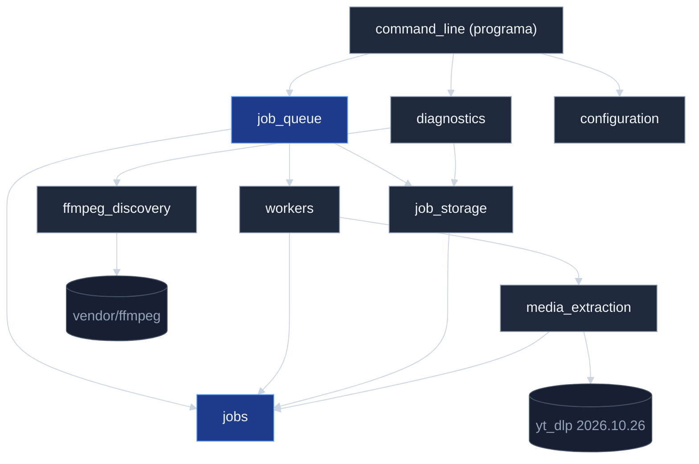
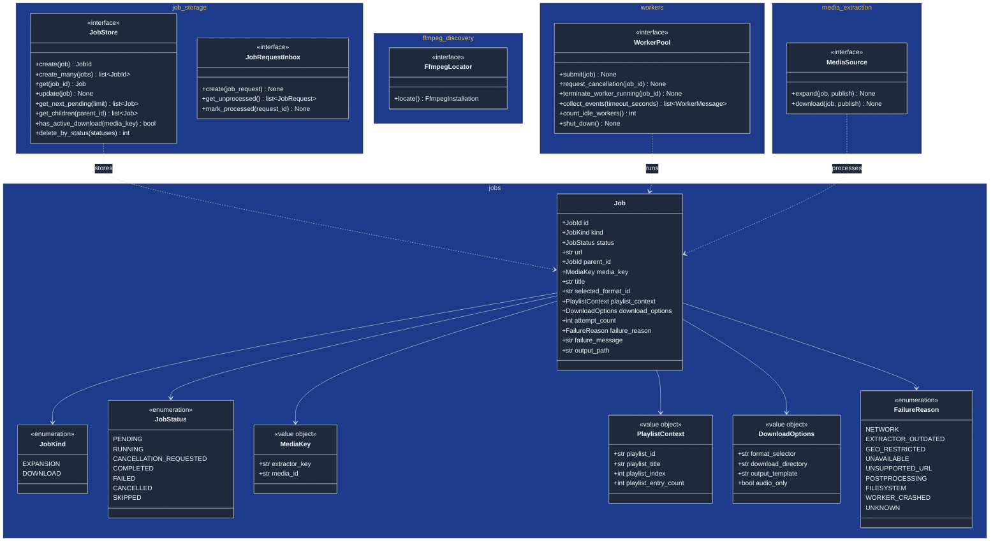
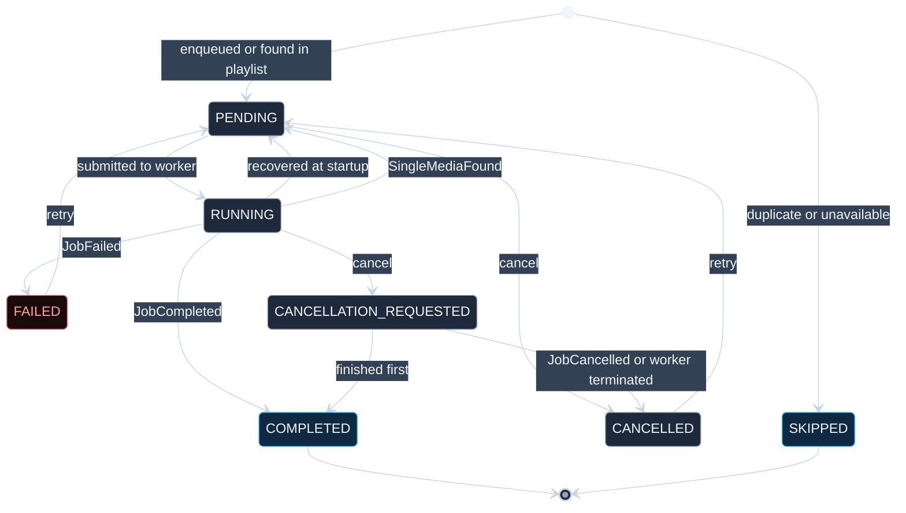

# Diseño — Parte 1: arquitectura, dominio y ciclo de vida

- **Estado:** Borrador para revisión (versión 4: componentes con API pública y grafo comprobado)
- **Fecha:** 2026-11-22
- **Base:** [vocabulario](00-vocabulary.md) y [ADR-0001 a ADR-0017](../notes/README.md)

---

## 1. Principios de diseño

1. **La arquitectura revela intención** (principio de nombres #9). Al abrir el paquete se ven los **componentes del dominio** (`jobs`, `job_queue`, `workers`, `media_extraction`…), no categorías técnicas como `domain/`, `application/` o `use_cases/` ([ADR-0016](../notes/adr-0016-component-packages-and-flat-layout.md)).
2. **Un paquete por componente, con su contrato y sus implementaciones**, como en yt-dlp (`downloader/` contiene `FileDownloader` y sus descargadores) y en FFmpeg (`libavcodec/` contiene `FFCodec` y sus códecs).
3. **Cada componente expone una API pública en su `__init__.py`**, como las cabeceras públicas de FFmpeg; el resto del paquete es interno ([ADR-0017](../notes/adr-0017-ffmpeg-inspired-public-api-and-dependency-graph.md)).
4. **Motor y programa separados**, como las librerías y `fftools/` en FFmpeg. Los componentes son el motor; `command_line/` es el programa que los ensambla, y el único que conoce las implementaciones.
5. **Los casos de uso son módulos con nombre de acción** (`enqueue_media.py`, `cancel_job.py`) dentro del componente al que pertenecen (#12).
6. **Grafo de dependencias declarado y comprobado**, como los `*_deps` de FFmpeg: `import-linter` falla si alguien lo rompe.
7. **Reglas comprobables sin herramientas** (#13). `job_queue/` se prueba con dobles de los contratos, sin yt-dlp, sin SQLite y sin procesos.
8. **Solo los módulos `yt_dlp_*` de `media_extraction/` importan `yt_dlp`.** Si una actualización rompe el contrato ([ADR-0002](../notes/adr-0002-pinned-yt-dlp-version.md)), el impacto queda ahí.

### Qué se toma de yt-dlp y de FFmpeg, y qué no

| Proyecto | Se toma | No se toma |
|---|---|---|
| yt-dlp | Un paquete por componente del dominio; contrato e implementaciones juntos; paquete en la raíz, sin `src/`; pruebas fuera del paquete | `YoutubeDL.py` (4.552 líneas, 70 métodos públicos, 140 parámetros en un diccionario); `utils/` (`_utils.py`: 5.747 líneas); archivos `common.py`; la CLI en `__init__.py`; estado mutable en `globals.py` |
| FFmpeg | Motor (librerías) separado de los programas (`fftools/`); API pública mínima por componente; dependencias declaradas y comprobadas; registro explícito de implementaciones | Librerías compiladas y distribuidas por separado (tenemos un solo producto); prefijos `libav*`, `sws`, `ff_` (en C suplen la falta de espacios de nombres; aquí serían codificaciones, #6); carpetas de miles de archivos; `cmdutils.c` |

---

## 2. Estructura de paquetes

```text
queued-media-downloader/               Proyecto (nombre de la distribución)
├── pyproject.toml                     module-root = "" y contratos de import-linter
├── uv.lock
├── README.md
├── LICENSE                            The Unlicense + excepción de vendor/ffmpeg
├── vendor/ffmpeg/<version>-win64-lgpl-shared/
├── doc/
├── tests/                             Mismos paquetes que el código (tests/jobs/, tests/job_queue/…)
│   └── doubles/                       Dobles de los contratos
└── queued_media_downloader/           Paquete de Python (espacio de nombres)
    ├── __main__.py                    Llama a command_line; incluye el guard de spawn
    │
    ├── jobs/                          Qué es un job
    │   ├── __init__.py                API pública: Job, JobKind, JobStatus, MediaKey, job events…
    │   ├── job.py                     Job y JobId
    │   ├── job_kind.py
    │   ├── job_status.py
    │   ├── job_lifecycle.py           Transiciones permitidas e InvalidJobTransitionError
    │   ├── job_events.py
    │   ├── media_key.py
    │   ├── playlist_context.py
    │   ├── download_options.py
    │   └── failure_reason.py
    │
    ├── job_queue/                     Lo que el usuario hace con la cola
    │   ├── __init__.py                API pública: EnqueueMedia, RunQueue, CancelJob…
    │   ├── enqueue_media.py
    │   ├── run_queue.py
    │   ├── cancel_job.py
    │   ├── retry_job.py
    │   ├── list_jobs.py
    │   ├── show_job.py
    │   ├── purge_finished_jobs.py
    │   ├── recover_interrupted_jobs.py
    │   └── job_event_applier.py       Interno: lo usa run_queue
    │
    ├── job_storage/                   Dónde se guardan los jobs
    │   ├── __init__.py                API pública: JobStore, JobRequestInbox
    │   ├── job_store.py               Contrato
    │   ├── job_request_inbox.py       Contrato
    │   ├── sqlite_connection.py       Implementación (interna): apertura y PRAGMAs
    │   ├── sqlite_migrations.py       Implementación (interna): aplica las migraciones
    │   ├── sqlite_job_store.py        Implementación (interna)
    │   ├── sqlite_job_request_inbox.py
    │   └── migrations/0001_create_jobs.sql
    │
    ├── workers/                       Quién ejecuta los jobs
    │   ├── __init__.py                API pública: WorkerPool, WorkerMessage
    │   ├── worker_pool.py             Contrato
    │   ├── process_worker_pool.py
    │   ├── thread_worker_pool.py      Para el prototipo
    │   ├── worker_loop.py
    │   ├── worker_instructions.py     RunJob, CancelJob, ShutDown
    │   ├── worker_message.py          WorkerMessage: job event con su job y su worker
    │   ├── process_tree_terminator.py         Contrato interno del componente (ADR-0013)
    │   └── windows_process_tree_terminator.py
    │
    ├── media_extraction/              Cómo se expande y se descarga
    │   ├── __init__.py                API pública: MediaSource (no importa yt_dlp)
    │   ├── media_source.py            Contrato
    │   ├── media_source_settings.py   Configuración común a los jobs de un worker
    │   ├── yt_dlp_media_source.py
    │   ├── yt_dlp_parameters.py
    │   ├── output_template_builder.py
    │   ├── progress_event_translator.py
    │   ├── failure_classifier.py
    │   └── recording_postprocessors.py
    │
    ├── ffmpeg_discovery/              Dónde está ffmpeg y si es válido
    │   ├── __init__.py                API pública: FfmpegLocator, FfmpegInstallation
    │   ├── ffmpeg_locator.py          Contrato
    │   ├── vendored_ffmpeg_locator.py
    │   └── ffmpeg_binary_verifier.py
    │
    ├── diagnostics/
    │   ├── __init__.py                API pública: DiagnoseEnvironment
    │   └── diagnose_environment.py
    │
    ├── configuration/
    │   ├── __init__.py                API pública: Settings, load_settings
    │   ├── settings.py
    │   └── settings_loader.py
    │
    └── command_line/                  El programa (como fftools/ en FFmpeg)
        ├── __init__.py                API pública: main
        ├── composition_root.py        Ensambla las implementaciones para la línea de comandos
        ├── command_parser.py
        └── job_presenter.py
```

- **Carpeta del proyecto con guiones y paquete con guiones bajos:** la forma del nombre indica qué es cada nivel ([ADR-0015](../notes/adr-0015-project-and-package-name.md)). El nombre del paquete se repite porque en Python el nombre del `import` es el nombre de la carpeta; es la misma regla que FFmpeg aplica con `#include "libavformat/avformat.h"`.
- **Sin `src/`:** `uv sync` instala el proyecto en modo editable, de modo que el import apunta a la misma carpeta con o sin `src/` (comprobado con `uv_build` y `module-root = ""`). El proyecto no se publica en PyPI ([ADR-0005](../notes/adr-0005-vendored-ffmpeg-lgpl-shared.md)).
- **El ensamblaje pertenece al programa:** una GUI futura sería otro paquete hermano de `command_line/`, con su propio `composition_root.py` (por ejemplo, con otra presentación o con `ThreadWorkerPool`).

---

## 3. Reglas de dependencia

1. **Cada componente se usa solo a través de su `__init__.py`.** `job_queue/` escribe `from queued_media_downloader.job_storage import JobStore`; nunca importa `job_storage.sqlite_job_store`.
2. **El `__init__.py` exporta contratos y tipos, nunca implementaciones.** `job_storage/__init__.py` exporta `JobStore`, no `SqliteJobStore`.
3. **Solo `command_line/composition_root.py` importa módulos internos de otros componentes**, para crear las implementaciones. Cumple la función de los registros de yt-dlp (`get_suitable_downloader`) y de FFmpeg (`allcodecs.c`), pero explícito y en un solo lugar.
4. **Dentro de un componente, los módulos se importan entre sí libremente.**
5. **Solo los módulos `yt_dlp_*` importan `yt_dlp`.**
6. **Sin ciclos:** cada componente solo depende de componentes de niveles inferiores.



- `command_line/composition_root.py` importa además los módulos internos con las implementaciones de todos los componentes; no se dibuja para no saturar el diagrama.
- `workers/` recibe una fábrica de `MediaSource` que inyecta `composition_root`; la fábrica es una función de módulo, para que pueda enviarse a otro proceso.

### Comprobación automática

Las reglas se declaran en `pyproject.toml` y las comprueba `import-linter` (dependencia de desarrollo; comando `lint-imports`). Configuración validada con `import-linter` 2.17 sobre un paquete de prueba con esta estructura: pasa con la estructura correcta y detecta los ciclos y los imports de módulos internos.

```toml
[tool.importlinter]
root_package = "queued_media_downloader"
include_external_packages = true   # necesario para la regla 5 (yt_dlp)

# Regla 6: sin ciclos. Un nivel solo depende de niveles inferiores;
# los componentes de un mismo nivel (separados por "|") no se importan entre sí.
[[tool.importlinter.contracts]]
name = "Components only depend on lower components"
type = "layers"
containers = ["queued_media_downloader"]
layers = [
    "command_line",
    "job_queue | diagnostics",
    "workers",
    "media_extraction | job_storage | ffmpeg_discovery",
    "jobs | configuration",
]

# Reglas 1 a 3: un contrato por componente. Fuera del componente, solo su
# __init__.py; la única excepción es composition_root.
[[tool.importlinter.contracts]]
name = "job_storage is only used through its public API"
type = "protected"
protected_modules = ["queued_media_downloader.job_storage.*"]
allowed_importers = [
    "queued_media_downloader.job_storage",
    "queued_media_downloader.command_line.composition_root",
]

# ... un contrato igual para jobs, job_queue, workers, media_extraction,
# ffmpeg_discovery, diagnostics y configuration.

# Regla 5: yt_dlp solo dentro de media_extraction.
[[tool.importlinter.contracts]]
name = "Only media_extraction imports yt_dlp"
type = "forbidden"
source_modules = ["queued_media_downloader"]
forbidden_modules = ["yt_dlp"]
ignore_imports = ["queued_media_downloader.media_extraction.** -> yt_dlp"]
```

- **Un contrato `protected` por componente, no uno compartido:** en la prueba, proteger varios componentes en un solo contrato autoriza a cada paquete a usar el interior de los demás.
- **Regla 5** también se validó, con el wheel de yt-dlp 2026.10.26 instalado: un `import yt_dlp` desde `workers/` rompe el contrato. El patrón `media_extraction.**` autoriza a todo el componente; que `media_source.py` no importe `yt_dlp` se revisa en código (los patrones de `import-linter` trabajan por segmentos completos del nombre).

---

## 4. Entidades y contratos



### Decisiones de modelado

- **Una entidad para los dos tipos de job.** Expansión y descarga comparten estado, cola y pool; solo cambia qué método de `MediaSource` se invoca.
- **`MediaKey` como objeto de valor.** Agrupa `extractor_key` y `media_id`, que siempre viajan juntos, y da nombre a la identidad de un contenido.
- **`JobStore` y `JobRequestInbox` separados** (segregación de interfaces). `cancel_job` y `retry_job` solo registran peticiones.
- **`WorkerPool` sin argumentos booleanos.** `request_cancellation` (cooperativa) y `terminate_worker_running` (forzada) son dos operaciones con dos nombres.
- **`selected_format_id` vacío hasta que el worker lo elige.** Se fija en el primer intento y se reutiliza al reanudar ([ADR-0010](../notes/adr-0010-sqlite-persistent-queue.md)).
- **`FailureReason` es una clasificación de dominio,** no la excepción de yt-dlp. `failure_classifier.py` traduce.
- **El estado de una playlist no se almacena:** se deriva de sus hijos.
- **Los job events viven en `jobs/`, no en `workers/`.** Describen lo que le pasó a un job. En `workers/` crearían un ciclo: `media_extraction/` los publica y `workers/` depende del contrato de `media_extraction/`.
- **`collect_events` devuelve `WorkerMessage`, no `JobEvent`.** El job event no lleva el identificador del job; el mensaje sí, junto con el worker y el número de secuencia, y `job_event_applier` lo necesita para saber a qué job aplicarlo.

---

## 5. Job events

Los workers publican job events; `job_event_applier` los aplica a los jobs. Son objetos inmutables y serializables (no contienen el `info_dict` de yt-dlp).

| Job event | Lo publica | Efecto |
|---|---|---|
| `JobStarted` | Ambos tipos | `PENDING` → `RUNNING` |
| `SingleMediaFound(media_key, title)` | Expansión | La URL era un solo contenido: `kind` pasa a `DOWNLOAD` y vuelve a `PENDING` |
| `PlaylistEntriesFound(playlist_entries)` | Expansión | Crea jobs hijos por lotes; los duplicados quedan `SKIPPED` |
| `FormatSelected(selected_format_id)` | Descarga | Guarda el formato antes de que empiece la descarga |
| `DownloadProgressed(downloaded_bytes, total_bytes, bytes_per_second, eta_seconds)` | Descarga | No se persiste; se reenvía a la presentación |
| `PostprocessingProgressed(postprocessor_name, postprocessing_stage)` | Descarga | No se persiste; se reenvía a la presentación |
| `JobCompleted(output_path)` | Ambos tipos | → `COMPLETED` |
| `JobFailed(failure_reason, failure_message)` | Ambos tipos | → `FAILED` |
| `JobCancelled` | Ambos tipos | → `CANCELLED` |

`FormatSelected` se obtiene con un postprocessor propio de yt-dlp (`SelectedFormatRecorder`, registrado con `when='before_dl'`). El progreso no se persiste: escribir en SQLite varias veces por segundo desgastaría un disco modesto sin ayudar a reanudar, que depende de los `.part`.

---

## 6. Ciclo de vida de un job

La máquina de estados es la misma para expansión y descarga. Las reglas viven en `jobs/job_lifecycle.py`: cualquier transición no listada se rechaza.



### Reglas

- **Toda URL entra como expansión.** Sin extraer no se sabe si es un contenido o una playlist. Si resulta ser un solo contenido (`SingleMediaFound`), el job pasa a descarga y vuelve a `PENDING`.
- **`CANCELLATION_REQUESTED` es un estado explícito.** La cancelación cooperativa no es inmediata: el job puede terminar antes de recibirla.
- **Cancelación forzada:** si el worker no confirma en `cancellation_grace_seconds`, el pool termina su process tree y el job pasa a `CANCELLED`.
- **Recuperación al arrancar** (`recover_interrupted_jobs`): `RUNNING` → `PENDING` y `CANCELLATION_REQUESTED` → `CANCELLED`.
- **Reintento:** `FAILED` y `CANCELLED` vuelven a `PENDING` e incrementan `attempt_count`. `SKIPPED` no se reintenta.
- **Cancelar una playlist** cancela su expansión y todos sus hijos no terminados.
- **Una expansión termina en `COMPLETED`** cuando encontró todas sus playlist entries, no cuando sus hijos terminan de descargar.

---

## 7. Continúa en

[Parte 2: flujos, persistencia y operación](02-flows-persistence-and-operations.md).
