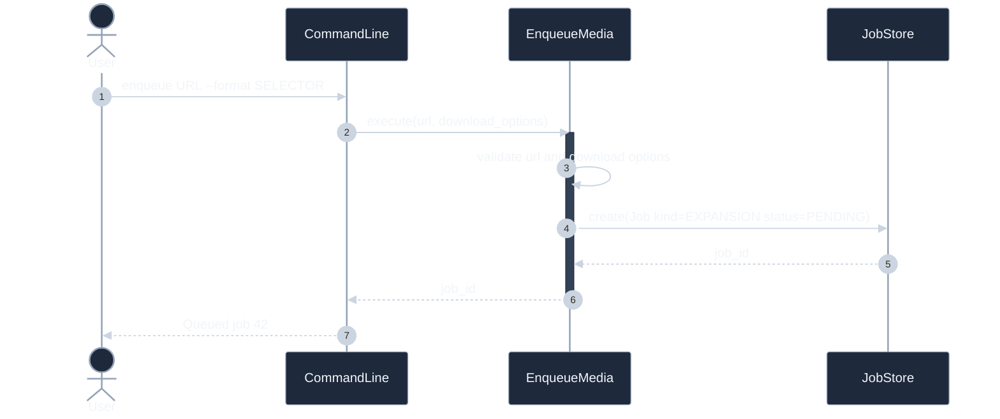
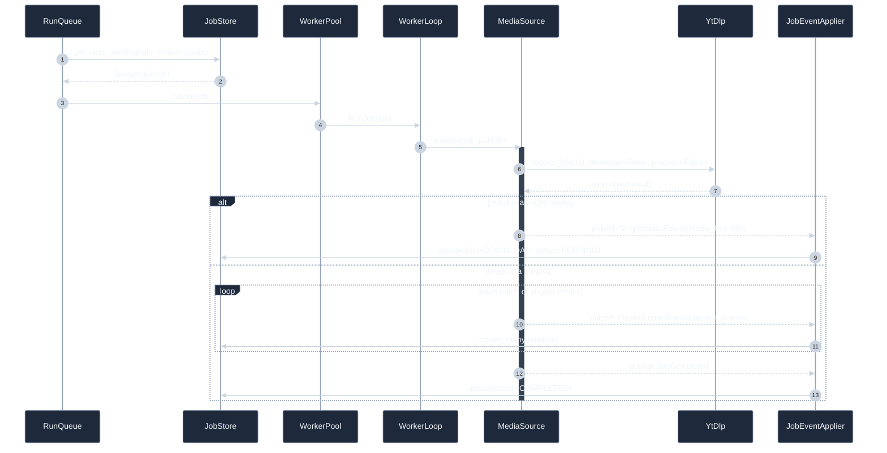
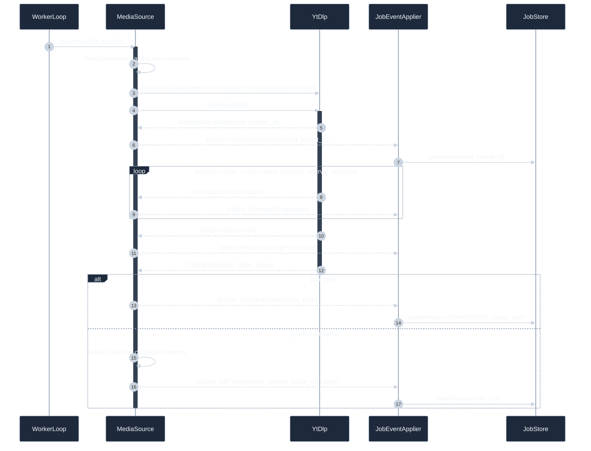
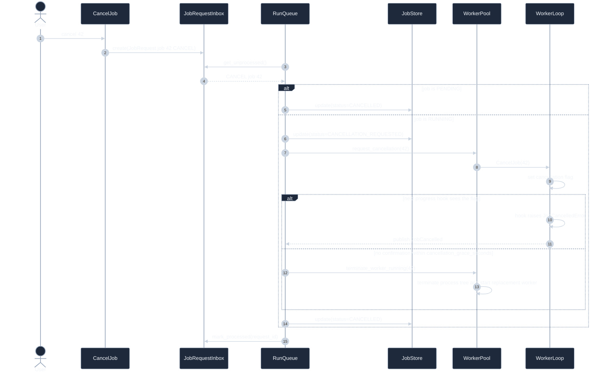
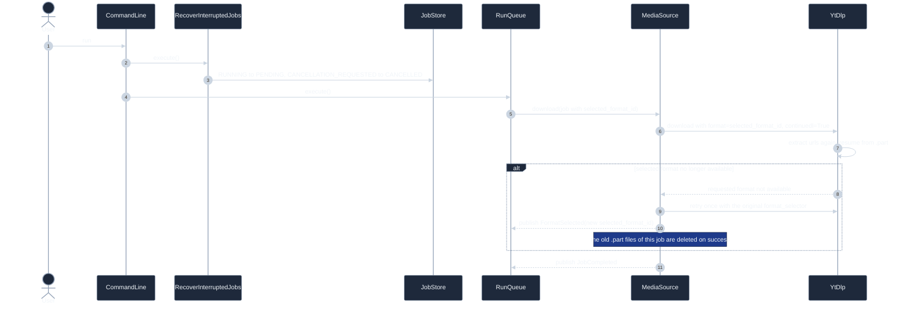
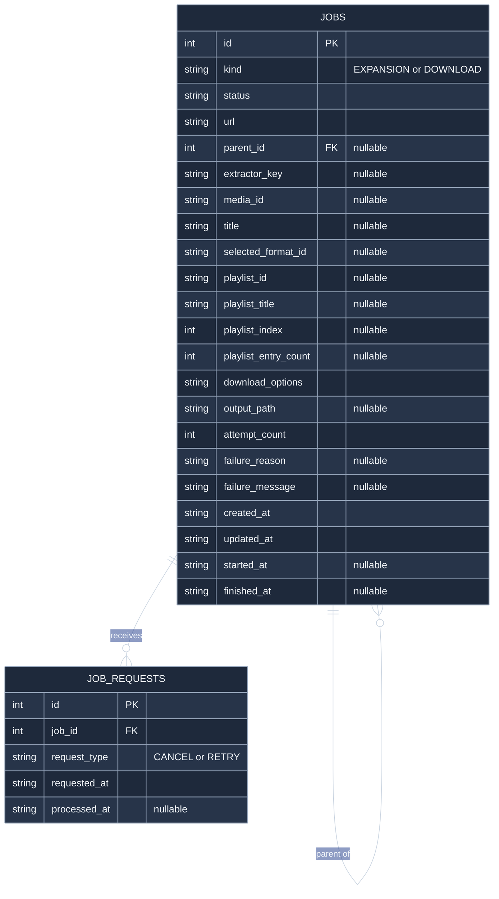

# Diseño — Parte 2: flujos, persistencia y operación

- **Estado:** Borrador para revisión (versión 2: vocabulario corregido)
- **Fecha:** 2026-11-22
- **Base:** [vocabulario](00-vocabulary.md), [Parte 1](01-architecture.md) y [ADR-0001 a ADR-0021](../notes/README.md)

---

## 1. Diagramas de secuencia

Participantes:

| Participante | Proceso | Módulo |
|---|---|---|
| `CommandLine` | Principal | `command_line/command_parser.py` |
| `EnqueueMedia`, `CancelJob`, `RecoverInterruptedJobs` | Principal | `job_queue/` |
| `RunQueue` | Principal | `job_queue/run_queue.py` |
| `JobEventApplier` | Principal | `job_queue/job_event_applier.py` |
| `JobStore`, `JobRequestInbox` | Principal | `job_storage/` |
| `WorkerPool` | Principal | `workers/process_worker_pool.py` |
| `WorkerLoop` | Worker | `workers/worker_loop.py` |
| `MediaSource` | Worker | `media_extraction/yt_dlp_media_source.py` |
| `YtDlp` | Worker | librería `yt_dlp` |

### 1.1 Encolar

`enqueue` solo crea el job: no extrae ni descarga. Puede ejecutarse mientras otro proceso ejecuta `run` ([§2.4](#24-escritura-desde-varios-procesos)).



Las download options se fijan al encolar y viajan con el job: si después cambia la configuración, los jobs ya encolados no cambian de comportamiento.

### 1.2 Expansión



- Los job events viajan del worker a `RunQueue` por el `WorkerPool` ([§3](#3-contrato-del-worker)); el diagrama los simplifica como una flecha directa a `JobEventApplier`.
- **`process=False`** devuelve las playlist entries como un iterable perezoso. Se recorren por lotes (por ejemplo, de 50) sin cargar la playlist completa en memoria; `playlist_index` se calcula al enumerar. **A validar en el prototipo** con canales grandes.
- **Una playlist entry que es otra playlist** (canal → pestañas) produce un hijo `EXPANSION`.
- **`multi_video`** se trata como un solo contenido.
- **Duplicados y no disponibles** se crean como `SKIPPED` ([§2](#2-esquema-sqlite)).

### 1.3 Descarga



- **Dos postprocessors de registro:** `SelectedFormatRecorder` (`when='before_dl'`) y `FinalPathRecorder` (`when='after_move'`). La ruta final puede diferir de la plantilla tras unir o convertir.
- **Progreso limitado en el worker:** como máximo un `DownloadProgressed` cada `progress_interval_seconds` por job; el último (`finished`) siempre se publica. yt-dlp llama al hook en cada bloque recibido.
- **Parámetros fijos en cada `YoutubeDL`:** `ffmpeg_location`, `js_runtimes`, `cachedir`, `paths`, `outtmpl`, `trim_file_name`, `continuedl=True`, `noprogress=True`, `color="never"`, `logger` propio, `file_access_retries`.

### 1.4 Cancelación



- **`JobCancelledError` hereda de `DownloadCancelled` de yt-dlp,** para que yt-dlp la propague hasta `download()` sin convertirla en error.
- **La bandera la activa un hilo de cancelación del worker,** que escucha `cancellation_queue` mientras el hilo principal ejecuta yt-dlp.
- Si el job termina antes de ver la bandera, llega `JobCompleted` y gana: `CANCELLATION_REQUESTED → COMPLETED`.
- **Cancelar una playlist** crea una job request `CANCEL` para la expansión y para cada hijo no terminado.

### 1.5 Recuperación y reanudación



- **Recuperar** (corregir estados tras un cierre inesperado) y **reanudar** (continuar una descarga parcial) son conceptos distintos ([vocabulario](00-vocabulary.md)).
- La reanudación de bytes la hace yt-dlp (`.part`, `.ytdl`). El proyecto solo garantiza que **plantilla y formato sean los mismos** que en el primer intento.
- Si el sitio retiró el formato guardado, se acepta perder lo descargado antes que fallar.

---

## 2. Esquema SQLite

### 2.1 Modelo



### 2.2 DDL inicial

```sql
-- job_storage/migrations/0001_create_jobs.sql
CREATE TABLE jobs (
    id                   INTEGER PRIMARY KEY,
    kind                 TEXT    NOT NULL CHECK (kind IN ('EXPANSION', 'DOWNLOAD')),
    status               TEXT    NOT NULL CHECK (status IN (
                             'PENDING', 'RUNNING', 'CANCELLATION_REQUESTED',
                             'COMPLETED', 'FAILED', 'CANCELLED', 'SKIPPED')),
    url                  TEXT    NOT NULL,
    parent_id            INTEGER REFERENCES jobs (id) ON DELETE CASCADE,
    extractor_key        TEXT,
    media_id             TEXT,
    title                TEXT,
    selected_format_id   TEXT,
    playlist_id          TEXT,
    playlist_title       TEXT,
    playlist_index       INTEGER,
    playlist_entry_count INTEGER,
    download_options     TEXT    NOT NULL,
    output_path          TEXT,
    attempt_count        INTEGER NOT NULL DEFAULT 0,
    failure_reason       TEXT,
    failure_message      TEXT,
    created_at           TEXT    NOT NULL,
    updated_at           TEXT    NOT NULL,
    started_at           TEXT,
    finished_at          TEXT
);

CREATE INDEX jobs_by_status ON jobs (status, id);

CREATE INDEX jobs_by_parent ON jobs (parent_id);

-- Migración 0002 (T21): mismo contenido y mismo tipo de archivo de salida.
CREATE UNIQUE INDEX unique_active_download_per_media
    ON jobs (extractor_key, media_id, json_extract(download_options, '$.audio_only'))
    WHERE kind = 'DOWNLOAD' AND media_id IS NOT NULL AND status <> 'SKIPPED';

CREATE TABLE job_requests (
    id           INTEGER PRIMARY KEY,
    job_id       INTEGER NOT NULL REFERENCES jobs (id) ON DELETE CASCADE,
    request_type TEXT    NOT NULL CHECK (request_type IN ('CANCEL', 'RETRY')),
    requested_at TEXT    NOT NULL,
    processed_at TEXT
);

CREATE INDEX unprocessed_job_requests ON job_requests (id) WHERE processed_at IS NULL;
```

### 2.3 Decisiones del esquema

- **Nombres sin codificación** ([vocabulario](00-vocabulary.md)): los índices se nombran por lo que permiten (`jobs_by_status`, `unique_active_download_per_media`), sin prefijos `ix_`/`ux_`; `download_options` no lleva el sufijo `_json`, aunque se almacene como JSON.
- **`download_options` como JSON:** cambian con más frecuencia que el resto del modelo y nunca se filtra por ellas; así no hace falta una migración por cada opción nueva.
- **Contexto de playlist en columnas:** sí se consulta (orden, agrupación en `list`) y alimenta la plantilla de salida.
- **Fechas en texto ISO 8601 UTC:** SQLite no tiene tipo fecha; el texto ISO es legible y se ordena bien.
- **La base de datos es la única fuente de verdad sobre lo descargado.** No se usa `download_archive` de yt-dlp ni triggers con reglas de negocio ([ADR-0012](../notes/adr-0012-no-download-archive-no-database-triggers.md)).
- **PRAGMAs al abrir la conexión:** `journal_mode=WAL`, `foreign_keys=ON`, `busy_timeout=5000`, `synchronous=NORMAL`.

### 2.4 Escritura desde varios procesos

| Quién | Qué puede escribir |
|---|---|
| Proceso `run` (`RunQueue`) | Todas las **transiciones de estado** de los jobs |
| Otros comandos (`enqueue`, `cancel`, `retry`) | Solo **crear** jobs `PENDING` y **job requests** |
| Workers | Nada; solo publican job events |

Así, `cancel` y `retry` funcionan mientras `run` se ejecuta en otra terminal, sin que dos procesos compitan por el estado de un job. Si `run` no está activo, las job requests se procesan la próxima vez que arranque.

### 2.5 Migraciones

- Scripts SQL numerados en `job_storage/migrations/`, nombrados por lo que hacen (`0001_create_jobs.sql`, `0002_...`).
- La versión aplicada se guarda en `PRAGMA user_version`.
- Al abrir la base de datos se aplican, en orden y en una transacción, las migraciones con número mayor que `user_version`.
- Una migración publicada no se modifica; los cambios van en una nueva.

---

## 3. Contrato del worker

### 3.1 Colas

Todas las colas son de cada worker, también las de salida:

```text
                 ┌──────────── instruction_queue (por worker) ────────┐
Proceso      ───►│ RunJob(job) · ShutDown                             │───► hilo principal (yt-dlp)
principal        ├──────────── cancellation_queue (por worker) ───────┤
             ───►│ CancelJob(job_id)                                  │───► hilo de cancelación
                 └────────────────────────────────────────────────────┘
             ◄─── job_event_queue (por worker): WorkerMessage(worker_id, job_id, sequence_number, job_event)
             ◄─── log_queue (por worker): registros de logging
```

- **Colas de salida por worker (T20):** el bloqueo de escritura de una cola de `multiprocessing` se comparte entre los procesos que escriben en ella. Un worker que muere mientras escribe (caída o terminación forzada, UC-05) dejaría bloqueados a los demás. En el proceso principal, un hilo por cola pasa los mensajes a una cola interna que lee `collect_events`, y los registros al `logging` del proceso. Esos hilos nunca escriben en las colas: detenerlos no se bloquea aunque el worker muriera a mitad de una escritura.
- **Un solo escritor del log:** los workers arrancados con *spawn* no heredan la configuración de `logging`. Envían sus registros por `log_queue`, y `run` los escribe en `state/logs/queued-media-downloader.log` (con rotación: 5 MiB y tres archivos anteriores). La consola queda para la presentación.

- **`cancellation_queue` separada:** el hilo principal del worker está ocupado en yt-dlp y no puede leer; el hilo de cancelación sí.
- **`sequence_number`** cuenta los mensajes de cada worker, para detectar en los logs mensajes perdidos o desordenados.
- **Worker instructions y job events** son dataclasses inmutables con tipos simples. `multiprocessing` las serializa con `pickle`; como ambos lados ejecutan el mismo código, no hace falta versionar el protocolo.

### 3.2 Ciclo de vida del worker

1. **Arranque:** el pool crea el proceso y llama a `ProcessTreeTerminator.register_root_process(pid)` ([ADR-0013](../notes/adr-0013-process-tree-terminator-abstraction.md)). Todo proceso que el worker lance después (ffmpeg, deno) queda dentro de su process tree. El worker importa `yt_dlp` una sola vez.
2. **Por cada `RunJob`:** crea un `YoutubeDL` nuevo, ejecuta, publica el job event final y lo descarta.
3. **Reciclado:** tras `max_jobs_per_worker` jobs, termina limpiamente al acabar el job en curso y el pool arranca un reemplazo.
4. **Terminación forzada** (`terminate_worker_running`): el pool llama a `ProcessTreeTerminator.terminate_tree()`, que termina el worker y todos sus descendientes.
5. **Caída inesperada:** el pool detecta un `exitcode` distinto de cero con un job asignado, publica `JobFailed(WORKER_CRASHED)` en nombre del worker y arranca un reemplazo.

### 3.3 Implementación con hilos (prototipo)

`ThreadWorkerPool` implementa la misma interfaz `WorkerPool` con `queue.Queue` y las mismas worker instructions. Diferencias: `terminate_worker_running` solo puede esperar a la cancelación cooperativa (un hilo no se puede terminar desde fuera) y no hay reciclado. `RunQueue` no distingue entre las dos implementaciones.

---

## 4. Línea de comandos y configuración

### 4.1 Comandos

Los comandos usan los mismos verbos que los casos de uso, para que haya una sola palabra por concepto. La salida y los logs están en inglés ([ADR-0011](../notes/adr-0011-code-conventions.md)).

| Comando | Caso de uso |
|---|---|
| `enqueue URL... [--format SELECTOR] [--audio-only] [--download-directory DIR]` | `enqueue_media` |
| `run [--worker-count N] [--keep-waiting]` | `recover_interrupted_jobs` + `run_queue` |
| `list [--status STATUS] [--parent JOB_ID]` | `list_jobs` |
| `show JOB_ID` | `show_job` |
| `cancel JOB_ID...` | `cancel_job` |
| `retry JOB_ID... \| --all-failed` | `retry_job` |
| `purge [--completed] [--cancelled]` | `purge_finished_jobs` |
| `diagnose` | `diagnose_environment` |

- **`--playlist`:** con un enlace a un video dentro de una lista (`watch?v=…&list=…`), descarga la lista entera; sin la opción, solo el video ([ADR-0027](../notes/adr-0027-video-links-inside-lists.md)). Las URL de lista pura se expanden enteras siempre.
- **`--audio-only`:** descarga en la subcarpeta `audio` de la carpeta de descargas (T23). Sin `--format`, pide el mejor audio (`ba/b`) en lugar del selector por defecto. En la descarga, yt-dlp extrae el audio con `FFmpegExtractAudio` sin recodificarlo cuando el formato lo permite (`preferredcodec: best`); así también sirve con un formato que traiga video.
- **`run` verifica ffmpeg antes de ejecutar ningún job** ([ADR-0006](../notes/adr-0006-ffmpeg-resolution-and-verification.md)). Si no hay uno utilizable, termina con código `2`; si lo hay, muestra cuál usa y su versión.

- **`--keep-waiting`** (antes `--watch`): `run` no termina al vaciarse la cola y espera jobs nuevos. El nombre dice lo que hace.
- **`Ctrl+C` durante `run`:** deja de enviar jobs, solicita la cancelación de los jobs en curso y termina sus workers tras `cancellation_grace_seconds`. Un segundo `Ctrl+C` termina de inmediato. Los jobs interrumpidos se recuperan en el siguiente `run`.
- **Librería:** `argparse` (biblioteca estándar).
- **Código de salida:** `0` si todo terminó bien, `1` si algún job falló, `2` por error de uso o de configuración.

### 4.2 Configuración

**Precedencia:** argumentos de la línea de comandos > variables de entorno (`QUEUED_MEDIA_DOWNLOADER_*`) > `config.toml` > valores por defecto. El archivo se lee con `tomllib`.

| Clave | Por defecto | Uso |
|---|---|---|
| `download_directory` | `%USERPROFILE%\Downloads\queued-media-downloader` | Destino de las descargas |
| `state_directory` | `<proyecto>\state` | Base de datos, caché de yt-dlp y estado de verificación de ffmpeg |
| `worker_count` | `1` | Tamaño del pool |
| `max_jobs_per_worker` | `20` | Reciclado de workers |
| `cancellation_grace_seconds` | `10` | Espera antes de terminar un worker que no confirma la cancelación |
| `progress_interval_seconds` | `0.5` | Frecuencia máxima de `DownloadProgressed` |
| `default_format_selector` | `bv*+ba/b` | Format selector por defecto |
| `single_media_output_template` | `%(title)s [%(id)s].%(ext)s` | Plantilla para contenidos sueltos |
| `max_filename_length` | `150` | `trim_file_name`, por el límite de rutas de Windows |
| `ffmpeg_path` | *(vacío)* | Ruta propia de ffmpeg (primer paso de [ADR-0006](../notes/adr-0006-ffmpeg-resolution-and-verification.md)) |

- **`state/` dentro del proyecto** y en `.gitignore`. Se llama *state* y no *data*: contiene el estado de la aplicación, y *data* es una palabra de ruido.
- **Los hijos de una playlist no tienen un ajuste propio:** su plantilla es `<playlist>/<playlist_index> - ` seguida de `single_media_output_template`, construida con el contexto guardado en SQLite (saneando y escapando `%`) ([ADR-0028](../notes/adr-0028-playlist-child-output-template.md)).
- `configuration/settings_loader.py` valida la configuración al arrancar y falla con un mensaje claro si algún valor no es válido.

---

## 5. Estrategia de pruebas

| Módulo | Tipo | Qué se prueba | Dependencias reales |
|---|---|---|---|
| `jobs` | Unitarias | Tabla completa de transiciones (permitidas y rechazadas), objetos de valor | Ninguna |
| `job_queue` | Unitarias con dobles | `run_queue`: carrera entre cancelación y finalización, duplicados, `SingleMediaFound`, job requests; `recover_interrupted_jobs` | Ninguna |
| `job_storage` | Integración | `SqliteJobStore` y `SqliteJobRequestInbox` sobre un archivo temporal; migraciones de 0 a N; índice de duplicados | SQLite |
| `media_extraction` | Contrato, sin red | `yt_dlp_parameters`, `output_template_builder` (escapado, saneado, longitud), `failure_classifier` con las excepciones reales de yt-dlp, `progress_event_translator` con diccionarios de hook grabados | Librería `yt_dlp` |
| `workers` | Integración | Cancelación cooperativa y terminación, detección de caídas, reciclado, `WindowsProcessTreeTerminator` sobre un proceso hijo ficticio | Procesos reales |
| `ffmpeg_discovery` | Unitarias | Orden de localización, binario ausente, puntero de Git LFS, caché de hash | Archivos ficticios |
| `command_line` | Integración | Comandos sobre un `state_directory` temporal, códigos de salida | SQLite |
| Extremo a extremo | Opcional | Descarga real corta | Red, ffmpeg, deno |

- **TDD sin integración continua** ([ADR-0021](../notes/adr-0021-tdd-and-windows-validation-without-ci.md)): `uv run pytest` en el ciclo diario; `uv run pytest -m windows` en un entorno Windows al cerrar cada iteración.
- **Windows probado en cualquier sistema** siempre que sea posible: `multiprocessing.get_context("spawn")` para los workers y `pathlib.PureWindowsPath` para las reglas de rutas. Solo el Job Object y los binarios de ffmpeg requieren las pruebas `windows`.
- **Marcadores de pytest:** `network` y `windows`. Por defecto se ejecutan las pruebas que no requieren ni red ni Windows.
- **Descargas sin internet:** servidor HTTP local con medios generados con ffmpeg; las descargas reales son verificaciones manuales.
- **Dobles de prueba** en `tests/doubles/`: `InMemoryJobStore`, `InMemoryJobRequestInbox`, `ScriptedWorkerPool` (publica una secuencia de job events predefinida), `FakeMediaSource` y `FakeProcessTreeTerminator`.
- **Estructura de cada prueba:** *Arrange, Act, Assert*, un solo concepto comprobado por prueba y principios FIRST ([guías](../reference/clean-code-guidelines/principle/aaa.md)).
- **Pruebas de contrato con yt-dlp:** son la red de seguridad al actualizar la versión fijada ([ADR-0002](../notes/adr-0002-pinned-yt-dlp-version.md)).
- **Reglas de importación:** `lint-imports` comprueba el grafo de componentes y la API pública ([Parte 1, §3](01-architecture.md#3-reglas-de-dependencia)). Se ejecuta junto con las pruebas.
- **Dependencias de desarrollo** en `[dependency-groups] dev` de `pyproject.toml`: `pytest`, `import-linter`, `ruff` y `mypy` ([ADR-0019](../notes/adr-0019-code-quality-tools.md)).

---

## 6. Pendientes

| Tema | Estado |
|---|---|
| Iteración perezosa con `process=False` en canales grandes | Validar en el prototipo |
| Medición de ffmpeg y deno en un equipo modesto | Validar en el prototipo |
| Configuración concreta de Ruff y mypy | Iteración E1 ([ADR-0019](../notes/adr-0019-code-quality-tools.md)) |
