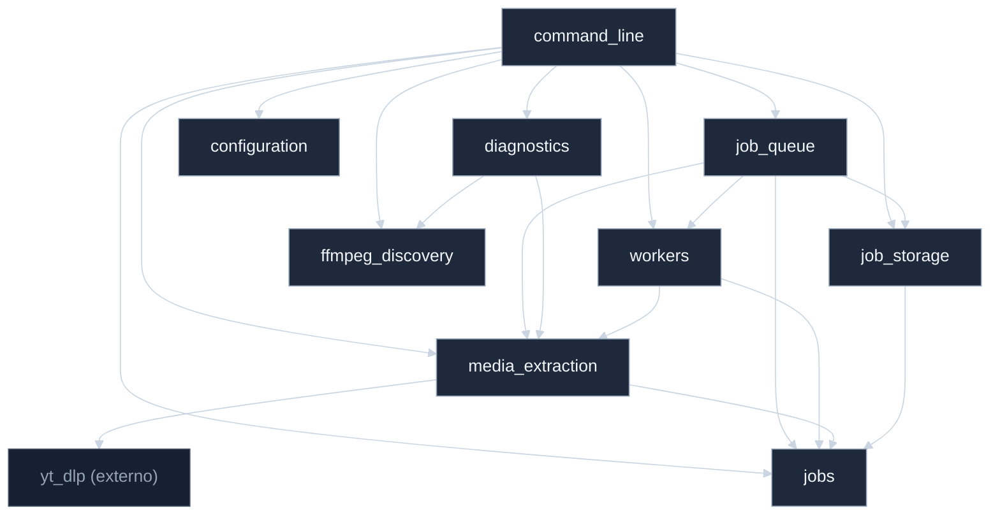
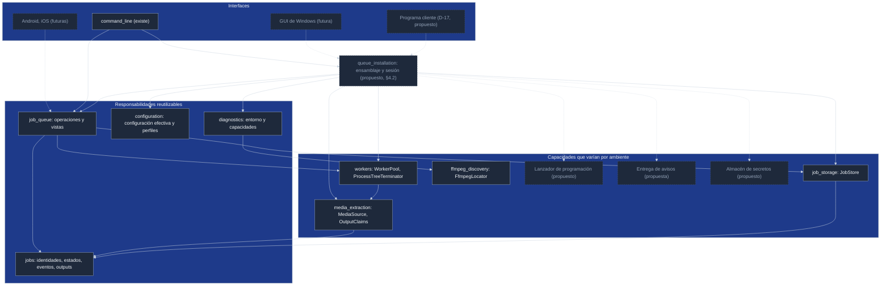

# Diseño — Parte 3: arquitectura objetivo, contratos públicos y evolución multiplataforma

- **Estado:** Analysis and Design (instrucción 2.3.0). Es diseño, no implementación: ningún componente marcado *propuesto* existe en el código.
- **Fecha:** 2026-11-26
- **Base:**
  - [Parte 1](01-architecture.md): arquitectura vigente;
  - [Parte 2](02-flows-persistence-and-operations.md): flujos, persistencia y operación;
  - [análisis de requisitos](../requirements/requirements-analysis.md): decisiones D-1 a D-21 y contratos de §13;
  - [ADR-0032](../notes/adr-0032-reusable-engine-and-platform-capabilities.md) y [ADR-0033](../notes/adr-0033-output-identity-and-storage-references.md).
- **Commit de partida:** `b4ac64a`.

**Evidencia.** Cada conclusión indica su nivel:

| Nivel | Significado |
|---|---|
| **Código** | Inspección del código de este repositorio o de una dependencia instalada (yt-dlp 2026.11.23, yt-dlp-ejs 0.8.0) |
| **Inventario** | [Experimento reproducible](../notes/experiments/architecture-inventory-linux.json) (`scripts/experiments/architecture_inventory.py`) |
| **Referencia** | Lo hace un proyecto de referencia, en su código |
| **Documental** | Documentación oficial de la plataforma o de la dependencia |
| **Inferido** | Deducido de lo anterior, sin demostrar |
| **Pendiente** | Necesita un ambiente que no está disponible (Windows, Android o iOS) |

**Alcance.**
- Hoy:
  - la CLI es la primera interfaz;
  - Windows x64 es la primera plataforma que se implementa y se acepta.
- Más adelante habrá una GUI para Windows y aplicaciones para Android e iOS. Son drivers de arquitectura, no trabajo autorizado.
- El modelo de requisitos es único: 26 casos de uso, sin variantes por plataforma.

---

## 1. Drivers de arquitectura

| Driver | Origen | Efecto en el diseño |
|---|---|---|
| Un solo modelo funcional para todas las interfaces | Responsable (2.3.0, §1, §6) | Las reglas viven en componentes que no conocen la interfaz. Las diferencias de plataforma se expresan como escenarios, restricciones y capacidades |
| La CLI es la primera interfaz | ADR-0001 | La CLI es un consumidor más; no es dueña de reglas ni del ensamblaje del producto (§4, A-1) |
| Windows x64 es la primera plataforma, no la única | ADR-0004, aclarado por ADR-0032 | Los mecanismos de Windows se aíslan por responsabilidad, como `ProcessTreeTerminator` |
| GUI de Windows, Android e iOS como evolución | Responsable | Los contratos públicos no dependen de texto para terminal. Las identidades no dependen de rutas de Windows |
| Garantías ya obtenidas | ADR-0029, ADR-0030; T42 | No se debilitan la propiedad, la integridad ni la terminación del árbol de procesos |
| Dependencias fijadas | ADR-0002, ADR-0018 | Esta etapa no cambia ninguna dependencia |
| Sin implementación anticipada | Responsable (§4) y YAGNI | Una abstracción se introduce solo con un consumidor real o una alternativa justificada |

---

## 2. Arquitectura vigente

### 2.1 Inventario por componente

Los conteos son del [inventario](../notes/experiments/architecture-inventory-linux.json): 85 módulos, 6.896 líneas y 395 funciones de prueba. Con la parametrización, pytest ejecuta 586 pruebas y deselecciona 14 (las marcadas `windows`); 579 antes de esta etapa, más 7 de la comprobación del modelo.

| Componente | Módulos / líneas | Clases (tipo) | API pública | Responsabilidad | Autoridad |
|---|---|---|---|---|---|
| `jobs` | 12 / 673 | 15 dataclass, 5 enum, 1 excepción | 24 nombres | Entidades y valores: `Job`, `MediaKey`, `DownloadOptions`, `JobEvent`, `JobRequest`, `JobStatus` | Estados y transiciones (`job_lifecycle`), identidad del contenido (`MediaKey`), owner token (`Job.owner_token`) |
| `configuration` | 3 / 208 | 2 dataclass, 1 excepción | 4 | Configuración validada con precedencia | Configuración efectiva (SUP-F03) |
| `job_storage` | 8 / 767 | 2 Protocol, 5 clases, 5 excepciones | 10 | Persistencia de jobs y bandeja de job requests | Invariantes persistidos: duplicado activo, ruta de salida única, migraciones |
| `media_extraction` | 16 / 1.399 | 1 Protocol, 10 clases, 4 dataclass, 3 excepciones | 9 | Integración con yt-dlp: extracción, descarga, progreso, clasificación de fallos, reclamaciones, parciales | Clasificación de fallos (BR-25), propiedad de los archivos finales (ADR-0030) |
| `workers` | 13 / 1.176 | 5 Protocol, 5 clases, 5 dataclass, 2 excepciones | 6 | Ejecución aislada, cancelación y terminación del árbol de procesos | Ciclo de vida del worker; terminación (ADR-0029) |
| `job_queue` | 9 / 890 | 6 dataclass, 9 clases, 1 excepción | 15 | Casos de uso: encolar, cancelar, listar, mostrar, purgar, recuperar, reintentar, ejecutar | Coordinación; aplicación de job events (`job_event_applier`) |
| `diagnostics` | 2 / 155 | 1 enum, 1 dataclass, 1 clase | 3 | Comprobación del entorno (UC-01) | — |
| `ffmpeg_discovery` | 5 / 385 | 1 Protocol, 2 clases, 1 enum, 1 dataclass, 1 excepción | 4 | Localizar y verificar el ffmpeg incluido | Verificación de la build (ADR-0006) |
| `command_line` | 15 / 1.211 | 2 clases, 1 enum | 1 (`main`) | Programa CLI: argumentos, presentación, códigos de salida, señales, log, ensamblaje | Códigos de salida; ensamblaje (ADR-0017 A) |

| Componente | Depende de (verificado) | Consumidores | Mecanismos variables (módulos) | Pruebas | Estado | Disposición |
|---|---|---|---|---|---|---|
| `jobs` | — | Todos | Ninguno; `Path` en `DownloadOptions` y `partial_directory` (A-7) | 43 | Completo para el alcance implementado | Generalize (resultados, identidad de la petición) |
| `configuration` | — | `command_line` | `tomllib` (1); ubicación por defecto del estado = repositorio (A-8) | 11 | Parcial (UC-20) | Extend (clases y perfiles, §13.17 del análisis) |
| `job_storage` | `jobs` | `job_queue`, `command_line` | `sqlite3` (5), oculto tras `JobStore` | 45 | Completo | Preserve el contrato; Extend el esquema |
| `media_extraction` | `jobs`, `yt_dlp` | `workers`, `job_queue`, `diagnostics`, `command_line` | Rutas físicas (`realpath`, `normcase`); yt-dlp lanza ffmpeg y deno como procesos | 85 | Parcial (R-24, R-28) | Extend; Generalize la propiedad (ADR-0033) |
| `workers` | `jobs`, `media_extraction` | `job_queue`, `command_line` | `multiprocessing` (3), `ctypes` (2), `signal` (2) | 29 (más las de Windows) | Completo en escritorio; validación en Windows pendiente | Preserve en escritorio; alternativa móvil diferida |
| `job_queue` | `jobs`, `job_storage`, `workers`, `media_extraction` | `command_line` | Ninguno | 62 | Completo para UC-02 a UC-10 | Extend; Separate el canal de observación (A-2) |
| `diagnostics` | `ffmpeg_discovery`, `media_extraction` | `command_line` | `sqlite3` (solo el tipo de excepción) | 8 | Parcial | Extend (UC-16; capacidades, §8.7) |
| `ffmpeg_discovery` | — | `diagnostics`, `command_line` | `subprocess` (1), sufijo `.exe` | 14 | Completo | Extend (codificadores disponibles, D-18) |
| `command_line` | Todos | Usuario | `argparse` (8), `sqlite3` (1), `signal` (1) | 68 | Completo para UC-01 a UC-10 | Separate (A-1, A-3) |

**Contratos sustituibles.** Cada Protocol tiene más de una implementación o un doble de prueba: `JobStore` (SQLite, decorador `BusyQueueWaiting`, `InMemoryJobStore`), `WorkerPool` (procesos, `ScriptedWorkerPool`), `MediaSource` (yt-dlp, `FakeMediaSource`), `ProcessTreeTerminator` (Windows, POSIX) y `FfmpegLocator`. Por eso Dependency Inversion está justificada donde se aplica, y no hay interfaces sin alternativa.

### 2.2 Grafo de dependencias verificado

Grafo de imports directos entre componentes, obtenido con grimp (la librería de `lint-imports`); no tiene ciclos. Los contratos de [Parte 1, §3](01-architecture.md#3-reglas-de-dependencia) lo comprueban en cada `run_checks`.

| Dependencia | Estática (import) | Operacional (en ejecución) |
|---|---|---|
| yt-dlp | Solo `media_extraction` (contrato `forbidden`) | Lanza ffmpeg y ffprobe como procesos externos (`postprocessor/ffmpeg.py`, `Popen`) y el runtime de JavaScript para los retos de YouTube (`extractor/youtube/jsc/_builtin/*`, `Popen`) |
| FFmpeg | Ninguna | La localiza `ffmpeg_discovery` (`ffmpeg -version`) y yt-dlp la invoca en cada unión o extracción de audio |
| Deno | Ninguna | `media_extraction.yt_dlp_javascript_runtime` resuelve la ruta; yt-dlp lo ejecuta |
| SQLite | `job_storage`; `command_line.composition_root` (abrir y migrar); `diagnostics` (tipo de error) | Un archivo en la carpeta de estado, en modo WAL |
| Sistema operativo | `workers` (Job Objects con `ctypes`, grupos de procesos, consola); `command_line` (señales); `ffmpeg_discovery` (sufijo) | Rutas físicas en `DownloadOptions.download_directory`, `Job.output_path`, `OutputClaims` y la carpeta de estado |

`job_queue` depende de `workers` solo por `WorkerPool` y `WorkerMessage`, y de `media_extraction` solo por `remove_partial_directory` (purga). Esto último no es un acoplamiento accidental: es la API pública de una responsabilidad de archivos.

### 2.3 Acoplamientos accidentales

Usar estas tecnologías no es un defecto. El defecto es que una responsabilidad estable dependa de un detalle que varía entre interfaces o plataformas.

| ID | Ubicación (evidencia: código) | Responsabilidad afectada | Consecuencia | Disposición |
|---|---|---|---|---|
| A-1 | `command_line/composition_root.py` (`_open_queue_database`, `open_worker_pool`, `create_process_tree_terminator`, `output_claims_directory`); `command_line/run_command.py:121-170` (secuencia: verificar ffmpeg, abrir el job store y la bandeja, abrir el pool, espera por cola ocupada, recuperar interrumpidos, `RunQueue`) | El ensamblaje del producto y la sesión de ejecución | Una GUI, una API Python (D-17) o una aplicación tendrían que copiar cómo se abre la base de datos, cómo se traducen sus errores, cómo se elige el terminador y en qué orden se recupera antes de ejecutar. Es conocimiento duplicado (DRY), y la recuperación de UC-06 dependería de que cada interfaz respete el orden | **Separate** (§4.2) |
| A-2 | `job_queue/run_queue.py:34` (`Present = Callable[[WorkerMessage, Job \| None], None]`); `command_line/job_presenter.py` | La observación de los jobs | La presentación recibe el sobre de transporte del pool (`worker_id`, `sequence_number`, `POOL_WORKER_ID`): un consumidor gráfico dependería de un detalle de `workers` | **Separate**: observación = job event + estado del job (§5.3) |
| A-3 | `job_queue/list_jobs.py` (`ListJobs` y `ShowJob` devuelven `Job` y `JobDetails`) | La consulta pública | La representación pública es el modelo interno: cualquier cambio de `Job` (resultados N, D-15) rompe a todos los consumidores, y nada impide exponer `failure_message` sin filtrar (SUP-SEC01) | **Introduce** representaciones públicas versionadas (§5.2) |
| A-4 | `media_extraction/progress_event_translator.py:54` (`total_bytes or total_bytes_estimate`) | El progreso | Se pierde si el tamaño es conocido o estimado; no hay etapa ni representación para una duración desconocida (directos, D-10) | **Extend** `DownloadProgressed` (§5.4) |
| A-5 | `media_extraction/failure_classifier.py` (texto como señal en algunos caminos) | La clasificación de fallos | Ya conocido (R-28, D-12): la autoridad es correcta y su evidencia es incompleta | **Extend** (BR-25) |
| A-6 | `Job.output_path: str`, índice único `unique_output_path`, `OutputClaims` (ruta canonizada con `realpath` y `normcase`) | La identidad del resultado | La normalización de Windows es la identidad: un traslado o una restauración en otra máquina cambian la identidad de un resultado que no cambió | **Generalize** (ADR-0033) |
| A-7 | `jobs/job.py:144-164` (`partial_directory` = `download_directory / .partial / job-N`); `DownloadOptions.download_directory: Path` | Destino y ubicación de los parciales | La entidad conoce la disposición física y persiste una ruta absoluta de la máquina | **Generalize** con la referencia de almacenamiento (ADR-0033); sin cambio hasta implementar D-15 |
| A-8 | `configuration/settings_loader.py:72` (`project_root() / "state"`) | Ubicación de la instalación | La carpeta de estado por defecto depende del checkout. En una aplicación instalada o móvil, la ubicación la da el ambiente | **Generalize**: la interfaz aporta la ubicación; el valor por defecto se conserva en la CLI de Windows |

No son acoplamientos accidentales:
- `workers/console_interrupts.py` y la selección por `sys.platform` en `composition_root`: son el mecanismo de ejecución en procesos y su punto de selección, el patrón de ADR-0013.
- `ffmpeg_discovery` y su sufijo `.exe`: es localización de un ejecutable.
- `argparse`, `print` y `ExitCode`: aparecen solo en `command_line` (inventario: ningún otro componente los importa).

---

## 3. Cualificación de Clean Code y Naming Principles

**Referencias examinadas:**
- `doc/reference/clean-code-guidelines`:
  - `principle/`: srp, ocp, dip, isp, lod, sod, dry, kiss, yagni, pola, bsr;
  - `design-pattern/composition`;
  - `practise/`: class, exception, naming, magic;
  - `glossary/`: portability, reusability, immobility, rigidity, fragility, coupling, cohesion.
- `doc/reference/naming-principles/clean-code-naming-principles.md`: principios 1 a 13.

### 3.1 Reglas concretas y su aplicación

| Regla (referencia) | Componentes que la cumplen (evidencia) | Divergencia | Recomendación | Verificación |
|---|---|---|---|---|
| **Architecture reveals intent** (naming #9) | Paquetes por responsabilidad: `jobs`, `job_queue`, `workers` (ADR-0016) | — | Conservar. No renombrar a `domain/`, `application/` ni `infrastructure/`: no aportan intención | Revisión de paquetes nuevos contra el vocabulario |
| **Frameworks are plugins** (naming #10) | `argparse` solo en `command_line` (inventario) | A-1: el ensamblaje del producto vive dentro del plugin CLI | Separar el ensamblaje del producto de la presentación (§4.2) | Contrato `forbidden`: los componentes no importan `argparse` (regla AR-02, §9.1) |
| **Dependencies point inward** (naming #11) | Contrato `layers` sin ciclos | A-2: un tipo de transporte de `workers` llega a la presentación a través de `job_queue` | Canal de observación con tipos de `jobs` (§5.3) | Contrato futuro AR-05 (§9.1), activable tras A-2 |
| **Use cases drive architecture** (naming #12) | `job_queue/*.py` con nombre de acción (`enqueue_media`, `cancel_job`) | — | Los casos de uso nuevos siguen el patrón (`pause_queue`, `export_queue`) dentro del componente que los gobierna | Revisión |
| **Testability without framework** (naming #13) | Casos de uso probados con dobles (`tests/doubles`), sin SQLite ni procesos | La secuencia de `run` (A-1) solo se prueba a través de la CLI | Tras separar, probar la sesión sin `argparse` ni stdout | Pruebas de contrato de la sesión (§9.2) |
| **Una palabra por concepto** (naming #8) | `output` en código (`output_path`, `OutputClaims`) = «resultado» en requisitos (vocabulario) | «Result» ya significa *resultado de una operación* (`CancelJobResult`, `PurgeResult`, `RunQueueResult`) | Los archivos de un job se llaman **output** en el código (`JobOutput`), nunca `JobResult` | Vocabulario y revisión |
| **Distinciones con sentido** (naming #3) | `JobStatus` frente a `JobKind` frente a `JobRequestType` | `WorkerMessage` frente a `JobEvent`: hoy la presentación ve los dos | Ver A-2 | — |
| **SRP / SoC** (principle/srp, sod) | `job_event_applier` (aplicar eventos), `output_claims` (propiedad), `failure_classifier` (clasificar) | `composition_root` mezcla el ensamblaje del producto con el de la CLI; `run_command` mezcla la sesión con la presentación | §4.2 | Inventario: `command_line` sin `sqlite3` tras la separación (AR-03) |
| **DRY: un conocimiento, una representación** (principle/dry) | Duplicados: una regla (BR-13) aplicada en el job store y en el applier | Riesgo A-1: el conocimiento de ensamblaje se duplicaría en cada interfaz | §4.2 | Una sola definición de la sesión (revisión del grafo) |
| **No usar DRY para fusionar similitudes accidentales** (instrucción §8) | `Settings` y `DownloadOptions` son distintos aunque compartan campos: configuración frente a opciones fijadas al encolar (D-19) | — | Conservar la distinción | — |
| **ISP** (principle/isp) | `JobStore` (10 métodos, un grupo de consumidores), `MediaSource` (2), `WorkerPool` (7), `ProcessTreeTerminator` (3) | — | Las capacidades de plataforma nuevas son interfaces pequeñas y separadas; nada de un `PlatformAdapter` (§8) | Revisión de cada Protocol nuevo: un consumidor real y al menos una alternativa |
| **DIP sin una interfaz por clase** (principle/dip; instrucción §8) | Protocols solo donde hay alternativas (§2.1) | — | No crear interfaces para `Settings`, `Job` ni los casos de uso | Revisión |
| **Composición antes que herencia** (design-pattern/composition) | `BusyQueueWaitingJobStore` envuelve `JobStore`; `RunQueue` recibe sus colaboradores | — | Las capacidades se componen en el ensamblaje, no por herencia | — |
| **Hide implementation details** (practise/class) | API pública por `__init__.py` y un contrato `protected` por componente (ADR-0017) | A-3: `Job` se expone como representación pública | §5.2 | `lint-imports` (vigente) |
| **Excepciones con significado** (practise/exception) | Excepciones por componente (`InvalidUrlError`, `JobNotFoundError`, `DuplicateOutputPathError`) | Sin un código estable para los consumidores | Contrato de errores con código, alcance y recuperabilidad (§5.5) | Pruebas de contrato de errores |
| **Sin números mágicos** (practise/magic) | `POOL_SEQUENCE_NUMBER`, `POOL_WORKER_ID`, `DATABASE_FILE_NAME` | — | — | Ruff |
| **Portabilidad: minimizar el código de plataforma y configurar en lugar de modificar** (glossary/portability) | Código de plataforma en 4 módulos de `workers`, 1 de `ffmpeg_discovery` y `composition_root` | A-6, A-7, A-8 (rutas de Windows como identidad y como ubicación) | ADR-0033; ubicación aportada por la interfaz | Pruebas compartidas de identidad sin rutas (§9.2) |
| **YAGNI / KISS** | Sin sistema de plugins, servidor ni registro global | — | No introducir servidor, protocolo, framework gráfico ni registro de capacidades (§8.7) | Revisión de cada introducción contra un consumidor real |

**Lo que no hace falta cambiar:**
- la estructura de paquetes;
- los nombres de los componentes;
- `jobs`, `job_storage`, `workers` y `ffmpeg_discovery` en su forma actual;
- los contratos de `lint-imports` vigentes;
- `multiprocessing` en escritorio;
- la API pública de `job_queue`.

Ruff, mypy y `lint-imports` no demuestran por sí solos Clean Code. Demuestran las reglas que se expresan en ellos; el resto se verifica con las pruebas y revisiones de §9.

---

## 4. Responsabilidades reutilizables y separación del ensamblaje

### 4.1 Matriz de reutilización (verificada)

**Reutilizable** significa que la misma regla y el mismo contrato sirven a cualquier interfaz. No significa que el mismo código Python se ejecute en todas las plataformas: eso depende de la alternativa de ejecución (§7).

| Responsabilidad | Dónde está | Reutilización | Evidencia y condición |
|---|---|---|---|
| Business rules de estados y transiciones | `jobs.job_lifecycle` | **Alta** | Sin dependencias (inventario) |
| Identidad del contenido | `jobs.MediaKey` | **Alta** | Valor puro |
| Identidad de la petición | Ausente (D-16) | **Alta** al introducirla | Debe calcularse en `jobs`, sin rutas (§6.2) |
| Identidad del job | `Job.owner_token` | **Alta** | Valor puro |
| Identidad del resultado | `output_path` (ruta) | **Hoy baja** (A-6) | ADR-0033 |
| Validación de solicitudes | `job_queue.enqueue_media` (`InvalidUrlError`) | **Alta** | Sin mecanismos |
| Detección de duplicados | `job_storage` (índice) y `job_event_applier` | **Alta** como regla; el índice SQLite es un mecanismo | BR-13 |
| Perfiles y configuración | `configuration` (sin perfiles) | **Alta** como precedencia y validación; el formato TOML y la ubicación varían | A-8 |
| Job events | `jobs.job_events` | **Alta** | Dataclasses inmutables |
| Formatos de intercambio | Ausentes (UC-22) | **Alta** al introducirlos | Versionados, sin rutas absolutas (§6.5) |
| Políticas de recuperación | `job_queue.recover_interrupted_jobs`; ADR-0030 | **Alta**; la evidencia local depende del almacenamiento | D-9 |
| Persistencia | `JobStore` (Protocol) | **El contrato**; SQLite es reutilizable donde haya `sqlite3` | §6.6 |
| Ejecución de workers | `workers.ProcessWorkerPool` | **Requiere cualificación**: `multiprocessing` no está en iOS y no se soporta en Android (Documental) | El contrato `WorkerPool` es la frontera |
| Terminación de procesos | `workers.*_process_tree_terminator` | **Específica del ambiente** | ADR-0029 |
| Acceso a archivos | `media_extraction` (rutas), `OutputClaims` (`O_EXCL`) | **Requiere cualificación** | Android SAF e iOS dan URIs o bookmarks, no siempre rutas (Documental) |
| Ejecución multimedia | yt-dlp → `ffmpeg` como proceso | **Requiere cualificación** | En iOS no hay subprocesos (Documental) |
| Programación | Ausente | **Específica del ambiente**; la intención es reutilizable | D-13 |
| Notificaciones | Ausentes | **Específicas del ambiente**; el suceso es reutilizable | D-14 |
| Protección de credenciales | Ausente | **Específica del ambiente** | D-1 |
| Presentación | `command_line.job_presenter`, `list_command` | **Específica del consumidor** | — |

### 4.2 Separar el ensamblaje del producto de la CLI (A-1)

1. **Responsabilidad:** abrir una instalación del producto (carpeta de estado, base de datos con sus migraciones, reclamaciones, log) y componer las implementaciones del ambiente. Ofrecer la sesión de ejecución, que recupera antes de ejecutar (UC-06).
2. **Problema:** hoy lo hace `command_line`, el plugin de la CLI. Cualquier otro consumidor lo duplicaría.
3. **Principios:** Frameworks are plugins; DRY; SRP; Testability without framework.
4. **Evidencia:** `composition_root.py` (210 líneas) y `run_command._run_queue`.
5. **Alternativa recomendada:**
   - introducir un componente de ensamblaje del producto, con el nombre candidato `queue_installation` (la «instalación» del vocabulario: estado, cola, reclamaciones, log). Será el único que conozca las implementaciones de `job_storage`, `workers` y `media_extraction`. Las selecciona por ambiente, como hoy `create_process_tree_terminator`;
   - mover a ese componente la secuencia de la sesión (verificar dependencias, recuperar, ejecutar), que dejará de estar en `run_command`;
   - `command_line` conserva `argparse`, la presentación, los códigos de salida, las señales y su propio ensamblaje de presentación. Hoy `composition_root` está protegido para que solo lo use su paquete; el componente nuevo hereda la excepción de ADR-0017 B.
6. **Efecto:**
   - una GUI, la API Python de D-17 o una aplicación abren la misma instalación con las mismas garantías;
   - ADR-0017 A («cada programa ensambla») se amplía con ADR-0032: el ensamblaje *del producto* es uno solo, y cada interfaz ensambla solo su presentación.
7. **Verificación:**
   - `command_line` deja de importar `sqlite3` (inventario);
   - contrato AR-03 (§9.1);
   - pruebas de la sesión sin `argparse`.
- **Cuándo:** en la primera unidad de E3 que introduzca un segundo consumidor real, que es el contrato JSON o la API Python de D-17 (§11). No antes.

---

## 5. Contratos públicos (evolución de D-17)

D-17 resolvió: CLI primero, lógica reutilizable sin `argparse`, contrato JSON versionado y API Python = módulos de caso de uso. Con los drivers multiplataforma, el contrato público se define por **responsabilidades**, no por la forma de transporte:

| Responsabilidad | Representación pública | Hoy |
|---|---|---|
| Commands | Operaciones de `job_queue` (`EnqueueMedia.execute`, `CancelJob.execute`…) con entradas tipadas y resultados tipados | Existen para UC-02 a UC-10 |
| Queries | Vistas públicas versionadas (`JobView`, `JobOutputView`…; nombres candidatos), separadas de `Job` | `Job` interno (A-3) |
| Events | Job events de `jobs`, con el estado resultante del job | `WorkerMessage` (A-2) |
| Errors | Código estable, clasificación, alcance, recuperabilidad, acción recomendada; detalle diagnóstico aparte | Excepciones tipadas sin código |
| Progress | Valor de progreso con su tipo de tamaño y su etapa | `DownloadProgressed` (A-4) |
| Capabilities | Lo que la instalación puede hacer en su ambiente (§8.7) | Solo `diagnose` |
| Configuration y profiles | Configuración efectiva y perfiles, sin secretos | `Settings` interno |
| Results | Outputs del job (ADR-0033) | `output_path` |
| Diagnostics | Informe de UC-16 con enmascarado en el origen | Ausente |
| Versioning | Versión del contrato, independiente de la del producto; cambios compatibles por adición | Ausente |

La CLI será el primer consumidor de estas representaciones: `list --json`, `show --json` y los códigos de error en stderr. Así se prueban antes de que exista otra interfaz. Para eso no hace falta una capa intermedia que solo delegue: los casos de uso existentes son las operaciones.

### 5.1 Operaciones necesarias para los 26 casos de uso

| Operación | UC | Existe hoy | Actor | Entradas → resultado | Errores (código candidato) | Efectos y persistencia | Concurrencia y cancelación | Idempotencia | Eventos |
|---|---|---|---|---|---|---|---|---|---|
| Diagnosticar el entorno | 01, 27 | `DiagnoseEnvironment` | User | — → comprobaciones y capacidades | `dependency_unavailable` | Ninguno | Lectura | Sí | — |
| Encolar | 02, 24 | `EnqueueMedia` | User, programa cliente | URL, perfil o preferencias → job id | `invalid_url`, `queue_busy` | Job `PENDING` y su identidad de petición | Atómica en SQLite | No (dos encolados = dos jobs; el duplicado se resuelve al descargar, BR-13) | `JobCreated` (candidato) |
| Consultar antes de encolar | 15 | Ausente | User | URL → formatos e información | Clasificación de fallos | Ninguno | Cancelable | Sí | — |
| Ejecutar la cola (sesión) | 03, 04, 06, 11, 17 | `RunQueue` más la secuencia de `run_command` (A-1) | User, programador | Política → resumen | `queue_busy`, `dependency_unavailable` | Transiciones de jobs, outputs | Una sesión por instalación (SUP-C04) | — | Job events |
| Cancelar | 05 | `CancelJob` | User | job id → resultado | `job_not_found`, `job_already_finished` | Petición en la bandeja o transición directa | Cooperativa y forzada | Sí (cancelar dos veces no cambia nada) | `JobCancelled` |
| Reintentar | 07 | `RetryJob` | User | job id → resultado | `job_not_found`, `job_not_retryable` | Transición a `PENDING` | Bandeja si hay sesión | Sí | — |
| Listar y mostrar | 08, 09 | `ListJobs`, `ShowJob` | User | Filtro → vistas | `job_not_found` | Ninguno | Lectura | Sí | — |
| Purgar | 10 | `PurgeFinishedJobs` | User | Filtro → resumen | — | Borra registros y parciales; nunca archivos definitivos (BR-18) | Excluye jobs activos | Sí | — |
| Pausar, continuar, detener | 14 | Ausente | User, programador | — → estado de la cola | `no_change` | Intención persistida (BR-42) | Bandeja | Sí | `QueuePaused`, `QueueResumed` (candidatos) |
| Preparar un informe | 16 | Ausente | User | Alcance → archivo | — | Archivo enmascarado | Lectura | Sí | — |
| Administrar perfiles | 18, 19 | Ausente | User | Perfil → id de perfil | `profile_not_found`, `profile_in_use` | Perfil persistido, sin secretos en los jobs (§6.4) | Atómica | Por id | — |
| Administrar la configuración | 20 | Parcial (`load_settings`) | User | Clave y valor → configuración efectiva | `invalid_setting` | Archivo de configuración | — | Sí | — |
| Programar | 21 | Ausente | User | Programación → id | `schedule_not_supported` | Programación persistida y su mecanismo de arranque (§8.5) | — | Por id | — |
| Exportar e importar | 22 | Ausente | User | Selección → archivo; archivo → informe | `unsupported_exchange_version` | Jobs e historial sin secretos ni propiedad | Importar con la cola sin sesión | Importar dos veces no duplica (identidad de la petición) | — |
| Respaldar y restaurar | 23 | Ausente | User | — → copia; copia → informe | `backup_inconsistent` | Copia coherente; reconciliación de outputs (§6.5) | Sin sesión al restaurar | — | — |
| Administrar y verificar outputs | 25, 26 | Ausente | User | job id u output → estado | `output_missing`, `output_not_owned` | Borrado solo de outputs propios y con autorización (BR-17, BR-31); verificado según BR-38 | — | Sí | — |
| Avisos | 28 | Ausente | Sistema | Suceso → entrega | `notification_unavailable` (no bloquea) | Ninguno sobre el job | — | — | Consume job events |

Los nombres de código son candidatos para el contrato de errores (§5.5). Su lista definitiva se fija al implementar cada unidad de E3.

### 5.2 Consultas

- **El modelo interno no es la vista pública.** Las vistas exponen:
  - el id, el tipo, el estado, el título y la URL, sin credenciales (SUP-SEC01);
  - el padre y la posición en la playlist;
  - el número de intentos;
  - el fallo con su código y su mensaje público;
  - los outputs con su tipo, su estado y su ubicación visible.
- **Quedan fuera:**
  - el owner token;
  - `selected_format_id`, salvo en una vista de diagnóstico;
  - la ruta de los parciales;
  - los datos de reclamación.
- Las vistas llevan la versión del contrato. Los campos nuevos se añaden sin romper; quitar uno requiere una versión mayor.
- **Consultas que faltan:** progreso actual (solo con una sesión activa; no se persiste), configuración efectiva, perfiles, recursos (espacio por unidad, D-5), programación, versiones de las dependencias, historial y verificación (UC-26).

### 5.3 Eventos

| Evento | Productor | Consumidor | Se persiste | Puede perderse | Orden | Naturaleza |
|---|---|---|---|---|---|---|
| `JobStarted` | worker | `job_event_applier` | Sí (`RUNNING`) | No | Por job | Funcional |
| `SingleMediaFound` | worker (expansión) | applier | Sí (media key, título) | No | Por job | Funcional |
| `PlaylistEntriesFound` | worker | applier | Sí (hijos) | No; idempotente por posición | Por job | Funcional |
| `FormatSelected` | worker | applier | Sí (`selected_format_id`) | Sí, sin efecto en el estado | Por job | Funcional débil |
| `DownloadProgressed` | worker | presentación | No | Sí (observabilidad; SUP-P03) | Por job | Observabilidad |
| `PostprocessingProgressed` | worker | presentación | No | Sí | Por job | Observabilidad |
| `JobCompleted`, `JobFailed`, `JobCancelled` | worker o pool | applier | Sí | No: si el worker cae, el pool publica `JobFailed(WORKER_CRASHED)` | Final por job | Funcional |
| `WorkerMessage` | pool | `RunQueue` | No | — | Por worker | **Transporte interno** |

- **Decisión de diseño:** el canal público de observación entrega `(job event, estado del job después de aplicarlo)`. `WorkerMessage` sigue siendo interno.
- **Mecanismo:** el `Present` de `RunQueue` cambia de firma. Lo usa solo `command_line`, así que el cambio es local. No hace falta otro sistema de eventos.
- **Reconstrucción:** un consumidor que se conecta tarde no recibe la historia. La reconstruye con una consulta, porque los eventos funcionales ya están persistidos como estado.
- **Notificaciones:** los avisos (D-14) consumen el mismo canal y nunca son autoridad del estado.

### 5.4 Progreso

El significado del progreso se calcula en el motor y la interfaz solo decide cómo mostrarlo. Extensión propuesta de `DownloadProgressed` (A-4):

| Campo | Significado |
|---|---|
| `downloaded_bytes` | Bytes del output en curso |
| `total_bytes`, `total_kind` | Tamaño y su tipo: `known` (`total_bytes`), `estimated` (`total_bytes_estimate` o `filesize_approx`), `unknown` (directo o sin dato) |
| `fragment_index`, `fragment_count` | Solo si yt-dlp los informa |
| `stage` | `extracting`, `downloading`, `postprocessing`, `verifying`, `waiting` (aplazado, D-2) |
| `output_index`, `output_count` | Para jobs con N outputs (D-15) |

- Las playlists se presentan como una agregación de sus hijos, que se calcula en la consulta.
- Una pausa o una recuperación no son progreso: son cambios de estado de la cola o del job.
- Un directo activo tiene `total_kind = unknown` y la interfaz muestra tiempo y bytes, no un porcentaje.

### 5.5 Errores

| Elemento | Fuente | Público |
|---|---|---|
| Causa técnica | Cadena de excepciones (BR-25) | No; queda en el log y en el informe de diagnóstico |
| Clasificación funcional | `FailureReason` (autoridad: `failure_classifier`) | Sí |
| Alcance | Job, sitio, recurso o sistema (catálogo de condiciones) | Sí |
| Recuperabilidad | Transitoria, persistente o con intervención | Sí |
| Acción recomendada | Reintentar, renovar el acceso, liberar espacio, actualizar dependencias | Sí |
| Mensaje | Texto público enmascarado en el origen (SUP-SEC01) | Sí |
| Datos sensibles | Cookies, tokens, URLs con credenciales | Nunca |

Ningún consumidor compara cadenas de yt-dlp, de FFmpeg ni de la CLI. El clasificador sigue siendo la única autoridad y se amplía según D-12.

---

## 6. Contratos fundamentales reconciliados

### 6.1 Identidad y ubicación de los outputs (D-15; A-6)

Detalle en [ADR-0033](../notes/adr-0033-output-identity-and-storage-references.md) (propuesta). Distingue:

| Concepto | Contrato |
|---|---|
| Identidad del output | `(job identity, clave del output)`. La clave es el tipo y su discriminante (`video`, `audio`, `subtitle:es`, `thumbnail`), estable aunque el output se traslade |
| Tipo y obligatoriedad | Lo pedido es obligatorio salvo que se marque opcional (D-15) |
| Nombre visible | El nombre que verá el User |
| Referencia de almacenamiento | Cómo se llega al archivo en *este* ambiente. En Windows es una ruta. En Android puede ser un URI de documento con permiso persistente; en iOS, un bookmark (Documental) |
| Propiedad | La reclamación del owner token sobre la referencia (ADR-0030); la detección de colisiones se conserva |
| Evidencia, integridad y disponibilidad | Registro, publicación, comprobación estructural (D-9, UC-26) |

- `output_path` se conserva durante la transición como **referencia de almacenamiento del output principal en Windows**. Su significado y sus límites quedan documentados.
- No se introduce una abstracción de almacenamiento antes de implementar D-15.
- La implementación de Windows sigue usando rutas y `O_EXCL`: es la referencia más simple que cumple el contrato.

### 6.2 Identidad de la petición y contexto de acceso (D-16)

La propuesta de §13.2 del análisis dejaba el perfil de acceso y el proxy fuera de la identidad. Se revisa así:

| Elemento | ¿En la identidad de la petición? | Razón |
|---|---|---|
| Identidad del contenido (media key) | Sí | — |
| Preferencias de resultado normalizadas | Sí | Variantes legítimas (D-16) |
| **Clase de contexto de acceso** | **Sí, como un identificador opaco** | Una sesión autorizada puede cambiar el contenido, los formatos o las pistas disponibles. Dos peticiones con contextos distintos son objetivos funcionales distintos: el User no debe cambiar de carpeta para distinguirlas |
| Credenciales (cookies, contraseña de proxy) | No | Secretos; no forman parte de una identidad pública |
| Conectividad (proxy, modo de red) | No | No cambia el objetivo (D-7) |
| Destino (carpeta solicitada) | **Sí, como parte local** (BR-32: otra carpeta es una variante) | Se normaliza con el mecanismo del ambiente (en Windows, `realpath` + `normcase`). Al importar o restaurar en otra instalación esa parte se recalcula; el resto de la identidad es **portable** |
| Configuración operativa (reintentos, ritmo, límites) | No | — |

- La **clase de contexto de acceso** es el id estable del perfil de acceso (§6.4) o *anónimo*. No es un hash de las credenciales: renovar las cookies de un perfil no cambia la identidad.
- Si el User indica que dos perfiles dan el mismo contenido, comparten clase. Es una opción del perfil y por defecto no la comparten.
- **Parte portable y parte local.** La identidad tiene una parte portable (contenido, preferencias normalizadas, clase de contexto de acceso, versión del algoritmo) y una parte local (el destino). La parte portable es la que se compara entre instalaciones (UC-22, AAC-04). La identidad completa es la que detecta duplicados en una instalación.
- BR-32 se actualiza en consecuencia (revisión de la instrucción 2.3.0, §45).

### 6.3 Destino y portabilidad (§46 de la instrucción)

Se separan tres cosas:
1. **La petición:** qué se quiere obtener.
2. **El destino solicitado:** dónde lo quiere el User. Puede ser una ruta (Windows) o un recurso elegido con el selector del sistema (móvil).
3. **La ubicación asignada:** la referencia de almacenamiento que obtiene cada output al reclamarse.

- La detección de colisiones actual (`realpath` + `normcase` + `O_EXCL`, ADR-0030) se conserva como **mecanismo de Windows** para comparar ubicaciones. No es un contrato universal de identidad.
- Una restauración en otra máquina o una importación conservan la identidad de la petición y de los outputs, y reasignan su ubicación.

### 6.4 Identidad de los perfiles (D-19)

- La resolución funcional se conserva: las preferencias que determinan el resultado se fijan al encolar.
- **Revisión:** el nombre visible no es una identidad estable. Renombrar, recrear con el mismo nombre o importar romperían las referencias. Cada perfil tiene un **id opaco estable**, creado una vez, y un nombre visible editable.
- **Qué guarda cada job:**
  - **preferencias de resultado:** una copia;
  - **acceso:** el id del perfil, que se resuelve al enviar el job. Así no copia secretos.

| Acción | Efecto |
|---|---|
| Crear | Nuevo id |
| Renombrar | Mismo id |
| Modificar | Mismo id. Los jobs pendientes usan el acceso nuevo; sus preferencias de resultado no cambian (ya se copiaron) |
| Eliminar | Un perfil de acceso con jobs pendientes no se elimina sin confirmación; esos jobs fallan con «perfil no disponible» al enviarse |
| Recrear con el mismo nombre | Id distinto: los jobs antiguos no lo adoptan en silencio |
| Exportar e importar | Se exporta el id y el nombre, sin secretos. Al importar, el id se conserva si no existe en la instalación de destino |
| Restaurar | La copia trae los ids; los secretos se restauran solo si la copia los incluye cifrados por el ambiente (D-21, §6.5) |
| Renovar credenciales | Mismo id y misma clase de contexto de acceso |

- Compatible con UC-18, UC-19, UC-20, UC-22 y UC-23.
- No se crea ninguna tabla todavía: el esquema se diseña con D-15 (§11).

### 6.5 Respaldo, restauración e intercambio entre plataformas (UC-22, UC-23)

| Operación | Contenido | Entre plataformas |
|---|---|---|
| Intercambiar URLs | Lista de URLs | Sí |
| Intercambiar solicitudes | Peticiones con su identidad, preferencias y clase de acceso, sin secretos | Sí; contrato versionado |
| Intercambiar perfiles | Id, nombre y preferencias, sin secretos | Sí |
| Intercambiar historial | Jobs terminados con sus vistas públicas | Sí |
| Trasladar outputs | Los archivos los mueve el User; la importación reasigna las referencias si los encuentra | Con reconciliación |
| Respaldar y restaurar una instalación | Base de datos coherente (experimento SQLite), reclamaciones, configuración y, opcionalmente, secretos protegidos | **Solo en el mismo ambiente**. Copiar SQLite no traslada una instalación: las rutas, las reclamaciones y los secretos protegidos son del ambiente |

- La coherencia de la copia SQLite (experimento E2) **no** demuestra la coherencia entre la base de datos y los archivos. La restauración concilia con UC-06 y ADR-0030.
- No se aprueba una sincronización automática entre dispositivos.

### 6.6 Persistencia

| Elemento | Compartido | Adaptación por ambiente |
|---|---|---|
| Modelo de información (jobs, outputs, perfiles, programación, intención de pausa) | Sí | — |
| Contrato `JobStore` | Sí | — |
| Esquema y migraciones | Sí, si la implementación es SQLite | — |
| Transacciones y unicidad | Sí, como invariantes | Mecanismo SQLite en escritorio |
| Concurrencia entre procesos (WAL) | Escritorio | En móvil, un solo proceso (Documental: sin multiprocesamiento en iOS) |
| Ubicación física | No | La aporta el ambiente (A-8) |
| Permisos | No | ACL de Windows; sandbox de la aplicación en móvil |
| Respaldo | Contrato | Mecanismo de copia de SQLite (E2); integración con el respaldo del sistema en móvil (pendiente) |

- SQLite está en la biblioteca estándar del Python embebido en Android e iOS, pero eso no garantiza que el mecanismo actual (varios procesos y WAL) funcione igual (Inferido; pendiente).
- No se implementa otro job store.

### 6.7 Intenciones del User frente a condiciones del ambiente (D-2, D-6)

| Condición | Significado funcional | Estado del job |
|---|---|---|
| El User pausa | Intención persistida (BR-42) | Sin cambio |
| El User cancela | Intención persistida | `CANCELLATION_REQUESTED` → `CANCELLED` |
| El proceso recibe una señal (`Ctrl+C`) | Interrupción sin intención (D-6) | `RUNNING`; se recupera (UC-06) |
| El sistema suspende la aplicación | Interrupción | Igual que una señal |
| El sistema termina una tarea (timeout del servicio en primer plano en Android, expiración en iOS) | Interrupción | Igual |
| Una política de energía o de red impide continuar | Condición de admisión (D-2) | `PENDING`, aplazado con su condición |
| Se revoca un permiso de almacenamiento | Condición de recurso (UC-17) | `FAILED` `FILESYSTEM` con «permiso revocado», o aplazado si la política lo indica |

Ninguna condición de plataforma crea un estado nuevo: todas se expresan con las intenciones, la admisión y las condiciones del catálogo.

---

## 7. Cualificación multiplataforma

### 7.1 Plataformas e interfaces

| Dimensión | Windows CLI | Windows GUI (futura) | Android (futura) | iOS (futura) |
|---|---|---|---|---|
| Sistema operativo | Windows 10/11 | Windows 10/11 | Android | iOS / iPadOS |
| Procesador | x64 (ADR-0004) | x64 | arm64-v8a principalmente (Referencia: Ghost-Downloader-3 compila `arm64-v8a`) | arm64 |
| Runtime | CPython 3.13 con uv | El mismo motor local (§7.4) | CPython solo en modo embebido (Documental) | CPython solo en modo embebido (Documental, PEP 730) |
| Distribución | Repositorio con LFS (ADR-0020) | Instalador (por decidir) | APK o tienda | App Store |
| Ejecución en segundo plano | Proceso de usuario mientras dure `run` | Igual, mientras la aplicación esté abierta | Limitada (§8.4) | Muy limitada (§8.4) |
| Procesos hijos | Sí | Sí | `subprocess` no se soporta oficialmente; las referencias ejecutan binarios del directorio de librerías nativas (Referencia) | No (Documental) |
| Almacenamiento | Rutas | Rutas | Directorio privado, MediaStore o SAF (Documental) | Contenedor de la aplicación y selector de documentos (Documental) |
| Permisos | ACL del usuario | ACL | Notificaciones, servicio en primer plano, almacenamiento | Notificaciones, archivos elegidos por el User |
| Multimedia | ffmpeg y ffprobe incluidos (LGPL compartida) | Igual | Binarios o librerías empaquetados (Referencia) | Solo librerías enlazadas (Inferido de la ausencia de subprocesos) |

Una diferencia de implementación no es una diferencia de producto: encolar es el mismo objetivo en las cuatro columnas.

### 7.2 Dependencias fundamentales

| Dependencia | Responsabilidad e integración actual | Contrato que necesita el producto | Windows | Android | iOS | Evidencia | Sin cualificar |
|---|---|---|---|---|---|---|---|
| Python 3.13.18 | Runtime del motor | Librería estándar, hilos, `sqlite3`, `ctypes` en escritorio | Cualificado (T42) | Embebido (Chaquopy, Briefcase, Buildozer); `subprocess` y `multiprocessing` sin soporte oficial | Embebido; sin multiproceso; las extensiones deben ir como frameworks | Documental (guías de Android e iOS, PEP 730, PEP 738); Referencia (Ghost-Downloader-3 usa Chaquopy) | Rendimiento, tamaño y ciclo de vida en dispositivo |
| yt-dlp 2026.11.23 | Librería (`YoutubeDL`) en `media_extraction` | Extracción, descarga, progreso, cancelación por hooks, postprocessors | Cualificado | Modo librería demostrado (Referencia: Ghost-Downloader-3 ADR-0007); Seal lo ejecuta como proceso mediante youtubedl-android (Referencia) | Python puro: carga (Inferido); los postprocessors de FFmpeg y los retos de JavaScript necesitan procesos (Código) | Código: `postprocessor/ffmpeg.py`, `jsc/_builtin/*` usan `Popen` | iOS completo |
| yt-dlp-ejs 0.8.0 + runtime de JavaScript | Retos de YouTube; deno 2.9.8 como ejecutable | Resolver retos `n` y `sig` | Deno incluido como dependencia | QuickJS-NG como proceso (Referencia: Ghost-Downloader-3 `js_runtimes={"quickjs": ...}`) | Sin procesos: haría falta un `JsChallengeProvider` en proceso, registrado con `register_provider`, el punto de extensión legítimo de yt-dlp (Código) | Código: `_jsruntime.py` admite deno ≥ 2.3.0, bun ≥ 1.2.11, node ≥ 22, quickjs ≥ 2023-12-09 | Un proveedor en proceso para iOS (no existe uno cualificado) |
| FFmpeg y ffprobe | Ejecutables incluidos, `n9.0.2-39` LGPL compartida | Unión, remux, extracción de audio, metadatos, inspección (UC-26) | Cualificado | Ejecutables empaquetados como librerías nativas (Referencia: Ghost-Downloader-3 y Seal) | Solo como librería enlazada. FFmpegKit se retiró en 2025 y quedan bifurcaciones comunitarias (Documental) | ADR-0018; la build no incluye libx264 ni libx265 | iOS: unir sin `ffmpeg.exe`; licencias (R-29) |
| SQLite 3.53.1 | `job_storage` | Transacciones, unicidad, WAL entre procesos | Cualificado | En la librería estándar embebida (Inferido) | Igual (Inferido) | Experimento E2 (copia coherente, Linux) | WAL multiproceso en móvil (no aplica) |
| `multiprocessing` | `ProcessWorkerPool` | Aislar un job y terminarlo | Cualificado (ADR-0008, ADR-0029) | Sin soporte oficial (Documental) | No (Documental) | — | Unidad de ejecución móvil (§8.3) |
| `subprocess` | `ffmpeg_discovery`; yt-dlp internamente | Lanzar ffmpeg y el runtime de JavaScript | Cualificado | Sin soporte oficial; funciona en las referencias | No | Documental, Referencia | Política de tiendas sobre ejecutables |
| Red (`urllib`, `requests` de yt-dlp) | yt-dlp | HTTP, proxy (D-7) | Cualificado | Disponible; la política de red del sistema puede impedir continuar (Documental) | Disponible en primer plano; en segundo plano, solo URLSession de fondo (Documental), que no ejecuta yt-dlp | — | Transferencias en segundo plano en iOS |
| Almacenamiento | Rutas y `O_EXCL` | Reclamar, publicar con un renombrado, borrar | Cualificado en Linux; Windows pendiente (T42) | SAF y MediaStore no garantizan `O_EXCL` ni renombrados atómicos (Inferido) | Igual (Inferido) | Documental | Contrato de reclamación móvil |
| Protección de secretos | Ausente (D-1) | Guardar cookies y contraseñas de proxy restringidas al usuario | ACL o DPAPI o Credential Manager (pendiente) | Keystore (Documental) | Keychain (Documental) | — | Todo |

**Restricciones de distribución:**
- Las tiendas móviles limitan descargar código ejecutable después de instalar. En iOS hay interpretaciones públicas que admiten Python puro, pero no son una garantía (Documental: discusión de PEP 730). Esto condiciona UC-27 en móvil.
- La política de Google Play sobre ejecutables está pendiente de cualificar.

### 7.3 Python en ambientes móviles

| Aspecto | Android | iOS |
|---|---|---|
| Runtime embebido | `libpython` vía JNI; herramientas: Chaquopy, Briefcase, Buildozer (Documental) | Framework `Python.xcframework`; herramientas: Briefcase, Kivy (Documental) |
| Extensiones compiladas | Ruedas para Android (Documental) | Deben ir como frameworks en la carpeta `Frameworks` de la aplicación (Documental) |
| Inicialización y ciclo de vida | La aplicación nativa arranca el intérprete; el sistema puede terminar el proceso (Documental) | Igual; además, la suspensión es inmediata al pasar a segundo plano, salvo las excepciones de BackgroundTasks |
| Concurrencia | Hilos; un solo proceso de Python | Hilos (Documental); sin procesos |
| Comunicación con el código nativo | JNI. Ghost-Downloader-3 entrega al código nativo estructuras de datos (`draftFields`) y concentra todas las llamadas del motor en un único hilo dueño del estado (Referencia, ADR-0012 de Ghost-Downloader-3) | Embedding API desde Swift u Objective-C |
| Actualización de componentes | yt-dlp se actualiza en tiempo de ejecución en Seal y en Ghost-Downloader-3 (Referencia) | Restringida (§7.2) |

- **Conclusión:** usar Python en móvil no implica ejecutar scripts como procesos. La forma documentada es embeber el intérprete.
- **Viabilidad en Android:** hay una referencia que ejecuta el mismo motor Python en escritorio y en Android (Ghost-Downloader-3).
- **Viabilidad en iOS:** no está demostrada para UC-03, por las dependencias que necesitan procesos.
- No se elige ninguna tecnología en esta etapa.

### 7.4 Alternativas de ejecución

| Criterio | A. Ejecución local | B. Motor remoto | C. Híbrida |
|---|---|---|---|
| Viabilidad | Windows CLI y GUI: sí. Android: plausible (Referencia). iOS: no demostrada para descargar y unir | Técnicamente sí; necesita otro equipo autorizado | La suma de A y B |
| Autonomía | Total | Ninguna sin el otro equipo | Parcial |
| Reutilización | Motor Python completo en escritorio; reglas y contratos en todas | Motor sin cambios; interfaces finas | La de A y B, más la coordinación |
| Complejidad nueva | Mecanismos de plataforma (§8) | Servidor, autenticación, sesiones, transferencia de outputs, desconexiones | Descubrir capacidades, elegir el ambiente, identidad y propiedad entre dos instalaciones |
| Seguridad | Frontera local (SUP-I03) | Una frontera de red nueva: autorización, cifrado, exposición | Las dos |
| Rendimiento | El del dispositivo; en móvil, batería y límites de segundo plano | El del servidor; transferir los outputs al dispositivo | Variable |
| Fiabilidad | Recuperación local primero (D-9) | Depende de la red; los outputs quedan en el servidor | Necesita reconciliar los dos lados |
| Distribución | Un artefacto por plataforma con sus dependencias | Servidor más clientes | Ambos |
| Mantenibilidad | Un motor y N capas de plataforma | Un motor y N clientes; más el servidor | La mayor |
| Licencias | Se distribuye FFmpeg en cada plataforma (R-29) | FFmpeg solo en el servidor | Ambas |
| Testabilidad | Pruebas compartidas más pruebas por plataforma | Pruebas de protocolo | Ambas, más las de coherencia |
| Experiencia | Sin dependencia de otro equipo | Necesita el equipo encendido y accesible | Flexible, pero más difícil de explicar |
| Evidencia | Este producto (escritorio); Ghost-Downloader-3 (Android) | VoiceStudio: aplicaciones nativas que manejan el equipo del usuario por LAN (Referencia) | VoiceStudio: «el teléfono primero», el equipo opcional (Referencia, `mobile/contract/SPEC.md`) |

**Recomendación:**
1. **A para Windows CLI y Windows GUI.** El motor es local y la GUI es otra interfaz sobre la misma instalación.
2. **Para móvil, diseñar contratos que no impidan A ni C** y no construir B ahora. Los contratos públicos (§5) son la condición común de las tres alternativas: con ellos, B y C son transportes adicionales y no reescrituras. Las identidades de ADR-0033 y §6.2 evitan depender de rutas, que es la condición para que C concilie dos instalaciones.
3. **iOS queda pendiente** de cualificar dos dependencias (un proveedor de retos de JavaScript en proceso y una unión sin ejecutable externo). Si no se demuestran, la alternativa para iOS será C con un motor de escritorio, o un alcance restringido de UC-03 (formatos que no necesitan unión).

No se autoriza un servidor ni un protocolo. La investigación de B no lo autoriza.

---

## 8. Fronteras de variabilidad

### 8.1 Principio

Cada responsabilidad cuya implementación cambia legítimamente entre ambientes tiene su propio contrato, pequeño y con un consumidor real. Se elige en el ensamblaje del producto (§4.2), como hoy `create_process_tree_terminator`. **No hay un `PlatformAdapter`**: unir almacenamiento, ejecución, red, credenciales, programación, notificaciones y multimedia en una interfaz obligaría a cada plataforma a implementar lo que no necesita (ISP).

| Dimensión | Contrato (existente o candidato) | Windows (mecanismo) | Android (candidato, sin aprobar) | iOS (candidato, sin aprobar) |
|---|---|---|---|---|
| Ejecución de un job | `WorkerPool` (existe) | Procesos y Job Objects (ADR-0029) | Hilos en un servicio de primer plano; cancelación cooperativa | Hilos; cancelación cooperativa; tiempo limitado |
| Terminación | `ProcessTreeTerminator` (existe) | Job Object | Terminar los procesos hijos que la referencia lanza | No aplica (sin procesos) |
| Almacenamiento de outputs | Referencia de almacenamiento y reclamación (ADR-0033, candidato) | Ruta y `O_EXCL` | URI de documento con permiso persistente (SAF) o MediaStore | Contenedor o bookmark del selector de documentos |
| Ubicación de la instalación | Valor aportado por la interfaz (A-8) | `state/` del checkout o perfil del usuario | Directorio privado de la aplicación | Contenedor de la aplicación |
| Credenciales | Almacén de secretos (candidato, D-1) | Por cualificar (ACL, DPAPI, Credential Manager) | Keystore | Keychain |
| Programación | Programación persistida y lanzador (candidato, D-13) | `schtasks.exe` (candidato) | WorkManager, inexacto | BGProcessingTask, sin garantía de hora |
| Avisos | Entrega de avisos (candidato, D-14) | Por cualificar | Canal de notificaciones (permiso) | Notificaciones locales (permiso) |
| Multimedia | `FfmpegLocator` (existe) más capacidades (§8.7) | Build LGPL incluida | Binarios empaquetados | Librería enlazada o capacidades del sistema |
| Red | Opciones de yt-dlp (D-7) | Sin contrato propio | Sin contrato propio; la admisión consulta el tipo de red | Igual |

### 8.2 Antecedente: la terminación del árbol de procesos

- **Contrato compartido:** `ProcessTreeTerminator` (`register`, `terminate`, `close`). Garantiza que ffmpeg y deno no sobreviven al worker.
- **Detalles específicos:**
  - Windows: Job Object con `KILL_ON_JOB_CLOSE`, `ctypes`, consola compartida;
  - POSIX: grupo de procesos, `killpg`, `pidfd` donde exista.
- **Selección:** `sys.platform` en `composition_root`.
- **Garantías verificadas:** pruebas en Linux. Las de Windows están marcadas `windows` y su campaña está pendiente (ADR-0029, T42).
- **Limitaciones:** depende de que existan procesos. En iOS no aplica; en Android solo para los ejecutables que se lancen.
- **Principio reutilizable:** un contrato por responsabilidad, una implementación por ambiente, selección en un solo punto, pruebas compartidas del contrato y pruebas marcadas por plataforma. Así se diseñan las dimensiones de §8.1.

### 8.3 Ejecución y ciclo de vida

| Concepto | Hoy | Contrato funcional | ¿Necesita un proceso? |
|---|---|---|---|
| Intención de ejecutar | Job `PENDING` | Persistida | No |
| Admisión | `get_next_pending` (sin políticas todavía) | D-2: por alcance | No |
| Despacho | `RunQueue._submit_pending_jobs` | Una unidad de ejecución libre | No |
| Ejecución | `worker_loop` en un proceso | Unidad de ejecución **aislable y administrable**: se puede cancelar cooperativamente, terminar, y su caída no corrompe el estado | **En escritorio sí**: es la forma de terminar yt-dlp y sus hijos (ADR-0008). En el contrato, no |
| Worker | Proceso reciclable | Ejecutor de jobs | — |
| Interrupción, suspensión | `Ctrl+C`; cierre forzado | Interrupción sin intención (§6.7) | No |
| Recuperación | `RecoverInterruptedJobs` al iniciar la sesión | D-9 | No |

- Las garantías de Job Objects no se eliminan y `multiprocessing` no se sustituye.
- El contrato `WorkerPool` ya permite otra implementación: el diseño original admitía hilos (Parte 2, §3.3). Por tanto, ningún contrato funcional exige que un job sea un proceso.
- Una implementación con hilos pierde la terminación forzada de yt-dlp, porque un hilo no se puede matar. Su cancelación sería solo cooperativa, por los hooks de progreso y de postprocesamiento.

### 8.4 Ejecución en segundo plano

| Situación | Windows | Android | iOS |
|---|---|---|---|
| Aplicación visible | Ejecuta | Ejecuta | Ejecuta |
| En segundo plano | Ejecuta (proceso de usuario) | Solo con un servicio en primer plano. `dataSync` y `mediaProcessing` tienen un límite de 6 horas cada 24 desde Android 15 (Documental) | El sistema no garantiza tiempo de ejecución (Documental). URLSession de fondo transfiere archivos, pero no ejecuta yt-dlp |
| Suspendida o terminada por el sistema | No aplica | Proceso terminado; recuperar al volver | Suspendida; recuperar al volver |
| Reinicio o equipo apagado | Recuperación en el siguiente `run` | Igual | Igual |
| Tareas programadas | Programador de tareas | WorkManager, sin hora exacta | BGProcessingTask, sin hora garantizada; suele ejecutarse de noche (Documental) |

- **Objetivo funcional:** el trabajo no se pierde y continúa cuando el ambiente lo permite.
- **Garantía por plataforma:** en Windows, mientras haya sesión. En móvil no se promete una ejecución indefinida ni a una hora exacta.

### 8.5 Programación (D-13)

| Concepto | Contrato | Independiente de la plataforma |
|---|---|---|
| Intención de programación | Programación persistida: única o recurrente, ventanas, política ante una ejecución omitida (BR-45) | Sí |
| Política de admisión | `run` admite solo dentro de la ventana | Sí |
| Recurrencia y ventana | Datos de la programación | Sí |
| Lanzador | Lo que inicia la aplicación sin el User | No: `schtasks.exe` es la **implementación candidata de Windows**; WorkManager y BGProcessingTask son referencias de investigación |
| Garantía | La que dé el sistema operativo | No |

El modelo de programación no conoce ningún comando de Windows: el lanzador es una capacidad (§8.1).

### 8.6 Avisos (D-14)

- Los sucesos operativos (job completado, cola detenida, intervención necesaria) se derivan de los job events y del estado de la cola (§5.3).
- Cada canal tiene su entrega: la CLI escribe en la consola; Windows, Android e iOS usan su notificación; los programas cliente reciben el evento.
- **Preferencias:** qué sucesos se notifican y con qué prioridad.
- **Duplicados:** se agrupan por job y por suceso.
- **Si falta el permiso o falla la entrega:** el fallo se registra y el job no cambia.
- El aviso nunca es autoridad del estado y el producto funciona sin él.

### 8.7 Capacidades del ambiente

Una interfaz no debe ofrecer lo que su ambiente no puede cumplir; por ejemplo, recodificar sin un codificador disponible (D-18, R-29) o programar sin un lanzador. **Diseño mínimo:**
- **Consulta:** las capacidades se consultan con una operación de diagnóstico (§5.1), ampliando `DiagnoseEnvironment`: codificadores de la build (`ffmpeg -encoders`), runtime de JavaScript, lanzador de programación, entrega de avisos, almacén de secretos.
- **Validación:** las operaciones que dependen de una capacidad la comprueban y fallan con un código estable (`capability_unavailable`).
- **Lo que no se crea:** ni un registro global, ni plugins, ni un framework de extensiones.

### 8.8 Almacenamiento (D-5, D-11, D-12)

| Aspecto | Windows | Android | iOS |
|---|---|---|---|
| Rutas físicas | Sí | Solo en el directorio privado y en el directorio de la aplicación en el almacenamiento externo | Solo en el contenedor |
| Directorios compartidos | Sí | MediaStore o SAF (Documental) | Selector de documentos (Documental) |
| Recurso elegido por el User | Ruta | URI con `takePersistableUriPermission`; revocable (Documental) | URL del selector con `startAccessingSecurityScopedResource`; acceso persistido con un bookmark (Documental) |
| Cuotas | Pendiente (D-5) | Espacio del volumen; el sistema puede limpiar cachés | Igual |
| Unidades extraíbles y remotas | Sí | Proveedores de documentos | Proveedores de archivos |
| Temporales | Carpeta de parciales en la misma unidad (D-9) | Directorio privado; la publicación a un URI es una copia, no un renombrado (Inferido) | Igual |

- **Independiente de la forma física:**
  - identidad y propiedad del output (ADR-0033);
  - evidencia de publicación (D-9);
  - clasificación de fallos (D-12): «permiso revocado» y «recurso no disponible» son condiciones del catálogo y no excepciones de plataforma;
  - autorización para borrar (BR-17, BR-18).
- No se elige una representación definitiva para móvil.

### 8.9 Credenciales y proxy (D-1, D-7)

- **Se conservan** las modalidades aprobadas: archivo de cookies del User; proxy en modo sistema, directo o explícito.
- **Almacén de secretos:** la protección se cualifica por plataforma, sin criptografía propia. En Windows candidatos sin aprobar: ACL restrictiva, DPAPI y Credential Manager. En Android, Keystore; en iOS, Keychain.
- **Archivo temporal por job** (yt-dlp reescribe `cookiefile` al cerrar): en la carpeta de estado restringida al usuario y limpiado al terminar (D-21).
- **Referencias persistidas:** el job guarda el id del perfil (§6.4).
- **Caducidad y renovación:** UC-19 A6.
- **Dónde nunca aparecen secretos:** JSON, eventos, diagnóstico, logs, informes, exportaciones ordinarias, configuración pública ni avisos. La prueba de valores trampa del criterio de R-27 cubre todas estas salidas.
- **Sin cookies del navegador en móvil:** la lectura de las cookies del navegador (UC-19 A10) no aplica en móvil; los navegadores móviles no exponen sus cookies a otras aplicaciones (Inferido).

### 8.10 Recuperación (D-9)

| Interrupción | Contrato funcional | Mecanismo que varía |
|---|---|---|
| Terminación del proceso, cierre, suspensión, reinicio | El job sigue `RUNNING` y se recupera local primero | Cuándo vuelve a ejecutarse la aplicación |
| Pérdida de permisos o desconexión del almacenamiento | Condición de recurso (UC-17); los outputs no verificables no cuentan como completos | Cómo se detecta la revocación |
| Cambio de ambiente o restauración | Conciliar las referencias; la propiedad se conserva por el owner token | La forma de la referencia |
| Actualización de dependencias | Ningún cambio con jobs activos (BR-44) | El procedimiento de actualización |

No se debilita la propiedad, la integridad ni la evidencia para facilitar la portabilidad.

### 8.11 Fronteras de confianza

| Frontera | Garantía |
|---|---|
| User → aplicación | Entradas validadas (URL, perfiles, configuración) |
| Aplicación → motor | Contratos tipados; el motor no confía en el texto de la presentación |
| Motor → dependencias (yt-dlp, FFmpeg, runtime de JavaScript) | Versiones fijadas y verificadas (ADR-0002, ADR-0006); sus mensajes son datos, no instrucciones |
| Motor → sistema operativo | Rutas dentro del destino (SUP-SEC06); permisos mínimos |
| Archivos importados y respaldos | No confiables (SUP-SEC05): se validan la versión, el esquema y las rutas |
| Fuentes multimedia y servicios auxiliares (SponsorBlock) | No confiables; los fallos se clasifican |
| Programas cliente locales | Las mismas validaciones que la CLI (SUP-I03) |
| Componentes remotos futuros (B y C) | Fuera de alcance. Requerirían autenticación y autorización propias antes de existir |

La ejecución local no hace confiable toda entrada, y las garantías no impiden los escenarios locales legítimos.

---

## 9. Verificación arquitectónica

### 9.1 Reglas de dependencia

| ID | Regla | Estado | Activación | Mecanismo |
|---|---|---|---|---|
| AR-01 | Componentes por niveles, sin ciclos | **Vigente** | — | `layers` |
| AR-02 | Ningún componente salvo `command_line` importa `argparse` (las reglas no dependen de la CLI) | **Vigente desde esta etapa**; se cumple hoy (inventario) | Ahora | `forbidden` en `pyproject.toml` |
| AR-03 | `command_line` no importa `sqlite3` ni las implementaciones de `workers` y `job_storage` | Objetivo; hoy no se cumple (A-1) | Al separar el ensamblaje (§4.2) | `forbidden` |
| AR-04 | `jobs` no importa mecanismos variables (`sqlite3`, `subprocess`, `multiprocessing`, `ctypes`, `signal`, `argparse`) | **Vigente desde esta etapa**; se cumple hoy | Ahora | `forbidden` |
| AR-05 | La presentación no importa `workers` (no consume `WorkerMessage`) | Objetivo; hoy no se cumple por `composition_root` (A-2) | Tras A-1 y A-2 | `forbidden` |
| AR-06 | La parte portable de la identidad de la petición y la identidad del output no dependen de `os.path` ni de la normalización de rutas | Objetivo | Al implementar D-15 y D-16 | Prueba compartida (no expresable con imports) |
| AR-07 | Las políticas de programación no importan el lanzador de Windows | Objetivo | Al implementar D-13 | `forbidden`, si el lanzador es un módulo propio |

- **Se activan ya AR-02 y AR-04,** porque protegen fronteras que hoy se cumplen.
- **AR-03 y AR-05 no se activan** porque fallarían sobre el código actual. Su criterio de activación es la unidad de E3 correspondiente.
- No se deshabilita ninguna regla existente.

### 9.2 Estrategia de pruebas

| Tipo | Qué verifica | Plataforma | Existe |
|---|---|---|---|
| Pruebas compartidas de contrato | Identidad (contenido, petición, job, output), estados y transiciones, business rules, precedencia de configuración, finalización con N outputs, propiedad, recuperación, clasificación de errores, eventos, vistas públicas, intercambio versionado | Cualquiera con CPython; hoy Linux | Parcial (`tests/jobs`, `tests/job_queue`, `tests/job_storage`) |
| Contrato de cada capacidad | Una suite por Protocol que toda implementación debe pasar: `JobStore` (SQLite y memoria), `WorkerPool`, `ProcessTreeTerminator` | Cada implementación en su plataforma | Parcial (el terminador tiene pruebas compartidas y marcadas) |
| Específicas de Windows | Terminación, nombres y rutas, permisos, programación, avisos, consola | Windows (`-m windows`) | 14 pruebas deseleccionadas en Linux |
| Específicas de Android e iOS (futuras) | Ciclo de vida, permisos, almacenamiento, segundo plano, credenciales | Dispositivo o emulador | No |
| Dependencias e integración multimedia | yt-dlp con un servidor local; ffmpeg incluido | Linux y Windows | Sí (`tests/media_extraction`, `tests/vendor`) |
| Servicios externos | Ninguna en la suite: se sustituyen por servidores locales | — | Por diseño (SUP-V01: servidor local) |

- Los criterios de aceptación de los casos de uso son los mismos en todas las plataformas. Solo cambia la evidencia: cada resultado registra la plataforma, la versión y el commit.
- Una prueba que pasa en Linux no demuestra el comportamiento en Windows, Android ni iOS. Una que pasa en Windows tampoco demuestra portabilidad.

### 9.3 Criterios de aceptación arquitectónicos

| ID | Criterio | Verificación |
|---|---|---|
| AAC-01 | Las reglas de negocio y los casos de uso no importan la CLI | AR-02 |
| AAC-02 | Un segundo consumidor (prueba o API Python) ejecuta una sesión completa (recuperar, ejecutar, observar) sin `argparse` ni stdout | Prueba de la sesión tras §4.2 |
| AAC-03 | Ningún consumidor necesita interpretar texto de la CLI, de yt-dlp ni de FFmpeg para conocer un estado, un error o el progreso | Pruebas de las vistas, de los errores y del progreso |
| AAC-04 | La parte portable de la identidad de la petición y la identidad del output son iguales en dos instalaciones con rutas distintas | AR-06 |
| AAC-05 | Cada capacidad variable tiene un contrato con al menos un consumidor y una suite compartida | Revisión más las suites de §9.2 |
| AAC-06 | Ningún secreto aparece en vistas, eventos, logs, informes, exportaciones ni avisos | Prueba de valores trampa (R-27) |
| AAC-07 | Las garantías de ADR-0029 y ADR-0030 se mantienen tras cada cambio de la arquitectura | Pruebas vigentes, sin deselecciones nuevas |
| AAC-08 | Una instalación existente se actualiza sin borrar su base de datos | Pruebas de migración desde cada versión publicada del esquema |

---

## 10. Arquitectura objetivo

### 10.1 Vista lógica y de componentes

El diagrama distingue lo que existe (borde continuo) de lo propuesto (borde discontinuo). Las aplicaciones futuras no implican que se ejecuten en el mismo proceso ni que usen Python directamente (§7.4).

- **Relaciones verificadas:** las de trazo continuo entre componentes existentes coinciden con el grafo de §2.2. La relación `command_line` → `queue_installation` es propuesta.
- **Relaciones conceptuales:** las de trazo discontinuo.
- **Aplicaciones móviles:** el vínculo con `job_queue` representa el uso de los contratos, sea en proceso (A) o a través de un transporte (C). No representa un import.

### 10.2 Arquitectura de ejecución (autoridades)

| Pregunta | Autoridad (hoy) | Cambia en la arquitectura objetivo |
|---|---|---|
| Quién recibe las solicitudes | La interfaz | No |
| Quién valida | La operación de `job_queue` (`EnqueueMedia`) | No |
| Quién conserva la intención | `JobStore` (jobs) y la bandeja de job requests (pausa y cancelación) | No |
| Quién selecciona los jobs | `RunQueue` con `get_next_pending` | Se añade la admisión por políticas (D-2), en `job_queue` |
| Quién admite | — | `job_queue` (política), con datos de capacidades y recursos |
| Quién ejecuta | `WorkerPool` | No; implementación por ambiente |
| Quién produce los outputs | `MediaSource` (yt-dlp) | No |
| Quién determina la finalización | `job_event_applier` con `Job.complete` | Finalización con N outputs obligatorios (D-15), en `jobs` |
| Quién publica los eventos | El worker, a través del pool | El canal de observación entrega eventos y estado (A-2) |
| Quién persiste | `JobStore` | No |
| Quién recupera | `RecoverInterruptedJobs` (llamado desde la CLI) | La sesión de `queue_installation` (A-1) |
| Quién protege los archivos | `OutputClaims` (ADR-0030) | La misma autoridad, con la referencia de almacenamiento (ADR-0033) |

Ninguna autoridad se duplica: los cambios mueven quién *invoca*, no quién *decide*.

### 10.3 Arquitectura de persistencia

| Información | Persistir | Autoridad | Transacción o reconciliación | Sensible | Exportable | Específica de la instalación |
|---|---|---|---|---|---|---|
| Jobs, estado e intentos | Sí | `JobStore` | Transacción | No | Sí (historial) | No |
| Identidad de la petición | Sí | `jobs` (cálculo), `JobStore` | Transacción | No | Sí | No |
| Outputs (clave, tipo, obligatoriedad, estado) | Sí | `jobs`, `JobStore` | Transacción | No | Sí, sin referencias | No |
| Referencias de almacenamiento | Sí | `OutputClaims` | Reconciliación con los archivos (UC-06) | Pueden revelar rutas | No | **Sí** |
| Reclamaciones | Sí (archivos `.claim`) | `OutputClaims` | `O_EXCL` | No | No | **Sí** |
| Perfiles (id, nombre, preferencias) | Sí | `configuration` | Atómica | No | Sí | No |
| Secretos de acceso | Sí, protegidos | Almacén de secretos | — | **Sí** | Nunca en el intercambio ordinario | **Sí** |
| Programación | Sí | `job_queue` | Atómica | No | Sí | El lanzador, sí |
| Intención de pausa | Sí | Bandeja o estado de la cola | Transacción | No | No | Sí |
| Progreso | No | — | — | No | No | — |
| Parciales | Archivos | `media_extraction` | Se reconstruyen o se descartan (D-9) | No | No | Sí |
| Logs | Archivos con rotación | `command_line` (hoy) | — | Enmascarados | En el informe de UC-16 | Sí |

Antes de diseñar el esquema se fijan estos contratos. Las migraciones se escriben en E3, sin modificar las ya publicadas.

### 10.4 Integración multimedia

| Fase | Responsable | Producto (frontera) | Error | Progreso | Cancelación | Varía por plataforma |
|---|---|---|---|---|---|---|
| Extracción | yt-dlp (`extract_info`) | `MediaSource` | Clasificador | Etapa `extracting` | Hook | El runtime de JavaScript |
| Descarga | yt-dlp | `MediaSource` | Clasificador (BR-25) | `DownloadProgressed` | Hook de progreso | No |
| Procesamiento (unión, remux, audio, subtítulos, metadatos) | yt-dlp con FFmpeg | `MediaSource`, `PostprocessingProgressed` | `POSTPROCESSING` | Etapa `postprocessing` | Hook de postprocesamiento y terminación del árbol | La forma de FFmpeg |
| Inspección y verificación | ffprobe (UC-26, D-9) | Operación de verificación (propuesta) | `output_corrupt` (candidato) | Etapa `verifying` | Cooperativa | La forma de ffprobe |
| Publicación | yt-dlp mueve el archivo; `OutputClaims` lo protege | `JobCompleted` | `FILESYSTEM` | — | Antes de mover | Renombrado o copia |
| Recuperación | `RecoverInterruptedJobs` | `job_queue` | — | — | — | No |

El producto no construye una capa multimedia propia. Usa yt-dlp para todo lo que yt-dlp hace, y FFmpeg y ffprobe solo donde yt-dlp no llega (verificación).

### 10.5 Interfaces

| Se comunica | Con |
|---|---|
| Solicitudes | Operaciones con entradas tipadas (§5.1) |
| Consultas y resultados | Vistas públicas versionadas (§5.2) |
| Errores | Contrato de errores (§5.5) |
| Progreso y eventos | Canal de observación (§5.3, §5.4) |
| Capacidades | Operación de diagnóstico (§8.7) |

No se elige Flutter, React Native, Kotlin Multiplatform, Swift, C#, un framework gráfico ni un protocolo: la elección necesita requisitos y evidencia de la etapa en que se autorice cada aplicación.

---

## 11. Estrategia de evolución

### 11.1 Matriz de evolución

| Componente actual | Responsabilidad | Estado | Problema | Disposición | Contrato afectado | Impacto | Evidencia |
|---|---|---|---|---|---|---|---|
| `jobs` (`Job`, `JobEvent`, `job_lifecycle`) | Entidades, estados, eventos | Completo para el alcance implementado | Un solo `output_path`; sin identidad de la petición; `DownloadProgressed` sin tipo de tamaño | **Generalize** | D-15, D-16, §5.4 | Migración; los consumidores de `output_path` se adaptan | A-4, A-6, A-7 |
| `jobs.MediaKey`, `JobStatus`, `Job.owner_token` | Identidad del contenido, estados, identidad del job | Correcto | — | **Preserve** | — | — | Inventario: sin mecanismos |
| `configuration` | Configuración efectiva | Parcial | Sin perfiles ni clases; ubicación ligada al checkout | **Extend**, más **Generalize** la ubicación | D-19, §13.17 | Bajo | A-8 |
| `job_storage` (`JobStore`, SQLite) | Persistencia | Completo | Sin outputs, perfiles ni programación | **Preserve** el contrato; **Extend** el esquema | D-15, D-19, D-13 | Migraciones 0005 en adelante | §10.3 |
| `job_storage.busy_queue_waiting` | Espera por cola ocupada | Completo | — | **Preserve** | SUP-C04 | — | T42-D12 |
| `media_extraction.yt_dlp_media_source`, `yt_dlp_parameters` | Integración con yt-dlp | Divergente (R-24) | Sin reintentos | **Extend** | D-3 | Bajo | E1 |
| `media_extraction.failure_classifier` | Clasificación de fallos | Defecto (R-28) | Cadena de causas incompleta | **Extend** | D-12, BR-25 | Bajo | E3 |
| `media_extraction.output_claims` | Propiedad de los archivos finales | Completo para un output | Ruta como identidad; los sidecars no se reclaman (R-30) | **Generalize** | ADR-0033 | Medio | A-6 |
| `media_extraction.progress_event_translator` | Progreso | Completo | Confunde un tamaño conocido con uno estimado | **Extend** | §5.4 | Bajo | A-4 |
| `workers` (`ProcessWorkerPool`, terminadores) | Ejecución aislada | Completo en escritorio | No hay implementación móvil | **Preserve**; implementación móvil **Defer** | `WorkerPool` | Ninguno ahora | ADR-0008, ADR-0029 |
| `job_queue` (casos de uso) | Operaciones | Completo para UC-02 a UC-10 | Devuelve `Job`; `Present` expone `WorkerMessage` | **Extend** con operaciones; **Separate** la observación | §5.2, §5.3 | Bajo (un consumidor) | A-2, A-3 |
| `job_queue.recover_interrupted_jobs` | Recuperación | Defecto (R-25) | No usa la evidencia local | **Extend** | D-9 | Medio | Análisis §13.11 |
| `diagnostics` | Entorno | Parcial | No informa capacidades | **Extend** | §8.7, UC-16 | Bajo | — |
| `ffmpeg_discovery` | Localizar FFmpeg | Completo | No lista los codificadores | **Extend** | D-18 | Bajo | R-29 |
| `command_line.composition_root`, `run_command` | Ensamblaje y sesión | Completo | El ensamblaje del producto está en la CLI | **Separate** en `queue_installation` | §4.2 | Medio: mover código sin cambiar el comportamiento | A-1 |
| `command_line` (presentadores, comandos) | Presentación CLI | Completo | Presenta a partir de `Job` y `WorkerMessage` | **Extend** (`--json`); se adapta a las vistas | D-17 | Bajo | A-2, A-3 |
| Avisos, programación, secretos, perfiles, intercambio, respaldo, verificación | — | Ausentes | — | **Introduce** con su caso de uso | D-13, D-14, D-1, D-19, UC-22, UC-23, UC-26 | Por unidad | Análisis §9 |
| GUI, Android, iOS, transporte remoto | — | — | — | **Defer** | §7.4 | — | Responsable |

Ningún componente se clasifica **Replace**: no hay ninguna incompatibilidad demostrada. La arquitectura objetivo conserva los nueve componentes y su grafo, y añade uno (`queue_installation`).

### 11.2 Transición

- **Datos:** migraciones progresivas (0005 en adelante; la última publicada es 0004). Los jobs, el historial, los parciales y las reclamaciones existentes se conservan.
- **`output_path`:**
  - se convierte en el output principal de cada job completado, con la clave `video` o `audio` según `audio_only`;
  - sigue disponible mientras exista un consumidor que lo lea;
  - sigue siendo la referencia de almacenamiento de ese output en Windows.
- **Reclamaciones existentes:** siguen siendo válidas. La migración no reescribe archivos `.claim`.
- **Configuración:** las claves actuales se conservan; los perfiles son una capa nueva.
- **Contratos públicos:**
  - la versión 1 se publica con el primer `--json`;
  - las vistas se prueban en la CLI antes de otra interfaz.
- **Regresiones:** las pruebas vigentes (586) y la evidencia histórica de T42 se conservan; ninguna prueba se deselecciona para facilitar un cambio.
- **Prohibiciones:**
  - no se modifica ninguna migración publicada;
  - no se pide al User borrar su base de datos (AAC-08).
- La planificación de las unidades está en la [propuesta de E3](../project-management/iteration-plan-e3-proposal.md).

---

## 12. Realización de los 26 casos de uso

Columnas:
- **Componentes actuales:** los que ya realizan parte del caso.
- **Contratos que faltan:** referencias a §5, §6 y §8.
- **Varía por plataforma:** mecanismos de §8.1.
- **Diseño:** *Realizado* (el diseño vigente ya lo cubre); *Definido* (este documento fija sus contratos); *Condicionado* (depende de una cualificación pendiente).

Los datos, eventos, errores y pruebas de cada caso están en su especificación y en §5.

<!-- uc-realization:start -->
| UC | Responsabilidades | Componentes actuales | Contratos que faltan | Varía por plataforma | Persistencia | Pruebas que demostrarán la conformidad | Diseño |
|---|---|---|---|---|---|---|---|
| UC-01 | Verificar dependencias y capacidades | `diagnostics`, `ffmpeg_discovery`, `media_extraction` | Capacidades (§8.7) | Instalación y dependencias | Ninguna | `tests/diagnostics` más capacidades | Definido |
| UC-02 | Validar y persistir la petición | `job_queue.EnqueueMedia`, `JobStore` | Identidad de la petición (§6.2), perfiles (§6.4), vista (§5.2) | Ninguno | Jobs | `tests/job_queue` más identidad compartida | Definido |
| UC-03 | Descargar, procesar, publicar, completar | `RunQueue`, `WorkerPool`, `MediaSource`, `OutputClaims`, applier | N outputs (§6.1), progreso (§5.4), errores (§5.5), reintentos (D-3) | Ejecución, multimedia, almacenamiento | Jobs, outputs, reclamaciones | `tests/media_extraction`, `tests/workers`; pruebas `windows` | Definido |
| UC-04 | Expandir sin descargar | `yt_dlp_expansion`, applier | Ritmo (D-3) | Runtime de JavaScript | Hijos | `tests/media_extraction` | Realizado |
| UC-05 | Cancelar cooperativa y forzadamente | `CancelJob`, bandeja, `ProcessTreeTerminator` | Código de error (§5.5) | Terminación | Bandeja | `tests/job_queue`, `tests/workers`; `windows` | Realizado |
| UC-06 | Recuperar local primero | `RecoverInterruptedJobs`, `OutputClaims` | Evidencia por output (D-9), sesión (§4.2) | Almacenamiento | Jobs, reclamaciones | Criterio de regresión de R-25 | Definido |
| UC-07 | Reintentar | `RetryJob` | Código de error | Ninguno | Jobs | `tests/job_queue` | Realizado |
| UC-08 | Listar | `ListJobs` | Vista pública (§5.2) | Ninguno | Lectura | Pruebas de vistas | Definido |
| UC-09 | Ver un job | `ShowJob` | Vista pública, errores (§5.5) | Ninguno | Lectura | Pruebas de vistas | Definido |
| UC-10 | Purgar registros y parciales | `PurgeFinishedJobs`, `remove_partial_directory` | Evidencia por operación (análisis §13.12) | Almacenamiento | Jobs | `tests/job_queue` | Realizado |
| UC-11 | Aplazar ante el sitio o la red | `RunQueue` (sin admisión) | Admisión (D-2), restricciones temporales (D-4) | Red (tipo de red en móvil) | Condición del job | Pruebas de admisión | Definido |
| UC-14 | Pausar, continuar, detener | Bandeja, interrupción | Intención persistida (BR-42) | Ciclo de vida (§8.4) | Bandeja | Pruebas de la bandeja | Definido |
| UC-15 | Consultar antes de encolar | `MediaSource` (extracción) | Operación y vista (§5.1) | Runtime de JavaScript | Ninguna | Servidor local | Definido |
| UC-16 | Preparar un informe enmascarado | `diagnostics`, log | Enmascarado en el origen (SUP-SEC01) | Compartir el archivo | Ninguna | Valores trampa (R-27) | Definido |
| UC-17 | Preservar ante fallos de almacenamiento | `failure_classifier` | Cadena de causas (BR-25), admisión por recurso | Almacenamiento (§8.8) | Condición del job | Criterio de regresión de R-28 | Definido |
| UC-18 | Administrar perfiles de descarga | `configuration` (sin perfiles) | Identidad de perfiles (§6.4) | Ninguno | Perfiles | Pruebas compartidas de perfiles | Definido |
| UC-19 | Administrar perfiles de acceso | — | Almacén de secretos (§8.9), clase de contexto de acceso (§6.2) | Credenciales | Perfiles y secretos | Valores trampa; `windows` (ACL) | Condicionado |
| UC-20 | Administrar la configuración | `configuration` | Clases y precedencia (análisis §13.17) | Ubicación (A-8) | Archivo | `tests/configuration` | Definido |
| UC-21 | Programar | — | Programación y lanzador (§8.5) | Programación | Programación | Pruebas de ventanas; `windows` (lanzador) | Condicionado |
| UC-22 | Exportar e importar | — | Intercambio versionado (§6.5) | Selector de archivos | Ninguna nueva | Ida y vuelta entre instalaciones con rutas distintas (AAC-04) | Definido |
| UC-23 | Respaldar y restaurar | `JobStore`, owner token | Copia coherente y reconciliación (§6.5) | Ubicación | Copia | Experimento E2 convertido en prueba; reconciliación | Definido |
| UC-24 | Información complementaria | `MediaSource` | N outputs con sidecars (§6.1, R-30) | Multimedia | Outputs | Servidor local | Definido |
| UC-25 | Administrar los outputs | `output_path` | Referencia de almacenamiento y autorización (§6.1, BR-17, BR-31) | Almacenamiento | Outputs | Pruebas compartidas de propiedad | Definido |
| UC-26 | Verificar los outputs | `ffmpeg_discovery` | Verificación con ffprobe (§10.4) | Multimedia | Evidencia | ffprobe con archivos de prueba | Condicionado |
| UC-27 | Administrar las dependencias | `diagnostics` | Procedimiento cualificado (D-8), capacidades | Distribución (§7.2) | Ninguna | Entorno aislado | Condicionado |
| UC-28 | Recibir avisos | — | Canal de observación (§5.3), entrega (§8.6) | Avisos | Preferencias | Pruebas del canal; entrega sin permiso | Definido |
<!-- uc-realization:end -->

**Contratos compartidos.** Satisfacen a varios casos a la vez, y cada uno tiene una autoridad:

| Contrato | Autoridad |
|---|---|
| Identidad de la petición | `jobs` |
| Identidad del output y finalización | `jobs` |
| Propiedad | `OutputClaims` |
| Configuración efectiva y perfiles | `configuration` |
| Admisión y control de ejecución | `job_queue` |
| Recuperación | `job_queue` más `OutputClaims` |
| Errores estructurados | `failure_classifier` |
| Progreso y eventos | `jobs` (tipos) más el canal de `job_queue` |

Ninguno se implementa por separado en cada caso de uso.

---

## 13. Aplicabilidad por plataforma

| Estado | Significado |
|---|---|
| **Disponible** | Flujo básico implementado y probado en desarrollo |
| **Parcial** | Implementado en parte |
| **Futura** | Objetivo aplicable sin un obstáculo técnico identificado |
| **Restringida** | Aplicable con una garantía menor o una restricción técnica documentada |
| **No demostrada** | Su viabilidad depende de una cualificación pendiente |
| **No aplicable** | Fuera de lugar en esa plataforma, con justificación |

Esta matriz no autoriza implementar en Android ni en iOS.

<!-- platform-applicability:start -->
| UC | Windows CLI | Windows GUI | Android | iOS | Restricción o condición |
|---|---|---|---|---|---|
| UC-01 | Disponible | Futura | Restringida | Restringida | En móvil la instalación es la de la tienda; se verifican capacidades, no `uv sync` |
| UC-02 | Disponible | Futura | Futura | Futura | — |
| UC-03 | Disponible | Futura | Restringida | No demostrada | Android: límite de servicios en primer plano y ejecutables empaquetados. iOS: sin procesos para FFmpeg ni para el runtime de JavaScript |
| UC-04 | Disponible | Futura | Futura | No demostrada | iOS: retos de JavaScript sin procesos |
| UC-05 | Disponible | Futura | Restringida | Restringida | En móvil, cancelación cooperativa; terminación forzada solo de procesos lanzados (Android) |
| UC-06 | Disponible | Futura | Restringida | Restringida | El sistema termina o suspende la aplicación; permisos revocables |
| UC-07 | Disponible | Futura | Futura | Futura | — |
| UC-08 | Disponible | Futura | Futura | Futura | — |
| UC-09 | Disponible | Futura | Futura | Futura | — |
| UC-10 | Disponible | Futura | Restringida | Restringida | Borrar parciales en el almacenamiento elegido por el User (SAF, selector) |
| UC-11 | Futura | Futura | Restringida | Restringida | Políticas de red y energía del sistema |
| UC-14 | Futura | Futura | Restringida | Restringida | La suspensión del sistema no es una pausa del User |
| UC-15 | Futura | Futura | Futura | No demostrada | iOS: retos de JavaScript |
| UC-16 | Futura | Futura | Futura | Futura | Se comparte con el mecanismo del sistema |
| UC-17 | Futura | Futura | Restringida | Restringida | Cuotas y errores de SAF o del selector de documentos sin cualificar |
| UC-18 | Futura | Futura | Futura | Futura | — |
| UC-19 | Futura | Futura | Restringida | Restringida | Keystore o Keychain; sin lectura de cookies del navegador (A10 no aplica en móvil) |
| UC-20 | Parcial | Futura | Futura | Futura | En móvil no se expone el archivo de configuración |
| UC-21 | Futura | Futura | Restringida | No demostrada | Android: WorkManager sin hora exacta. iOS: sin ejecución garantizada en segundo plano |
| UC-22 | Futura | Futura | Futura | Futura | Intercambio versionado sin rutas absolutas |
| UC-23 | Parcial | Futura | Restringida | Restringida | Solo dentro del mismo ambiente; entre plataformas se usa UC-22 |
| UC-24 | Futura | Futura | Futura | No demostrada | iOS: incrustar subtítulos y metadatos requiere FFmpeg |
| UC-25 | Parcial | Futura | Restringida | Restringida | Borrar en MediaStore o SAF requiere el consentimiento del User |
| UC-26 | Futura | Futura | Restringida | No demostrada | ffprobe como ejecutable en Android; iOS sin cualificar |
| UC-27 | Futura | Futura | Restringida | Restringida | Políticas de tienda sobre código descargado |
| UC-28 | Futura | Futura | Futura | Futura | Requiere permiso de notificaciones; el producto funciona sin él |
<!-- platform-applicability:end -->

---

## 14. Reconciliación de D-1 a D-21

No se reabre ninguna resolución funcional. Se revisan las soluciones técnicas que dependían de una plataforma.

| Decisión | Resolución funcional (aprobada) | Diseño recomendado | Windows | Android | iOS | Evidencia | Pendiente |
|---|---|---|---|---|---|---|---|
| D-1 Cookies | Archivo de cookies del User; perfiles; renovación y caducidad | Perfil con id estable; secretos en un almacén por plataforma; copia temporal por job (§6.4, §8.9) | ACL, DPAPI o Credential Manager (por cualificar) | Keystore | Keychain | `save_cookies` (Código) | Mecanismo en Windows; cookies del navegador (A10) solo en escritorio |
| D-2 Continuidad | Continuidad selectiva y política configurable | Admisión en `job_queue`; sin estados nuevos (§6.7) | Sesión `run` | La aplicación admite cuando el sistema la ejecuta | Igual, con menos tiempo | `run_queue` (Código) | Límites de espera |
| D-3 Ritmo | Capacidades de yt-dlp, sin intervalo universal | Reintentos en `yt_dlp_parameters`; ritmo por sitio en la admisión | Igual | Igual | Igual | Experimento E1 | Valores |
| D-4 Restricciones temporales | Política limitada según la condición | `Retry-After` leído de la cadena; 403 no temporal | Igual | Igual | Igual | Código | Plazos |
| D-5 Almacenamiento preventivo | Comprobación adaptativa | Estimación por output y espacio reservado; la consulta de espacio es una capacidad | `shutil.disk_usage` | Espacio del volumen privado | Igual | Código | Medición y cuotas |
| D-6 Pausa | Pausa recuperable; intenciones distintas | Intención persistida; las condiciones del sistema no son intenciones (§6.7) | Bandeja | Igual | Igual | Bandeja (Código) | Pausa tras restaurar |
| D-7 Proxy | Sistema, directo, explícito | Opciones de yt-dlp; secretos fuera de la identidad (§6.2) | Igual | Proxy del sistema por cualificar | Igual | `YoutubeDL.proxies` (Código) | SOCKS |
| D-8 Dependencias | Administración controlada y reversible | Versiones cualificadas; candidata aislada; capacidades | uv y LFS | Actualizar en ejecución (Referencia) frente a la política de la tienda | Con la versión de la aplicación | ADR-0002 | Política de tiendas |
| D-9 Recuperación | Local primero | Evidencia por output con la referencia de almacenamiento (§8.10) | Rutas | URI con permiso | Bookmark | ADR-0030 | Expectativa antes de publicar |
| D-10 Directos | Directos y programados en el alcance | Aplazar el programado; el activo tiene duración máxima; progreso `unknown` (§5.4) | Sesión | Límite de 6 horas del servicio | Sin ejecución prolongada | Código | Recursos |
| D-11 Purga y archivos | Registros y archivos separados; borrar es explícito | Autorización por output y por referencia | Rutas | Consentimiento de MediaStore o SAF | Selector | ADR-0030 | Coste del hash |
| D-12 Fallos de almacenamiento | Clasificar por causa, alcance, temporalidad y recuperabilidad | Clasificador como autoridad; «permiso revocado» como condición (§8.8) | `winerror` | Errores de SAF | Errores del contenedor | Experimento E3 | Traducciones por plataforma |
| D-13 Programación | Capacidad propia | Programación persistida y lanzador por plataforma (§8.5) | `schtasks.exe` (candidato) | WorkManager (investigación) | BGProcessingTask (investigación) | Documental | Garantías reales |
| D-14 Avisos | Avisos configurables | Sucesos del canal de observación; entrega por plataforma (§8.6) | Por cualificar | Canal de notificaciones | Notificaciones locales | Documental | Dependencia en Windows |
| D-15 Resultados | Cero, uno o N; obligatorios salvo marca | Output con clave estable y referencia de almacenamiento (ADR-0033) | Ruta y `O_EXCL` | URI | Bookmark | Código | Esquema |
| D-16 Identidad | Contenido y petición separados | Más la clase de contexto de acceso, opaca; parte portable y parte local (destino) (§6.2) | Igual | Igual | Igual | — | Equivalencia de selectores |
| D-17 Integración | CLI primero; lógica sin `argparse` | Contratos por responsabilidad; `queue_installation`; vistas, eventos, errores, progreso versionados (§4.2, §5) | CLI con `--json` | Contratos en proceso o por transporte | Igual | Código (A-1, A-2, A-3); Referencia (VoiceStudio, Ghost-Downloader-3) | Esquemas |
| D-18 Transformaciones | Ligadas a la obtención | Capacidades (codificadores) antes de ofrecer una recodificación | Build LGPL | Build por cualificar | Librería por cualificar | ADR-0018 | R-29 |
| D-19 Perfiles | Las preferencias se fijan al encolar | Id opaco estable y nombre visible (§6.4) | Igual | Igual | Igual | — | — |
| D-20 Ancho de banda | Límite individual y global | Reparto en la admisión | Igual | Más el tipo de red | Igual | Código | Medición |
| D-21 Retención y privacidad | Retención diferenciada y configurable (disposición del Responsable) | Tabla de §13.14 del análisis actualizada; purga automática ≠ modo privado | Igual | Directorios que el sistema limpia | Igual | Disposición 2.3.0 | Plazos sin inventar (pendientes de medición) |

**Disposiciones:**
- **R-29:**
  - la necesidad funcional se mantiene (descargar H.264 y HEVC existentes, unir, remux, convertir y recodificar cuando esté cualificado y permitido);
  - no se aprueba la distribución universal de codificadores;
  - la distribución LGPL vigente no cambia;
  - el riesgo sigue abierto en lo técnico y lo jurídico, separando licencia de FFmpeg, licencias de librerías, capacidad de codificar y de decodificar, uso de codificadores del sistema y distribución por plataforma.
- **D-21:** se adopta la política funcional del Responsable, sin plazos universales (análisis §13.14).
- **Identidad de perfiles:** §6.4.
- **Contexto de acceso:** §6.2.
- **Almacenamiento:** §6.1, §8.8.
- **Contratos públicos:** §5.

---

## 15. Limitaciones y cualificaciones pendientes

| Cuestión | Evidencia disponible | Alternativas | Impacto | Cualificación futura |
|---|---|---|---|---|
| Retos de JavaScript sin procesos (iOS) | Punto de extensión `JsChallengeProvider` (Código) | Proveedor en proceso; motor remoto (C); restringir sitios | UC-03, UC-04, UC-15 en iOS | Experimento con un motor JavaScript embebido detrás de `register_provider` |
| Unión sin ejecutable (iOS) | Postprocessors con `Popen` (Código); FFmpegKit retirado (Documental) | Librería FFmpeg enlazada; formatos progresivos; capacidades del sistema | UC-03, UC-24, UC-26 en iOS | Experimento en dispositivo |
| Ejecutables en Android | Referencias que lo hacen (Seal, Ghost-Downloader-3) | Binarios en el directorio de librerías nativas | UC-03 en Android | Política de la tienda; prueba en dispositivo |
| Segundo plano en móvil | Documental (Android 15, BackgroundTasks) | Servicio en primer plano; continuar al volver | UC-03, UC-21 | Medición en dispositivo |
| Reclamaciones con SAF o bookmarks | Inferido | Reclamación en la base de datos más una comprobación del destino | ADR-0033 | Experimento en dispositivo |
| Protección de secretos en Windows | Ninguna | ACL, DPAPI, Credential Manager | UC-19 | Campaña de Windows posterior |
| Rendimiento del motor embebido | Ninguna | — | Todos en móvil | Medición |
| Valores de D-2 a D-5, D-10, D-20, D-21 | Pendientes de medición (análisis §9) | — | — | E3 y la campaña de Windows |

Ninguna capacidad móvil se declara demostrada por inferencia.

## Fuentes

**Referencias en código** (solo ideas; no se copia código con licencia incompatible):

| Referencia | Commit | Licencia | Qué se examinó |
|---|---|---|---|
| Ghost-Downloader-3 | `b824a78` | GPL-3.0 | `app/platform/` (mecanismos por plataforma), `features/yt_dlp_pack` (yt-dlp como librería con QuickJS-NG; adaptadores de Android sin Qt), `features/ffmpeg_pack` (ffmpeg como proceso), `app/engine.py` (capacidades inyectadas), ADR 0002, 0007, 0012, 0014, 0017, 0024 |
| Seal | `5a4f5fb` | GPL-3.0 | `App.kt` (inicialización de youtubedl-android, FFmpeg, aria2c), `download/DownloaderV2.kt` (cancelación por id de proceso), `util/FileUtil.kt` (SAF, `DocumentFile`), `AndroidManifest.xml` (servicio en primer plano `specialUse`, permisos), Room |
| VoiceStudio | `d906140` | AGPL-3.0 | `mobile/contract/SPEC.md` (aplicaciones nativas con un único contrato; el teléfono primero y el equipo opcional), `mobile/contract/openapi.json` (generado desde el backend), `backend/`, `cli/` |
| FFmpeg | `ffmpeg-master` (checkout parcial: 57 archivos) | LGPL/GPL | `configure` (`--enable-shared`, `--disable-everything`, `--target-os`, `--enable-jni` con `--enable-mediacodec`), `libavcodec/codec.h` frente a `codec_internal.h`, `fftools/` |
| yt-dlp 2026.11.23 | Instalado | Unlicense | `utils/_jsruntime.py`, `extractor/youtube/jsc/` (`register_provider`), `postprocessor/ffmpeg.py`, `downloader/` |

**Documentación oficial:**
- Python: «Using Python on Android» y «Using Python on iOS» (docs.python.org); disponibilidad de `subprocess` («not Android, not iOS»); PEP 730 y PEP 738.
- Android: «Foreground service timeouts» y «Access documents and other files from shared storage» (developer.android.com).
- Apple: «Downloading files in the background», «Providing access to directories» y `startAccessingSecurityScopedResource()` (developer.apple.com); foros de soporte técnico sobre BackgroundTasks y bookmarks.
- FFmpegKit: aviso de retirada en su repositorio (2025).
