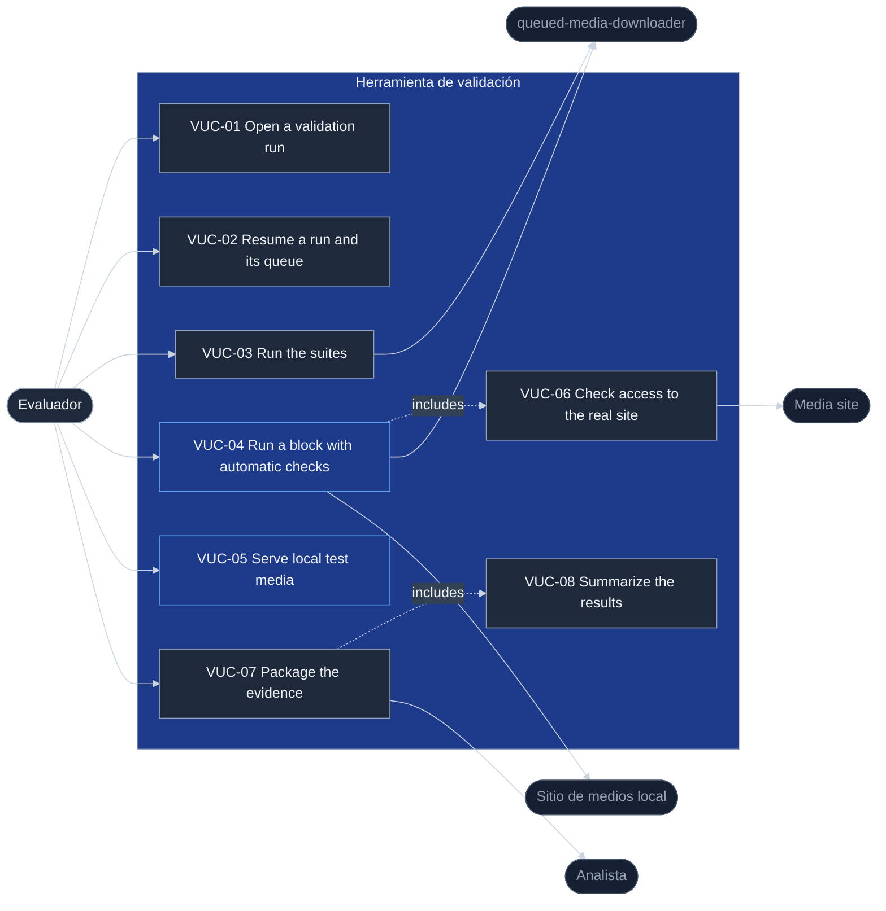

# Modelo de casos de uso de la validación en Windows

- **Versión:** 1.0 (propuesta)
- **Fecha:** 2026-11-26
- **Origen:** [análisis del funcionamiento sin vigilancia](../requirements/unattended-operation-analysis.md), §2.2 y §3.2
- **Herramienta actual:** `scripts/windows/validation_campaign.ps1`; [guion de la campaña](../project-management/windows-validation-campaign.md)
- **Reglas:** VBR-01 a VBR-03 del [catálogo de reglas](../requirements/business-rules.md)

En la sesión de validación del 2026-11-25, el Evaluador pasó un 51 % del tiempo esperando la siguiente instrucción. La causa raíz es que la validación no tiene un oráculo automático y sus pasos dependen de YouTube y de la red aunque no los prueben. Este modelo trata la herramienta de validación como una solución con sus propios casos de uso (BABOK 10.47): un caso de uso de negocio para el proceso y casos de uso del sistema para la herramienta.

---

## 1. Actores

| Actor | Tipo | Descripción |
|---|---|---|
| **Evaluador** | Principal | Persona que valida en Windows un commit publicado de `main` |
| **Analista** | Secundario | Rol que interpreta resultados, clasifica defectos y corrige; recibe la evidencia |
| **queued-media-downloader** | Secundario (sistema validado) | El programa que se valida |
| **Sitio de medios local** | Secundario | Servidor HTTP local con medios de prueba (VUC-05) |
| **Media site** | Secundario | Sitio real (YouTube), solo en los bloques que lo prueban (VBR-01) |

## 2. Caso de uso de negocio

**BUC-01 Validar un commit en Windows.**
- **Objetivo:** dejar evidencia de que un commit publicado cumple los criterios de la campaña en Windows, sin esperas del Evaluador.
- **Disparador:** el Analista publica en `main` un commit con cambios del producto o de la validación.
- **Flujo:**
  1. El Evaluador abre una ejecución (VUC-01).
  2. Ejecuta las suites (VUC-03).
  3. Ejecuta los bloques de la campaña, cada uno con su comprobación automática (VUC-04), sobre medios locales (VUC-05) salvo los que prueban el sitio real, precedidos por la comprobación del sitio (VUC-06).
  4. Empaqueta la evidencia (VUC-07) con el resumen de resultados (VUC-08) y la entrega al Analista una sola vez.
- **Garantía de éxito:** la evidencia de todos los bloques, clasificada como pasa, falla o bloqueado por el entorno (VBR-02), en un solo archivo.
- **Medida de éxito:** espera del Evaluador por debajo del 10 % de la sesión.

## 3. Diagrama

## 4. Casos de uso del sistema

| ID | Caso de uso | Función de la herramienta | Estado | Prioridad |
|---|---|---|---|---|
| VUC-01 | Abrir una ejecución de validación | `Start-ValidationRun` | Existente | — |
| VUC-02 | Retomar una ejecución y su cola | `Resume-ValidationRun`, `Use-ValidationQueue` | Existente | — |
| VUC-03 | Ejecutar las suites | `Invoke-ValidationSuites` | Existente | — |
| VUC-04 | Ejecutar un bloque con comprobación automática | `Invoke-ValidationBlock` (nueva) | **Nuevo** | Alta |
| VUC-05 | Servir medios de prueba locales | `Start-ValidationMediaSite` (nueva) | **Nuevo** | Alta |
| VUC-06 | Comprobar el acceso al sitio real | `Test-ValidationSiteAccess` (nueva) | **Nuevo** | Media |
| VUC-07 | Empaquetar la evidencia | `Save-ValidationArchive` (nueva) | **Nuevo** | Media |
| VUC-08 | Resumir los resultados | `Show-ValidationSummary` (nueva) | **Nuevo** | Media |

### VUC-01 a VUC-03 (existentes; especificación breve)

- **VUC-01 Abrir una ejecución de validación.**
  - **Objetivo:** una carpeta de ejecución para el commit publicado, con el entorno registrado.
  - **Disparador:** un commit nuevo en `main`.
  - **Comportamiento:** comprueba que el clon está limpio y en el `main` publicado; crea `runs\<instante>-<commit>`; guarda el entorno, las dependencias y `diagnose`.
  - **Garantía mínima:** no toca la cola, las descargas ni la configuración reales.
- **VUC-02 Retomar una ejecución y su cola.**
  - **Objetivo:** continuar la misma ejecución en otra ventana, o volver a una cola de un bloque.
  - **Disparador:** hace falta una segunda ventana, o seguir con un bloque.
  - **Garantía mínima:** ninguna orden del programa se ejecuta sin cola activa.
- **VUC-03 Ejecutar las suites.**
  - **Objetivo:** las cinco verificaciones y las pruebas `windows` y `network` sobre el commit, con su evidencia.
  - **Garantía mínima:** restablece la cola activa al terminar.

### VUC-04 Ejecutar un bloque con comprobación automática

- **Objetivo:** el Evaluador ejecuta un bloque de la campaña con una sola orden y obtiene su resultado (pasa, falla o bloqueado) sin interpretar la salida ni esperar instrucciones.
- **Actor principal:** Evaluador. **Secundarios:** queued-media-downloader, Sitio de medios local, Media site.
- **Disparador:** el Evaluador llega a un bloque del guion.
- **Precondiciones:** ejecución abierta (VUC-01); para los bloques locales, el sitio de medios local en marcha (VUC-05).
- **Flujo básico:**
  1. El Evaluador ejecuta `Invoke-ValidationBlock "<bloque>"`.
  2. La herramienta crea la cola del bloque y prepara sus datos: encola los contenidos del bloque, del sitio local salvo que el bloque pruebe el sitio real (VBR-01).
  3. La herramienta ejecuta las órdenes del bloque. Las que antes pedían una segunda ventana (retener la base de datos, cancelar a mitad de una descarga, `Ctrl+C`) las lanza como procesos en segundo plano, sincronizados con el estado de la cola y no con la velocidad del Evaluador.
  4. Tras cada orden comprueba lo esperado: código de salida, estado de cada job, archivos y procesos vivos.
  5. Guarda la salida de cada orden, cada comprobación con su resultado y el resultado del bloque ([VBR-02](../requirements/business-rules.md)).
  6. Muestra el resultado del bloque y la siguiente orden del guion.
- **Flujos alternativos:**
  - **A1. Paso que necesita una acción física** (cerrar la ventana de la terminal, abrir un archivo con un reproductor): la herramienta muestra una sola instrucción, espera la confirmación del Evaluador y sigue con las comprobaciones.
  - **A2. El bloque prueba el sitio real:** antes del paso 2 incluye VUC-06; si el sitio no está disponible, el bloque queda **bloqueado por el entorno** sin enviar peticiones (VBR-03).
  - **A3. Una comprobación falla:** el bloque sigue con las comprobaciones independientes y termina como **falla**, con la evidencia de cada una.
  - **A4. El bloque ya se ejecutó en esta ejecución:** la herramienta crea una cola nueva con sufijo (`-r2`) sin borrar nada.
- **Garantías:**
  - **De éxito:** el resultado del bloque y su evidencia, sin intervención del Analista.
  - **Mínima:** ningún dato real del User cambia; ninguna carpeta se borra.
- **Escenarios de prueba:** cada bloque contra el sitio local en el entorno de desarrollo (sin Windows, cuando el bloque no depende de Windows), y los bloques completos en Windows.

### VUC-05 Servir medios de prueba locales

- **Objetivo:** los bloques que prueban procesos, cierres, reanudación y archivos tienen medios que no dependen de YouTube ni de internet.
- **Actor principal:** Evaluador. **Secundario:** queued-media-downloader.
- **Disparador:** el Evaluador va a ejecutar bloques locales.
- **Flujo básico:**
  1. El Evaluador ejecuta `Start-ValidationMediaSite` (o VUC-04 lo arranca solo).
  2. La herramienta genera, con el ffmpeg incluido y sus codificadores nativos, los medios del bloque:
     - un video y un audio separados en un manifiesto DASH, para la unión;
     - un archivo grande servido a velocidad limitada, para cancelar, interrumpir y reanudar a mitad;
     - una playlist (feed) con una entrada repetida en otra, para los duplicados.
  3. La herramienta los sirve en `127.0.0.1` y muestra las URLs.
- **Flujos alternativos:**
  - **A1. Simular un corte de red:** el servidor se detiene y se vuelve a arrancar a mitad de una descarga, para UC-12.
  - **A2. Puerto ocupado:** usa otro puerto libre y lo muestra.
- **Garantía mínima:** solo escucha en la dirección local; no escribe fuera de la carpeta de la ejecución.

### VUC-06 Comprobar el acceso al sitio real

- **Objetivo:** saber, sin gastar peticiones, si el sitio real responde antes de un bloque que lo usa.
- **Actor principal:** Evaluador (o VUC-04, que lo incluye). **Secundario:** Media site.
- **Disparador:** un bloque que prueba el sitio real.
- **Flujo básico:**
  1. La herramienta hace una sola extracción, sin descarga, de un contenido conocido.
  2. Clasifica la respuesta como **disponible**, **bloqueado** ([BR-01](../requirements/business-rules.md)) o **sin conexión** ([BR-05](../requirements/business-rules.md)).
  3. Guarda la respuesta en la evidencia y devuelve la clasificación.
- **Flujo alternativo:** **A1. Bloqueado o sin conexión:** el bloque que lo pidió queda bloqueado por el entorno ([VBR-03](../requirements/business-rules.md)).
- **Garantía mínima:** como mucho una petición al sitio por comprobación.

### VUC-07 Empaquetar la evidencia

- **Objetivo:** entregar al Analista toda la evidencia de la ejecución en un archivo pequeño, sin escribir comandos.
- **Actor principal:** Evaluador. **Secundario:** Analista.
- **Disparador:** termina la ejecución o un grupo de bloques.
- **Flujo básico:**
  1. El Evaluador ejecuta `Save-ValidationArchive`.
  2. La herramienta incluye el resumen (VUC-08).
  3. Lista los archivos descargados con su tamaño y su hash, sin incluirlos.
  4. Comprime la ejecución sin las carpetas de descargas.
  5. Muestra la ruta y el tamaño del archivo.
- **Flujo alternativo:** **A1. Sin 7-Zip:** usa `Compress-Archive` con el mismo contenido.
- **Garantía mínima:** no incluye videos ni datos fuera de la carpeta de la ejecución.

### VUC-08 Resumir los resultados

- **Objetivo:** un solo documento con el resultado de cada bloque y su evidencia, que el Analista lee en lugar de consolas pegadas.
- **Actor principal:** Evaluador (o VUC-07, que lo incluye). **Secundario:** Analista.
- **Disparador:** el Evaluador quiere ver el estado de la ejecución, o la empaqueta.
- **Flujo básico:**
  1. La herramienta lee los resultados de los bloques (VUC-04) y de las suites (VUC-03).
  2. Escribe `summary.md` y `summary.json`, con:
     - el commit evaluado;
     - cada bloque con su resultado ([VBR-02](../requirements/business-rules.md));
     - las comprobaciones fallidas;
     - la ruta de su evidencia.
  3. Muestra el resumen en la consola.
- **Garantía mínima:** el resumen nunca marca como pasado un bloque que no se ejecutó.

## 5. Trazabilidad

| Caso de uso | Desperdicio que quita (§2.2 del análisis) | Tarea |
|---|---|---|
| VUC-04 | Espera de instrucciones; pasos repetidos por errores del guion | T60 |
| VUC-05 | Pasos 6 a 12 bloqueados por YouTube o la red | T59 |
| VUC-06 | Comprobaciones manuales del sitio; peticiones a un sitio que bloquea | T61 |
| VUC-07 | Comandos de empaquetado escritos a mano | T61 |
| VUC-08 | Interpretar consolas pegadas | T60 |
