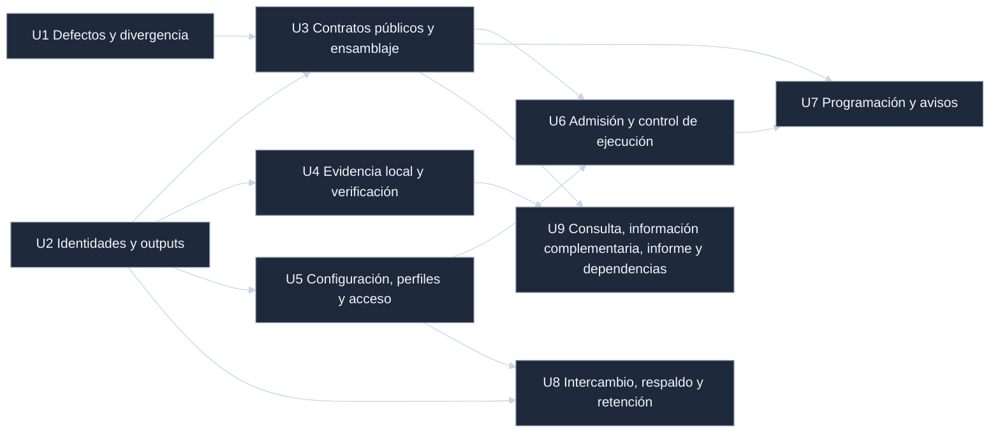

# Propuesta de planificación de E3

- **Estado:** **Propuesta**. E3 no ha empezado. Su ejecución y su planificación definitiva requieren la autorización del Responsable (instrucción 2.3.0, §86).
- **Fecha:** 2026-11-26
- **Base:**
  - [Parte 3 del diseño](../design/03-target-architecture-and-evolution.md): arquitectura objetivo, matriz de evolución y realización de los 26 casos de uso;
  - [análisis de requisitos](../requirements/requirements-analysis.md): decisiones, contratos y la cobertura de T52 a T67 (§14.2);
  - [lista de riesgos](risk-list.md).

## 1. Alcance y objetivos

- **Alcance:** implementar los 26 casos de uso aceptados para la CLI de Windows x64, con la arquitectura objetivo y sin implementar ninguna otra interfaz ni plataforma.
- **Objetivos:**
  1. Corregir los defectos y la divergencia abiertos (R-24, R-25, R-28) con sus criterios de regresión.
  2. Introducir los contratos compartidos una sola vez, antes que los casos de uso que los usan:
     - identidades y outputs;
     - contratos públicos;
     - admisión;
     - perfiles y secretos.
  3. Conservar las garantías actuales (ADR-0029, ADR-0030; 586 pruebas de desarrollo) y la compatibilidad de las instalaciones existentes (AAC-08).
  4. Dejar el producto listo para la campaña integral de Windows, que se hace después de E3.

**Fronteras.**
- Ninguna unidad:
  - implementa una GUI, una aplicación móvil, una API HTTP, un servidor MCP ni un transporte remoto;
  - cambia las dependencias fijadas;
  - modifica una migración publicada.
- La campaña de Windows no forma parte de E3.

## 2. Orden recomendado y dependencias

El orden se obtiene de las dependencias entre contratos y del impacto de cada cambio, no de los números de los casos de uso.

- **U1 y U2 no dependen entre sí.** U1 corrige comportamientos vigentes sin contratos nuevos.
- **U2 va antes que U3:** si las vistas públicas se definieran con `output_path`, se reemplazarían enseguida. Así se evita un contrato temporal.
- **U3 separa el ensamblaje** (A-1) porque introduce el segundo consumidor real (`--json` y la API Python).

## 3. Unidades

### U1. Defectos y divergencia sin contratos nuevos

| Campo | Contenido |
|---|---|
| Objetivo | Reintentos de yt-dlp (R-24) y cadena de causas del clasificador (R-28) |
| UC y flujos | UC-03 A15 (divergente), A2 (defecto); UC-17 (condiciones de almacenamiento) |
| Reglas y suplementarios | BR-07, BR-22, BR-25; SUP-R11, SUP-V03 |
| Decisiones | D-3, D-12 |
| Contratos | Ninguno nuevo; se amplían `yt_dlp_parameters` y `failure_classifier` |
| Componentes | `media_extraction` |
| Migraciones | Ninguna |
| Riesgos | R-24, R-28; traducciones de `winerror` pendientes de Windows |
| Pruebas | Experimentos E1 y E3 convertidos en pruebas de contrato; los cinco caminos de error |
| Criterio de aceptación | Los criterios de regresión de R-24 y R-28 de la lista de riesgos |
| Compatibilidad | Sin cambio de datos |
| Evidencia | Linux en desarrollo; pruebas `windows` para los códigos |
| Tareas reconciliadas | T54; la parte de clasificación de T52 y T67 |

### U2. Identidades y outputs

| Campo | Contenido |
|---|---|
| Objetivo | N outputs por job, identidad de la petición con la clase de contexto de acceso, referencia de almacenamiento, reclamación por output |
| UC y flujos | UC-03 A16, A17; UC-24; UC-25 (base); UC-02 (identidad) |
| Reglas y suplementarios | BR-13 (divergente de D-16), BR-17, BR-29, BR-30, BR-31, BR-32 |
| Decisiones | D-15, D-16; ADR-0033 (se acepta en esta unidad) |
| Contratos | Identidad de la petición, `JobOutput`, finalización con los outputs obligatorios |
| Componentes | `jobs` (Generalize), `job_storage` (esquema), `media_extraction.output_claims` (Generalize), `job_event_applier` |
| Migraciones | 0005: tabla de outputs y migración de `output_path` al output principal; identidad de la petición en los jobs |
| Riesgos | R-14, R-30; compatibilidad con las reclamaciones existentes |
| Pruebas | Identidad compartida sin rutas (AR-06, AAC-04); migración desde 0004; R-30 (todo archivo escrito tiene su reclamación) |
| Criterio de aceptación | Un job con vídeo y subtítulos queda `COMPLETED` solo con los obligatorios publicados; las identidades coinciden en dos instalaciones con rutas distintas |
| Compatibilidad | Jobs, historial y reclamaciones existentes conservados (AAC-08) |
| Evidencia | Linux; pruebas `windows` de nombres y rutas en la campaña posterior |
| Tareas reconciliadas | Ninguna previa: D-15 y D-16 no tenían tarea (análisis §14.2) |

### U3. Contratos públicos y ensamblaje del producto

| Campo | Contenido |
|---|---|
| Objetivo | Vistas versionadas, errores con código, canal de observación, progreso con significado, `queue_installation`, salida `--json` |
| UC y flujos | UC-08, UC-09 (vistas), UC-01 (capacidades, base), UC-03 (progreso); SUP-U05 |
| Reglas y suplementarios | SUP-I01, SUP-I03, SUP-SEC01, SUP-U01, SUP-U05, SUP-F02 |
| Decisiones | D-17 (evolución, Parte 3 §5); ADR-0032 |
| Contratos | §5.2 a §5.5 y §8.7 de la Parte 3 |
| Componentes | `queue_installation` (Introduce), `command_line` (Separate), `job_queue` (Separate la observación), `jobs` (`DownloadProgressed`) |
| Migraciones | Ninguna |
| Riesgos | Cambio de firma de `Present` (un solo consumidor); R-27 (enmascarado) |
| Pruebas | Sesión sin `argparse` (AAC-02); vistas, errores y progreso (AAC-03); activar AR-03 y AR-05 |
| Criterio de aceptación | `list --json` y `show --json` validan contra el esquema versionado; ningún consumidor necesita texto |
| Compatibilidad | La salida de texto de la CLI no cambia |
| Evidencia | Linux |
| Tareas reconciliadas | T56 y T66 consolidadas; T63 (indicación de reintento) |

### U4. Evidencia local y verificación

| Campo | Contenido |
|---|---|
| Objetivo | Recuperar local primero (R-25), verificar outputs (UC-26), administrar outputs (UC-25), purgar con evidencia (UC-10 A5) |
| UC y flujos | UC-06 A4, A11, A12; UC-26; UC-25; UC-10 A5 |
| Reglas y suplementarios | BR-18, BR-23, BR-38; SUP-R10 |
| Decisiones | D-9, D-11 |
| Contratos | Evidencia por operación (análisis §13.12), expectativa registrada antes de publicar |
| Componentes | `job_queue.recover_interrupted_jobs` (Extend), verificación con ffprobe (Introduce) |
| Migraciones | 0006 si la expectativa necesita columnas |
| Riesgos | R-25; coste del hash (pendiente de medición) |
| Pruebas | Criterio de regresión de R-25 (servidor local detenido); archivos truncados |
| Criterio de aceptación | El de R-25 |
| Compatibilidad | Los jobs antiguos sin expectativa se recuperan como hoy |
| Evidencia | Linux |
| Tareas reconciliadas | T55; la parte de archivos de T65 |

### U5. Configuración, perfiles y acceso autorizado

| Campo | Contenido |
|---|---|
| Objetivo | Clases de configuración, perfiles con id estable (D-19), perfiles de acceso con almacén de secretos (D-1, D-7) |
| UC y flujos | UC-18, UC-19 (salvo A10), UC-20 |
| Reglas y suplementarios | BR-12, BR-33, BR-34, BR-35, BR-40; SUP-SEC01, SUP-SEC03, SUP-SEC04, SUP-F03 |
| Decisiones | D-1, D-7, D-19 |
| Contratos | Identidad de perfiles (Parte 3, §6.4); almacén de secretos (§8.9) |
| Componentes | `configuration` (Extend; Generalize la ubicación, A-8), almacén de secretos (Introduce) |
| Migraciones | 0007: perfiles y referencia del job al id del perfil |
| Riesgos | R-27; mecanismo de Windows para los secretos sin cualificar |
| Pruebas | Valores trampa en todas las salidas (AAC-06); renombrar, recrear e importar perfiles |
| Criterio de aceptación | Ningún secreto en la base de datos, los logs, las vistas ni las exportaciones; renovar las credenciales no cambia la identidad |
| Compatibilidad | La configuración actual sigue siendo válida |
| Evidencia | Linux; ACL o DPAPI en la campaña de Windows |
| Tareas reconciliadas | Preajustes de T66 |
| Condición | UC-19 A10 (cookies del navegador) sigue condicionada (cifrado `v20`) |

### U6. Admisión y control de ejecución

| Campo | Contenido |
|---|---|
| Objetivo | Admisión por alcance (job, sitio, recurso, sistema), aplazamiento, `Retry-After`, ritmo, almacenamiento preventivo y reactivo, pausa persistente, directos, ancho de banda, suspensión del equipo |
| UC y flujos | UC-11, UC-14, UC-17, UC-03 E1 |
| Reglas y suplementarios | BR-02 a BR-06, BR-08 a BR-11, BR-24, BR-26 a BR-28, BR-41 a BR-43; SUP-R06 a SUP-R09, SUP-P05, SUP-P06, SUP-U04 |
| Decisiones | D-2, D-4, D-5, D-6, D-10, D-20 |
| Contratos | Admisión en `job_queue`; intenciones frente a condiciones (Parte 3, §6.7) |
| Componentes | `job_queue` (Extend), `RunQueue` |
| Migraciones | 0008: condición de aplazamiento e intención de pausa |
| Riesgos | R-26; valores pendientes de medición |
| Pruebas | Admisión con servidores locales que responden 429, 503 y 403; unidades llenas simuladas |
| Criterio de aceptación | Ningún job `FAILED` por una condición transitoria; ningún estado nuevo |
| Compatibilidad | Sin cambios para las colas sin condiciones |
| Evidencia | Linux; `powercfg` (SUP-R08) en la campaña de Windows |
| Tareas reconciliadas | T52, T53, T57, T58; la parte de directos de T65; T67 consolidada |

### U7. Programación y avisos

| Campo | Contenido |
|---|---|
| Objetivo | Programación persistida con lanzador de Windows y avisos operativos |
| UC y flujos | UC-21, UC-28 |
| Reglas y suplementarios | BR-37, BR-39, BR-45 |
| Decisiones | D-13, D-14 |
| Contratos | Programación y lanzador (Parte 3, §8.5); entrega de avisos (§8.6) |
| Componentes | `job_queue` (programación), lanzador y entrega (Introduce, Windows) |
| Migraciones | 0009: programación y preferencias de aviso |
| Riesgos | Suspensión e hibernación; dependencia para las notificaciones de Windows sin decidir |
| Pruebas | Ventanas y ejecuciones omitidas sin reloj real; entrega sin permiso; pruebas `windows` del lanzador |
| Criterio de aceptación | La política no importa el lanzador (AR-07); un fallo de entrega no cambia ningún job |
| Compatibilidad | Sin programación, `run` se comporta como hoy |
| Evidencia | Linux; Windows en la campaña |
| Tareas reconciliadas | Ninguna previa |
| Condición | La dependencia para las notificaciones de Windows requiere una decisión (D-14: evidencia insuficiente) |

### U8. Intercambio, respaldo y retención

| Campo | Contenido |
|---|---|
| Objetivo | Exportar e importar versionado, respaldar y restaurar con reconciliación, retención por clase de dato |
| UC y flujos | UC-22, UC-23, UC-10 (retención) |
| Reglas y suplementarios | BR-36; SUP-I02, SUP-SEC05, SUP-R12, SUP-D01 |
| Decisiones | D-21; Parte 3 §6.5 |
| Contratos | Formato de intercambio versionado sin rutas ni secretos |
| Componentes | `job_queue` (operaciones), `job_storage` (copia de SQLite) |
| Migraciones | Ninguna prevista |
| Riesgos | Plazos de retención pendientes de medición |
| Pruebas | Ida y vuelta entre instalaciones con rutas distintas (AAC-04); E2 convertido en prueba; importar dos veces no duplica |
| Criterio de aceptación | Ningún job importado o restaurado obtiene la propiedad de un archivo (BR-36) |
| Compatibilidad | Exportaciones con versión |
| Evidencia | Linux |
| Tareas reconciliadas | Ninguna previa |

### U9. Consulta, información complementaria, informe y dependencias

| Campo | Contenido |
|---|---|
| Objetivo | Consultar antes de encolar, información complementaria, informe enmascarado, administración de dependencias y capacidades de transformación |
| UC y flujos | UC-15, UC-24, UC-16, UC-27, UC-02 A14 |
| Reglas y suplementarios | BR-44; SUP-SEC02, SUP-O03, SUP-M01, SUP-S01 |
| Decisiones | D-8, D-18; R-29 |
| Contratos | Capacidades (Parte 3, §8.7) |
| Componentes | `diagnostics`, `ffmpeg_discovery` (Extend) |
| Migraciones | Ninguna |
| Riesgos | R-29 (abierto); procedencia de las versiones candidatas |
| Pruebas | Servidor local; informe con valores trampa |
| Criterio de aceptación | No se ofrece una recodificación sin un codificador disponible y permitido |
| Compatibilidad | — |
| Evidencia | Linux |
| Tareas reconciliadas | T62, T64 |

## 4. Reconciliación de T52 a T67

| Tarea | Situación en esta propuesta |
|---|---|
| T52 | U1 (clasificación) y U6 (aplazamiento) |
| T53 | U6, ampliada |
| T54 | U1 |
| T55 | U4 |
| T56, T66 | U3, consolidadas; los preajustes de T66 van a U5 |
| T57, T58 | U6 |
| T59 a T61 | Validación: campaña de Windows después de E3 |
| T62 | U9 |
| T63 | U3 |
| T64 | U9 |
| T65 | U4 (archivos) y U6 (directos) |
| T67 | U1 y U6 |

- Ninguna tarea se elimina: las históricas conservan su número y su trazabilidad.
- **Capacidades sin tarea previa** (D-15, D-16, UC-18 a UC-28): ahora están en U2, U3, U5, U7, U8 y U9.

## 5. Estrategia de migración y pruebas

- **Migraciones:**
  - progresivas desde 0005, sin modificar 0001 a 0004 (la última publicada);
  - cada una con una prueba desde la versión anterior publicada (AAC-08).
- **Pruebas compartidas y específicas:** según la Parte 3, §9.2.
- **Ninguna prueba se deselecciona** para facilitar un cambio.
- **Cada unidad pasa los seis gates** antes de publicarse.

## 6. Riesgos y condiciones pendientes

| Elemento | Unidad | Condición |
|---|---|---|
| R-29 | U9 | Decisión técnica y jurídica pendiente; la distribución LGPL no cambia |
| Valores de D-2 a D-5, D-10, D-20, D-21 | U6, U8 | Medición |
| Secretos en Windows | U5 | Cualificación en la campaña de Windows |
| Notificaciones de Windows | U7 | Decisión sobre la dependencia |
| Cookies del navegador (UC-19 A10) | U5 | Cifrado `v20` de Chrome y Edge |
| Versiones no cualificadas de yt-dlp (UC-27 A2) | U9 | Procedimiento de D-8 |
