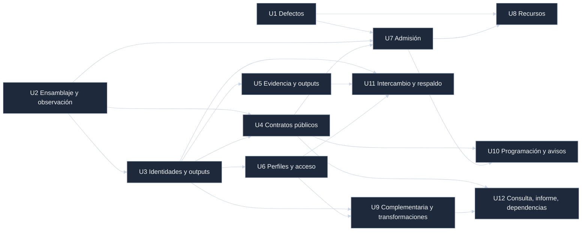

# Plan de la iteración E3

- **Estado:** **Planificada; ejecución no autorizada.** E3 empieza cuando el Responsable la autorice (instrucción 2.4.0, §108). La instrucción 2.5.0 añadió las unidades U13 a U16 (§11), la 2.6.0 las aceptó y la 2.7.0 separa la hoja de ruta de la EDT, completa el diccionario de la EDT y reconcilia los contratos necesarios antes de implementar (§12).
- **Fecha:** 2026-11-26
- **Base:**
  - [diseño, Parte 3](../design/03-target-architecture-and-evolution.md): arquitectura objetivo, contratos públicos, arquitectura de ejecución (§16), realización de los 26 casos de uso;
  - [ADR-0032](../notes/adr-0032-reusable-engine-and-platform-capabilities.md), [ADR-0033](../notes/adr-0033-output-identity-and-storage-references.md), [ADR-0034](../notes/adr-0034-single-coordinator-and-isolated-execution.md);
  - [análisis de requisitos](../requirements/requirements-analysis.md) y [lista de riesgos](risk-list.md).
- **Verificación del plan:** `scripts/check_requirements_model.py` comprueba:
  - que cada flujo no implementado de los 38 casos de uso aceptados y de los candidatos tiene una sola fila de planificación: «Planificado» con una unidad de E3, «Futuro» o «Candidato» con un horizonte de la hoja de ruta, «Bloqueado» con una decisión pendiente o «No aplicable» con su motivo (§6 y §12);
  - que las unidades existen y su grafo no tiene ciclos (§3);
  - que cada business rule aprobada y cada requisito suplementario pendiente aparecen en el plan.

  Es consistencia documental, no evidencia de implementación.

## 1. Objetivos y frontera de terminación

**Objetivo.** Implementar los 26 casos de uso aceptados para la CLI de Windows x64 con la arquitectura objetivo:
- coordinación única;
- pool de procesos como mecanismo de escritorio;
- contratos públicos independientes de la CLI;
- identidades independientes de la ubicación.

Se conservan las garantías vigentes y las instalaciones existentes.

**Frontera.** E3 termina cuando:
1. Todas las unidades cumplen su condición de terminación.
2. Los flujos pendientes tienen sus criterios de aceptación cubiertos por pruebas, o una condición pendiente explícita (UC-02 A14 y UC-03 A19 por R-29; UC-19 A10; UC-27 A2). Son 181 flujos alternativos y de excepción y 16 flujos básicos sin implementar.
3. Pasan las seis comprobaciones y las reglas AR-03 y AR-05 están activas.
4. El producto queda listo para la campaña integral de Windows, que es posterior a E3.

**Fuera de E3:**
- GUI, aplicaciones Android e iOS, API HTTP, servidor MCP y servicios remotos;
- cambios de las dependencias fijadas;
- el ejecutor móvil (ADR-0034);
- la GUI de Windows y las aplicaciones de Android e iOS, que son evolución prevista (SUP-C06).

## 2. Unidades definitivas

La propuesta tenía 9 unidades. La cualificación de la arquitectura cambió tres cosas:
1. **U3 de la propuesta se divide.**
   - El ensamblaje y la observación (A-1, A-2) no dependen de los outputs y dan el arnés de verificación de las demás unidades: van primero (U2).
   - Las vistas versionadas dependen de los outputs: van después (U4).
2. **U6 de la propuesta se divide.** La admisión y el control (U7) son la base de los recursos (U8), que dependen de mediciones y de Windows.
3. **Las transformaciones y la información complementaria se separan (U9).** Dependen de D-18 y de R-29 y no deben bloquear a las demás.

| Unidad | Responsabilidad | Unidad de la propuesta |
|---|---|---|
| U1 | Defectos y divergencia sin contratos nuevos (R-24, R-28) | U1 |
| U2 | Ensamblaje del producto, sesión, canal de observación y contrato de ejecución | Parte de U3 |
| U3 | Identidades y outputs (D-15, D-16, ADR-0033) | U2 |
| U4 | Contratos públicos versionados: vistas, errores, progreso, salida para otros programas | Parte de U3 |
| U5 | Evidencia local, verificación y administración de outputs | U4 |
| U6 | Configuración, perfiles y acceso autorizado | U5 |
| U7 | Admisión y control de ejecución | Parte de U6 |
| U8 | Recursos: almacenamiento, ancho de banda, directos, suspensión | Parte de U6 |
| U9 | Información complementaria y transformaciones | Partes de U2 y U9 |
| U10 | Programación y avisos | U7 |
| U11 | Intercambio, respaldo y retención | U8 |
| U12 | Consulta previa, entrada, informe y dependencias | U9 |

## 3. Dependencias

<!-- e3-dependencies:start -->
| Unidad | Depende de | Tipo | Motivo |
|---|---|---|---|
| U1 | — | — | Corrige comportamiento vigente sin contratos nuevos |
| U2 | — | Diseño | Contrato de ejecución y ensamblaje definidos en ADR-0034 y en la Parte 3, §16.15 |
| U3 | U2 | Verificación | Sus pruebas usan el programa cliente y el canal de observación de U2 |
| U4 | U2 | Implementación | Las vistas y la observación pública se ofrecen a través de la instalación |
| U4 | U3 | Diseño e implementación | Las vistas incluyen los outputs; definirlas antes daría un contrato temporal |
| U5 | U3 | Implementación y migración | La evidencia es por output y por reclamación |
| U6 | U3 | Implementación y migración | La identidad de la petición incluye la clase de contexto de acceso |
| U7 | U1 | Implementación | La admisión reacciona a las condiciones que clasifica U1 |
| U7 | U2 | Implementación | La admisión vive en la coordinación de la sesión |
| U7 | U4 | Implementación | El estado de los jobs aplazados y de la cola se expone en las vistas |
| U8 | U1 | Implementación | Clasificación de las condiciones de almacenamiento (R-28) |
| U8 | U7 | Implementación | Los recursos son clases de la admisión |
| U9 | U3 | Implementación | Los outputs complementarios son outputs |
| U9 | U6 | Implementación | Los perfiles fijan las transformaciones pedidas |
| U10 | U4 | Implementación | Los avisos consumen el canal público |
| U10 | U7 | Implementación | Las ventanas se aplican en la admisión |
| U11 | U3 | Implementación | El intercambio usa las identidades portables |
| U11 | U5 | Implementación | Restaurar concilia con la evidencia local |
| U11 | U6 | Implementación | Se exportan perfiles sin secretos |
| U12 | U4 | Implementación | La consulta previa y el informe usan las vistas y la salida para otros programas |
| U12 | U9 | Implementación | El diagnóstico informa las capacidades de transformación |
| U13 | U3 | Diseño e implementación | La modificación recalcula la identidad de la petición y respeta las reclamaciones |
| U13 | U7 | Implementación | Elegibilidad, prioridad y orden viven en la admisión |
| U14 | U4 | Implementación | Suscripciones y contenido nuevo se exponen con el contrato estructurado |
| U14 | U10 | Implementación | La consulta programada usa la programación y los avisos |
| U14 | U13 | Implementación | Los jobs de una suscripción tienen procedencia y prioridad (BR-46) |
| U15 | U4 | Implementación | La solicitud externa es el comando público de encolado (BR-48) |
| U15 | U5 | Implementación | Abrir, compartir y exportar operan sobre outputs registrados y verificados |
| U16 | U11 | Implementación | El modo privado y el borrado por categoría dependen de la retención (D-21) |
| U16 | U12 | Implementación | La comprobación de versión comparte el diagnóstico de la instalación |
<!-- e3-dependencies:end -->

**Orden recomendado:**

| Ola | Unidades | Nota |
|---|---|---|
| 1 | U1 y U2, en paralelo | No comparten autoridades: U1 toca `media_extraction`; U2, `command_line`, `workers` y la sesión |
| 2 | U3 | Primera migración (0005) |
| 3 | U4, U5 y U6 | U5 y U6 tocan el esquema: se integran por turnos |
| 4 | U7 y U9 | — |
| 5 | U8, U10 y U11 | — |
| 6 | U12 | — |

- **Validación:** la campaña de Windows es posterior a E3 y no bloquea ninguna unidad; cada unidad registra sus pruebas `windows` para ella.
- **Concurrencia:** no se integran a la vez dos unidades que creen migraciones o modifiquen `JobEventApplier`, la única autoridad del estado.

## 4. Unidades

Cada unidad sigue el ciclo del caso de desarrollo:
1. contrato;
2. criterios;
3. pruebas;
4. implementación;
5. verificación y corrección inmediata;
6. seis comprobaciones;
7. evidencia;
8. trazabilidad;
9. publicación.

Cada unidad incluye la observabilidad necesaria para verificarse; las consultas finales se consolidan en U4 y U12.

### U1. Defectos y divergencia sin contratos nuevos

| Campo | Contenido |
|---|---|
| Objetivo | Reintentos de yt-dlp (R-24) y cadena de causas del clasificador (R-28, A-5) |
| Alcance y flujos | UC-03 A2 y A15 (§6) |
| Reglas y suplementarios | BR-07, BR-22, BR-25; SUP-R11, SUP-V03, SUP-V01 (transversal) |
| Contratos | Ninguno nuevo; se amplían `yt_dlp_parameters` y `failure_classifier` |
| Componentes | `media_extraction` |
| Datos y migraciones | Ninguno |
| Pruebas | Experimentos de reintentos y de cadena de causas convertidos en pruebas; los cinco caminos de almacenamiento |
| Criterio de aceptación | Los criterios de regresión de R-24 y R-28 |
| Riesgos | R-24, R-28; traducciones de `winerror` pendientes de Windows |
| Evidencia | Linux; pruebas `windows` de los códigos para la campaña |
| Exclusiones | Admisión y aplazamiento (U7, U8) |
| Terminación | Ningún fallo transitorio reproducido falla a la primera; los cinco caminos quedan clasificados |

### U2. Ensamblaje, sesión, observación y contrato de ejecución

| Campo | Contenido |
|---|---|
| Objetivo | Cuatro cambios: `queue_installation` (A-1); canal de observación con `(job_id, JobEvent)` (A-2); contrato `WorkerPool` generalizado al mínimo (ADR-0034); ubicación de la instalación aportada por la interfaz (A-8) |
| Alcance y flujos | UC-05 A9 (cancelar durante el postprocesamiento, con el contrato generalizado) |
| Reglas y suplementarios | BR-14, BR-16; SUP-S06, SUP-C09, SUP-I05 |
| Contratos | Abrir y cerrar la instalación, sesión, observación, capacidad y terminación forzada opcional (Parte 3, §16.9 y §16.15) |
| Componentes | `queue_installation` (Introduce), `command_line` (Separate), `job_queue.run_queue`, `workers` (contrato; `ProcessWorkerPool` sin cambios de comportamiento) |
| Datos y migraciones | Ninguno |
| Pruebas | Programa cliente (AAC-02, criterio de §16.15); suite compartida del contrato de ejecución con `ProcessWorkerPool` y `ScriptedWorkerPool`; regresión completa de UC-03, UC-05 y UC-06 |
| Criterio de aceptación | AAC-02, AAC-09, AAC-10, AAC-13; activar AR-03 y AR-05 |
| Riesgos | R-32; cambio de firma con un solo consumidor |
| Evidencia | Linux; las pruebas `windows` vigentes del pool, sin deselecciones nuevas |
| Exclusiones | Vistas versionadas (U4) |
| Terminación | La CLI usa `queue_installation`; `command_line` no importa `sqlite3` ni implementaciones; ningún consumidor recibe `WorkerMessage` |

### U3. Identidades y outputs

| Campo | Contenido |
|---|---|
| Objetivo | Cuatro cambios: identidad de la petición (parte portable y local, clase de contexto de acceso); `JobOutput` con claves estructuradas (ADR-0033); reclamación por output (R-30); finalización con los outputs obligatorios |
| Alcance y flujos | UC-03 A1, A16, A17; UC-09 A6 (observabilidad de los outputs) |
| Reglas y suplementarios | BR-13 (divergente), BR-17, BR-29, BR-30, BR-31, BR-32; SUP-C08, SUP-C10, SUP-SEC06, SUP-P08 |
| Contratos | Parte 3, §6.1 a §6.3 y §16.16 |
| Componentes | `jobs` (Generalize), `job_storage` (esquema), `media_extraction.output_claims` (Generalize), `job_event_applier` |
| Datos y migraciones | 0005: outputs, output principal desde `output_path`, identidad de la petición. Sin reescribir reclamaciones |
| Pruebas | Identidades sin rutas (AR-06, AAC-04); migración desde 0004 con una base publicada; todo archivo escrito tiene su reclamación |
| Criterio de aceptación | AAC-04, AAC-08, AAC-12; cierre de R-30 |
| Riesgos | R-14, R-30 |
| Evidencia | Linux; pruebas `windows` de nombres y rutas para la campaña |
| Exclusiones | Vistas públicas versionadas (U4); verificación con ffprobe (U5) |
| Terminación | Un job con vídeo y subtítulos queda `COMPLETED` solo con sus obligatorios; `show` lista sus outputs |

### U4. Contratos públicos versionados

| Campo | Contenido |
|---|---|
| Objetivo | Cuatro cambios: `JobView` y `JobOutputView` (A-3); errores con código (§5.5); progreso con `total_kind` y `stage` (A-4); salida para otros programas y búsqueda |
| Alcance y flujos | UC-08 A5, A6; UC-09 A2, A5 |
| Reglas y suplementarios | SUP-I01, SUP-I03, SUP-I04, SUP-U01, SUP-U05, SUP-SEC01, SUP-F02 |
| Contratos | Parte 3, §5.2 a §5.5, versión 1 |
| Componentes | `job_queue` (consultas), `jobs` (`DownloadProgressed`), `command_line` (presentación) |
| Datos y migraciones | Ninguno |
| Pruebas | Esquemas por versión; valores trampa (AAC-06); el programa cliente consulta sin texto (AAC-03) |
| Criterio de aceptación | AAC-03, AAC-06 |
| Riesgos | R-27, R-32 |
| Evidencia | Linux |
| Exclusiones | No basta con `--json`: el criterio lo cumple el programa cliente |
| Terminación | La CLI presenta a partir de las vistas; su salida de texto no cambia |

### U5. Evidencia local, verificación y administración de outputs

| Campo | Contenido |
|---|---|
| Objetivo | Cinco cambios: recuperar local primero (R-25, D-9); verificar outputs con ffprobe (UC-26); administrarlos (UC-25); purgar con archivos (UC-10 A5); reintentar con outputs parciales |
| Alcance y flujos | UC-06 A4, A11, A12; UC-07 A8; UC-10 A5; UC-25 y UC-26 completos |
| Reglas y suplementarios | BR-18, BR-19, BR-23, BR-38; SUP-R10 |
| Contratos | Evidencia por operación (análisis §13.12); recuperación por outputs (Parte 3, §16.12) |
| Componentes | `job_queue` (recuperación, operaciones de outputs); verificación con ffprobe (Introduce, con `ffmpeg_discovery`) |
| Datos y migraciones | 0006, si la expectativa necesita columnas |
| Pruebas | Criterio de R-25 con el servidor local detenido; outputs truncados; opcionales ausentes |
| Criterio de aceptación | El de R-25; AAC-12 |
| Riesgos | R-25; coste del hash (medición) |
| Evidencia | Linux |
| Exclusiones | No habrá un mecanismo de recuperación por cada modalidad de ejecución |
| Terminación | La recuperación no depende de ningún mensaje final del ejecutor |

### U6. Configuración, perfiles y acceso autorizado

| Campo | Contenido |
|---|---|
| Objetivo | Tres cambios: clases de configuración y ubicación de la instalación (A-8); perfiles con id estable (D-19); perfiles de acceso con revisión de contexto (§16.17) y almacén de secretos (D-1, D-7) |
| Alcance y flujos | UC-18, UC-19 y UC-20 (salvo los flujos de U11); UC-02 A9, A12, A13; UC-01 A11 |
| Reglas y suplementarios | BR-12, BR-33, BR-34, BR-35, BR-40; SUP-SEC03, SUP-SEC04, SUP-F03 |
| Contratos | Parte 3, §6.4, §8.9 y §16.17 |
| Componentes | `configuration` (Extend), almacén de secretos (Introduce) |
| Datos y migraciones | 0007: perfiles y referencia del job al id y la revisión |
| Pruebas | Valores trampa en todas las salidas; renombrar, recrear e importar perfiles; dos workers con el mismo perfil (UC-19 A7) |
| Criterio de aceptación | AAC-06; renovar credenciales no cambia la identidad y cambiar la cuenta sí |
| Riesgos | R-27; secretos en Windows sin cualificar |
| Evidencia | Linux; ACL o DPAPI en la campaña |
| Exclusiones | UC-19 A10 (cookies del navegador) sigue condicionado |
| Terminación | Ningún secreto en la base de datos, los logs, las vistas ni las exportaciones |

### U7. Admisión y control de ejecución

| Campo | Contenido |
|---|---|
| Objetivo | Admisión por alcance (job, sitio, sistema); aplazamiento sin estados nuevos; `Retry-After`; ritmo por sitio; pausa persistente; detención |
| Alcance y flujos | UC-11 (salvo A3 y E3); UC-14; UC-03 A11, A12, A14; UC-04 A6; UC-06 A10; UC-08 A4; UC-09 A4 |
| Reglas y suplementarios | BR-01, BR-02, BR-03, BR-04, BR-05, BR-06, BR-10, BR-11, BR-41, BR-42; SUP-U04, SUP-R06, SUP-R07, SUP-P05 |
| Contratos | Parte 3, §6.7 y §16.10; política en `job_queue` |
| Componentes | `job_queue` (`RunQueue`, política de admisión) |
| Datos y migraciones | 0008: condición de aplazamiento, intención de pausa, restricción por sitio |
| Pruebas | Servidores locales con 429, 503 y 403; corte de red simulado; pausa tras un reinicio |
| Criterio de aceptación | Ningún job `FAILED` por una condición transitoria; ningún estado nuevo |
| Riesgos | Valores pendientes de medición |
| Evidencia | Linux |
| Exclusiones | Recursos (U8) |
| Terminación | La coordinación sigue siendo única y el programa cliente la observa |

### U8. Recursos: almacenamiento, ancho de banda, directos, suspensión

| Campo | Contenido |
|---|---|
| Objetivo | Almacenamiento preventivo y reactivo (D-5, D-12); ancho de banda global (D-20); directos y programados (D-10); suspensión del equipo (SUP-R08); fragmentos concurrentes |
| Alcance y flujos | UC-17 completo; UC-11 A3, E3; UC-03 A13, E1; UC-01 A10 |
| Reglas y suplementarios | BR-08, BR-09, BR-24, BR-26, BR-27, BR-28, BR-43; SUP-R08, SUP-R09, SUP-P04, SUP-P06, SUP-P07, SUP-P09 |
| Contratos | Clases de recurso de la admisión (§16.10) |
| Componentes | `job_queue` (política), `media_extraction` (parámetros), mecanismo de suspensión de Windows (Introduce) |
| Datos y migraciones | Ninguno nuevo; usa los aplazamientos de U7 |
| Pruebas | Unidades simuladas llenas o ausentes; directos simulados; memoria con N workers |
| Criterio de aceptación | Los de UC-17; R-26 |
| Riesgos | R-26; cuotas y códigos de Windows |
| Evidencia | Linux; `powercfg` y códigos de Windows en la campaña |
| Exclusiones | — |
| Terminación | La admisión no usa solo el número de workers como capacidad |

### U9. Información complementaria y transformaciones

| Campo | Contenido |
|---|---|
| Objetivo | Subtítulos, miniaturas, metadatos, comentarios, SponsorBlock, capítulos, rangos, contenedor y conversión, con capacidades (D-18) |
| Alcance y flujos | UC-24 completo; UC-02 A7, A8, A10, A11, A14; UC-03 A18, A19 |
| Reglas y suplementarios | SUP-M01 |
| Contratos | Claves de output (§16.16), capacidades (§8.7) |
| Componentes | `media_extraction` (postprocessors), `ffmpeg_discovery` (codificadores) |
| Datos y migraciones | Ninguno |
| Pruebas | Servidor local con subtítulos y miniaturas; SponsorBlock simulado sin el servicio externo |
| Criterio de aceptación | Ninguna recodificación se ofrece sin una capacidad disponible y permitida |
| Riesgos | R-29 (UC-02 A14 y UC-03 A19 condicionados) |
| Evidencia | Linux; `ffmpeg -encoders` en Windows |
| Exclusiones | La distribución LGPL no cambia |
| Terminación | Cada output complementario tiene su clave y su reclamación |

### U10. Programación y avisos

| Campo | Contenido |
|---|---|
| Objetivo | Programación persistida con lanzador de Windows (D-13); avisos operativos (D-14) |
| Alcance y flujos | UC-21 y UC-28 completos |
| Reglas y suplementarios | BR-37, BR-39, BR-45 |
| Contratos | Parte 3, §8.5 y §8.6 |
| Componentes | `job_queue` (programación); lanzador y entrega de avisos (Introduce, Windows) |
| Datos y migraciones | 0009: programación y preferencias de aviso |
| Pruebas | Ventanas y ejecuciones omitidas con un reloj simulado; entrega sin permiso; pruebas `windows` del lanzador |
| Criterio de aceptación | AR-07; un fallo de entrega no cambia ningún job |
| Riesgos | Suspensión e hibernación; dependencia de avisos sin decidir |
| Evidencia | Linux; Windows en la campaña |
| Exclusiones | Sin servicio residente |
| Terminación | La política no importa el lanzador |

### U11. Intercambio, respaldo y retención

| Campo | Contenido |
|---|---|
| Objetivo | Exportar e importar versionado; respaldar y restaurar conciliando archivos y reclamaciones; retención por clase de dato (D-21) |
| Alcance y flujos | UC-22 y UC-23 completos; UC-10 A6; UC-18 A7; UC-20 A5 |
| Reglas y suplementarios | BR-36; SUP-I02, SUP-SEC05, SUP-R12, SUP-D01 |
| Contratos | Parte 3, §6.5 y §16.16 |
| Componentes | `job_queue` (operaciones), `job_storage` (copia) |
| Datos y migraciones | Ninguno previsto |
| Pruebas | Ida y vuelta entre instalaciones con rutas distintas (AAC-04); el experimento de copia de SQLite como prueba; importar dos veces no duplica |
| Criterio de aceptación | BR-36; el respaldo no es solo SQLite |
| Riesgos | Plazos de retención pendientes de medición |
| Evidencia | Linux |
| Exclusiones | Sin sincronización entre dispositivos |
| Terminación | Ningún job importado o restaurado obtiene la propiedad de un archivo sin conciliarla |

### U12. Consulta previa, entrada, informe y dependencias

| Campo | Contenido |
|---|---|
| Objetivo | Consultar antes de encolar (UC-15); URLs de un archivo y selección de entradas; informe enmascarado (UC-16); administración de dependencias (UC-27, D-8); diagnóstico sin conexión |
| Alcance y flujos | UC-15, UC-16 y UC-27 completos; UC-02 A5, A6; UC-04 A8; UC-01 A9 |
| Reglas y suplementarios | BR-44; SUP-SEC02, SUP-O03, SUP-S01 |
| Contratos | Vistas (U4), capacidades (§8.7) |
| Componentes | `job_queue`, `diagnostics`, `media_extraction` |
| Datos y migraciones | Ninguno |
| Pruebas | Servidor local; informe con valores trampa; entorno aislado para versiones candidatas |
| Criterio de aceptación | El informe no contiene secretos ni multimedia |
| Riesgos | Procedencia de las candidatas (UC-27 A2 condicionado) |
| Evidencia | Linux |
| Exclusiones | Ningún cambio de las dependencias fijadas fuera del procedimiento SUP-S01 |
| Terminación | Los criterios de UC-15, UC-16 y UC-27 |

## 5. Activación de reglas y pruebas por unidad

| Unidad | Reglas que se activan | Suites nuevas |
|---|---|---|
| U2 | AR-03, AR-05 | Contrato de ejecución; programa cliente |
| U3 | AR-06 (prueba compartida) | Identidades; migración desde 0004 |
| U4 | — | Esquemas versionados; valores trampa |
| U10 | AR-07 | Programación con reloj simulado |

- AR-02, AR-04 y AR-08 ya están activas.
- Ninguna regla vigente se desactiva.
- Ninguna prueba se deselecciona para facilitar un cambio.

## 6. Cobertura de los flujos pendientes

Tienen una sola unidad:
- cada flujo no implementado (estado *parcial*, *defecto*, *divergente* o *ausente* en la matriz de completitud);
- cada flujo básico sin implementar («Básico»).

El script del modelo lo comprueba. El criterio de aceptación es el del caso de uso, y la verificación, la de su unidad.

<!-- e3-coverage:start -->
| UC | Flujos | Unidad | Planificación | Horizonte o condición |
|---|---|---|---|---|
| UC-01 | A9 | U12 | Planificado | E3 |
| UC-01 | A10 | U8 | Planificado | E3 |
| UC-01 | A11 | U6 | Planificado | E3 |
| UC-02 | A5, A6 | U12 | Planificado | E3 |
| UC-02 | A7, A8, A10, A11, A14 | U9 | Planificado | E3 |
| UC-02 | A9, A12, A13 | U6 | Planificado | E3 |
| UC-03 | A1, A16, A17 | U3 | Planificado | E3 |
| UC-03 | A2, A15 | U1 | Planificado | E3 |
| UC-03 | A11, A12, A14 | U7 | Planificado | E3 |
| UC-03 | A13, E1 | U8 | Planificado | E3 |
| UC-03 | A18, A19 | U9 | Planificado | E3 |
| UC-04 | A6 | U7 | Planificado | E3 |
| UC-04 | A8 | U12 | Planificado | E3 |
| UC-05 | A9 | U2 | Planificado | E3 |
| UC-06 | A4, A11, A12 | U5 | Planificado | E3 |
| UC-06 | A10 | U7 | Planificado | E3 |
| UC-07 | A8 | U5 | Planificado | E3 |
| UC-08 | A4 | U7 | Planificado | E3 |
| UC-08 | A5, A6 | U4 | Planificado | E3 |
| UC-09 | A2, A5 | U4 | Planificado | E3 |
| UC-09 | A4 | U7 | Planificado | E3 |
| UC-09 | A6 | U3 | Planificado | E3 |
| UC-10 | A5 | U5 | Planificado | E3 |
| UC-10 | A6 | U11 | Planificado | E3 |
| UC-11 | Básico, A1, A2, A4, A5, A6, A7, A8, A9, E1, E2, E4 | U7 | Planificado | E3 |
| UC-11 | A3, E3 | U8 | Planificado | E3 |
| UC-14 | Básico, A1, A2, A3, A4, A5, A6, E1 | U7 | Planificado | E3 |
| UC-15 | Básico, A1, A2, A3, A4, A5, A6, E1, E2, E3 | U12 | Planificado | E3 |
| UC-16 | Básico, A1, A2, E1 | U12 | Planificado | E3 |
| UC-17 | Básico, A1, A2, A3, A4, A5, A6, A7, A8, A9, A10, E1, E2 | U8 | Planificado | E3 |
| UC-18 | Básico, A1, A2, A3, A4, A5, A6, E1, E2, E3 | U6 | Planificado | E3 |
| UC-18 | A7 | U11 | Planificado | E3 |
| UC-19 | Básico, A1, A2, A3, A4, A5, A6, A7, A8, A9, A10, E1, E2, E3 | U6 | Planificado | E3 |
| UC-20 | Básico, A1, A2, A3, A4, A6, A7, E1, E2 | U6 | Planificado | E3 |
| UC-20 | A5 | U11 | Planificado | E3 |
| UC-21 | Básico, A1, A2, A3, A4, A5, A6, A7, A8, A9, E1, E2 | U10 | Planificado | E3 |
| UC-22 | Básico, A1, A2, A3, A4, A5, A6, E1, E2, E3 | U11 | Planificado | E3 |
| UC-23 | Básico, A1, A2, A3, E1, E2, E3 | U11 | Planificado | E3 |
| UC-24 | Básico, A1, A2, A3, A4, A5, A6, A7, A8, E1, E2 | U9 | Planificado | E3 |
| UC-25 | Básico, A1, A2, A3, A4, A5, A6, E1, E2, E3 | U5 | Planificado | E3 |
| UC-26 | Básico, A1, A2, A3, A4, E1, E2 | U5 | Planificado | E3 |
| UC-27 | Básico, A1, A2, A3, A4, A5, E1, E2 | U12 | Planificado | E3 |
| UC-28 | Básico, A1, A2, A3, A4, E1 | U10 | Planificado | E3 |
| UC-02 | A17 | U13 | Planificado | E3 |
| UC-05 | A10 | U13 | Planificado | E3 |
| UC-10 | A7 | U13 | Planificado | E3 |
| UC-14 | A7, A8, A9, E2 | U13 | Planificado | E3 |
| UC-21 | A10 | U13 | Planificado | E3 |
| UC-29 | Básico, A1, A2, A3, A4, A5, A6, E1, E2 | U13 | Planificado | E3 |
| UC-30 | Básico, A1, A2, A3, A4, A5, A6, A7, A8, E1, E2, E3 | U14 | Planificado | E3 |
| UC-31 | Básico, A1, A2, A3, A4, A5, A6, A7, E1, E2 | U14 | Planificado | E3 |
| UC-02 | A15, A16, E1 | U15 | Planificado | E3 |
| UC-25 | A7, A8, A9, A10, E4 | U15 | Planificado | E3 |
| UC-18 | A8, A9 | U6 | Planificado | E3 |
| UC-19 | A11 | U6 | Planificado | E3 |
| UC-20 | A8, A9, A10 | U16 | Planificado | E3 |
| UC-32 | Básico, A1, A2, A3, A4, A5, E1, E2, E3 | U16 | Planificado | E3 |
| UC-02 | A18 | U5 | Planificado | E3 |
| UC-33 | Básico | — | Futuro | H5 |
| UC-33 | A1, A2, A3, A4, A5, A6, A7, A8, A9, E1, E2, E3 | — | Candidato | H5 |
| UC-34 | Básico | — | Futuro | H6 |
| UC-34 | A1, A2, A3, A4, A5, A6, A7, E1, E2 | — | Candidato | H6 |
| UC-35 | Básico | — | Futuro | H6 |
| UC-35 | A1, A2, A3, A4, A5, E1 | — | Candidato | H6 |
| UC-36 | Básico | — | Futuro | H5 |
| UC-36 | A1, A2, A3, A4, A5, A6, A7, E1, E2 | — | Candidato | H5 |
| UC-37 | Básico | — | Futuro | H6 |
| UC-37 | A1, A2, A3, A4, A5, E1, E2 | — | Candidato | H6 |
| UC-38 | Básico | — | Futuro | H6 |
| UC-38 | A1, A2, A3, A4, A5, A6, A7, E1, E2 | — | Candidato | H6 |
| UC-39 | Básico | — | Futuro | H5 |
| UC-39 | A1, A2, A3, A4, A5, A6, A7, A8, E1, E2, E3, E4 | — | Candidato | H5 |
| UC-40 | Básico | — | Futuro | H7 |
| UC-40 | A1, A2, A3, A4, A5, A6, E1 | — | Candidato | H7 |
| UC-41 | Básico, A1, A2, A3, A4, E1, E2 | — | Candidato | H9 |
| UC-42 | Básico, A1, A2, E1 | — | Candidato | H6 |
| UC-43 | Básico, A1, A2, E1 | — | Candidato | H6 |
| UC-18 | A10 | — | Candidato | H5 |
<!-- e3-coverage:end -->

**Recuento:**
- tienen unidad 181 flujos alternativos y de excepción pendientes y 16 flujos básicos sin implementar;
- los 72 alternativos y de excepción ya implementados y los 10 flujos básicos implementados (UC-01 a UC-10) se conservan con sus pruebas.

**Requisitos transversales:**
- SUP-V01 se amplía en cada unidad;
- SUP-V02 pertenece a la campaña de validación de Windows, posterior a E3.

## 7. Reconciliación de T52 a T67

| Tarea | Unidad | Situación |
|---|---|---|
| T52 | U1 (clasificación) y U7 (aplazamiento) | Se consolida |
| T53 | U7 | Se amplía con la admisión por alcance |
| T54 | U1 | Vigente |
| T55 | U5 | Vigente; depende de U3 |
| T56 | U4 | Se consolida con T66 |
| T57 | U8 | Vigente |
| T58 | U7 (pausa) y U8 (ancho de banda) | Se divide |
| T59 a T61 | Campaña de validación de Windows posterior a E3 | Vigentes; fuera de E3 |
| T62 | U12 | Vigente |
| T63 | U4 | Vigente |
| T64 | U12 | Vigente |
| T65 | U5 (purgar con archivos) y U8 (directos) | Se divide |
| T66 | U4 (salida para otros programas, búsqueda) y U6 (preajustes) | Se divide |
| T67 | U1 y U8 | Se consolida |

- Los números históricos se conservan.
- Las necesidades sin tarea previa quedan en U2, U3, U4, U6 y U9 a U12: D-15, D-16, UC-18 a UC-28 y A-1 a A-8.
- No se crean números de tarea nuevos: las unidades son la descomposición.

## 8. Migración

- **Migraciones publicadas:** 0001 a 0004. No se modifican.
- **Migraciones nuevas:** se numeran desde 0005 en el orden de integración: U3 (0005), U5 (0006, si hace falta), U6 (0007), U7 (0008) y U10 (0009). Los números finales se asignan al integrar.
- **Datos que se conservan:** jobs, historial, parciales, archivos definitivos, reclamaciones con su owner token y configuración.
- **`output_path`:** pasa a ser el output principal.
- **Pruebas:** cada migración se prueba desde la base de datos de la versión publicada anterior (AAC-08).
- **Ninguna transición** exige borrar la cola del User. La CLI conserva su comportamiento entre unidades.

## 9. Preservación de T42 y validación

| Evidencia de T42 | Después de E3 |
|---|---|
| Terminación del árbol (T33), espera por cola ocupada (D12), solucionador de retos (D3) | Sigue aplicable: el pool y sus contratos se conservan (ADR-0034) |
| Propiedad de archivos (ADR-0030) | Se reevalúa con la reclamación por output (U3) |
| Recuperación (UC-06) | Se reevalúa con la evidencia local (U5) |
| Escenarios nuevos (U6 a U12) | Se validan en la campaña integral posterior |

No se crean etiquetas ni se inicia otra campaña durante E3.

## 10. Riesgos y condiciones pendientes

| Elemento | Unidad | Condición |
|---|---|---|
| R-29 | U9 | Decisión técnica y jurídica; la distribución LGPL no cambia |
| UC-19 A10 | U6 | Cifrado `v20` de Chrome y Edge |
| UC-27 A2 | U12 | Procedimiento de D-8 para candidatas |
| Valores de D-2 a D-5, D-10, D-20, D-21 | U7, U8, U11 | Medición |
| Memoria de los workers (SUP-P04) | U8 | Medición; si se incumple, reconsiderar un proceso por job (ADR-0034) |
| Secretos en Windows | U6 | Cualificación en la campaña |
| R-31, R-33 | Posterior a E3 | Ejecutor y plataformas móviles |

## 11. Ampliaciones aceptadas del descubrimiento funcional (instrucciones 2.5.0 y 2.6.0)

La instrucción 2.6.0 **acepta** UC-29 a UC-32 y las ampliaciones de flujos propuestas en la 2.5.0, y aprueba BR-46 a BR-54; en la tabla de cobertura (§6) llevan el alcance «Aceptado». Aceptar no autoriza implementar: E3 sigue sin autorizar. U13 a U16 pasan a ser unidades del alcance aceptado de E3; U1 a U12 no cambian de contenido, salvo UC-02 A18 (reemplazo explícito, BR-53), que va en U5 con la administración de outputs y las reclamaciones. Evidencia en el [análisis, §15](../requirements/requirements-analysis.md#15-descubrimiento-funcional-250) y [§16](../requirements/requirements-analysis.md#16-descubrimiento-260-ia-privacidad-y-modelo-comercial).

| Unidad | Responsabilidad | Requisitos | Migración | Pruebas |
|---|---|---|---|---|
| U13 | Orden, elegibilidad, prioridad, pausa de un job, selecciones, acción al terminar y modificación de jobs no terminados | UC-14 A7, A8, A9, E2; UC-02 A17; UC-05 A10; UC-10 A7; UC-21 A10; UC-29; BR-46 (con la política anti-inanición del diseño, §18.4), BR-47 | Columnas de orden, pausa, hora de inicio y procedencia en jobs, con valores por defecto que conservan el comportamiento actual | Envío con jobs no elegibles y prioridades iguales; orden tras reinicio; modificación concurrente con el envío |
| U14 | Suscripciones y contenido nuevo | UC-30, UC-31; BR-50 | Tablas nuevas de suscripción y contenido conocido, sin tocar las de jobs | Fuente simulada que publica, retira y falla; consulta programada sin duplicados |
| U15 | Solicitudes externas y acceso a resultados | UC-02 A15, A16, E1; UC-25 A7 a A10, E4; BR-48, BR-52; SUP-I06; SUP-SEC07 (representación exportable y pública de las URLs) | Ninguna | Adaptador con texto de una, varias y ninguna URL; exportación verificada sin mover la reclamación |
| U16 | Datos de la aplicación, privacidad y actualización | UC-20 A8 a A10; UC-32; BR-49, BR-50 (términos separados), BR-51; SUP-D02, SUP-D03, SUP-C12; SUP-SEC07 (representación de diagnóstico) | Ninguna para la privacidad; la actualización reutiliza las migraciones existentes (SUP-C10) | Almacenes vacíos tras jobs privados; recuperación de un job privado interrumpido; canal simulado |

### Diccionario de U13 a U16

| Campo | U13 | U14 | U15 | U16 |
|---|---|---|---|---|
| Objetivo | Modificar jobs no terminados y decidir el envío por elegibilidad, prioridad y orden | Seguir fuentes y obtener su contenido nuevo | Recibir solicitudes de otras aplicaciones y operar sobre los resultados | Modo privado, borrado por categoría y actualización de la aplicación |
| Alcance | UC-29; UC-14 A7 a A9, E2; UC-02 A17; UC-05 A10; UC-10 A7; UC-21 A10 | UC-30, UC-31 | UC-02 A15, A16, E1; UC-25 A7 a A10, E4 | UC-20 A8 a A10; UC-32 |
| Entregables | Comandos `modify`, pausa y orden; política anti-inanición elegida (diseño, §18.4) | Tablas de suscripción y contenido conocido; comando de consulta | Adaptador de solicitudes externas; operaciones de BR-52 | Contrato del modo privado (UC-20); comprobación de versiones por canal |
| Requisitos | BR-32, BR-46, BR-47 | BR-50 | BR-48, BR-52; SUP-I06; SUP-SEC07 (representaciones exportable y pública) | BR-49, BR-50, BR-51; SUP-D02, SUP-D03, SUP-C12; SUP-SEC07 (representación de diagnóstico) |
| Dependencias | U3, U7 | U4, U10, U13 | U4, U5 | U11, U12 |
| Contratos previos | Matriz de modificaciones de UC-29; identidad portable y local | — | Representaciones de URL (SUP-SEC07) | Inventario de datos (SUP-D03, §16.4 del análisis) |
| Riesgos | R-14 (identidad), R-30 (reclamaciones) | R-34 (canales) | R-27 (secretos) | R-35 (canales) |
| Criterios de aceptación | Los de UC-29, UC-14 y BR-46; ningún job elegible bloqueado | Los de UC-30 y UC-31; ninguna sincronización borra resultados | Los de UC-02 A15 a A16 y UC-25 A7 a A10 | Los del contrato de UC-20 A8; UC-32 |
| Evidencia | Pruebas de desarrollo; concurrencia con `run` | Fuente simulada | Pruebas con URLs con secretos | Pruebas del contrato; inventario frente al esquema |
| Terminación | Todos sus flujos implementados y probados | Ídem | Ídem | Ídem |

- **Asignadas a unidades existentes:** UC-18 A8 y A9 (patrones de URL e idioma en el perfil) y UC-19 A11 (usuario y contraseña del sitio) van en U6, porque los perfiles y el almacén de credenciales ya están allí; SUP-U06 también.
- **Sin unidad:** SUP-C11 (nombres de archivo portables) es una propiedad transversal de U3, que crea los nombres y las reclamaciones; SUP-C13 (condiciones técnicas de Google Play) y R-36 no son de E3: aplican solo si se elige ese canal.
- **Orden:** U13 toca la identidad (U3) y la admisión (U7) y se diseña con ellas; U14 a U16 solo añaden tablas o adaptadores.
- **BR-53** (reemplazo explícito) va en U5; **BR-54** (separación comercial) no tiene implementación en E3: E3 la respeta sin dependencias comerciales en los componentes multimedia y con un punto de extensión de la elegibilidad en U7; su realización depende de UC-41 (H9). **BR-55** (resultados derivados) condiciona el diseño de la identidad de U3; su realización es de H5. **SUP-P10** (cualificación del dispositivo, propuesto) es de H5á en la unidad Roadmap (UC-41).
- **Tareas T52 a T67:** no cambian. Los T-ids de U13 a U16 se crearán al autorizar E3.

## 12. EDT y líneas base

### 12.1 Estructura de desglose del trabajo

La EDT solo contiene trabajo ejecutable. La [hoja de ruta del producto](../product-management/product-roadmap.md) indica capacidades y horizontes, y no es una unidad: un flujo «Futuro» o «Candidato» de §6 apunta a un horizonte y no cuenta como planificado.

| Nivel 1 | Paquetes de trabajo (nivel 2) | Estado |
|---|---|---|
| E3. Motor y CLI de Windows | U1 a U16 | Alcance aceptado; ejecución no autorizada |
| Definición de contratos previos | Los de §12.3 que deben quedar definidos antes de su unidad | Diseño; se completa al empezar cada unidad |
| Gestión del proyecto | Gobierno, registros y control de cambios ([gobierno](governance.md)) | Continuo |
| Gestión del producto | Modelo y caso de negocio, hoja de ruta ([espacio de producto](../product-management/business-model-and-case.md)) | Continuo |

### 12.2 Diccionario de la EDT: campos comunes

Cada unidad tiene su objetivo, alcance, requisitos, contratos, datos, pruebas, criterios, riesgos, evidencia y terminación en §4 (U1 a U12) y en §11 (U13 a U16). Comunes a todas:

| Campo | Contenido |
|---|---|
| Actividades | Contrato, criterios, pruebas, implementación, revisión, comprobaciones (caso de desarrollo, ciclo de la unidad) |
| Recursos | Agente de implementación en Linux; Evaluador en Windows solo para la evidencia de Windows al final del alcance aprobado (§9) |
| Estado | Planificada; ejecución no autorizada |
| Condición de terminación | La de la unidad, con las seis comprobaciones satisfactorias y sus flujos de §6 implementados |

### 12.3 Contratos necesarios antes de implementar

| Contrato | Definido en | Debe estar definido antes de | Puede completarse después |
|---|---|---|---|
| Identidad portable y local | BR-32; UC-29 (matriz de modificaciones); diseño, §6.2 | U3 | — |
| Varios outputs por job | D-15; ADR-0033 | U3 | — |
| Resultados derivados (lugar en la identidad, sin suponer que todo job es una descarga) | BR-55; ADR-0035; diseño, §18.2 | U3 | Las condiciones de reutilización por operación (H5) |
| Modificación de solicitudes | BR-47; UC-29 | U13 | — |
| Propiedad | ADR-0030, ADR-0033 | U3, U5 | El mecanismo móvil |
| Prioridad, orden y elegibilidad | BR-46; diseño, §18.4 | U7, U13 | La política anti-inanición se elige en U13 |
| Recuperación | D-9; ADR-0034; diseño, §18.3 | U2, U5 | La recuperación por etapas (H5) |
| Contratos públicos | ADR-0032; diseño, §18.8 | U4 | Los comandos de procesamiento (H5) |
| Recursos | Diseño, §18.4 | U8 (dimensiones de admisión sin limitarse a `worker_count`) | Las dimensiones de inferencia (H5) |
| Representación de URLs | SUP-SEC07 | U3 (operativa), U15 (pública y exportable), U16 (diagnóstico) | — |
| Punto de extensión comercial de la elegibilidad | BR-54; ADR-0036 | U7 | El componente de acceso (H9) |
| Integración futura de procesamiento | ADR-0035; diseño, §18 | U3, U4, U8 (no deben impedirla) | Todo lo demás (H5, H6) |

### 12.4 Decisiones que no bloquean E3

| Decisión | ¿Afecta a E3? | Unidad que depende |
|---|---|---|
| Precio final, forma de contratación, adquisición entre plataformas (D-26) | No | Ninguna |
| Red de publicidad | No | Ninguna |
| Canal definitivo de iOS (D-27) | No | Ninguna |
| Framework gráfico | No | Ninguna (H2) |
| Modelo y runtime de IA concretos (D-28) | No | Ninguna (H5) |
| Inferencia remota y su contratación (D-28) | No | Ninguna |
| Evento y cómputo del periodo inicial (D-25) | Solo el punto de extensión | U7 debe dejar la elegibilidad abierta a una condición de acceso, sin implementarla |
| Continuidad de Windows tras el periodo (D-27) | Solo el punto de extensión | U7, ídem |
| Detalles de ADR-0035 por operación | No, si U3 respeta §12.3 | U3 (forma de la identidad) |
| UC-42, UC-43, UC-18 A10, SUP-P10 | No | Ninguna |

### 12.5 Líneas base

| Línea base | Contenido |
|---|---|
| Alcance del producto | 38 casos de uso aceptados; reglas aprobadas, incluidas BR-46 a BR-55; requisitos aceptados, incluidos SUP-I06, SUP-D02, SUP-D03, SUP-C11 a SUP-C13, SUP-U06 y SUP-SEC07 |
| Candidatos | UC-41 a UC-43; flujos propuestos de UC-33 a UC-40 y UC-18 A10; SUP-P10 |
| Alcance de entrega propuesto | [Hoja de ruta, §4](../product-management/product-roadmap.md#4-alcance-propuesto-de-la-primera-entrega-de-windows) |
| Alcance de la iteración E3 | U1 a U16 |
| Hoja de ruta posterior | [Hoja de ruta, §3](../product-management/product-roadmap.md#3-horizontes) |
| Decisiones pendientes | D-25 a D-28 ([registro](governance.md#8-registro-de-decisiones)) |
| Dependencias | §3 |

### 12.6 Trabajo que puede empezar tras la autorización

Con la autorización de E3: U1 (sin contratos nuevos) y la definición de los contratos de §12.3 para U3 y U7; después, el orden de §3. Ninguna decisión pendiente bloquea ese comienzo.
