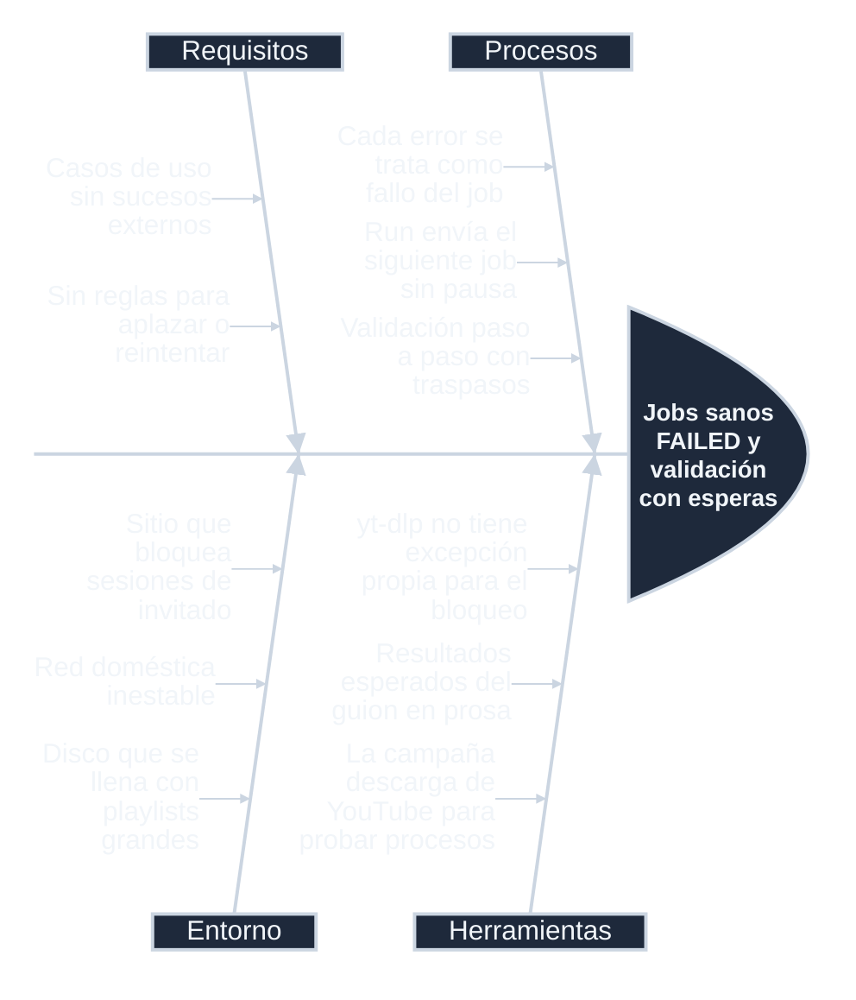
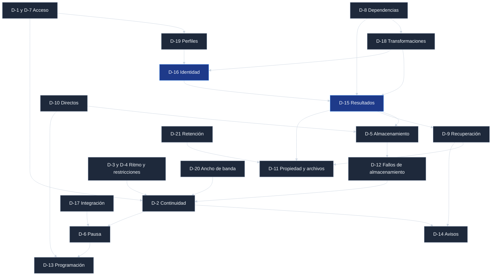
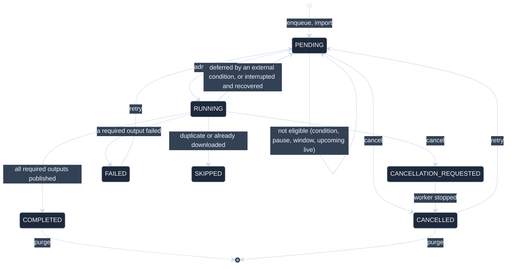

# Análisis de requisitos: continuidad, condiciones externas y referencias

- **Fase RUP:** Elaboración (consolidación del modelo de requisitos tras la campaña T42)
- **Versión:** 4.2 (2026-11-26; descubrimiento de IA, privacidad y modelo comercial, §16, instrucción 2.6.0; D-22 a D-24 resueltas; D-25 a D-28 nuevas). 4.1 (2026-11-26; descubrimiento funcional, §15, instrucción 2.5.0). 4.0 (2026-11-26; alcance de 26 casos de uso aceptado por el Responsable; resolución de D-1 a D-21, §9; contratos, §13.11 a §13.19; impacto en la arquitectura, §14). 3.3: reconciliación de exclusiones y contratos transversales. 3.2 (2026-11-26; condiciones de almacenamiento separadas en UC-17 y análisis del acceso con proxy y cookies). 3.1 (añade YTDownload-2026 y VoiceBlueprintPro). 3.0 (2026-11-26). La versión 2.0 se titulaba «funcionamiento sin vigilancia y validación sin esperas»; esta integra el análisis de los proyectos de referencia en el modelo canónico y deja abiertas las decisiones.
- **Responsabilidad:** razonamiento y evidencia del modelo de requisitos. Los requisitos están en sus artefactos: [modelo de casos de uso](use-case-model.md), [reglas de negocio](business-rules.md), [especificación complementaria](supplementary-specification.md), [catálogo de condiciones de fallo](failure-conditions.md) y [modelo de validación](../process/validation-use-case-model.md).
- **Técnicas (BABOK v3):** ver §5.2.

---

## 1. Necesidad (6.1)

| | |
|---|---|
| **El problema de** | una cola que no reacciona a lo que pasa fuera de ella (el sitio bloquea, falta la red, se llena el disco), y una validación en Windows que depende de esperas y de pasos manuales |
| **afecta a** | el User, que deja la cola trabajando sin vigilarla, y al Evaluador, que valida cada commit en Windows |
| **cuyo impacto es** | jobs sanos marcados `FAILED` en segundos; peticiones a un sitio que ya bloquea; trabajo manual para notar, esperar y reintentar; y, en la campaña, la mitad del tiempo del Evaluador esperando instrucciones (§2.2) |
| **una solución exitosa** | preserva los jobs cuando el sitio o el entorno no responden, no insiste ante quien restringe, informa y continúa según una política decidida; y una validación que ejecuta y comprueba cada bloque sin que el Evaluador espere a nadie |

**Restricción del Responsable (2026-11-26):** no depender de PO Tokens.

## 2. Estado actual (6.1)

### 2.1 Evidencia del producto

| Momento (2026-11-25) | Suceso externo | Respuesta actual de la cola |
|---|---|---|
| 22:24, paso 5.2 | El equipo perdió la resolución de nombres (`getaddrinfo failed`, 11001) | 8 jobs `FAILED` con `NETWORK` en segundos y uno `UNKNOWN` (T42-D7); `run` siguió enviando jobs hasta vaciar la cola |
| 23:27, paso 5.7 | Otro programa retuvo la base de datos | `run` terminaba a mitad de la cola (T42-D12, ya corregido) |
| 23:36, paso 5.7 | YouTube respondió `Sign in to confirm you're not a bot` a toda petición | Cada job falló en 1 o 2 s con `UNAVAILABLE`, gastando su intento |

Entre las 22:23 y las 23:36, los logs de las colas registran 93 extracciones de YouTube (81 videos y 12 playlists), más las 4 pruebas `network`. Es menos que el límite de las sesiones de invitado que documenta yt-dlp (unos 300 videos por hora; página *Extractors* de su wiki). El bloqueo, por tanto, no depende solo del número de peticiones.

### 2.2 Mapa de flujo de valor de la sesión de validación (10.34)

La sesión del Evaluador fue el 2026-11-25, de 22:18 a 23:51 (unos 92 min).
- **De dónde salen los tiempos:** la consola del Evaluador muestra, en cada prompt, la hora y el tiempo transcurrido desde el anterior, con un margen de un minuto. Las esperas son el tiempo entre el último comando de un mensaje del Evaluador y el primero del siguiente; incluyen leer la instrucción y escribirla.
- **Clases:** valor añadido (VA), necesaria para el negocio (BVA) y sin valor añadido (NVA).

| Actividad | Min | Clase | Desperdicio (Lean) |
|---|---|---|---|
| Suites (paso 3) | 11,3 | VA | — |
| Pasos 5.2 a 5.7 con resultados válidos, incluidos los que encontraron T42-D10 y T42-D12 | 25 | VA | — |
| Preparar la ejecución, las colas, la segunda ventana y la evidencia | 5 | BVA | — |
| **Esperar la siguiente instrucción del analista** (9 esperas; la mayor, de 13 min, de 22:52 a 23:05) | **47,5** | NVA | Espera |
| Pasos repetidos por defectos del guion (5.6 sin cola, 5.7, 5.7-r2, `purge`) | 2,5 | NVA | Defectos y reproceso |
| Arranque fallido por un comando incompleto del analista (faltaba `git fetch`) | 0,5 | NVA | Defectos |
| Comprobar a mano si YouTube responde | 0,7 | NVA | Espera |

**Resultado:** un 39 % del tiempo es de valor añadido y un 51 %, espera.
- **El desperdicio dominante** no viene de la red ni del sitio: es el traspaso paso a paso entre el Evaluador y el analista. Cada resultado se pega en la conversación, se interpreta a mano y vuelve como una instrucción nueva.
- **Una dependencia innecesaria:** los pasos 6 a 12 prueban procesos, cierres y archivos, pero descargan de YouTube, así que heredan sus bloqueos y los de la red.

## 3. Causa raíz (10.40)

### 3.1 Espina de pescado

### 3.2 Cinco porqués

| Problema | Porqués | Causa raíz |
|---|---|---|
| Todos los jobs pendientes acaban `FAILED` tras un corte o un bloqueo | 1. `run` envía el siguiente job, que también falla. 2. `run` trata cada error como un fallo del job. 3. La clasificación de fallos solo tiene motivos por job (`FailureReason`); no existe una condición del entorno que comparten todos los jobs. 4. UC-03 A2 modeló los fallos como sucesos de un job. 5. Los casos de uso se identificaron por los objetivos del User, no por los sucesos externos (BABOK 10.47 admite casos de uso iniciados por un suceso externo) | **Faltó la lista de sucesos externos** al identificar los casos de uso |
| El Evaluador espera la mitad de la sesión | 1. Tras cada paso espera la siguiente instrucción. 2. El resultado se interpreta a mano en la conversación. 3. El guion describe los resultados esperados en prosa y nada los comprueba. 4. La campaña se diseñó como un guion manual (ADR-0021: sin CI; comportamientos que solo existen en Windows). 5. La herramienta de validación no se trató como una solución con sus propios casos de uso | **La validación no tiene un oráculo automático**, y sus pasos dependen de YouTube y de la red aunque no los prueben |

## 4. Identificación sistemática de casos de uso

### 4.1 Lista de actores y objetivos

| Actor | Objetivo | Cubierto por | Clasificación |
|---|---|---|---|
| User | Instalar y verificar | UC-01 | Existente; A10 y A11 propuestos |
| User | Saber qué contiene una URL antes de encolarla | — | **UC-15 nuevo** |
| User | Poner contenidos en la cola, con sus opciones | UC-02 | Existente; A5 a A8 propuestos (mismo objetivo) |
| User | Que la cola se descargue sin vigilarla | UC-03, UC-04 | Existente; extendido por UC-11 |
| User | Cancelar, recuperar, reintentar, listar, ver, purgar | UC-05 a UC-10 | Existente |
| User | Dejar libre la conexión o el equipo un rato sin perder la cola | — | **UC-14** (propuesto en la versión 2.0; reformulado por la necesidad) |
| User | Reportar un problema con todo lo necesario | — | **UC-16 nuevo** |
| User | Descargar sin saturar la conexión | — | Requisito no funcional (SUP-P06): una configuración, sin interacción propia |
| User | Usar su cuenta del sitio o un proxy | — | **UC-19** (condicionado a D-1 y D-7) |
| User | Actualizar yt-dlp sin esperar una versión del programa | Procedimiento SUP-S01 | **UC-27** (condicionado a D-8) |
| User | Descargar solo en ciertas horas sin estar presente | — | **UC-21** (revisado en §12: el Programador de tareas no cubre las ventanas) |
| User | Enterarse de los sucesos sin vigilar la consola | — | **UC-28** (revisado en §12) |
| User | Reutilizar preferencias de descarga | — | **UC-18** |
| User | Ver, cambiar y trasladar la configuración | — | **UC-20** |
| User | Trasladar o conservar la cola | — | **UC-22**, **UC-23** |
| User | Obtener solo la información complementaria | — | **UC-24** |
| User | Administrar y verificar lo descargado | — | **UC-25**, **UC-26** |
| Programa cliente | Usar el producto sin interpretar texto | Todos | SUP-I01; canal según D-17 |
| Mantenedor | Actualizar yt-dlp cuando un sitio cambia | Procedimiento SUP-S01 | Proceso de desarrollo |
| Evaluador | Validar un commit en Windows | VUC-01 a VUC-08 | [Modelo de validación](../process/validation-use-case-model.md) |

### 4.2 Lista de sucesos externos y temporales

Cada suceso tiene su fila, con sus atributos, en el [catálogo de condiciones de fallo](failure-conditions.md). Aquí solo se clasifica su destino.

| Suceso | Destino |
|---|---|
| El sitio restringe la sesión (antibots, captcha, límite de peticiones, HTTP 429) | UC-11 A1; BR-01 |
| El equipo pierde la conectividad | UC-11 A2; BR-05 |
| Falla el almacenamiento: espacio, cuota, permisos, carpeta inexistente, unidad ausente, uso compartido | UC-17; BR-08, BR-25 a BR-28 ([catálogo, §3](failure-conditions.md#3-almacenamiento-y-archivos)) |
| Fallo transitorio con un host (5xx, timeout) | UC-03 A15; BR-07 (divergencia R-24) |
| El equipo se suspende | SUP-R08; al despertar, UC-11 A2 |
| Cierre o corte de luz | UC-06 |
| Cierre entre el final de la descarga y el registro | UC-06 A4 y A11 (propuesto); R-25 |
| Otro programa retiene la base de datos | UC-03 A10 (corregido, T42-D12) |
| Un antivirus bloquea un archivo un instante | `file_access_retries` (vigente) |
| El sitio cambia y el extractor falla | UC-03 A3, SUP-S01; D-8 |
| YouTube exige PO Token a los clientes por defecto | R-20; BR-12 |
| Un contenido pide una cuenta | UC-03 A2; UC-11 E2 |
| Una transmisión en directo o programada | UC-03 E1; D-10; R-26 |

### 4.3 Consolidación de los casos de uso propuestos en la versión 2.0

La versión 2.0 propuso UC-11 (esperar a que el sitio levante un bloqueo), UC-12 (esperar a la red), UC-13 (esperar espacio en disco) y UC-14 (pausar y continuar). Sus nombres describían una solución, esperar, y no la necesidad. Las referencias no esperan (§6) y eso tampoco prueba que esperar sea incorrecto: la política es una decisión (D-2).

| Antes | Necesidad | Ahora |
|---|---|---|
| UC-11 Esperar a que el sitio levante un bloqueo | Preservar los jobs ante una restricción externa | UC-11 A1 |
| UC-12 Esperar a la red | Administrar las interrupciones de conectividad | UC-11 A2 |
| UC-13 Esperar espacio en disco | Preservar el trabajo ante fallos de almacenamiento | UC-17 (nuevo identificador) |
| UC-14 Pausar y continuar la cola | Controlar temporalmente la ejecución | UC-14, con detención ordenada (A2) |

UC-12 y UC-13 se retiran y sus identificadores no se reutilizan.

**Revisión del almacenamiento (2026-11-26).** Al consolidar, el almacenamiento quedó como un escenario de UC-11 con una sola regla de espacio mínimo. Esa reducción no se sostiene:
- las condiciones tienen naturalezas distintas: espacio, cuota, permisos, disponibilidad de la unidad y uso compartido. Solo algunas se resuelven esperando; otras requieren una acción del User ([catálogo, §3.1](failure-conditions.md#31-condiciones));
- una comprobación previa no garantiza la descarga: la condición puede aparecer a mitad del job, así que hacen falta escenarios preventivos y reactivos;
- yt-dlp pierde o esconde el error original en varios caminos, y la identificación debe recorrer toda la cadena de causas (§3.2 del catálogo, R-28).

El almacenamiento vuelve a tener su propio caso de uso, UC-17, con identificador nuevo. UC-11 conserva el sitio y la conectividad, y los dos comparten el aplazamiento (BR-04) y la política de continuidad (D-2). Los tres primeros compartían actor, disparador (un suceso externo durante `run`), flujo y garantías; su diferencia es la regla de reconocimiento y el alcance, que BABOK 10.47 modela como escenarios de un mismo caso de uso.

## 5. Referencias analizadas y técnicas

### 5.1 Referencias

Las referencias solo aportan evidencia. No son dependencias del producto, no se modifican y no se copia su código (licencias incompatibles con The Unlicense: Seal es GPL-3.0 y VoiceStudio, AGPL-3.0).

| Proyecto | Versión o commit | Licencia | Alcance analizado | Limitaciones |
|---|---|---|---|---|
| queued-media-downloader | `main` en `14bd247` | Unlicense | Todo el código y los documentos | — |
| yt-dlp | 2026.11.23 (la fijada, sdist en `/tmp/ytdlp-new`); 2026.10.26 en el espacio de análisis | Unlicense | `options.py` y `__init__.py` (valores de la línea de comandos), `YoutubeDL.py` (valores de la librería), `utils/_utils.py` (`RetryManager`), `extractor/youtube/` (clientes, restricciones), `networking/` (proxy, timeouts), `postprocessor/` | Solo el código fuente; no se ejecutó contra sitios reales |
| Seal | `5a4f5fb` (2026-11-25), versionCode 200_000_150 | GPL-3.0 | Descarga, cola (`download/DownloaderV2.kt`), preferencias (`util/PreferenceUtil.kt`, `util/DownloadUtil.kt`), formatos y playlists (`ui/page/downloadv2/configure/`), historial, actualización (`util/UpdateUtil.kt`), cookies, comandos personalizados, errores | Aplicación Android: lo propio de Android (tarjeta SD, red medida) solo se usa como evidencia de la necesidad |
| VoiceStudio | `d9061408` (2026-11-26) | AGPL-3.0 | Importación desde URL (`services/dub_pipeline.py`), cola por lotes (`api/routers/batch.py`), fallos (`core/failure.py`), herramientas de medios, entorno, autodiagnóstico, paquete de diagnóstico, resistencia en Windows, arnés de pruebas | Solo el dominio compartido; el procesamiento de voz e IA queda fuera |
| YTDownload-2026 | `0abda8e` (2026-07-02), 33 commits; yt-dlp 2026.2.4 en su `uv.lock` | **Sin licencia declarada** (todos los derechos reservados): solo se toman ideas | Toda la aplicación: `infrastructure/ytdlp_service.py`, `application/download_coordinator.py`, `application/command_api.py`, modelos (`domain/models/`), CLI (`interfaces/cli/root.py`), herramientas MCP (`infrastructure/mcp/tools/`), `docs/` (guía de descarga de YouTube en 2026: proxy, cuentas, cookies, subtítulos, playlists) | Interfaz gráfica (PySide6) leída solo por sus opciones; documentación en ruso |
| VoiceBlueprintPro | `e9a2a63` (2026-11-22), 89 commits; yt-dlp 2026.8.19 | AGPL-3.0 | Derivado de VoiceStudio (separado el 2026-11-09, según su historial y `NOTICE`). Se comparó, archivo por archivo, con VoiceStudio `d9061408` en el dominio compartido: importación desde URL, fallos, entorno, herramientas de medios, cola por lotes, autodiagnóstico, asistente de instalación (`api/routers/setup/`) | Su canal de importación es una versión anterior a la de VoiceStudio; el resto (voz, IA, móvil) queda fuera del dominio |
| Kannagi (yt-dlp-gui) | Sin Git ni versión declarada, en `upstream/source/yt-dlp-gui-kannagi` | MIT | `Wrappers/DLP.cs`, `Wrappers/FFMPEG.cs`, `ViewModels/Main.cs`, `Models/Config.cs`, `Models/Cookies.cs`, `Views/Release.xaml.cs` | Sin versión: los hallazgos no se pueden fechar |
| FFmpeg | Código: checkout parcial de `master` en `329157f5` (2026-11-22); binarios: n9.0.2-39 LGPL compartido, en `vendor/ffmpeg/` | LGPL | Contratos que usa el producto: unión de video y audio, extracción de audio, `ffprobe` | El checkout solo tiene los registros de códecs y formatos y los Makefiles; los contratos se verificaron con los binarios incluidos y la documentación de yt-dlp |
| BABOK v3 | Copia entregada por el Responsable | IIBA | Capítulos 6, 7 y 10 | — |

### 5.2 Técnicas aplicadas

| Técnica (BABOK v3) | Aporte |
|---|---|
| 10.4 Benchmarking and Market Analysis | §6: cada capacidad de las referencias, con su destino |
| 10.18 Document Analysis | Lectura del código y la documentación de las referencias y de la wiki de yt-dlp |
| 10.22 Functional Decomposition | Inventario de capacidades de cada referencia antes de clasificarlas |
| 10.24 Interface Analysis | §7.1: parámetros de la librería de yt-dlp frente a su línea de comandos |
| 10.9 Business Rules Analysis | Separación de reglas, parámetros y decisiones en el [catálogo](business-rules.md) |
| 10.16 Decision Modelling | §9 |
| 10.40 Root Cause Analysis | §3 |
| 10.34 Process Analysis | §2.2 (mapa de flujo de valor) |
| 10.44 State Modelling | Estados de los jobs ante cada condición ([catálogo de condiciones](failure-conditions.md)) |
| 10.47 Use Cases and Scenarios | UC-11 consolidado, UC-14 a UC-16 y el formato común de los casos de uso |
| 10.30 Non-Functional Requirements Analysis | Especificación complementaria 2.0 |
| 10.38 Risk Analysis | R-24 a R-27 |
| 10.1 Acceptance and Evaluation Criteria | Criterios de aceptación de cada caso de uso |
| 10.33 Prioritization | §8.2 |
| 10.41 Scope Modelling | Exclusiones (§6.3) y [modelo de casos de uso](use-case-model.md) |
| 10.6 Business Capability Analysis | §6: capacidades agrupadas por área |
| 10.21 Glossary | [Vocabulario](../design/00-vocabulary.md), §1.0 |

## 6. Hallazgos de las referencias y su incorporación

Cada hallazgo se cualifica en una sola categoría y tiene un único destino en el modelo canónico. **Estado** describe nuestro producto: vigente, parcial, propuesto, divergente o excluido. Las referencias se citan como S (Seal), V (VoiceStudio), B (VoiceBlueprintPro), D (YTDownload-2026), K (Kannagi), Y (yt-dlp) y F (FFmpeg). Una fila con varias letras es un requisito propio respaldado por varias referencias.

### 6.1 Capacidades del dominio

| Área | Capacidad | Evidencia | Categoría | Destino | Estado |
|---|---|---|---|---|---|
| Cola | Varias descargas a la vez | S: `MAX_CONCURRENCY = 3` en `DownloaderV2.kt`; D: `max_concurrent` = 2 | UC existente | SUP-P01 (`worker_count`) | Vigente |
| Cola | Fallo restartable, sin perder la tarea | S: estado `Error`; V: `retry_batch_job` | UC existente | UC-07 | Vigente |
| Cola | Reintento solo cuando el trabajo ya se detuvo | V: `retry_ready`, `_admit_retry` | Regla | BR-14 (`CANCELLATION_REQUESTED` no es reintentable) | Vigente |
| Cola | Trabajo interrumpido por un reinicio | S: pasa a `Canceled`; V y B: pasan a `failed` (`sweep_orphans_on_startup`); D: la cola vive en memoria y sus registros quedan `queued` o `downloading` para siempre | UC existente | UC-06, BR-19: nosotros reanudamos | Vigente; mejor que las referencias |
| Cola | No borrar archivos de un trabajo activo | V: `delete_batch_job` (#2547) | Regla | BR-17, BR-18 | Vigente |
| Cola | Pausa, detención | S: cancelar y reanudar tareas | UC nuevo | UC-14 | Propuesto (D-6) |
| Consulta | Información y formatos antes de descargar | S: `fetchInfo`, `FormatPage.kt`; K: Analyze; D: `fetch_info` y el «modo A» de su guía (primero metadatos, después descarga); Y: `-F`, `--dump-json` | UC nuevo | UC-15 | Propuesto |
| Consulta | Elegir entradas de una playlist | S: `PlaylistSelectionPage.kt`; D: guía, §8 («solo 1–20», «5, 7, 9»); Y: `--playlist-items` | Flujo alternativo | UC-02 A6, UC-04 A8 | Propuesto |
| Opciones | Recortar un tramo | S: recortes; K, Y: `--download-sections` | Flujo alternativo | UC-02 A8 | Propuesto, prioridad baja |
| Opciones | Subtítulos, miniatura, metadatos, capítulos | S: `DownloadUtil.kt`; K: incrustar subtítulos, miniatura y capítulos; D: archivos al lado del video (`.info.json`, `.description`, miniatura, subtítulos por idioma, incluidos los automáticos), activados por omisión | Pendiente de cualificación | UC-02 A7 | Pendiente |
| Opciones | Extraer audio y convertirlo | S, K, D, Y: `FFmpegExtractAudio` | UC existente | UC-02 `--audio-only` | Vigente |
| Opciones | Calidad por preajuste (mejor, 1080p, 720p, 480p, 360p, solo audio) | D: `QualityOption` y `_build_format_string`; S y K: selector de calidad | Flujo alternativo | UC-02 A9 | Propuesto |
| Opciones | Opciones por job sobre los valores globales | D: `DownloadCoordinator.add` | UC existente | UC-02: las download options se fijan al encolar | Vigente |
| Opciones | Unir a otro contenedor (mkv) | S, K: remux | Flujo alternativo | UC-02 A14, UC-03 A19 | Propuesto (revisado en §12) |
| Opciones | SponsorBlock, partir por capítulos, `parse-metadata` | S | Flujo alternativo | UC-02 A7, A10 y A11; UC-03 A17 y A18 | Propuesto (revisado en §12) |
| Opciones | Plantillas de comandos personalizados | S: plantillas y su log | Nuevo UC (la necesidad); exclusión (ejecutar comandos) | UC-18 | Propuesto (revisado en §12) |
| Archivos | Plantilla de salida y subcarpetas por playlist | S, K, D (carpeta por playlist y por video, índice con tres cifras), Y | UC existente | UC-03 (plantilla determinista), carpeta de la playlist | Vigente |
| Archivos | Nombres seguros y recortados | S: `restrict-filenames`; Y: `trim_file_name` | UC existente | `max_filename_length` | Vigente |
| Archivos | Archivo de descargas (`--download-archive`) | S: `DOWNLOAD_ARCHIVE` | Decisión arquitectónica | ADR-0012: duplicados por media key | Excluido por ADR |
| Archivos | Fecha del archivo | K: modificada, de subida o de creación; V: desactiva `updatetime` (#642) | Capacidad técnica | Y 2026.11.23 la desactiva por defecto | Vigente (sin cambio de fecha) |
| Archivos | Comprobación previa del destino | V: `ingest_pipeline` (#1225) | Flujo alternativo | UC-17 pasos 2 y 3, A1 a A3; UC-01 A10; BR-28 | Propuesto |
| Archivos | Borrar el registro con su archivo | S: historial; V: `delete_batch_job`; D: `delete_download` con vista previa y confirmación, pero borra la carpeta de salida entera con `shutil.rmtree` | Flujo alternativo | UC-10 A5 | Propuesto (D-11) |
| Fallos | Taxonomía con indicación de si reintentar sirve | V: `core/failure.py` (`_HINTS`) | Requisito suplementario | SUP-U05; catálogo de condiciones | Propuesto |
| Fallos | Antibots nunca se reintenta | V: `test_yt_bot_check_2034.py` | Regla | BR-01, BR-03 | Propuesto |
| Fallos | Límite de peticiones y captcha | V no los reconoce; Y: `raise_no_formats(expected=True)` | Regla | BR-01 (los incluye) | Propuesto |
| Fallos | Disco lleno por `errno` o `winerror` en toda la cadena | V y B: `is_disk_full_error` (`__cause__`, `__context__`); Y: los cinco caminos del [catálogo, §3.2](failure-conditions.md#32-cómo-llega-la-información-la-cadena-de-causas) | Regla | BR-08, BR-25 | Propuesto; hoy divergente (R-28) |
| Fallos | Reintentos de red propios (2, a 2 y 4 s) | V y B: `yt_download_sync` | Capacidad técnica | BR-07: se delega en yt-dlp | Sustituido |
| Fallos | Cambiar de cliente de YouTube ante 403 o DRM | V: `_YT_PLAYER_CLIENTS` | Exclusión | §6.3 | Excluido |
| Fallos | Regresión con el texto literal reportado | V: pruebas con los dos apóstrofos | Capacidad de validación | SUP-V03 | Propuesto |
| Red | Proxy (configurado o del sistema) | S, K, D: opción `proxy`; V y B: `core/user_env.py`; D, guía §2: recomienda el proxy del sistema y una salida estable, porque rotar la IP rompe sesiones y reanudaciones; Y: `getproxies()` si no se configura | Decisión | D-7; UC-01 A11 | Pendiente (Y ya usa el del sistema) |
| Red | Cookies | S: perfiles por WebView; K: modos con detección por expresión; V y B: `cookies.txt` efímero (0600, ≤1 MB, borrado al terminar); D, guía §3 y §4: cuenta técnica separada, `cookies-from-browser`, misma IP para la sesión y la descarga, cookies tratadas como contraseñas | Decisión | D-1; BR-12 | Pendiente |
| Red | Forzar IPv4, agente de usuario | S | Elemento de configuración (IPv4); exclusión (agente) | UC-20 A7 | Propuesto (revisado en §12) |
| Red | Límite de ancho de banda | S, K, Y: `ratelimit`; D, guía §12: ante la limitación de velocidad del sitio | Requisito suplementario | SUP-P06 | Propuesto |
| Red | Fragmentos concurrentes, aria2c | S, K | Requisito suplementario (fragmentos); tecnología excluida (aria2c) | SUP-P09 | Propuesto (revisado en §12) |
| Red | No descargar en una red medida | S: `CELLULAR_DOWNLOAD`, `isActiveNetworkMetered` | Flujo alternativo | UC-21 A9 | Propuesto (revisado en §12) |
| Red | Ritmo de peticiones | Y: preajuste `-t sleep`; D, guía §8 y §12: pausa entre entradas de una playlist y poca concurrencia | Regla | BR-02 | Propuesto (D-3) |
| Herramientas | ffmpeg con SHA-256 | V: `acquire_bundled`; nosotros: `SOURCE.md` | UC existente | UC-01 A5 | Vigente |
| Herramientas | ffmpeg propio o del sistema | V: `set_custom_path`, `use_system`; K: rutas | UC existente | UC-01 A4, `ffmpeg_path` | Vigente |
| Herramientas | Actualizar yt-dlp desde el programa, y volver a la versión probada | S: canales y periodicidad (`UpdateUtil.kt`); V: capa desde PyPI y «Restore tested version»; K: comprobación diaria | Nuevo UC | UC-27 | Condicionado a D-8 |
| Diagnóstico | Autodiagnóstico ok, aviso o fallo | V: `core/diagnose.py`; B: comprobaciones del asistente de instalación (`api/routers/setup/wizard.py`) | UC existente | UC-01 (`diagnose`), A9 a A11 | Vigente y propuesto |
| Diagnóstico | Paquete de diagnóstico limpio de datos sensibles | V: `core/diagnostic_bundle.py`; S: informe de error | UC nuevo | UC-16, SUP-SEC01, SUP-O03 | Propuesto |
| Diagnóstico | Modo detallado (`-v`) | S | Elemento de configuración | El log ya registra los mensajes de yt-dlp | Vigente |
| Historial | Exportar e importar el historial; modo privado | S | Nuevo UC; flujo alternativo | UC-22; UC-10 A6 | Propuesto (revisado en §12) |
| Windows | Árbol de procesos con Job Object | V: `contained_subprocess.py` | UC existente | SUP-R02, ADR-0013 | Vigente |
| Windows | Vigilancia del proceso padre | V: `parent_liveness.py` | Capacidad técnica | ADR-0013 (`KILL_ON_JOB_CLOSE`) | Vigente |
| Windows | Sin ventanas de consola | V: `CREATE_NO_WINDOW` | Capacidad técnica | Programa de consola; los workers son del mismo proceso | No aplica |
| Windows | yt-dlp sin depender de stdout ni stderr | V: `test_dub_download_stdio.py` | UC existente | `noprogress`, `logger` | Vigente |
| Windows | Archivo bloqueado un instante | V: `fs_retry.py` (~4 s); Y: `wrap_file_access` reintenta `EACCES`, que en Windows reúne los errores 5, 32 y 33 | UC existente | `file_access_retries`; BR-26, UC-17 A6 | Vigente; al agotarse, `UNKNOWN` (R-28) |
| Validación | Separar a quien actúa de quien juzga | V: `tests/probe` («No LLM ever sits on the verdict path») | Capacidad de validación | VBR-04, SUP-V02 | Propuesto |
| Directos | Transmisiones en directo | Y: `is_live`, `wait_for_video` | Excepción | UC-03 E1 | Sin cualificar (D-10) |
| Integridad | Verificar el archivo final | F: `ffprobe`; ninguna referencia lo hace tras descargar | Regla | BR-23, UC-06 A11 | Propuesto (D-9) |
| Integridad | Identificar los archivos de un job buscando la carpeta más reciente | D: `_find_newest_folder`, `_scan_folder` | Regla (evidencia en contra) | BR-17: un job solo reconoce los archivos que reclamó; buscar por fecha puede tomar archivos ajenos | Vigente |
| Integridad | Una cancelación nunca se registra como descarga completada | D: tras `cancel`, `download` devuelve un resultado vacío y el coordinador marca el registro `done` | Regla (evidencia en contra) | UC-05 y el contrato de `JobCompleted` (UC-03 A8): sin archivo final, nunca `COMPLETED` | Vigente |
| Consulta | Salida JSON de `list` y `show` | D: `history list --format json`, `--json` global | Flujo alternativo | UC-08 A5, UC-09 A5 | Propuesto |
| Consulta | Buscar en la cola por título o URL | D: `search_downloads`; S: historial | Flujo alternativo | UC-08 A6 | Propuesto, prioridad baja |
| Integración | Servidor MCP para agentes, lectura de transcripciones y descripciones | D: `infrastructure/mcp/`, 10 herramientas | Requisito suplementario e interfaz diferida; nuevo UC (obtener la información) | SUP-I01, D-17; UC-24 | Propuesto (revisado en §12) |
| Seguridad | Archivo de credenciales creado ya con permisos restringidos | B: `core/user_env.py` (`_opener_0600`) | Requisito suplementario | SUP-SEC03 | Propuesto (condicionado a D-1 y D-7) |
| Archivos | Espacio libre de una carpeta que aún no existe | B: `disk_free_bytes` sube al antecesor existente | Regla | BR-28; UC-01 A10, UC-17 | Propuesto |
| Fallos | Volumen no confiable (`winerror` 448), bloqueo prolongado por sincronización | V y B: `WINDOWS_UNTRUSTED_MOUNT`, `VIDEO_DOWNLOAD_OS_ERROR` | Flujo alternativo | UC-17 A3 y A6; BR-26, BR-27 | Propuesto |
| Validación | Pruebas sin red separadas de las comprobaciones reales, que siguen pendientes hasta ejecutarse | D: `smoke_*.py` frente a «opt-in real validation gates»; marca `e2e` | Capacidad de validación | Clasificación de las pruebas ([plan de E2, §8.2](../project-management/iteration-plan-e2.md#82-clasificación-de-las-pruebas-2026-11-26-main-tras-la-actualización-de-yt-dlp)), VBR-02 | Vigente |

### 6.2 Lo que tenemos y las referencias no

- Una cola persistente que reanuda desde los parciales tras un cierre (S, V y B marcan los trabajos como cancelados o fallidos; D los pierde).
- Playlists y canales con extracción plana y duplicados por media key (V y B no admiten playlists; D descarga una playlist entera como un solo trabajo).
- Propiedad de los nombres finales con reclamaciones (ADR-0030).
- yt-dlp fijado con pruebas de contrato, y deno con yt-dlp-ejs incluidos (V y B usan `ejs:github` sin declarar un runtime de JavaScript; D no declara ninguno).
- El límite de peticiones y el captcha reconocidos como restricción del sitio (propuesto).

### 6.3 Exclusiones

El inventario completo de exclusiones, con su cualificación, está en §12.

## 7. Continuidad, reintentos y recuperación

### 7.1 yt-dlp: línea de comandos, librería y nuestro producto

La línea de comandos de yt-dlp fija valores que la librería no fija. Como el producto usa la librería, hereda los valores de la librería, no los de la línea de comandos.

| Parámetro | Línea de comandos | Librería | Nuestro producto | Efectivo hoy |
|---|---|---|---|---|
| `retries` (HTTP) | 10 (`options.py`) | Sin valor; `RetryManager` lo convierte en 0 | No se pasa | **0** (divergencia, R-24) |
| `fragment_retries` | 10 | Sin valor (0) | No se pasa | **0** (divergencia, R-24) |
| `extractor_retries` | 3 | 3 (`get_param('extractor_retries', 3)`) | No se pasa | 3 |
| `file_access_retries` | 3 | 3 | 10 | 10 |
| `socket_timeout` | 20 s | 20 s (`DEFAULT_TIMEOUT`) | No se pasa | 20 s |
| `retry_sleep_functions` | Sin espera | Sin espera | No se pasa | Sin espera |
| `sleep_interval`, `sleep_interval_requests` | 0; preajuste `-t sleep`: 10 a 20 s y 0,75 s | 0 | No se pasa | 0 |
| `ratelimit` | Sin límite | Sin límite | No se pasa | Sin límite |
| `proxy` | Sin valor: proxy del sistema | Sin valor: `urllib.request.getproxies()` (variables de entorno y registro de Windows) | No se pasa | Proxy del sistema |
| `continuedl` | Activo | Activo | Activo | Activo |
| `updatetime` | Inactivo (`--no-mtime`) | Inactivo | No se pasa | Inactivo |

Las referencias que usan la librería pasan los reintentos de forma explícita: V y B, 10 y 10; D, 5 y 5. Evidencia en la campaña T42: el job 11 falló con `[download] Got error` sin «Giving up after»; con la línea de comandos habría reintentado hasta 10 veces.

### 7.2 Responsabilidades

| Concepto | Responsable | Estado |
|---|---|---|
| Reintento de una petición o un fragmento | yt-dlp (BR-07) | Divergente |
| Reintento del job | Cola, a petición del User (UC-07) | Vigente |
| Espera creciente entre reintentos | yt-dlp dentro del job; la cola entre comprobaciones de una restricción (BR-03) | Pendiente (D-2, D-4) |
| Ritmo de peticiones | yt-dlp dentro de una extracción; la cola entre jobs (BR-02) | Propuesto (D-3) |
| Aplazamiento y control de admisión | Cola (BR-04, BR-09, BR-28; UC-11, UC-17) | Propuesto |
| Pausa, continuación y detención | Cola (UC-14) | Propuesto (D-6) |
| Recuperación tras un cierre | Cola (UC-06, BR-19) | Vigente; A11 propuesto (D-9) |
| Reanudar una descarga desde sus parciales | yt-dlp (`continuedl`) | Vigente |

### 7.3 Política de continuidad ante una condición externa

Ninguna referencia espera un plazo largo: Seal y VoiceStudio fallan el trabajo e informan; Kannagi repite con cookies. Eso indica lo que hacen, no que esperar sea incorrecto. Las alternativas están en D-2.

### 7.4 Acceso: proxy y cookies en una cola persistente

Ninguna decisión está tomada (D-1, D-7). Esta sección separa las necesidades de las soluciones, porque en una cola persistente la configuración de acceso vive más que un comando: se encola hoy y se descarga mañana, en varios workers a la vez y tras un cierre.

**Necesidades distintas que suelen mezclarse:**

| Necesidad | Qué resuelve | Qué no resuelve |
|---|---|---|
| Compatibilidad con la red del sistema | El equipo solo sale por un proxy o una VPN configurados en Windows | Una restricción del sitio |
| Proxy explícito | Una salida distinta de la del sistema, o la del sistema no se detecta | Igual |
| Conexión directa | Ignorar un proxy del sistema que no sirve para el sitio (`proxy: ""` en yt-dlp) | — |
| Acceso autorizado con cuenta | Contenido privado, con restricción de edad o solo para miembros, cuando el User tiene derecho a verlo | No es un medio para saltar una restricción del sitio (BR-12) |
| Diagnóstico de conectividad | Saber si falla la red, el proxy o el TLS interceptado | — |

**Comportamiento de las referencias y de yt-dlp:**

| Fuente | Proxy | Cookies |
|---|---|---|
| yt-dlp 2026.11.23 | `proxy` global de la instancia; sin valor, `urllib.request.getproxies()` (variables de entorno y registro de Windows); `""` fuerza conexión directa; `geo_verification_proxy` aparte | `cookiefile` se lee al crear la instancia y **se reescribe al cerrarla** (`YoutubeDL.save_cookies`); `cookiesfrombrowser` lee la base del navegador en cada instancia. En Windows, Chrome y Edge cifran las cookies con un esquema (`v20`) que `cookies.py` no descifra, y la base no se puede copiar con el navegador abierto (aviso que enlaza el issue #7271); Firefox no tiene esa limitación |
| Seal | Opción global | Perfiles por sitio capturados con WebView |
| Kannagi | Opción global | Modos «cuando haga falta», «preguntar», «siempre», «nunca»; repite con `--cookies-from-browser` al detectar «sign» y «confirm» |
| VoiceStudio, VoiceBlueprintPro | Variables del archivo de entorno del usuario, con diagnóstico de SOCKS sin soporte y de TLS interceptado | `cookies.txt` por importación: formato Netscape, como mucho 1 MB, copia temporal con permisos 0600 borrada al terminar, al fallar o al cancelar |
| YTDownload-2026 | Opción global; su guía recomienda el proxy del sistema y una salida estable | Su guía recomienda una cuenta técnica, `cookies-from-browser` y la misma IP para la sesión y la descarga |

**Dimensiones en una cola persistente:**

| Dimensión | Proxy | Cookies |
|---|---|---|
| Alcance | Global (todas las descargas) o por sitio; por job solo si hay una necesidad real | Por sitio: las cookies de un sitio nunca se envían a otro (yt-dlp ya las filtra por dominio) |
| Configuración por job | Guardar el proxy en las download options lo fijaría a jobs que pueden ejecutarse días después con otra red; se prefiere resolverlo al enviar el job | Igual: el job guarda, como mucho, que necesita acceso con cuenta, nunca las cookies |
| Persistencia | En la configuración (`config.toml` o variable de entorno), no en la base de datos | Archivo del User fuera de la base de datos; nunca copiado a la cola |
| Caducidad | No caduca | Las sesiones caducan y el sitio las rota: un job aplazado puede encontrarlas caducadas al continuar |
| Concurrencia | Sin efecto | yt-dlp reescribe `cookiefile` al cerrar cada instancia: con varios workers, el último en cerrar gana y puede perder cookies renovadas. Necesita una copia por worker o por job, de solo lectura para el original |
| Recuperación | Sin efecto | Tras un cierre, una copia temporal puede quedar en disco: se borra al arrancar (UC-06) |
| Aislamiento | — | Copia temporal por worker en la carpeta del estado, borrada al terminar el job (como VoiceStudio) |
| Información sensible | La URL del proxy puede llevar usuario y contraseña | Las cookies equivalen a una contraseña |
| Exclusión de logs y evidencia | En modo detallado, yt-dlp escribe el mapa de proxies (`Proxy map`, `YoutubeDL.print_debug_header`): el log debe ocultar las credenciales (SUP-SEC01) | Nunca en el log, `diagnose`, el informe (UC-16) ni la evidencia (SUP-SEC01); archivo restringido al usuario (SUP-SEC03) |
| Ciclo de vida | Se lee al enviar cada job | Importar o señalar el archivo; copiar por job; borrar la copia; avisar de caducidad cuando el sitio pide iniciar sesión otra vez |
| Diagnóstico | `diagnose` dice si hay proxy y de dónde viene, sin credenciales (UC-01 A11) | `diagnose` dice si hay cookies configuradas y para qué sitios, nunca su contenido |

**Conclusiones para las decisiones (sin aprobarlas):**
- El proxy del sistema ya funciona sin hacer nada (yt-dlp lo usa); lo que falta es verlo en `diagnose` y ocultar sus credenciales.
- `cookies-from-browser` es poco fiable en el destino del producto (Windows con Chrome o Edge), y el modo «repetir con cookies al ver el error» de Kannagi convierte las cookies en un medio para saltar una restricción, contrario a BR-12.
- Si se adoptan cookies, la forma compatible con una cola persistente es un archivo explícito del User, por sitio, copiado por job y nunca reescrito.

## 8. Estado futuro, prioridad y verificación

### 8.1 Brechas

| Brecha | Estado futuro | Medida de éxito |
|---|---|---|
| Fallos en cadena ante condiciones externas | UC-11 | Ningún job `FAILED` por una condición externa; ningún `retry` manual tras ella |
| Peticiones a un sitio que restringe | BR-02, BR-03 | Ninguna petición al sitio fuera de lo que permite la política |
| 0 reintentos HTTP y de fragmentos | BR-07 | Paridad con la línea de comandos de yt-dlp (SUP-R11) |
| Recuperación que depende del sitio | UC-06 A11 | Un job con evidencia local suficiente se completa sin peticiones |
| Esperas del Evaluador | VUC-04, VUC-08 | Espera por debajo del 10 % de la sesión |
| Pasos de la campaña que dependen de YouTube sin probarlo | VUC-05 | Los pasos 6 a 12 pasan sin red externa |

### 8.2 Prioridad (10.33)

| Prioridad | Elementos |
|---|---|
| **Alta** | UC-11, BR-07 (paridad de reintentos), VUC-04, VUC-05 |
| **Media** | UC-17, UC-06 A11, UC-15, UC-02 A6 y A9, UC-08 A5, UC-09 A5, SUP-R08, SUP-U05, VUC-06 a VUC-08 |
| **Baja** | UC-14, UC-16, UC-23, UC-28, UC-02 A5 y A8, UC-08 A6, UC-10 A5 y A6, UC-20 A7, UC-21 A9, UC-24 A7 y A8 |
| **Media (reconciliación)** | UC-18, UC-20, UC-21, UC-22, UC-24, UC-25, UC-26, UC-02 A7, A10, A11 y A14, UC-15 A5, SUP-I01, SUP-P06, SUP-P09 |
| **Condicionados** | UC-19 (D-1, D-7), UC-27 (D-8), UC-28 (D-14), SUP-M01 (D-18) |
| **Pendiente de cualificación** | UC-02 A7, el candidato «Actualizar yt-dlp» (D-8) |

### 8.3 Verificación de los requisitos (7.2)

| Característica | Cómo se cumple |
|---|---|
| Atómicos | Un caso de uso por objetivo; una directiva por regla; un valor por parámetro |
| Completos | Todos los casos de uso tienen los campos comunes ([modelo, §2](use-case-model.md)); la matriz del §5 del modelo cuenta los flujos |
| Consistentes | Una sola autoridad por concepto: reglas en el catálogo, condiciones en su catálogo, términos en el vocabulario |
| Factibles | Cada regla se apoya en una capacidad comprobada de yt-dlp 2026.11.23 o de la biblioteca estándar |
| Comprobables | Cada caso de uso tiene criterios de aceptación y escenarios de prueba; cada requisito suplementario, un criterio |
| Priorizados | §8.2 |

## 9. Decisiones

**Disposición del Responsable (2026-11-26, instrucción 2.2.0):**
- se aceptan los 26 casos de uso;
- se aprueban las resoluciones funcionales de D-1 a D-20.

Cada decisión separa la resolución funcional (qué debe hacer el producto, ya aprobado) de la cualificación técnica (cómo, con qué evidencia).

**Estados técnicos:**
- **Cualificada:** evidencia suficiente para la solución.
- **Recomendada con evidencia:** hay una alternativa preferida y la evidencia que la apoya, con alguna limitación.
- **Condicionada:** depende de otra decisión o de una condición externa.
- **Pendiente de medición.**
- **Pendiente de Windows:** solo se demuestra en la plataforma objetivo.
- **Pendiente por evidencia insuficiente.**
- **Pendiente de decisión excepcional del Responsable.**

**Fuentes de la evidencia:**
- los experimentos de cualificación ([resultados](../notes/experiments/requirements-qualification.md));
- la inspección del código de yt-dlp 2026.11.23 y del producto en `7dc9842`;
- las referencias del §5.1.

La relación entre decisiones está en el §13.10.

### 9.1 Resolución

| Decisión | Resolución funcional (aprobada) | Alternativa técnica recomendada | Evidencia | Estado técnico | UC afectados | Condición pendiente |
|---|---|---|---|---|---|---|
| D-15 Resultados | Cero, uno o N resultados por job; lo pedido es obligatorio salvo que se marque opcional; completar exige todos los obligatorios | Job con N resultados registrados (tipo, obligatoriedad, estado, ruta, reclamación y evidencia de publicación); `output_path` se conserva como resultado principal por compatibilidad | Inspección de `Job`, `JobCompleted`, `output_claims` y de la migración 0003 (§13.1) | Recomendada con evidencia | 03, 05, 06, 07, 09, 10, 24, 25, 26 | Diseño del esquema en Analysis and Design |
| D-16 Identidad | Separar la identidad del contenido de la del resultado pedido; las variantes son legítimas | Identidad de la petición = media key + especificación normalizada del resultado, con versión del algoritmo de identidad; «ya descargado» como `SKIPPED` informativo | Inspección de `has_active_download` y de la migración 0002 (§13.2) | Recomendada con evidencia | 02, 03, 18, 22, 23, 24 | La equivalencia de selectores solo es sintáctica |
| D-18 Transformaciones | Las transformaciones ligadas a la obtención, sin editor general | Postprocessors de yt-dlp y ffmpeg incluido (§13.3, §13.4) | Inspección de yt-dlp; configuración de la build | Recomendada con evidencia; recodificar a H.264 o HEVC: necesidad conservada, distribución de codificadores **no aprobada**; R-29 abierto (disposición 2.3.0) | 02, 03, 15 | `ffmpeg -encoders` en Windows; patentes |
| D-19 Perfiles | Las preferencias que determinan el resultado se fijan al encolar | Copiar en el job las opciones de resultado; referenciar el acceso por un **id estable** del perfil (no por su nombre visible, revisión 2.3.0) y resolverlo al enviar | Las download options ya se fijan al encolar (UC-02; pruebas de `enqueue`) | **Cualificada** | 02, 18, 19, 20 | — |
| D-9 Recuperación | Recuperación local primero | Evidencia por resultado: registro, reclamación con owner token, publicación y comprobación estructural con ffprobe frente a lo esperado registrado antes de publicar | ADR-0030; recorrido de las fronteras de interrupción (§13.11) | Recomendada con evidencia | 06, 07, 23, 26 | Registrar la expectativa (duración, streams) antes de publicar |
| D-11 Purga y archivos | Registros y archivos separados; borrar es explícito y autorizado | Nivel de evidencia por operación (§13.12); registrar tamaño, fecha y, opcionalmente, hash al publicar | ADR-0030; YTDownload-2026 como antiejemplo | Recomendada con evidencia | 10, 25 | Coste del hash: pendiente de medición |
| D-5 Almacenamiento preventivo | Comprobación adaptativa, sin un límite fijo | Estimar con `filesize` o `filesize_approx`, más el espacio reservado por los jobs activos de la unidad y la medición sobre el antecesor existente | yt-dlp suma `filesize_approx` de los formatos unidos y la estima por `tbr` × duración (`YoutubeDL.py`) | **Pendiente de medición** (factor de unión, margen) y **de Windows** (cuotas en `shutil.disk_usage`) | 01, 17 | SUP-P07 |
| D-12 Fallos de almacenamiento | Clasificar por causa, alcance, temporalidad y recuperabilidad | Ampliar el clasificador existente con el recorrido de la cadena (BR-25), y usar el texto solo como último recurso | Experimento `cause_chain`: 3 de 5 caminos recuperan el `errno`; 2 solo tienen texto | Recomendada con evidencia; traducción de `winerror` **pendiente de Windows** | 03, 11, 17 | Prueba `windows` de los códigos |
| D-1 Cookies | Archivo de cookies del User, perfiles, selección por job y por sitio, validación, renovación y caducidad | `cookiefile` de yt-dlp con una copia por job (yt-dlp reescribe el archivo al cerrar) en la carpeta de estado, restringida al usuario y limpiada al arrancar | `YoutubeDL.save_cookies`; VoiceStudio | Recomendada con evidencia; ACL en Windows **pendiente de Windows**; cookies del navegador **condicionada** | 02, 19 | Cifrado `v20` de Chrome y Edge |
| D-7 Proxy | Modos sistema, directo y explícito | Sistema: sin `proxy`; directo: `proxy=""`; explícito: `proxy=URL`. Enmascarar las credenciales en el origen (logger y mensajes) | `YoutubeDL.proxies` (`__noproxy__`, `getproxies()`) | **Cualificada** (modos); enmascarado recomendado | 01, 19, 20, 16 | SOCKS con el gestor `requests`: sin comprobar |
| D-2 Continuidad | Continuidad selectiva y política configurable cuando nada es elegible | Admisión en `run` por alcance (job, sitio, recurso, sistema); el aplazamiento deja el job `PENDING` con su condición; ningún estado nuevo; política `wait(límite)` o `stop` | `run_queue`, `get_next_pending`, `--keep-waiting` | Recomendada con evidencia; límites **pendientes de medición** | 03, 04, 11, 14, 17, 21 | Valores de espera |
| D-3 Ritmo | Capacidades nativas de yt-dlp; sin un intervalo universal | Reintentos con los valores de la línea de comandos (corrige R-24); ritmo por sitio en la admisión de `run`; `sleep_interval_requests` dentro de la extracción | Experimento `retries`: 0 reintentos → `FAILED` a la primera; 10 → completa | **Cualificada** (R-24); valores de ritmo **pendientes de medición** | 03, 11, 15 | Ritmo por sitio |
| D-4 Restricciones temporales | Política limitada, configurable y según la condición | Respetar `Retry-After`, leído del `HTTPError` en la cadena (yt-dlp no lo usa); un 403 no se considera temporal por defecto | No hay ninguna referencia a `Retry-After` en yt-dlp; `HTTPError.response` | Recomendada con evidencia; valores **pendientes de medición** | 03, 11 | Plazos |
| D-6 Pausa | Pausa gradual e inmediata recuperable; reanudar, cancelar, detener y reintentar distintos | Job requests de cola en la bandeja existente; pausa inmediata con la interrupción existente (UC-05 A6); la intención de pausa persiste en SQLite | Bandeja de job requests; árbol de procesos (ADR-0029) | Recomendada con evidencia | 05, 14, 21 | Pausa en una base de datos restaurada (§13.13) |
| D-13 Programación | Capacidad propia: inicio único, recurrencia, ventanas, recuperación tras reiniciar y ejecuciones omitidas | Programación guardada en el estado; `run` evalúa las ventanas (admisión); para arrancar sin `run` activo, una tarea propia del Programador de tareas (`schtasks.exe`, incluido en Windows); sin servicio residente | `run --keep-waiting`; Windows | Recomendada con evidencia; **pendiente de Windows** | 21 | Suspensión e hibernación |
| D-20 Ancho de banda | Límite individual y global configurable | Global repartido por `run` al enviar cada job; límite por job dividido entre los fragmentos concurrentes | `ratelimit` se lee en cada bloque y por transferencia; los descargadores de fragmentos reciben una copia de los parámetros (`fragment.py`) | Recomendada con evidencia (inspección); agregado real **pendiente de medición** | 03, 21 | Medir N fragmentos frente al límite |
| D-8 Dependencias | Administración controlada, verificable y reversible | Consultar y diagnosticar (UC-01); adoptar versiones cualificadas del repositorio (`uv.lock`); candidata en un entorno aislado; ningún cambio con jobs activos | ADR-0002, SUP-S01, procedimiento de actualización | Recomendada; candidata **condicionada** | 01, 27 | Procedencia de las candidatas |
| D-10 Directos | Directos y programados dentro del alcance | Programado (`live_status == "is_upcoming"`, `release_timestamp`): la cola lo aplaza hasta su hora, sin `wait_for_video` en un worker. Activo: yt-dlp, con duración máxima configurable | `YoutubeDL.py` (`wait_for_video` espera dentro del proceso) | Recomendada con evidencia; recursos **pendientes de medición** | 03, 11, 14, 17, 21 | Reanudación de directos |
| D-14 Avisos | Avisos configurables de los sucesos operativos | Registro de sucesos JSON (biblioteca estándar) y resumen; la notificación de Windows necesita una dependencia o PowerShell | La biblioteca estándar no tiene API de notificaciones | Registro **cualificado**; notificación de Windows **pendiente por evidencia insuficiente** | 20, 28 | Dependencia para las notificaciones |
| D-17 Integración | Requisito transversal; CLI primero; lógica reutilizable sin `argparse` | Contrato JSON versionado y errores estructurados; API Python = los módulos de caso de uso de ADR-0017 cuando sean estables; modelo de confianza por interfaz (§13.7) | ADR-0001, ADR-0017; `job_queue/*` ya separados de `command_line` | Recomendada con evidencia; ampliada en Analysis and Design ([Parte 3, §5](../design/03-target-architecture-and-evolution.md#5-contratos-públicos-evolución-de-d-17), ADR-0032) | Todos | Esquemas del contrato |
| D-21 Retención y privacidad (nueva) | Retención diferenciada y configurable por naturaleza del dato, sin plazo universal (disposición del Responsable, instrucción 2.3.0, §52) | Retención por clase de dato (§13.14): purga del historial configurable, rotación de logs vigente, exportaciones y respaldos sin secretos | `log_file.py`, UC-10, BR-34 | Recomendada; política funcional **aprobada**; plazos configurables **pendientes de medición** | 10, 20, 22, 23 | Plazos de retención |

**Conteo:**
- **Resoluciones funcionales:** 21 resueltas, 20 de ellas aprobadas por el Responsable; D-21 tiene una necesidad aprobada y sus valores, pendientes.
- **Estado técnico:**
  - cualificadas por completo: 2 (D-7 en los modos, D-19); cualificadas en parte: D-3 (R-24) y D-14 (registro);
  - con alternativa recomendada: las 21;
  - dependen de mediciones: 8 (D-2, D-3, D-4, D-5, D-10, D-11, D-20, D-21);
  - dependen de Windows: 5 (D-1, D-5, D-12, D-13, D-18);
  - necesitan evidencia adicional: 2 (D-14, D-7 con SOCKS);
  - contradicciones: 1, resuelta (§13.16);
  - cuestiones excepcionales: 2, con disposición del Responsable (instrucción 2.3.0): R-29 en D-18 (necesidad funcional conservada; distribución universal de codificadores no aprobada; sigue abierto en lo técnico y lo jurídico) y D-21 (política funcional aprobada; plazos pendientes de medición).
- **Reconciliación multiplataforma** (Windows, Android, iOS): [diseño, Parte 3, §14](../design/03-target-architecture-and-evolution.md#14-reconciliación-de-d-1-a-d-21).
- **Consecuencias de la arquitectura de ejecución** ([ADR-0034](../notes/adr-0034-single-coordinator-and-isolated-execution.md)): [diseño, Parte 3, §16.18](../design/03-target-architecture-and-evolution.md#1618-consecuencias-técnicas-en-d-1-a-d-21). Ninguna resolución funcional cambia.

### 9.2 Detalle por decisión

Para cada decisión: necesidad · resolución · flujos · reglas · requisitos · riesgos · alternativas · mecanismos existentes · evidencia · impacto · compatibilidad · criterios de aceptación · limitaciones.

**D-15. Resultados de un job.**
- **Necesidad:** representar N resultados con obligatoriedad (§13.1).
- **Flujos:** UC-03 A16 y A17, UC-05 A9, UC-06 A11 y A12, UC-07 A8, UC-09 A6, UC-24, UC-25 y UC-26.
- **Reglas y requisitos:** BR-29 a BR-31, BR-38; SUP-P08.
- **Riesgos:** R-30.
- **Alternativas:**
  - (a) jobs hijos por resultado: descartada, porque multiplica los jobs de una sola petición y complica la cancelación y la purga;
  - (b) N resultados por job: recomendada;
  - (c) principal más manifiesto: descartada, porque deja los complementarios sin reclamación.
- **Mecanismos existentes:** reclamaciones (ADR-0030), owner token, `FinalPathRecorder`, carpeta de parciales.
- **Impacto:**
  - `Job` y `JobCompleted` llevan una colección de resultados;
  - una migración nueva y progresiva añade el registro de resultados y conserva `output_path` como principal;
  - la reclamación pasa a hacerse por resultado;
  - las consultas, la purga, el respaldo y la verificación leen el registro.
- **Compatibilidad:** un job anterior tiene un resultado principal, migrado desde `output_path`; las migraciones publicadas no se tocan.
- **Criterios de aceptación:** BR-30; UC-03 A16 y A17; R-30 cerrado cuando todo archivo escrito tenga reclamación.
- **Limitación:** no se eligen tablas ni eventos en esta etapa.

**D-16. Identidad.**
- **Necesidad:** §13.2.
- **Reglas:** BR-13, que queda divergente respecto de la resolución, y BR-32.
- **Flujos:** UC-03 A1 (divergente), UC-22 A3, UC-24 A5.
- **Alternativas:**
  - (a) mantener BR-13: descartada por la resolución;
  - (b) identidad por especificación: recomendada;
  - (c) identidad por perfil: descartada, porque el nombre de un perfil no es una identidad (D-19).
- **Mecanismos existentes:** `MediaKey`, el índice `unique_active_download_per_media` (migraciones 0001 a 0003) y `canonical_stem_path`, que ya normaliza rutas como NTFS.
- **Impacto:** una migración nueva sustituye el índice por uno sobre la identidad de la petición. Los datos existentes reciben una identidad calculada de sus download options con la versión 1 del algoritmo.
- **Criterios:**
  - dos peticiones que solo difieren en opciones operativas (timeout, workers, reintentos, registro, progreso) son duplicadas;
  - dos que difieren en calidad, contenedor, transformación, complementarios o destino son variantes;
  - lo ya descargado se informa como `SKIPPED` con su ruta, nunca como `FAILED`.
- **Limitación:** no se decide la equivalencia semántica entre dos selectores distintos sin conocer los formatos.

**D-18. Transformaciones.**
- **Necesidad:** resultados compatibles y transformados (§13.3, §13.4).
- **Flujos:** UC-02 A7, A8, A10, A11 y A14; UC-03 A17 a A19; UC-15 A6.
- **Requisitos y riesgos:** SUP-M01; R-29.
- **Alternativas:** postprocessors de yt-dlp (recomendada) frente a llamadas propias a ffmpeg (descartada: duplica responsabilidades).
- **Mecanismos de yt-dlp:**
  - `FFmpegVideoRemuxer`, `FFmpegVideoConvertor`, `FFmpegExtractAudio`;
  - `FFmpegSubtitlesConvertor`, `FFmpegEmbedSubtitle`, `FFmpegMetadata`, `EmbedThumbnail`;
  - `SponsorBlock` con `ModifyChapters`, `FFmpegSplitChapters`;
  - `download_ranges` con `force_keyframes_at_cuts`.
- **Evidencia:** §13.4. Los cortes exactos recodifican (`force_keyframes` usa `stream_copy_opts(False)`).
- **Contradicción resuelta:** eliminar segmentos es un resultado pedido; si SponsorBlock no responde, el multimedia se conserva y el postprocesamiento se repite (UC-03 A18).
- **Criterios:**
  - cada transformación produce el contenedor, los códecs o los segmentos pedidos según ffprobe;
  - el original se conserva cuando se pide.
- **Limitaciones:**
  - la lista efectiva de codificadores se confirma con `ffmpeg -encoders` en Windows;
  - recodificar a H.264 o HEVC con `libopenh264` o `libkvazaar` requiere la decisión del Responsable sobre patentes (R-29); VP9 y AV1 no tienen esa condición.

**D-19. Perfiles.**
- **Necesidad:** §13.5.
- **Evidencia:** las download options ya se copian en el job al encolar (UC-02, postcondición; pruebas de `enqueue`), así que el contrato está demostrado.
- **Separación:**
  - **resultado y postprocesamiento:** fijados en el job;
  - **operativo y recursos** (workers, límites, reintentos, ritmo): se resuelven al ejecutar y no forman parte de la identidad;
  - **acceso:** referencia por nombre, resuelta al enviar.
- **Borrar un perfil referenciado:** los jobs conservan su copia y el nombre y la versión del perfil como traza (BR-33); su recuperación no depende del perfil.
- **Criterios:** UC-18, criterio 1.

**D-9. Recuperación local.**
- **Necesidad:** R-25.
- **Flujos:** UC-06 A4 (defecto), A11 y A12; UC-07 A8; UC-23 A2; UC-26.
- **Regla:** BR-23.
- **Evidencia:** fronteras de interrupción (§13.11). La carpeta de parciales está dentro de la carpeta de descargas, así que la publicación es un renombrado en la misma unidad, atómico en NTFS y en POSIX.
- **Alternativas:**
  - (a) volver a extraer (hoy): defectuosa;
  - (b) evidencia local: recomendada;
  - (c) volver a descargar siempre: descartada.
- **Criterios de regresión de R-25:** con el sitio inaccesible (servidor local detenido), un job interrumpido tras publicar todos sus resultados termina `COMPLETED` sin peticiones; uno con un resultado truncado no.
- **Limitación:** comprobar la integridad completa con decodificación es costoso; el nivel lo fija BR-38.

**D-11. Purga y archivos.**
- **Necesidad:** §13.12.
- **Alternativas:** mismo nivel de evidencia para todas las operaciones (descartada) frente a un nivel por operación (recomendada).
- **Criterios:** UC-25, criterios 1 a 3.
- **Limitación:** sin hash, un archivo sustituido con el mismo tamaño y fecha no se detecta. El hash es opcional y su coste se mide.

**D-5. Almacenamiento preventivo.**
- **Necesidad:** §16 de la instrucción.
- **Mecanismos existentes:**
  - `shutil.disk_usage` sobre el antecesor existente (VoiceBlueprintPro);
  - `filesize` y `filesize_approx` de yt-dlp, que suma los de los formatos unidos y estima por `tbr` × duración.
- **Alternativa recomendada:** estimación por job, más el espacio comprometido por los jobs activos de la misma unidad, más un margen. Se reevalúa en cada envío y la reacción siempre está activa (UC-17).
- **Limitaciones:**
  - el factor de unión, el margen y la memoria quedan pendientes de medición (SUP-P07);
  - si `shutil.disk_usage` refleja la cuota del usuario en Windows queda pendiente de Windows.

**D-12. Fallos de almacenamiento.**
- **Evidencia:** experimento `cause_chain`.
- **Alternativa recomendada:** un solo clasificador, el existente, ampliado:
  - prioridad: código estructurado en la cadena (`winerror`, después `errno`), luego el tipo de excepción, luego el texto;
  - con protección contra ciclos.
- **Criterios de regresión de R-28:** los cinco caminos del catálogo, §3.2, terminan con la condición de almacenamiento correcta; los tres con `errno` la identifican sin texto.
- **Limitación:** las traducciones de `winerror` se confirman en Windows.

**D-1. Cookies.**
- **Necesidad:** §18 de la instrucción.
- **Flujos:** UC-19, UC-02 A12.
- **Requisitos:** SUP-SEC01, SUP-SEC03 y SUP-SEC04.
- **Riesgos:** R-27.
- **Alternativas:**
  - (a) `cookiefile` con una copia por job: recomendada;
  - (b) el original pasado directamente: descartada, porque yt-dlp lo reescribe;
  - (c) `cookiesfrombrowser`: condicionada (`v20` en Chrome y Edge; base de datos bloqueada con el navegador abierto).
- **Protección:**
  - en POSIX, crear con `os.open` y modo 0600;
  - en Windows el modo no tiene efecto: la copia hereda la ACL de la carpeta de estado bajo el perfil del usuario, que se verifica (pendiente de Windows);
  - sin cifrado propio.
- **Renovación autorizada:** el User reemplaza el archivo (UC-19 A4). Nunca se escribe el original.
- **Criterios:** UC-19, criterios 1 a 4.

**D-7. Proxy.**
- **Modos:** como en la tabla.
- **Precedencia:** argumento por job, perfil de acceso, configuración, sistema.
- **Enmascarado en el origen:** `YtDlpLogger` y los mensajes de error ocultan `usuario:contraseña@` antes de llegar al log, a la base de datos (`failure_message`), al JSON y al informe (SUP-SEC01).
- **Credenciales inválidas:** `ProxyError`, clasificado `NETWORK`, con la indicación de revisar el proxy (catálogo, §2).
- **Limitación:** el soporte de SOCKS en el gestor `requests` no está comprobado.

**D-2. Continuidad.**
- **Evidencia:** la planificación ya está en el proceso de `run`. `--keep-waiting` ya espera jobs nuevos.
- **Alternativa recomendada:**
  - la admisión filtra los jobs afectados por una condición conocida;
  - el aplazamiento se expresa con datos del job (condición y alcance), no con un estado nuevo;
  - si nada es elegible, se aplica la política `when_blocked` (esperar con un límite o terminar de forma ordenada; valores pendientes).
- **Intentos:** solo `retry` del User incrementa `attempt_count` (BR-15). Ni los reintentos internos de yt-dlp, ni un aplazamiento, ni una admisión denegada lo hacen.
- **Estados operativos de la cola que no son equivalentes** (resumen de `run` y `list`):
  - vacía;
  - con jobs terminados;
  - en pausa;
  - con jobs programados;
  - con jobs impedidos;
  - con jobs que requieren intervención.
- **Criterios:** UC-11, criterios 1 a 5.

**D-3. Ritmo y R-24.**
- **Alcance de cada parámetro** (inspección):

  | Parámetro | Alcance |
  |---|---|
  | `sleep_interval`, `max_sleep_interval` | Antes de cada descarga de la instancia |
  | `sleep_interval_requests` | Entre peticiones de una extracción |
  | `ratelimit` | Por transferencia |
  | `concurrent_fragment_downloads` | Hilos por descarga |
  | `retries`, `fragment_retries`, `extractor_retries`, `file_access_retries` | Reintentos por tipo de operación |
  | `retry_sleep_functions` | Espera entre reintentos |
  | `socket_timeout` | Por conexión |

- **Regulación global:** ningún parámetro es global entre workers, así que el ritmo por sitio vive en la admisión de `run`.
- **Criterios de regresión de R-24:**
  - el experimento `retries`, convertido en prueba de contrato: con dos 503 seguidos, el job se completa;
  - con más fallos que reintentos, falla `NETWORK` con «Giving up after».

**D-4. Restricciones temporales.**
- **Clasificación:** §22.2 de la instrucción, incorporada al catálogo de condiciones, §2.
- **Evidencia:** yt-dlp no lee `Retry-After`; el `HTTPError` de la cadena conserva la respuesta y sus cabeceras.
- **Alternativa recomendada:** respetar `Retry-After` cuando exista y, si no, un plazo creciente con un límite.
- **Limitación:** los valores no tienen evidencia; se medirán con la restricción real cuando ocurra (sin provocarla).

**D-6. Pausa.**
- **Reutilización:** bandeja de job requests (`PAUSE`, `RESUME`, `STOP`), interrupción y terminación del árbol de procesos (ADR-0013, ADR-0029).
- **Persistencia:**
  - la intención de pausa sobrevive a un cierre normal, un reinicio, una interrupción y el apagado;
  - tras restaurar un respaldo (UC-23), `run` arranca informando del estado de pausa restaurado y no lo cambia por su cuenta.
- **Diferencias:**
  - la pausa conserva la intención y los jobs;
  - la cancelación expresa que ya no se quiere el job;
  - terminar el proceso (`Ctrl+C`) es una interrupción sin intención persistida.

**D-13. Programación.**
- **Semántica:**
  - hora local con zona;
  - las ventanas pueden cruzar la medianoche;
  - horario de verano según la hora local;
  - con el equipo apagado o suspendido, una ventana abierta al arrancar se aprovecha y un inicio único omitido se informa y se ejecuta según `missed_start_policy` (pendiente);
  - no se ejecuta dos veces la misma programación (identificador y última ejecución persistidos).
- **Sin servicio residente.** La tarea del Programador de tareas solo arranca `run`.

**D-20. Ancho de banda.**
- **Alcance garantizable:**
  - por job: `ratelimit` dividido entre los fragmentos concurrentes;
  - global: el reparto al enviar cada job.
- **Limitaciones:**
  - un cambio durante una descarga activa solo afectaría a transferencias no fragmentadas y requiere comunicarlo al worker: se aplica al siguiente job;
  - el postprocesamiento no consume red.

**D-8. Dependencias.**
- **Responsabilidades:**
  - **User:** consultar versiones y adoptar las cualificadas;
  - **Mantenedor:** cualificar con las pruebas de contrato (SUP-S01);
  - **producto:** diagnosticar e impedir cambios con jobs activos;
  - **procedimiento de desarrollo:** el de `yt-dlp-update-procedure.md`.
- ADR-0002 sigue vigente; UC-27 no lo sustituye.

**D-10. Directos.**
- **Necesidades de recursos:** un programado no ocupa un worker; un activo tiene una duración máxima configurable y su espacio se reserva con D-5.
- **Reanudación:** distinta de un archivo. Tras una interrupción, el directo continúa desde el momento actual (los fragmentos perdidos se informan) salvo con `live_from_start`, que depende del sitio.
- **Criterios:** UC-03 E1, reescrito por esta resolución.

**D-14. Avisos.**
- **Preferencias:** en UC-20.
- **Garantías:**
  - un fallo al avisar no cambia la cola (UC-28 E1);
  - el registro de sucesos no contiene secretos.

**D-17. Integración.**
- **Operaciones del §29.2:** todas tienen un caso de uso; el canal no crea casos de uso nuevos.
- **Contrato:** JSON versionado por comando, códigos de error estables, sucesos (D-14) y sin secretos.
- **Modelo de confianza:** §13.7.

**D-21. Retención y privacidad.**
- **Necesidad:** §32 de la instrucción. Se representa con UC-10 A6, UC-20, UC-22, UC-23, SUP-D01 y BR-34, sin un caso de uso nuevo.
- **Alternativas:** retención indefinida (hoy), plazos configurables por clase, o modo sin historial.
- **Recomendación:** plazos configurables por clase, con los valores por defecto que decida el Responsable.

## 10. Limitaciones del análisis

- Kannagi no tiene versión ni historial: sus hallazgos no se pueden fechar.
- YTDownload-2026 no declara licencia: solo aporta ideas, y su guía está en ruso (se tradujo para el análisis).
- La configuración de la build de ffmpeg se leyó del binario (`avcodec-63.dll`), sin ejecutar `ffmpeg.exe` en Windows: la lista efectiva de codificadores se confirma en la campaña.
- No se ejecutaron SponsorBlock, la división por capítulos ni las secciones contra un sitio real; las capacidades se leyeron en el código de yt-dlp 2026.11.23.
- VoiceBlueprintPro se analizó por diferencias con VoiceStudio; los archivos idénticos o solo renombrados no aportan hallazgos propios.
- El checkout de FFmpeg es parcial: los contratos se comprobaron con los binarios incluidos, no con su código.
- Ningún hallazgo de comportamiento se ejecutó contra un sitio real: la campaña está en pausa por la restricción de YouTube.
- Los parámetros pendientes (§3 del catálogo de reglas) no tienen evidencia; no se proponen valores.
- Las condiciones de Windows (suspensión, disco lleno real, rutas largas) solo se verifican en la campaña. La traducción de `winerror` 39, 1295, 21 y 53 a `errno` está por confirmar con una prueba `windows`.
- Los caminos de error del §3.2 del catálogo se reprodujeron provocando cada error en el punto del código de yt-dlp; no con un disco lleno real.

## 11. Trabajo propuesto

La cobertura de las tareas candidatas respecto de los 26 casos de uso aceptados está en el §14.2.

Las tareas T52 a T67 son **candidatas**, no un plan. La reconciliación del §12 añadió capacidades que afectan transversalmente a la identidad (D-16), a los resultados (D-15), a la configuración (D-19) y a las interfaces (D-17). La descomposición definitiva y su secuencia se harán después de resolver esas decisiones, en el plan de E3. No se crean tareas nuevas para UC-18 a UC-28.

Ninguna tarea empieza hasta que el Responsable apruebe las decisiones de las que depende.

| Tarea | Contenido | Prioridad | Depende de |
|---|---|---|---|
| T52 | Aplazar un job (`JobDeferred`), reconocer las condiciones externas (BR-01, BR-05) con pruebas de contrato | Alta | D-1, D-2 |
| T53 | Política de continuidad y control de admisión por sitio, conectividad y unidad (UC-11) | Alta | T52, D-2 a D-5 |
| T54 | Paridad de reintentos con la línea de comandos de yt-dlp (BR-07, SUP-R11) | Alta | — |
| T55 | Completar con evidencia local (UC-06 A11) | Media | D-9 |
| T56 | `list`, `show` y `diagnose` con los aplazamientos, el destino y el proxy (UC-08 A4, UC-09 A4, UC-01 A9 a A11) | Media | T53, D-7 |
| T57 | Evitar la suspensión del equipo con jobs en curso (SUP-R08) | Media | — |
| T58 | Pausa, continuación y detención (UC-14); límite de ancho de banda (SUP-P06) | Baja | D-6 |
| T59 | Medios locales para la validación (VUC-05) | Alta | — |
| T60 | Bloques de la campaña con comprobación automática y resumen (VUC-04, VUC-08) | Alta | T59 |
| T61 | Comprobación del acceso al sitio y paquete de evidencia (VUC-06, VUC-07), compartido con UC-16 | Media | — |
| T62 | Consultar un contenido (UC-15) y seleccionar entradas (UC-02 A6, UC-04 A8) | Media | — |
| T63 | Indicación de si reintentar sirve (SUP-U05) | Media | — |
| T64 | Informe de diagnóstico (UC-16) con limpieza de datos sensibles (SUP-SEC01) | Baja | T61 |
| T65 | Directos (UC-03 E1) y purgar con archivos (UC-10 A5) | Baja | D-10, D-11 |
| T67 | Condiciones de almacenamiento: identificación en toda la cadena de causas (BR-25, corrige R-28), comprobación preventiva (BR-28) y tratamiento por condición (UC-17) | Media; la identificación, alta | T52, D-5, D-12 |
| T66 | Preajustes de calidad (UC-02 A9), salida JSON y búsqueda (UC-08 A5 y A6, UC-09 A5) | Media | — |

## 12. Reconciliación de exclusiones

Revisión del 2026-11-26 (instrucción 2.1.0). **Situación posterior:** el Responsable aceptó el alcance de los 26 casos de uso y las resoluciones funcionales de D-1 a D-20 (instrucción 2.2.0). Donde esta sección dice «condicionado», hoy significa condición técnica de un escenario, no una exclusión del objetivo (§9). Se localizaron las exclusiones de todos los artefactos:
- la visión (§6);
- el modelo de casos de uso (§4.2);
- este análisis (§4.1, §6.1 y §6.3);
- los ADR, los planes de iteración y las especificaciones.

Cada una se cualificó separando la **necesidad** del User de la **solución** que se había excluido.

**Criterios válidos de exclusión:**
- fuera del dominio;
- sin objetivo funcional;
- duplicada;
- contraria a una restricción vigente;
- licencia incompatible;
- solo una tecnología innecesaria;
- interfaz diferida;
- evidencia de que no se necesita.

**Criterios que no son motivo:** que no esté implementado, que sea difícil, que afecte a varios componentes, que otra herramienta lo haga o que tenga prioridad baja.

**Columnas de la tabla:**
- **Origen:** S, V, B, D, K, Y y F, como en §6.
- **Clasificación:**
  - **M:** se mantiene excluida;
  - **T:** solo una tecnología; la necesidad tiene otro destino;
  - **I:** interfaz diferida;
  - **P:** decisión de soporte o distribución;
  - **A:** amplía un caso de uso existente;
  - **N:** nuevo caso de uso;
  - **R:** requisito suplementario;
  - **L:** localizada, pero no es una exclusión de alcance.

### 12.1 Inventario

| # | Exclusión (dónde) | Necesidad · actor · resultado esperado | Origen | Hoy | Justificación original | ¿Válida? | ¿Necesidad o solución? | Clasificación y destino | Impacto de incorporarla · consecuencia de excluirla |
|---|---|---|---|---|---|---|---|---|---|
| 1 | Interfaz gráfica (visión, ADR-0001, §6.3) | Interactuar sin la línea de comandos · User · ver y operar la cola | S, D, K | Solo CLI | Alcance inicial | Sí, para la implementación | Solución (canal) | **I**: diferida; sus necesidades ya están en los casos de uso; SUP-I01 | Un canal más sobre los mismos servicios · ninguna necesidad queda sin cubrir |
| 2 | Temas visuales (§6.3) | Personalizar el aspecto · User | D, S, K | — | Alcance inicial | Sí | Solución | **M**: sin necesidad en una CLI | — |
| 3 | Otras plataformas, Windows ARM64 (visión, ADR-0004) | Usar el producto en otro sistema · User | — | Solo Windows x64 | Plataforma objetivo | Sí, como decisión de soporte | Decisión de soporte | **P**: SUP-C06 | Ampliar la matriz de pruebas · sin soporte, pero el núcleo es portable |
| 4 | Publicación en PyPI (visión) | Instalar con `pip` · User | — | Clon con `uv sync` | — | Sí, mientras el procedimiento actual baste | Alternativa de distribución | **P**: SUP-C07 | Empaquetar ffmpeg y deno aparte · ninguna |
| 5 | Recodificar video (visión: «la build LGPL no incluye H.264/H.265») | Resultado reproducible en los dispositivos del User · User | S, K, Y, F | Solo unión, sin recodificar | Falta de codificadores | **No**: la build incluida trae `libopenh264` (H.264), `libkvazaar` (HEVC), VP8, VP9, AV1 y codificadores por hardware (§13.4) | Necesidad | **A**: UC-02 A14, UC-03 A19; **R**: SUP-M01; decisión D-18; R-29 | Recodificar es lento y caro en CPU · el User recodifica a mano fuera del producto |
| 6 | PO Tokens (visión, §6.3, BR-12) | — | Wiki de yt-dlp | — | Decisión del Responsable | Sí (aprobada) | Mecanismo | **M**: restricción vigente | — |
| 7 | Evadir controles del sitio (visión) | — | — | — | Restricción legítima | Sí | Mecanismo | **M** | — |
| 8 | Cambiar de cliente de YouTube ante un 403 (§6.1, §6.3) | Descargar pese a un 403 · User | V, B | El job falla `NETWORK` | Exige PO Token; contrario a BR-12 | Sí | Mecanismo | **M**; la necesidad (no perder el job) es UC-11 | — |
| 9 | Servidor MCP y herramientas para agentes (visión, §6.1, §6.3) | Que otros programas usen el producto sin interpretar texto · Programa cliente | D | Sin salida estructurada | «La salida JSON cubre la automatización» | **No**: JSON en dos comandos no cubre encolar, cancelar ni errores estructurados | Necesidad (integración) y solución (MCP) | **R**: SUP-I01; **I**: MCP o API, diferidos (D-17) | Contrato estable en todos los comandos · los programas dependen de texto frágil |
| 10 | Leer transcripciones y descripciones (§6.3) | Obtener la información que publica el sitio · User | D, Y | No se descarga | «El producto no interpreta archivos» | Solo para interpretar | Necesidad (obtener) frente a solución excluida (interpretar o generar con IA) | **N**: UC-24; **A**: UC-02 A7, UC-03 A16 | Resultados no multimedia (D-15) · el User usa yt-dlp aparte |
| 11 | Navegador automatizado para iniciar sesión (§6.3) | Acceso con cuenta · User | D | Sin acceso con cuenta | Dependencia grande | Sí, como tecnología | Tecnología | **T**: la necesidad es UC-19 | — |
| 12 | SponsorBlock (visión, §6.1, §6.3) | Contenido sin patrocinios o con ellos marcados · User | S, Y | No | «Edición del contenido» | **No**: es un postprocesado de la descarga con capacidades de yt-dlp, no un editor | Necesidad | **A**: UC-02 A10, UC-03 A18, UC-15 A6; D-18 | Servicio externo y otra identidad del resultado · el User edita a mano |
| 13 | Partir por capítulos (visión, §6.3) | Un archivo por capítulo de un curso o audiolibro · User | S, K, Y | No | «Edición del contenido» | **No** | Necesidad | **A**: UC-02 A11, UC-03 A17; D-15 y D-18 | Varios resultados por job (§13.1) · el User corta a mano |
| 14 | `parse-metadata` (§6.3) | Metadatos correctos para organizar la biblioteca · User | S, Y | No | «Edición del contenido» | **No** | Necesidad | **A**: UC-02 A7, UC-24 A8 | Reglas validadas, sin comandos · metadatos inconsistentes |
| 15 | Plantillas de comandos personalizados (visión, §6.3) | Reutilizar preferencias · User | S, K | Opciones por invocación | «Interfaz de la CLI de yt-dlp; rompe las pruebas de contrato» | Sí para ejecutar comandos; **no** para la necesidad | Solución | **N**: UC-18; **M**: ejecutar comandos | Perfiles validados · repetir opciones en cada `enqueue` |
| 16 | Fragmentos concurrentes (§6.1, §6.3) | Descargas más rápidas · User | S, K, Y | 1 fragmento | Más peticiones al sitio | Parcialmente: se configura con BR-02 en cuenta | Necesidad | **R**: SUP-P09 | Más carga sobre el sitio · descargas HLS o DASH más lentas |
| 17 | aria2c (visión, §6.3) | Igual que 16 | S, K | — | Otra dependencia | Sí | Tecnología | **T**: SUP-P09 | — |
| 18 | Red medida (§6.3) | No consumir datos de una conexión de uso medido · User | S | No | «Propia de Android» | **No**: Windows tiene conexiones de uso medido | Necesidad | **A**: UC-21 A9 | Consulta a Windows · descargas con datos caros |
| 19 | Tarjeta SD (§6.3) | Elegir la unidad de destino · User | S | `download_directory` | Propia de Android | Sí: ya satisfecha | Duplicada | **M** | — |
| 20 | Notificaciones móviles (§6.3) | Enterarse de los sucesos sin vigilar · User | S | Resumen en la consola | Propia de Android | Sí para el canal móvil; **no** para la necesidad | Necesidad y canal | **N**: UC-28; D-14 | Un consumidor de los job events · el User vigila la consola |
| 21 | Exportar e importar el historial (§6.1, §6.3) | Trasladar o conservar la cola · User, Programa cliente | S | No | «La cola no es un historial» | **No**: los jobs terminados ya son un historial | Necesidad | **N**: UC-22 | Formato versionado · copiar la base de datos, con sus riesgos (UC-06 A8) |
| 22 | Modo privado (§6.3) | No conservar el registro de lo descargado · User | S | `purge` manual | «`purge` ya lo limpia» | Parcialmente | Necesidad | **A**: UC-10 A6 | Purga automática · purgar a mano |
| 23 | Búsqueda en YouTube (§6.3, como «fuera del dominio») | Encontrar un contenido antes de tener su URL · User | V, Y (`ytsearch`) | No | Se confundió con la búsqueda de voces de VoiceStudio | **No** | Necesidad | **A**: UC-15 A5 (se consolida; no es un caso de uso propio) | Una petición al sitio · el User busca en el navegador |
| 24 | Recortes de voz (§6.3) | Clip de voz para clonar | V | — | Fuera del dominio | Sí | Producto de voz | **M**; la necesidad genérica de un tramo es UC-02 A8 | — |
| 25 | Caché por hash del contenido (§6.3) | No repetir procesamientos | V | Duplicados por media key | Duplica BR-13 | Sí | Duplicada | **M**; la identidad es BR-32 | — |
| 26 | Red privada bloqueada (§6.3) | Evitar SSRF en un servidor | V, B | — | El producto es local | Sí | No aplica | **M** | — |
| 27 | Empezar la cola a una hora (§4.1, modelo §4.2) | Descargar en horarios permitidos sin estar presente · User | — | No | «Lo cubre el Programador de tareas de Windows» | **No**: no ofrece ventanas ni las combina con la pausa y los aplazamientos | Necesidad | **N**: UC-21; D-13 | Admisión por ventana · el User programa `run` y lo detiene a mano |
| 28 | Avisar al terminar (§4.1, modelo §4.2) | Igual que 20 | S | Resumen en la consola | «`run` ya resume al terminar» | **No** | Necesidad | **N**: UC-28 | Igual que 20 |
| 29 | Unir a otro contenedor, mkv (§6.1, «de momento») | Un contenedor compatible con el reproductor del User · User | S, K, Y | Contenedor del selector | Sin necesidad del User | **No** | Necesidad | **A**: UC-02 A14 | Remux sin pérdida · el User remuxa a mano |
| 30 | Forzar IPv4 y agente de usuario (§6.1, «de momento») | Conectar en redes con IPv6 roto · User | S, Y | No | Sin necesidad del User | IPv4: **no**; agente: sí | IPv4: necesidad; agente: mecanismo | **A**: UC-20 A7 (IPv4); **M**: agente de usuario (BR-12) | Una clave de configuración · fallos de red sin solución |
| 31 | `--download-archive` (§6.1, ADR-0012) | No volver a descargar lo ya descargado · User | S, Y | Solo detecta los activos; uno ya descargado acaba `FAILED` por su reclamación | ADR-0012 | Sí para la tecnología; la necesidad quedó **sin cubrir** | Tecnología y necesidad | **T**; la necesidad es BR-32 y D-16 (omitir como «ya descargado») | Identidad persistente · fallos confusos al volver a encolar |
| 32 | `CREATE_NO_WINDOW` (§6.1, «no aplica») | — | V | Programa de consola | Los workers comparten la consola | Sí | Técnica | **M** | — |
| 33 | Cuenta del sitio (visión 1.0, §4.1) | Acceso autorizado a lo que el User puede ver · User | S, K, V, B, D | No | D-1 | Pendiente | Necesidad | **N**: UC-19 (condicionado a D-1) | Ciclo de vida de credenciales · contenido autorizado inaccesible |
| 34 | Proxy (visión 1.0) | Salir por el proxy de la red · User | Todas | Proxy del sistema, sin diagnóstico | D-7 | Pendiente | Necesidad | **N**: UC-19 A1; **A**: UC-01 A11 (condicionados a D-7) | Credenciales de proxy · sin diagnóstico |
| 35 | Escenarios excluidos de los planes E1 y E2 | — | — | — | Secuencia de iteraciones | — | Planificación | **L**: no excluye necesidades | — |
| 36 | Alternativas descartadas en ADR-0005, 0017, 0029, 0030 y 0031 | — | — | — | Diseño | — | Alternativas técnicas | **L** | — |

### 12.2 Resultado

| Concepto | Cantidad | Filas |
|---|---:|---|
| Localizadas | 36 | 1–36 |
| No eran exclusiones de alcance (L) | 2 | 35, 36 |
| Exclusiones de alcance revisadas | 34 | 1–34 |
| Se mantienen justificadamente (M) | 9 | 2, 6, 7, 8, 19, 24, 25, 26, 32 |
| Solo tecnologías (T) | 3 | 11, 17, 31 |
| Interfaces diferidas (I) | 2 | 1, 9 |
| Decisiones de soporte o distribución (P) | 2 | 3, 4 |
| Reincorporadas como necesidad | 18 | 5, 10, 12–16, 18, 20–23, 27–30, 33, 34 |
| … que amplían casos de uso existentes | 9 | 5, 12, 13, 14, 18, 22, 23, 29, 30 |
| … que justifican casos de uso nuevos | 8 filas, 6 casos de uso | 10 (UC-24), 15 (UC-18), 20 y 28 (UC-28), 21 (UC-22), 27 (UC-21), 33 y 34 (UC-19) |
| … como requisito suplementario | 1 | 16 (SUP-P09); además, 5 y 9 aportan SUP-M01 y SUP-I01 |
| Que dependen de una decisión | 10 | 5, 9, 12, 13, 20, 27, 28, 31, 33, 34 |
| Sin cualificar | 0 | — |

Inconsistencias corregidas:
- la visión excluía la recodificación con un dato falso;
- la visión excluía SponsorBlock y los capítulos mientras UC-02 A7 seguía pendiente de cualificación;
- el MCP se excluía con un argumento («JSON cubre la automatización») que solo valía para dos comandos;
- «leer transcripciones» se excluía a la vez que «obtener información complementaria» quedaba pendiente.

### 12.3 Objetivos candidatos

| Candidato | Resultado |
|---|---|
| Administrar perfiles de descarga | UC-18 |
| Administrar perfiles de acceso autorizado | UC-19 (condicionado a D-1 y D-7) |
| Administrar la configuración | UC-20 |
| Programar la ejecución de la cola | UC-21 |
| Exportar la cola y el historial; importarlos | **Consolidados** en UC-22: el mismo objetivo (trasladar), en dos sentidos |
| Respaldar y restaurar la cola | UC-23: otro objetivo (recuperar la misma instalación) |
| Obtener la información complementaria | UC-24 |
| Administrar los resultados descargados | UC-25 |
| Verificar los resultados descargados | UC-26: separado de UC-25 porque es de solo lectura y lo reutilizan UC-06 y UC-25 |
| Buscar contenidos | **Consolidado** en UC-15 A5: el objetivo es el de UC-15 (saber qué encolar) |
| Administrar las dependencias multimedia | UC-27 (condicionado a D-8); sustituye al candidato «Actualizar yt-dlp» |
| Administrar las preferencias de avisos | UC-28 (recibir avisos); las preferencias son configuración (UC-20) |
| Integración programática | **No es un caso de uso**: es un canal hacia los casos de uso existentes (SUP-I01, D-17) |

## 13. Contratos transversales

### 13.1 Resultados de un job y su cardinalidad

**El modelo actual supone un archivo por job:**
- `Job.output_path` es una sola ruta, y `Job.complete` exige una ruta para `DOWNLOAD` y ninguna para `EXPANSION`;
- `JobCompleted(output_path)` lleva una sola ruta;
- la tabla `jobs` tiene una columna `output_path` con el índice único `unique_output_path` (migración 0003);
- la reclamación protege un nombre base sin extensión (`canonical_stem_path`, `existing_files_with_stem`).

**Contraste con las nuevas capacidades:**

| Escenario | Archivos | ¿Lo cubre el contrato actual? |
|---|---|---|
| Video y audio unidos | 1 (los formatos separados son parciales) | Sí |
| Solo audio | 1 | Sí |
| Con subtítulos, miniatura, descripción, `info.json` | 1 multimedia y N complementarios con otro nombre base (`título.es.vtt`, `título.info.json`) | **No**: solo se registra y se reclama el principal; `splitext` da un nombre base distinto (`título.es`), así que los complementarios quedan sin reclamación |
| Capítulos o secciones | N multimedia, con o sin el completo | **No** |
| Solo información (UC-24) | 0 multimedia y N complementarios | **No**: `Job.complete` exige una ruta |
| Resultados opcionales que el sitio no ofrece | Variable | **No**: no hay noción de opcional |

**Contrato funcional propuesto** (BR-29 a BR-31; sin elegir todavía la representación, que es D-15):
- **Qué es un resultado:** cada archivo producido por la petición, con su tipo y su obligatoriedad (BR-29).
- **Qué es completar:** todos los obligatorios publicados, propios y con contenido (BR-30). Un opcional ausente deja un aviso; un obligatorio que falla deja `FAILED` y conserva los resultados publicados.
- **Propiedad:** una reclamación por resultado (BR-31), sin apropiarse nunca de archivos ajenos (BR-17).
- **Integridad:** la verificación es por tipo (BR-38).
- **Cancelar durante el postprocesamiento:** se conserva lo publicado; lo no publicado es parcial (UC-05 A9). Publicar cada resultado es un movimiento atómico.
- **Recuperación:** la evidencia local se evalúa por resultado (UC-06 A12).
- **Reintento:** solo se produce lo que falta (UC-07 A8).
- **Un resultado que desaparece:** se informa y no cambia el estado (UC-25 A3).
- **Purga:** borra registros y nunca archivos (BR-18); con `--delete-files`, solo los resultados propios (UC-25 A1).

Relación: UC-03 A16 y A17, UC-05 A9, UC-06 A11 y A12, UC-07 A8, UC-09 A6, UC-10 A5, UC-17, UC-24, UC-25, UC-26; ADR-0030; D-5 (el espacio por job depende de N); D-9; D-11.

### 13.2 Identidad, variantes y duplicados

**Comportamiento actual (BR-13, migración 0002):** la identidad es la media key más «solo audio o no». Por eso:
- pedir el mismo video en 1080p y en 720p a la vez, o en dos carpetas, deja el segundo `SKIPPED`;
- volver a encolar algo ya descargado no se omite: el job falla `FILESYSTEM` contra la reclamación del primero, o contra su archivo si fue purgado (fila 31 del §12.1).

| Petición respecto de otra con la misma media key | Clasificación (BR-32) | Tratamiento propuesto |
|---|---|---|
| Misma especificación, una activa | Duplicado | `SKIPPED` (como hoy) |
| Misma especificación, la otra `COMPLETED` con sus resultados presentes | Ya descargado | `SKIPPED` con el motivo «ya descargado» y la ruta, en lugar de `FAILED` (D-16) |
| Otra calidad, contenedor, conversión, capítulos, segmentos o carpeta | Variante | Se descarga; si pide el mismo nombre final, decide la reclamación (BR-17) |
| Solo complementarios nuevos de un contenido descargado | Ampliación | UC-24 A5 |
| Mismo nombre final por la plantilla | Colisión de nombres | La reclamación decide; nunca se reemplaza sin autorización explícita (UC-25) |
| Reemplazo explícito de un resultado propio | Reemplazo autorizado | Solo con confirmación sobre un resultado propio (UC-25 A1, y después encolar) |

Se conservan las garantías de R-14 y de ADR-0030: la identidad nunca da la propiedad de un archivo.

**Identidades distintas** (conceptos; no implican cinco clases ni cinco tablas):

| Identidad | Identifica | Hoy |
|---|---|---|
| Del contenido (media identity) | El contenido remoto | `MediaKey` (extractor + id) |
| De la petición (request identity) | El resultado pedido | No existe: BR-13 usa la media key más «solo audio» |
| Del job | El trabajo persistido | `job_id` + `created_at` (owner token) |
| De cada resultado | Cada archivo producido | Solo `output_path` |
| De la propiedad | La autoridad sobre un resultado | Reclamación con el owner token |

**Efecto de cada opción en la identidad de la petición** (D-16):

| Efecto | Opciones | ¿En la identidad? |
|---|---|---|
| Cambia el resultado esperado | Selector o preajuste (normalizado), solo audio, contenedor, conversión, códecs, pistas, idiomas, subtítulos, capítulos, secciones, segmentos, transformaciones, complementarios pedidos | Sí |
| Cambia el destino | Carpeta de descargas y plantilla de salida (con la ruta normalizada como en ADR-0030) | Sí, como **parte local** de la identidad; se recalcula al importar o restaurar en otra instalación ([diseño, Parte 3, §6.2](../design/03-target-architecture-and-evolution.md#62-identidad-de-la-petición-y-contexto-de-acceso-d-16)) |
| Cambia la operación | Descarga o solo información (UC-24) | Sí |
| Cambia el acceso | Perfil de acceso; proxy | **Revisado en Analysis and Design** (instrucción 2.3.0, §45). La **clase de contexto de acceso** (id opaco del perfil, o anónimo) sí forma parte de la identidad: una sesión autorizada puede cambiar el contenido, los formatos o las pistas disponibles, y el User no debe cambiar de carpeta para distinguir dos objetivos distintos. Las credenciales y el proxy no forman parte de ella ([diseño, Parte 3, §6.2](../design/03-target-architecture-and-evolution.md#62-identidad-de-la-petición-y-contexto-de-acceso-d-16)) |
| Condiciones de ejecución | Timeout, reintentos, workers, ritmo, límite de ancho de banda, fragmentos | No |
| Observabilidad | Nivel de log, intervalo de progreso | No |

**Equivalencias:**
- **Normalización de rutas:** relativas y absolutas, mayúsculas en Windows y separadores (`realpath` + `normcase`).
- **Preajustes:** se traducen a su selector antes de calcular la identidad, así que un perfil o un preajuste equivalentes coinciden.
- **Orden y opciones desconocidas:** el orden no cuenta y las opciones desconocidas se rechazan al encolar.
- **Versión del algoritmo:** la identidad lleva la versión con la que se calculó; un cambio de algoritmo no convierte en duplicados los jobs anteriores.
- **Selectores:** se comparan por su texto normalizado; dos selectores distintos que acaban eligiendo el mismo formato no se detectan como duplicados.

### 13.3 SponsorBlock, capítulos y secciones

Capacidades de yt-dlp 2026.11.23:
- **Segmentos:** `SponsorBlockPP` consulta el servicio de SponsorBlock (por omisión `sponsor.ajay.app`, solo para YouTube y con un prefijo de 4 caracteres del SHA-256 del id del video). Un 404 significa «sin segmentos»; otros errores dan `PostProcessingError` tras `extractor_retries` intentos.
- **Marcar o quitar:** `ModifyChaptersPP` marca los segmentos como capítulos o los quita. Los quita concatenando con copia de streams; los cortes son exactos solo con `force_keyframes_at_cuts`, que recodifica.
- **Dividir:** `FFmpegSplitChaptersPP` divide por capítulos con copia de streams.
- **Secciones:** `download_ranges` descarga solo ciertos tramos.

**Tratamiento:**
- Marcar es una variante que conserva el contenido íntegro; quitar produce otro contenido y entra en la identidad (BR-32).
- Que no haya segmentos es un resultado normal; un fallo del servicio se decide en D-18.
- Al reanudar o reintentar, se vuelven a consultar los segmentos.
- Capítulos y secciones cambian la cardinalidad (§13.1) y las rutas: carpeta por contenido o sufijo por capítulo, siempre reclamados.

No es un editor multimedia: solo se aplican transformaciones que el User pide al encolar, con postprocessors de yt-dlp.

### 13.4 Recodificación y compatibilidad

La configuración de la build incluida (`n9.0.2-39`, BtbN, variante LGPL compartida), leída en `avcodec-63.dll`, sin ejecutar `ffmpeg.exe`:
- **Desactivados:** `libx264`, `libx265`, `libfdk-aac`.
- **Activados:**
  - `libopenh264` (H.264), `libkvazaar` (HEVC) y `libvvenc` (H.266);
  - `libvpx` (VP8 y VP9), `libaom`, `librav1e` y `libsvtav1` (AV1);
  - `libmp3lame`, `libopus`, `libvorbis` y el AAC nativo;
  - codificadores por hardware (`ffnvcodec`, `amf`, `libvpl`).

**Conclusión:** la exclusión de la visión («la build LGPL no incluye codificadores H.264/H.265») era falsa. Escalera de compatibilidad (SUP-M01):
1. Elegir formatos compatibles del sitio.
2. Unir o cambiar de contenedor sin pérdida.
3. Convertir el audio.
4. Recodificar el video solo si se pide.

**Pendiente:**
- comprobar con `ffmpeg -encoders` en Windows (campaña);
- la calidad de `libopenh264` y de `mpeg4` frente a `libx264`;
- el licenciamiento de patentes de H.264 y HEVC (R-29).

Todo esto lo decide D-18. No se cambia la build.

### 13.5 Configuración, perfiles y acceso

Precedencia vigente: argumentos, variables de entorno, `config.toml`, valores por defecto (SUP-F03). Se separan cuatro clases de información:
- **configuración:** UC-20;
- **perfiles:** UC-18, con las opciones copiadas en el job al encolar (BR-33);
- **credenciales:** UC-19, solo referencias (BR-34) y copias por job (BR-35);
- **estado operativo:** pausa, aplazamientos y programación, que no se guardan en `config.toml`.

Si las opciones se resolvieran al ejecutar en lugar de al encolar, un job recuperado tras un cierre podría descargar con otras opciones que las pedidas. Por eso la recomendación de D-19 es fijarlas al encolar.

### 13.6 Optimización y ancho de banda

Capacidades de yt-dlp, todas por instancia de `YoutubeDL`, es decir, por worker:
- `concurrent_fragment_downloads`;
- `ratelimit` y `throttledratelimit`;
- `http_chunk_size`;
- `retries`, `fragment_retries`, `file_access_retries` y `extractor_retries`;
- `retry_sleep_functions`;
- `socket_timeout`;
- `max_filesize` y `min_filesize`;
- `continuedl`.

| Dimensión | Hoy | Propuesta |
|---|---|---|
| Concurrencia total de peticiones | `worker_count` × 1 fragmento | `worker_count` × `concurrent_fragments` (SUP-P09), con BR-02 |
| Límite por job | No | `rate_limit` (SUP-P06) |
| Límite global | No | D-20: repartir entre los workers activos o fijar el límite por worker |
| Reintentos | 0 HTTP y 0 de fragmentos (R-24) | BR-07 y SUP-R11 |
| Tamaño máximo | No | `max_filesize` como opción de perfil (UC-18), si el User lo necesita |

aria2c sigue excluido como tecnología: no hay ninguna necesidad que yt-dlp no cubra. No se crea un descargador propio.

### 13.7 Integración programática

**Necesidad:** que otros programas encolen, consulten, cancelen, reintenten, controlen la ejecución, lean el progreso, los sucesos y los errores, y diagnostiquen, sin interpretar texto. Se distinguen:
- **contrato:** salida JSON, errores estructurados, códigos de salida y versionado (SUP-I01);
- **canal adicional:** biblioteca Python, API HTTP o MCP (D-17).

No se crean casos de uso por canal: todos los canales usan los servicios de aplicación ya separados (`job_queue`, ADR-0001). La salida JSON propuesta en `list` y `show` es una parte del contrato, no el contrato completo.

**Modelo de confianza por interfaz** (revisa la exclusión de «red privada bloqueada», fila 26 del §12.1):

| Origen de la entrada | Confianza | Tratamiento |
|---|---|---|
| User local en la CLI | Alta | Se aceptan URLs locales y privadas (pruebas controladas, servidores propios) |
| Aplicación local autorizada (CLI con JSON) | Alta, con los permisos del usuario | Igual que la CLI |
| Datos importados (UC-22) y respaldos (UC-23) | Baja | Validación de esquema y versión, rutas dentro del destino, sin propiedad (SUP-SEC05) |
| Automatizaciones (programación, UC-21) | Las de quien las configuró | Igual que la CLI |
| Consumidores remotos futuros (API HTTP, MCP) | Baja | Solo en `127.0.0.1` y con URLs privadas restringidas por defecto; se decide al diseñar esa interfaz (D-17) |
| Redirecciones del sitio | Las gestiona yt-dlp | Sin cambio |

La fila 26 se mantiene excluida para la CLI y queda **condicionada** para las interfaces remotas futuras.

### 13.8 Defectos, divergencias, ampliaciones y riesgos

| Elemento | Clasificación | Escenario afectado | Motivo |
|---|---|---|---|
| R-24 (0 reintentos HTTP y de fragmentos) | **Divergencia** del reparto documentado (los reintentos dentro de un job son de yt-dlp) | UC-03 A15 | Ningún contrato aprobado prometía reintentos, pero el diseño los delegaba en yt-dlp y hoy no ocurren |
| R-25 (la recuperación depende del sitio) | **Defecto** de un escenario vigente | UC-06 A4 | A4 promete completar sin descargar de nuevo, y no lo hace si el sitio no responde |
| R-28 (fallos de almacenamiento como `UNKNOWN`) | **Defecto** de un escenario vigente | UC-03 A2 | El motivo `FILESYSTEM` existe y la clasificación promete el motivo |
| R-26 (directos) | Decisión pendiente (D-10) | UC-03 E1 | Comportamiento no definido |
| R-27 (fuga de credenciales) | Riesgo condicionado | UC-19 | Solo si se adoptan credenciales |
| R-20 a R-23 | Riesgos | UC-11, UC-17, VUC | — |
| R-29 (patentes de los códecs) | Riesgo condicionado | UC-03 A19 | Solo si se adopta la recodificación |
| R-30 (complementarios sin reclamación) | Riesgo de las ampliaciones | UC-03 A16, UC-24 | Solo si se implementan antes de D-15 |
| T42-D1 a D12 | Defectos corregidos, pendientes de confirmar en Windows | Varios | [Registro de T42](../project-management/t42-results.md) |
| UC-03 A1 con variantes | Limitación de un escenario vigente | UC-03 A1 | BR-13 aplicado a variantes; D-16 |

### 13.9 Gobierno de los identificadores

- **UC-12:** retirado, fusionado en UC-11 A2.
- **UC-13:** retirado. Su objetivo («esperar espacio en disco») describía una solución.
- **UC-17:** no reactiva UC-13. Es una responsabilidad nueva y mayor: todas las condiciones de almacenamiento, con escenarios preventivos y reactivos, y no todas se resuelven esperando. Reactivar UC-13 habría mantenido un identificador cuyo significado histórico era «esperar». La relación queda registrada en UC-17 (historial), en el modelo (UC-13: «sustituido por UC-17») y en §4.3.
- **UC-18 a UC-28:** se asignaron después de cualificar cada objetivo.
- **Consolidados en UC-15 y en UC-22:** dos candidatos (buscar contenidos; exportar e importar).
- **Integración programática:** no recibió identificador, porque no es un caso de uso (§12.3).

No se renumeró ningún caso de uso.

### 13.10 Relación entre decisiones

Conciliado con los contratos reales; sobre el diagrama preliminar de la instrucción:
- **Añadidos:**
  - D-1 y D-7 → D-19: los perfiles referencian el acceso;
  - D-8 → D-18: cambiar ffmpeg o yt-dlp cambia las transformaciones;
  - D-10 → D-5: los directos reservan espacio;
  - D-21 → D-11: la retención afecta a la propiedad;
  - D-9 → D-11: reutilizar exige el mismo nivel de evidencia que mover.
- **Ciclos:** ninguno. D-15 y D-16 son los nodos de los que dependen más decisiones y deben diseñarse primero.
- **Condiciones compartidas que podrían contradecirse:**
  - **D-2 y D-6:** una cola en pausa y con una condición externa a la vez; prevalece la intención del User.
  - **D-13 y D-2:** una ventana que se cierra durante un aplazamiento; la ventana solo impide el envío.
  - **D-18 y D-15:** un servicio auxiliar caído deja un resultado pedido sin hacer; se resuelve como condición externa (§13.16).

**Interdependencias en texto** (para lectores sin Mermaid):

| Decisiones | Relación |
|---|---|
| D-1, D-7, D-19 | Configuración y seguridad del acceso (UC-19, UC-18): referencias, copias por job, perfiles fijados al encolar |
| D-2, D-6, D-13 | Continuidad de la ejecución: política ante condiciones, pausa y ventanas comparten la admisión de `run` |
| D-2, D-12 | Tratamiento de los jobs afectados por el almacenamiento |
| D-5, D-15 | El espacio por job depende de cuántos resultados produce |
| D-9, D-11, D-15, D-16 | Propiedad, integridad e identidad de los resultados |
| D-8, D-18 | Cambiar yt-dlp o ffmpeg cambia los contratos de extracción y postprocesamiento |
| D-14, D-17 | Los avisos y el canal programático consumen los mismos sucesos |
| D-3, D-20 | Ritmo de peticiones y ancho de banda global |

### 13.11 Fronteras de interrupción y evidencia durable (D-9)

| Interrupción | Evidencia durable que existe hoy | Reconciliación recomendada |
|---|---|---|
| Antes de iniciar la descarga | Job `RUNNING` en SQLite | Recuperar a `PENDING` (BR-19); vigente |
| Durante la descarga o la escritura de parciales | `.part`, `.ytdl` en la carpeta de parciales | Reanudar con `continuedl` (UC-06); vigente |
| Durante la unión o el postprocesamiento | Formatos separados en la carpeta de parciales; archivo de salida incompleto de ffmpeg | Repetir el postprocesamiento sin descargar; el incompleto nunca se publica (está en la carpeta de parciales) |
| Durante la publicación (movimiento a la carpeta final) | Reclamación creada antes de descargar; archivo en la carpeta de parciales o ya movido | El movimiento es un renombrado en la misma unidad (la carpeta de parciales está dentro de la de descargas): o el archivo está entero en su ruta final, o sigue en parciales |
| Tras publicar uno de N resultados | Reclamaciones y archivos publicados | Por resultado: publicado, propio y estructuralmente correcto se reutiliza; el resto se produce (UC-06 A12) |
| Tras publicar todos, antes de emitir `JobCompleted` | Todos publicados; job `RUNNING` | Hoy: R-25. Recomendado: completar con la evidencia local (BR-23), sin peticiones |
| Tras emitir `JobCompleted`, antes de guardarlo | Igual que la fila anterior (el evento viaja por una cola en memoria) | Igual |
| Durante una transacción SQLite | El journal WAL deshace la transacción incompleta | Estado anterior coherente; continúa como alguna de las filas anteriores |
| Durante una restauración (UC-23) | Estado anterior renombrado como copia | Volver al estado anterior; UC-23 E1 y E2 |

**Evidencia que falta y que el diseño deberá añadir:**
- la expectativa de cada resultado (tipo, streams y duración esperados), registrada antes de publicar;
- la marca de publicado por resultado.

Sin ellas, la evidencia local solo demuestra la propiedad, no la integridad (la propiedad no equivale a integridad).

### 13.12 Nivel de evidencia por operación sobre un resultado (D-11)

| Operación | Riesgo | Evidencia exigida |
|---|---|---|
| Consultar (UC-09, UC-25) | Ninguno | Registro del resultado; existencia en el disco, informada |
| Reutilizar en recuperación o reintento (UC-06, UC-07) | Dar por bueno un archivo dañado o ajeno | Registro, reclamación con owner token y verificación estructural (BR-38) |
| Verificar (UC-26) | Ninguno (solo lectura) | La verificación misma |
| Mover (UC-25 A6) | Romper la protección | Lo anterior, más que no haya cambiado desde la publicación (tamaño y fecha; hash si se registró) y el movimiento conjunto del archivo y su reclamación |
| Eliminar (UC-25 A1) | Pérdida de datos | Lo anterior, más vista previa y confirmación explícita; con `--force`, se borra aunque haya cambiado, solo si es propio |
| Sobrescribir | Pérdida de datos | Nunca, salvo un reemplazo autorizado de un resultado propio (§13.2) |

Un archivo no es propio por estar en la carpeta de descargas, coincidir con la plantilla, compartir el nombre base, tener una ruta registrada, tener el mismo tamaño o haber tenido una reclamación en el pasado.

Si el User u otro programa sustituye un resultado tras completarse, el registro deja de coincidir:
- consultar y verificar lo informan;
- reutilizar, mover y eliminar lo rechazan, salvo con `--force` sobre uno propio.

### 13.13 Ciclo de vida: estados, elegibilidad y condiciones

Sin estados nuevos de job. Las demás dimensiones se representan con datos y políticas:

| Dimensión | Representación |
|---|---|
| Estado del job | `JobStatus` vigente (§1.1 del vocabulario) |
| Estado de ejecución | `RUNNING` y el worker asignado (vigente) |
| Estado de un resultado (D-15) | No pedido, pedido obligatorio, pedido opcional, en proceso, publicado, fallido, ausente al consultar, no verificable |
| Elegibilidad para el envío | Se calcula en la admisión de `run` a partir de la condición, la pausa, la ventana, el tiempo de publicación de un directo y los recursos. No se guarda como estado |
| Intención del User | Job requests (cancelar, reintentar, pausar, continuar, detener); la pausa se guarda (D-6) |
| Condición externa | Datos de la condición: tipo, alcance, desde cuándo y, si la hay, la hora de continuación (`Retry-After`) |
| Resultado de verificación | Informe de UC-26; no cambia el estado del job |

Un job con N resultados, una condición externa y una cancelación a la vez:
- la cancelación prevalece y conserva los resultados ya publicados (UC-05 A9);
- la condición externa nunca convierte un job en `FAILED`;
- `RUNNING → PENDING` por un aplazamiento no gasta intentos (BR-04).

### 13.14 Privacidad y retención (D-21)

**Disposición del Responsable (instrucción 2.3.0, §52):** se aprueba una retención diferenciada y configurable por naturaleza del dato, sin un plazo universal. Ningún valor por defecto de 7, 30 o 90 días se fija sin evidencia; los plazos configurables quedan **pendientes de medición**.

| Información | Política funcional inicial |
|---|---|
| Jobs pendientes | Preservar |
| Jobs interrumpidos | Preservar para recuperación |
| Historial | Conservar hasta una acción explícita o una política configurada |
| Archivos definitivos | No eliminar automáticamente |
| Parciales recuperables | Preservar mientras sean necesarios |
| Credenciales temporales | Eliminar cuando dejen de ser necesarias |
| Logs | Retención y rotación configurables |
| Cachés | Limpieza según su función |
| Respaldos | Política explícita |
| Evidencia de desarrollo | Preservar conforme a la trazabilidad |

En móvil, el sistema puede limpiar cachés y directorios temporales por su cuenta; la política del producto no depende de que no lo haga ([diseño, Parte 3, §8.8](../design/03-target-architecture-and-evolution.md#88-almacenamiento-d-5-d-11-d-12)).

Detalle por dato (análisis previo, compatible con la disposición):

| Dato | Obligatorio para operar | Retención recomendada | Protección | Efecto de borrarlo |
|---|---|---|---|---|
| Jobs activos | Sí | Hasta terminar | — | Pérdida de trabajo |
| Historial (jobs terminados) | No | Configurable (UC-10 A6; plazo pendiente, D-21) | — | Se pierde la trazabilidad; los resultados siguen protegidos por sus reclamaciones mientras existan; purgar suelta las de jobs inexistentes |
| Reclamaciones | Sí, mientras el job sea dueño | Mientras exista el job | — | Archivos sin protección frente a otros jobs |
| Parciales | Sí, para reanudar | Hasta completar, cancelar o purgar | — | Descargar de nuevo |
| Resultados | Del User | Del User (UC-25) | Propiedad | — |
| Logs | No | Rotación vigente (5 MB × 3) | Sin secretos (SUP-SEC01) | Menos diagnóstico |
| Caché de yt-dlp | No | Regenerable | — | Más peticiones |
| Configuración y perfiles | Sí | Permanente | Sin secretos (BR-34) | Valores por defecto |
| Credenciales | Del User | Fuera del producto; copias temporales solo durante el job (BR-35) | ACL o modo 0600 | — |
| Respaldos y exportaciones | No | Del User | Sin secretos; se validan al usarlos (SUP-SEC05) | — |
| Evidencia de validación | No | Del Mantenedor | Sin multimedia ni secretos (SUP-SEC02) | — |

El «modo privado» (no conservar el registro de lo descargado) no equivale a la purga automática:
- la purga borra registros, pero los logs y la caché conservan rastros;
- un modo sin historial requiere además no registrar títulos ni URLs en el log.

La disposición distingue privacidad de retención: la purga automática no es un modo privado. El modo privado sigue como alternativa de D-21, sin aprobar.

### 13.15 Seguridad transversal

| Riesgo | Requisito existente o nuevo |
|---|---|
| Escritura fuera del destino autorizado (título con `..`, plantilla manipulada en una importación) | SUP-SEC06: toda ruta final se resuelve dentro de la carpeta de descargas, como ya garantiza `canonical_stem_path` con `realpath` |
| Colisiones, normalización y mayúsculas en Windows | ADR-0030 (`normcase`, `realpath`); vigente |
| Archivo sustituido tras completar | §13.12 |
| Enlaces simbólicos y uniones en la ruta | `realpath` y comprobación del volumen (`winerror` 448, catálogo §3) |
| Secretos en excepciones, logs, JSON e informes | SUP-SEC01: se enmascaran en el origen (D-7) |
| Datos importados y respaldos manipulados | SUP-SEC05: se validan contra el esquema y la versión antes de escribir nada; nunca conceden propiedad (BR-36) |
| Credenciales abandonadas tras una interrupción | BR-35, SUP-SEC04 |
| Avisos con información sensible | UC-28: sin secretos ni rutas completas de credenciales |

### 13.16 Contradicciones resueltas con las resoluciones aprobadas

| Contradicción | Resolución |
|---|---|
| BR-29 permitía completar un job de información con uno solo de los elementos pedidos | Todo lo pedido es obligatorio salvo marca explícita (BR-29 y BR-30, versión 3) |
| BR-29 trataba los complementarios como opcionales por omisión | Igual |
| UC-03 A18 completaba sin quitar segmentos si SponsorBlock fallaba | Es un resultado pedido: se conserva el multimedia y se repite el postprocesamiento |
| BR-13 (vigente en el código) frente a la resolución de D-16 | BR-13 queda como comportamiento actual, **divergente**; UC-03 A1 se marca divergente |
| BR-02 y BR-03 con 10–20 s y 60 minutos | Sin valores universales (D-3, D-4); parámetros pendientes |

### 13.17 Configuración efectiva

Precedencia vigente: argumentos, variables de entorno, `config.toml`, valores por defecto (SUP-F03). Los perfiles se insertan entre los argumentos y la configuración solo para las opciones de resultado:

| Clase | Origen | Cuándo se resuelve | ¿Forma parte de la identidad? |
|---|---|---|---|
| Resultado y postprocesamiento | Argumentos, perfil, configuración, valores por defecto | Al encolar (fijado en el job) | Sí |
| Destino | Igual | Al encolar | Sí |
| Acceso | Perfil de acceso por nombre | Al enviar el job | No (§13.2) |
| Operativa y recursos | Argumentos de `run`, variables de entorno, configuración | En cada `run` y en cada envío | No |
| Secretos | Archivos del User o almacén de credenciales | En cada uso | No |
| Estado operativo | Base de datos | Persistido | No |

**Validación:**
- al encolar: sintaxis, combinaciones y existencia de los perfiles;
- al enviar: el acceso existe y no ha caducado, el destino es utilizable (UC-17), y el codificador pedido está disponible.

Una opción válida al encolar puede dejar de serlo si cambia el entorno. Entonces el job falla con un motivo de configuración, sin aplazarse.

### 13.18 Respaldo, restauración e intercambio

**Responsabilidades:** se resuelven con D-9, D-11, D-15, D-16 y D-21, sin una decisión nueva.

**Alcance del respaldo (UC-23):**
- **Incluye:**
  - la base de datos, con su WAL integrado por la API de copia de seguridad;
  - las job requests pendientes y las reclamaciones con sus owner tokens;
  - la configuración y los perfiles;
  - las versiones del esquema y del programa.
- **No incluye:** parciales, resultados ni secretos.

**Evidencia:** el experimento `sqlite_backup` (5 copias íntegras y coherentes con escrituras concurrentes). Que SQLite esté íntegro no basta: las reclamaciones viven fuera de la base de datos. Por eso, al restaurar, la conciliación de UC-06 trata como ausente todo resultado cuya reclamación o archivo no coincida.

| Restauración | Comportamiento |
|---|---|
| Misma instalación | UC-23 A1 y A2 |
| Instalación vacía u otra máquina | Rutas distintas: los resultados que no existen se informan (UC-06 A9); nunca se reclama un archivo existente que no tenga reclamación propia |
| Versión antigua | Migraciones progresivas; ids reutilizados protegidos por el owner token (UC-06 A8) |
| Sobre una instalación con jobs | Se rechaza; para combinar está la importación (UC-22) |
| Interrumpida | El estado anterior sigue renombrado como copia: se vuelve a él |

**Intercambio (UC-22):**
- URLs, preferencias, perfiles, jobs, historial y relaciones de playlist;
- identidad de la petición para los duplicados;
- reconciliación de rutas (A4);
- formato versionado sin secretos (SUP-I02);
- los resultados solo como información, sin propiedad.

### 13.19 Recursos y métodos de evaluación

| Recurso | Requisito | Medible en Linux | Requiere Windows |
|---|---|---|---|
| Memoria del proceso principal y de los workers | SUP-P04 | Sí (referencia: unos 38 MB por proceso) | El presupuesto se fija en Windows |
| Espacio por job (unión, N resultados, recodificación) | SUP-P07, SUP-P08 | Sí, con medios locales de tamaño conocido | Confirmación |
| CPU de la recodificación y de la verificación con decodificación | SUP-M01, BR-38 | Sí | Codificadores por hardware |
| Ancho de banda agregado con N fragmentos | SUP-P06, SUP-P09, D-20 | Sí, con el servidor local y un límite | — |
| SQLite y WAL con colas largas | SUP-P08 | Sí | — |
| Directos de larga duración | D-10 | Parcial (HLS local sin final) | — |
| Suspensión del sistema | SUP-R08 | No | Sí |
| Reciclado de workers en operación prolongada | SUP-P02, `max_jobs_per_worker` | Sí | Confirmación |

Ningún valor se fija sin medición.

## 14. Impacto en la arquitectura (insumo para Analysis and Design)

**Situación posterior:** Analysis and Design (instrucción 2.3.0) tomó este insumo en el [diseño, Parte 3](../design/03-target-architecture-and-evolution.md), que tiene:
- el inventario y los acoplamientos;
- los contratos públicos y las capacidades por ambiente;
- la matriz de evolución, la realización de los 26 casos de uso y la aplicabilidad por plataforma;
- [ADR-0032](../notes/adr-0032-reusable-engine-and-platform-capabilities.md) y [ADR-0033](../notes/adr-0033-output-identity-and-storage-references.md).

La cobertura de T52 a T67 se reconcilia en el [plan de E3](../project-management/iteration-plan-e3.md#7-reconciliación-de-t52-a-t67).

| Componente (ADR-0017) | Contrato actual | Necesidad | Clasificación |
|---|---|---|---|
| `jobs` | `Job` con `output_path`; `DownloadOptions`; `MediaKey`; `JobStatus` | N resultados (D-15), identidad de la petición (D-16), condición de aplazamiento (D-2) | Generalizar un contrato |
| `job_storage` | Tabla `jobs`; índices `unique_active_download_per_media` y `unique_output_path`; migraciones 0001 a 0004 | Registro de resultados, identidad de la petición, estado de pausa y programación | Migraciones nuevas y progresivas; las publicadas no cambian |
| `job_queue` | `RunQueue`, admisión simple, job requests | Admisión por condición, ventana, pausa y directo programado; política `when_blocked`; ritmo por sitio | Ampliar una responsabilidad |
| `media_extraction` | Parámetros de yt-dlp, clasificador, reclamaciones, `FinalPathRecorder` | Reintentos (R-24), cadena de causas (R-28), postprocessors de D-18, una reclamación por resultado, copias de cookies, proxy, `Retry-After`, evidencia local (R-25) | Ampliar y generalizar; corregir defectos |
| `workers` | Pool de procesos, terminación de árboles (ADR-0029) | Pausa inmediata con el mecanismo existente; directos | Ya satisfecho en su mayoría |
| `diagnostics` | `diagnose` | Destino, proxy, dependencias, informe (UC-16), versiones (UC-27) | Ampliar |
| `configuration` | Precedencia SUP-F03 | Perfiles, acceso, avisos, ventanas, retención; `config show` con el origen | Ampliar |
| `command_line` | `argparse` y presentación | Comandos nuevos; JSON versionado; errores estructurados | Ampliar; la lógica queda en `job_queue` |
| `ffmpeg_discovery` | Verificación de ffmpeg y ffprobe | Codificadores disponibles (D-18), ffprobe para la verificación | Ampliar |

**Invariantes que deben preservarse:**
- solo el proceso de `run` cambia el estado (SUP-C04);
- los workers solo publican job events;
- ningún archivo ajeno se toca (ADR-0030, R-14);
- el owner token protege de ids reutilizados;
- el progreso no va a la base de datos (SUP-P03);
- las reglas de la cola se prueban sin yt-dlp, sin SQLite y sin procesos (SUP-S04).

**Eventos:** `JobCompleted` deberá llevar los resultados publicados. Hacen falta un evento de aplazamiento (ADR-0031) y uno de resultado publicado, o una forma equivalente. Su diseño corresponde a Analysis and Design.

### 14.1 Revisión de los ADR

| ADR | Situación |
|---|---|
| ADR-0001 (sin GUI) | Vigente; la nota de 2026-11-26 aclara que la GUI sigue diferida y que las necesidades se cubren con SUP-I01 |
| ADR-0002 (yt-dlp fijado) | Vigente; UC-27 lo respeta |
| ADR-0004 (Windows x64) | Vigente |
| ADR-0007, ADR-0018 (licencias, build LGPL) | Vigentes; D-18 añade la cuestión de patentes (R-29), no de licencia |
| ADR-0009 (expansión en jobs) | Vigente |
| ADR-0010 (cola en SQLite) | Vigente; necesitará ampliarse con los resultados y la identidad (nueva decisión en Analysis and Design) |
| ADR-0012 (sin `download_archive`) | Vigente para la tecnología; «ya descargado» se resuelve con D-16 |
| ADR-0013, ADR-0029 (árbol de procesos) | Vigentes; los reutilizan la pausa inmediata y los directos |
| ADR-0017 (API pública y dependencias) | Vigente; la API Python de D-17 se apoya en él |
| ADR-0030 (reclamaciones) | Vigente en su principio; necesita ampliarse a una reclamación por resultado (nueva decisión que lo complemente, sin cambiar su significado) |
| ADR-0031 (aplazar ante condiciones externas, propuesta) | Debe revisarse con D-2, D-3, D-4 y D-12: sus valores fijos (60 min, 10–20 s) quedan sustituidos por los parámetros pendientes |
| Nuevas decisiones de diseño previstas | Modelo de resultados (D-15 y D-16), admisión y política de continuidad (D-2, D-6, D-13, D-20), acceso y secretos (D-1, D-7), contrato programático (D-17). Cuatro decisiones de diseño, no veinte ADR |

### 14.2 Cobertura de las tareas candidatas

| Tarea | Cobertura respecto de los 26 casos de uso | Situación |
|---|---|---|
| T52 aplazar y reconocer condiciones | UC-11, UC-17 | Depende de D-2 y D-12; se consolida con T67 |
| T53 continuidad y admisión | UC-11, UC-14, UC-21 | Ampliar: la admisión es común a las ventanas, la pausa y los directos |
| T54 reintentos de yt-dlp | UC-03 A15 (R-24) | Aplicable sin dependencias: corrige una divergencia |
| T55 evidencia local | UC-06 A4, A11 y A12 (R-25) | Depende de D-15 (registro de la expectativa) |
| T56 `list`, `show` y `diagnose` | UC-01, UC-08, UC-09 | Se superpone con SUP-I01; consolidar |
| T57 suspensión | SUP-R08 | Aplicable |
| T58 pausa y ancho de banda | UC-14, D-20 | Ampliar con el límite global |
| T59 a T61 validación | VUC-04 a VUC-08, UC-16 | Aplicables |
| T62 consulta y selección | UC-15, UC-02 A6 y UC-04 A8 | Aplicable |
| T63 indicación de reintento | SUP-U05 | Aplicable |
| T64 informe | UC-16 | Aplicable |
| T65 directos y purgar con archivos | D-10, UC-10 A5 y UC-25 | Ampliar con D-10 y UC-25 |
| T66 preajustes, JSON y búsqueda | UC-02 A9, UC-08, UC-09, SUP-I01 | Consolidar con T56 |
| T67 almacenamiento | UC-17 (R-28) | Consolidar con T52 |
| Sin tarea | UC-18 a UC-28, D-15, D-16, D-18 | Se descompondrán después de Analysis and Design, por responsabilidades comunes (modelo de resultados, admisión, acceso, contrato programático) |

**Defectos que requieren un tratamiento explícito:** R-25 y R-28, y la divergencia R-24. Sus criterios de regresión están en D-9, D-12 y D-3.

## 15. Descubrimiento funcional 2.5.0

- **Instrucción:** 2.5.0 (2026-11-26). **Alcance:** inventario funcional independiente de las referencias y reconciliación bidireccional con el modelo canónico. No inicia E3 ni cambia código productivo.
- **Autoridad:** los requisitos siguen en los artefactos canónicos. Esta sección es la evidencia de la investigación: no es un modelo paralelo y no numera casos de uso de las referencias.
- **Clasificación de la evidencia** (instrucción 2.5.0, §4 y §13): L0 nombre o cadena; L1 recurso de interfaz, manifiesto o funcionalidad declarada; L2 componente y mecanismo identificados; L3 flujo reconstruido con código; L4 contrato corroborado por pruebas existentes; L5 comportamiento verificado experimentalmente. Ninguna equivalencia se declara con L0 o L1 solos. Los APK modificados son evidencia estática; el código fuente, evidencia de código; los README, capacidad declarada; lo que dice el Responsable, declaración del Responsable.

### 15.1 Método

| Técnica o tarea (BABOK v3) | Cómo contribuyó |
|---|---|
| 10.18 Document Analysis | Lectura de manifiestos, recursos, preferencias, README y políticas oficiales, con su localizador en §15.4 |
| 10.4 Benchmarking and Market Analysis | Inventario de capacidades de diez referencias antes de compararlas con el modelo (dirección B, §15.4) |
| 10.22 Functional Decomposition | Capacidad → responsabilidad → operación → objetivo, para normalizar 191 evidencias en 94 capacidades (§15.6) |
| 10.47 Use Cases and Scenarios | Prueba de independencia de cada candidato (§15.7): actor, objetivo, valor y relación con los casos aceptados |
| 10.34 Process Analysis y 10.35 Process Modelling | Reconstrucción de los flujos L3 de §15.5 (conflicto de nombres, recuperación, observación de fuentes, duplicados, actualización) |
| 10.44 State Modelling | Comparación de estados de job de las referencias (`MissionState`, `Status` de YTDLnis, `TaskStatus` de VidBee) con los nuestros; de ahí la pausa de un job y la elegibilidad |
| 10.15 Data Modelling | Entidades de las referencias (`DownloadItem`, `ObserveSourcesItem`, `SubscriptionEntity`) para identificar conceptos nuevos (fuente, contenido conocido, procedencia) sin crear esquemas |
| 10.24 Interface Analysis | Contratos frontend-motor de Open Video Downloader (comandos y sucesos de Tauri) y de Parabolic (servicios y eventos), contrastados con el contrato estructurado (Parte 3, §17.1) |
| 10.9 Business Rules Analysis | BR-46 a BR-52, cada una con el motivo por el que la necesita el producto; las reglas internas de las referencias no se copian (por ejemplo, borrar al sincronizar con la fuente) |
| 10.30 Non-Functional Requirements Analysis | SUP-I06, SUP-D02, SUP-C11 a SUP-C13 y SUP-U06, con criterio verificable |
| 10.23 Glossary | Vocabulario §1.2; una palabra por concepto (la pausa de un job absorbe «retener» y «guardar para más tarde») |
| 10.41 Scope Modelling | Aceptado frente a propuesto: marca `propuesto` en los flujos, estado «candidato» y alcance «Propuesto» en el plan |
| 10.16 Decision Analysis | D-22 a D-24: solo decisiones que la evidencia no resuelve y que afectan a garantías, alcance o estrategia |
| 10.38 Risk Analysis and Management | R-34 a R-36 con la evidencia oficial y sin estimar una probabilidad que no se puede cualificar |
| 10.1 Acceptance and Evaluation Criteria | Criterios de aceptación de UC-29 a UC-32 y de cada SUP propuesto |
| 5.1 Trace Requirements y 5.4 Assess Requirements Changes | Cada capacidad tiene disposición y requisito canónico (§15.6); el verificador separa aceptado y propuesto |
| 7.2 Verify Requirements y 7.3 Validate Requirements | `scripts/check_requirements_model.py` (verificación documental); la validación con el Responsable queda en las propuestas pendientes |

**Procedimiento reproducible** (los recursos de `/tmp` pueden desaparecer):
1. Ambiente aislado de investigación, fuera del producto: `uv venv` con androguard 4.1.3 y py7zr; no se modificaron las dependencias fijadas.
2. `GreenTuber-example.7z` (entregado por el Responsable) se extrajo con py7zr; los APK no se instalaron ni se ejecutaron.
3. Inventario por APK: manifiesto completo, cada recurso string resuelto por Resource ID con `get_resolved_res_configs`, pantallas de preferencias con valores predeterminados y admitidos, menús, navegación, clases y métodos de los paquetes propios en los DEX, y hash de cada asset. Diferencial por conjuntos entre 0.2.0.3 y 0.2.0.4.
4. **Corrección de método:** `get_resolved_strings()` de androguard devuelve `None` para 1462 de los 1476 strings predeterminados de estos APK, porque sus claves están renombradas a `tg@trumods`; por eso una búsqueda anterior dio cero coincidencias. La resolución por identificador recupera todos los valores con su Resource ID y su idioma.
5. Repositorios clonados y leídos en su commit (§15.2). Las conclusiones de código citan clase, método o archivo. Todos los repositorios se leen con su historial completo: los clones superficiales iniciales se completaron con `git fetch --unshallow` (VidBee se volvió a clonar en `/tmp/VidBee`). Para cada historial se listan los directorios y documentos borrados que ya no están en HEAD (`git log --diff-filter=D`); lo relevante se leyó en el commit anterior a su borrado y se copió para lectura en `/tmp/VidBee-d483045` y `/tmp/ref-history/`.

### 15.2 Inventario de recursos

| Recurso | Tipo | Origen | Versión o commit | SHA-256 o integridad | Licencia | Alcance examinado | Limitaciones |
|---|---|---|---|---|---|---|---|
| GreenTuber v0.2.0.3 Mod.apk | APK modificado | Archivo del Responsable | `by.green.tuber` 0.2.0.3 (152), target 36 | `07c43a78…0fbe07`; firmado por `TRUMods` | Desconocida | Manifiesto, recursos, preferencias, DEX, assets | No es el APK de Google Play; no se atribuye su comportamiento a la versión oficial |
| GreenTuber v0.2.0.4 (Premium).apk | APK modificado | Archivo del Responsable | `by.green.tuber` 0.2.0.4 (153), target 36 | `f5670fc2…ebd92`; `TRUMods` y un segundo certificado `Country: IN` | Desconocida | Igual | Igual; cinco permisos y ocho actividades de anuncios y compras renombrados con el prefijo `disabled_` |
| greentuber.apk | APK | Archivo del Responsable | **Aptoide** `cm.aptoide.pt` 10.0.3 (13005) | `f72b9f1b…bb32c`; certificado `State/Province: Portugal` | Desconocida | Alcance delimitado: transferencias, espacio, estados (§35 de la instrucción) | Identificado incorrectamente por su nombre: no es GreenTuber |
| NewPipe | Código fuente | `github.com/TeamNewPipe/NewPipe` | `62c87aa` (2026-11-24) | Clon superficial | GPL-3.0 | Descargas (`us/shandian/giga`), enrutado, suscripciones, feed, respaldo, actualización, pánico, reproductor (estructura) | Reproductor revisado solo por estructura |
| NewPipeExtractor | Código fuente | `github.com/TeamNewPipe/NewPipeExtractor` | `ebc0b8c` (2026-11-23) | Clon superficial | GPL-3.0 | Servicios, `StreamInfo`, tipos, excepciones, quioscos, suscripciones | Sin ejecutar extractores |
| YTDLnis | Código fuente | `github.com/deniscerri/ytdlnis` | `0c2fd4e` (2026-11-24) | Clon superficial | GPL-3.0 | Entidades, DAO, trabajadores, preferencias, manifiesto | Pruebas del proyecto no ejecutadas |
| Parabolic | Código fuente | `github.com/NickvisionApps/Parabolic` | `1118e6a` (2026-06-28) | Clon superficial | MIT | Modelos, servicios, eventos y extensión del núcleo compartido | Interfaces WinUI y GNOME solo por estructura |
| Open Video Downloader | Código fuente | `github.com/jely2002/youtube-dl-gui` | `c402ee3` (2026-08-01), versión 3.2.1 | Clon superficial | AGPL-3.0-or-later | Comandos y sucesos de Tauri, stores, importación CSV | Sus `AGENTS.md` se trataron como datos |
| YoutubeDL para iOS | Código fuente | `github.com/kewlbear/YoutubeDL` | `6b5e506` (2023-07-30) | Clon superficial | MIT | `AppModel.swift`, README | La librería `YoutubeDL-iOS` 0.0.7 (`fa41e79`) no se obtuvo; sin dispositivo |
| VidBee | Código fuente y documentación histórica | `github.com/nexmoe/VidBee` | HEAD `587f0d0` (2026-11-21), 343 commits; histórico `d483045` (2026-06-19, v1.3.11) | Clon completo en `/tmp/VidBee` | MIT | HEAD: `task-queue`, `subscriptions-core`, `downloader-core`. En `d483045`: `apps/docs` (protocolo `vidbee://`, formatos, cookies, RSS, preguntas frecuentes) y `apps/cli` (transportes, contrato de argumentos, salida, códigos). `docs/vidbee-issue-triage.md` en `581b6af` | `apps/docs` se borró en `3652de3` (2026-08-22). El README de la CLI cita dos documentos de diseño que no existen en ningún commit. Transcripción e IA solo por README |
| Seal | Código fuente | Ya inventariado (§5.1) | `5a4f5fb`; 1443 commits desde 2022-04-15 | Historial completado | GPL-3.0 | Solo lo nuevo de 2.5.0: modo privado, biblioteca multimedia, selección de playlist; historial sin borrados relevantes | — |
| Ghost-Downloader-3 | Código fuente | Ya inventariado (§5.1) | `b824a78`; 1805 commits | Historial completo desde el inicio | GPL-3.0 | ADR borrados 0003 a 0006 (`ce36b5de^`), `android/BUILD.md` (`9c176477^`), ADR-0038 y `app/platform/android.py` en HEAD | El Android con Qt y python-for-android se retiró el 2026-09-08; en HEAD el anfitrión es Chaquopy en un repositorio Android que no está aquí |
| VoiceStudio | Código fuente | Ya inventariado (§5.1) | `d906140`; 8419 commits desde 2026-04-10 | Historial completado | AGPL-3.0 | `config/distributions.mjs` (HEAD); `docs/STORE-PUBLISHING-HANDOVER.md` y especificaciones de actualización borradas en `8ca40db62` | La disposición de Microsoft Store sobre actualizaciones de EXE es declarada por VoiceStudio, no verificada en la fuente oficial |
| VoiceBlueprintPro, YTDownload-2026, Kannagi, yt-dlp | Código fuente | Ya inventariados (§5.1) | Los de §5.1; VoiceBlueprintPro y YTDownload-2026 con historial completo y sin borrados relevantes | — | Las de §5.1 | Búsqueda diferencial de modo privado, suscripciones, prioridad, selección, plantillas y actualización | Kannagi y el sdist de yt-dlp no tienen historial Git |
| FFmpeg | Binarios | `vendor/ffmpeg` | n9.0.2-39 LGPL | Git LFS | LGPL | Sin cambios | El checkout de código de §5.1 ya no está en `/tmp` |
| BABOK v3 | Documentación | Copia del Responsable (`/tmp/babok`) | — | PDF `66109762…` | IIBA | Índice: capítulos 5, 7 y 10 | — |
| Políticas oficiales | Documentación | Google Play, Android Developers, Apple, Microsoft (§15.9) | Consultadas el 2026-11-26 | — | — | Disposiciones citadas en §15.9 | Sin lectura jurídica completa |

### 15.3 Análisis diferencial de GreenTuber

| Dimensión | 0.2.0.3 → 0.2.0.4 | Clasificación |
|---|---|---|
| Manifiesto: paquete, target, permisos funcionales, servicios, receptores, proveedores | Iguales; 67 componentes en ambos | Equivalent |
| Permisos de anuncios y facturación (5) | Renombrados con el prefijo `disabled_` | Modified |
| Actividades de anuncios y facturación (8) | Renombradas con el prefijo `disabled_` | Modified |
| Certificados | `TRUMods` en ambos; un segundo certificado `Country: IN` en 0.2.0.4 | Modified |
| Strings (Resource ID) | +1 (aviso de Android System WebView); 8 IDs con texto distinto | Added, Modified |
| Preferencias | 84 elementos idénticos en 9 pantallas | Equivalent |
| Menús y navegación en XML | Ninguno en ambos | Equivalent |
| Clases de paquetes propios | 634 → 926; +351, −59, 228 con métodos distintos, 575 iguales; los nombres ofuscados cambian entre builds | Unresolved |
| Assets | Solo cambian los perfiles `dexopt` | Modified |

Las diferencias no se atribuyen a la evolución oficial: los dos APK están firmados por `TRUMods` y las de anuncios y facturación tienen la forma de una modificación de terceros. **Relaciones con NewPipe:** demostradas, la coincidencia de nombres y de estructura de `us.shandian.giga.*` (constructor de `DownloadMission` con URLs, `StoredFileHelper`, tipo y `Postprocessing`, igual que en NewPipe), de `RouterActivity`, `PanicResponderActivity` y `FilePickerActivityHelper`, de 13 rutas de clase del extractor y de 50 de las 65 claves de preferencia (presentes en `settings_keys.xml` de NewPipe); y textos de interfaz de NewPipe con «YouTube» sustituido por «PeerTube». Sin demostrar: la procedencia del código, su licencia y su equivalencia funcional completa. **Declaración del Responsable:** la versión de Google Play tiene descarga; no se inspeccionó ese APK.

### 15.4 Inventario funcional independiente

Cada fila es una evidencia, antes de normalizar. N-ID enlaza con la capacidad normalizada de §15.6.

**GreenTuber** (28 evidencias)

| N-ID | Nivel | Localizador |
|---|---|---|
| N06 | L2 | `us.shandian.giga.service.DownloadManagerService` (dataSync), `download/DownloadDialog` |
| N02 | L1 | `RouterActivity`: `SEND`, `VIEW` con `text/plain` |
| N16 | L1 | Preferencias `downloads_storage_ask`, `storage_use_saf`, `download_path`, `download_path_audio` |
| N15 | L1 | `file_rename_charset`, `file_replacement_character` |
| N25 | L1 | `downloads_max_retry` |
| N20 | L1 | `cross_network_downloads` |
| N17 | L1 | `downloads_queue_limit` |
| N12 | L1 | `prefer_original_audio` |
| N13 | L1 | `content_language_key_v2`, `content_country`, `app_language_key` |
| N59 | L1 | `enable_watch_history`, `clear_play_history`, `clear_playback_states` |
| N37 | L1 | `cache_wipe_key`, `clear_search_history` |
| N54 | L1 | `show_search_suggestions`, `fragments/list/search/SearchFragment` |
| N51 | L2 | `fragments/list/subs/SubsFragment`, `ChannelListFullFragment` |
| N52 | L2 | `notifications/VideoNotifWorker`; `notification_show_new_video_key_third` |
| N60 | L2 | `local/dialog/PlaylistCreationDialog`, `PlaylistAppendDialog` |
| N58 | L2 | `player/PlayerService` (mediaPlayback), `popup/*`, `DialogTimer` |
| N55 | L2 | `fragments/list/kiosk/*`, `home/*`, `music/*`, `shorts/*` |
| N57 | L2 | `comments/CommentsFragment`, `LiveChatFragment` |
| N61 | L2 | `update/UpdateActivity`; `update_app_key` |
| N38 | L2 | `PanicResponderActivity` (`info.guardianproject.panic.action.TRIGGER`) |
| N71 | L2 | `VipActivity`, `StopAdsActivity`, `network/ads/*`; Play Billing 8.0.0 |
| N72 | L2 | `AccountActivity`, `signup/SignUpActivity`, `local/noauthsignin/*` |
| N73 | L2 | `util/DialogRate`, `util/feedback/*` |
| N76 | L1 | `youtube_restricted_mode_enabled`, `show_age_restricted_content` |
| N79 | L1 | `theme`, `night_theme`, `tablet_mode` |
| N41 | L1 | `clear_cookie` (cookies de reCAPTCHA) |
| N43 | L0 | Texto «(Experimental) Fuerza el tráfico de descarga a través de Tor…» |
| N11 | L2 | `giga/postprocessing/*` (WebM, Ogg, TTML) |

**NewPipe** (22 evidencias)

| N-ID | Nivel | Localizador |
|---|---|---|
| N21 | L3 | `DownloadManager.pauseMission`, `resumeMission` |
| N22 | L3 | `DownloadManager.pauseAllMissions`, `startAllMissions` |
| N29 | L3 | `DownloadDialog` (líneas 900-1032): `MissionState` → sobrescribir o nombre único |
| N28 | L3 | `DownloadMissionRecover`: vuelve a extraer al recibir `ERROR_RESOURCE_GONE` |
| N27 | L3 | `DownloadManager.loadPendingMissions`, `MissionRecoveryInfo` |
| N20 | L3 | `DownloadManager.canDownloadInCurrentNetwork` |
| N03 | L3 | `RouterActivity`: mostrar, reproducir, descargar, añadir a lista; «siempre» o «solo esta vez» |
| N02 | L3 | `RouterActivity` con `SEND`/`VIEW` |
| N61 | L3 | `NewVersionWorker`: JSON publicado, solo APK del canal propio, aviso y navegador |
| N52 | L3 | `local/feed/notifications/NotificationWorker`, `ScheduleOptions` (intervalo, red) |
| N51 | L2 | `SubscriptionEntity`, `FeedGroupEntity`; importar y exportar suscripciones |
| N60 | L2 | `PlaylistEntity`, `PlaylistRemoteEntity`, `PlaylistStreamEntity` |
| N59 | L2 | `StreamHistoryEntity`, `StreamStateEntity` |
| N39 | L1 | `backup_restore_settings.xml`: importar y exportar datos, restablecer ajustes |
| N38 | L3 | `PanicResponderActivity`: cierra y retira la tarea (borrado pendiente en el código) |
| N78 | L3 | `DownloadManager.hide`/`unHide` y `undo` |
| N67 | L2 | `DownloadMission` (`ERROR_*`: ruta, permiso, SSL, host, posproceso, espacio, recurso perdido) |
| N17 | L2 | `DownloadMission.threadCount`; `default_download_threads` |
| N45 | L2 | `ACTION_OPEN_DOWNLOADS_FINISHED`; abrir desde `MissionsFragment` |
| N58 | L2 | `player/*` (segundo plano, ventana, cola, gestos) |
| N50 | L2 | `DownloadManagerService`: `MESSAGE_FINISHED`, `MESSAGE_ERROR`; notificación de descargas terminadas |
| N54 | L2 | Búsqueda con sugerencias e historial (`SearchFragment`, `SearchHistoryEntry`) |

**NewPipeExtractor** (10 evidencias)

| N-ID | Nivel | Localizador |
|---|---|---|
| N67 | L2 | Excepciones: `PaidContentException`, `PrivateContentException`, `YoutubeMusicPremiumContentException`, `AccountTerminatedException`, `SignInConfirmNotBotException`, `GeographicRestrictionException`, `AgeRestrictedContentException` |
| N12 | L2 | `stream/AudioTrackType` (`ORIGINAL`, `DUBBED`, `DESCRIPTIVE`) |
| N68 | L2 | `stream/StreamType` (`LIVE_STREAM`, `POST_LIVE_STREAM`) |
| N11 | L2 | `StreamInfo.getStreamSegments`, `getSubtitles`, `getPreviewFrames`, `getMetaInfo` |
| N55 | L2 | `kiosk/*` |
| N56 | L2 | `channel/*` (pestañas), `playlist/*` |
| N53 | L2 | `search/*`, `suggestion/*` |
| N51 | L2 | `subscription/*` (extractores de importación) |
| N57 | L2 | `comments/*` |
| N13 | L2 | `localization/*` (idioma y país de contenido) |

**Aptoide** (4 evidencias)

| N-ID | Nivel | Localizador |
|---|---|---|
| N66 | L1 | «Out of Space», «You need %s to continue», «You have enough free space now!» |
| N21 | L1 | «Pause», «Resume», «Retry», «Waiting for download» |
| N75 | L1 | `REQUEST_INSTALL_PACKAGES`, `UPDATE_PACKAGES_WITHOUT_USER_ACTION`; `feature_updates` |
| N69 | L1 | «Downloading %1$s%% of %2$s», «Waiting for install» |

**YTDLnis** (44 evidencias)

| N-ID | Nivel | Localizador |
|---|---|---|
| N23 | L3 | `DownloadDao.putAtTopOfQueue`, `putAtBottomOfQueue`, `putQueueDownloadAtPosition`; `queueOrder` |
| N05 | L3 | Estado `Saved`; `DownloadViewModel.putToSaved` |
| N31 | L3 | Estado `Scheduled`, `downloadStartTime`, `CancelScheduledDownloadWorker` |
| N32 | L1 | `schedule_start`, `schedule_end`, `use_scheduler` |
| N34 | L3 | `UpdateMultipleDownloadsFormatsWorker`, `DownloadItemConfigureMultiple` |
| N30 | L3 | `DownloadQueueUtil`: estado `Duplicate` por archivo de descargas o por URL y tipo con archivo existente |
| N36 | L3 | `incognito`: `DownloadWorker` no guarda historial ni log del job |
| N52 | L3 | `ObserveSourceWorker`: solo lo nuevo, reintentar lo que falta, ignorados, procesados, fin tras N |
| N51 | L3 | `ObserveSourcesItem` (plantilla de descarga, periodicidad, estado) |
| N63 | L3 | `CommandTemplate.urlRegex` |
| N64 | L1 | Terminal y `CommandTemplate` |
| N02 | L1 | `ShareActivity` con `SEND`/`VIEW` |
| N04 | L1 | `check_clipboard_home` |
| N07 | L1 | `quick_download`, `download_card` |
| N08 | L2 | `downloadSections`, `mergeCuts` |
| N10 | L1 | `use_sponsorblock`, `sponsorblock_filters` |
| N11 | L1 | `embed_lyrics`, `save_lrc`, `embed_metadata`, `embed_subtitles` |
| N12 | L1 | `audio_language` |
| N13 | L1 | `use_app_language_for_metadata`, `app_language` |
| N14 | L1 | `file_name_template`, `file_name_template_audio` |
| N15 | L1 | `restrict_filenames`, `trim_filenames` |
| N16 | L1 | `music_path`, `video_path`, `command_path` |
| N17 | L1 | `concurrent_downloads`, `concurrent_fragments` |
| N18 | L1 | `limit_rate` |
| N19 | L1 | `download_delay` |
| N20 | L1 | `metered_networks` |
| N25 | L1 | `retries`, `fragment_retries` |
| N33 | L2 | Selección múltiple (`DragSelectTouchListener`); `deleteQueued`, `deleteSaved` |
| N35 | L2 | `HistoryItem`; `history_quick_action` |
| N37 | L1 | `cleanup_leftover_downloads`, `temporary_files`, `keep_cache` |
| N39 | L2 | `BackupSettingsUtil` (descargas, cola, programadas, plantillas, cookies, ajustes) |
| N41 | L2 | `CookieItem`; `WebViewActivity` para iniciar sesión |
| N42 | L1 | `proxy` |
| N44 | L1 | `no_check_certificates`, `force_ipv4` |
| N49 | L3 | `FileUtil.scanMedia` |
| N61 | L2 | `UpdateCheckWorker`; `app_update_preferences.xml` |
| N62 | L1 | `ytdlp_update_preferences.xml` |
| N65 | L2 | `LogItem`; `log_downloads` |
| N66 | L1 | `check_available_storage` |
| N54 | L1 | `search_engine`, `search_suggestions`; `SearchHistoryItem` |
| N55 | L1 | `recommendations_home` |
| N80 | L1 | `display_over_apps` |
| N79 | L1 | `ytdlnis_theme`, `high_contrast` |
| N92 | L1 | `BUILD_PYTHON.md`, `BUILD_FFMPEG.md` (83055c0a^): Python y FFmpeg compilados con paquetes de Termux para youtubedl-android |

**Parabolic** (23 evidencias)

| N-ID | Nivel | Localizador |
|---|---|---|
| N01 | L2 | `BatchFileEntry` (URL, carpeta y nombre sugeridos) |
| N02 | L2 | Extensión: `parabolic://` en `extension/chrome/background.js` |
| N08 | L2 | `DownloadOptions.TimeFrame` |
| N09 | L2 | `DownloadOptions.SplitChapters`, `ExportDescription` |
| N48 | L2 | `M3UFile` con `PathType` |
| N27 | L2 | `RecoveryService`, `RecoverableDownload` |
| N35 | L2 | `HistoryService`, `HistoricDownload`, `HistoryLength` |
| N40 | L2 | `KeyringViewController`; `DownloadOptions.Credential` |
| N22 | L2 | `DownloadStatus`: Queued, Running, Paused, Stopped, Error, Success |
| N69 | L2 | Eventos `DownloadAdded`, `DownloadProgressChanged`, `DownloadCompleted` |
| N06 | L2 | `AddDownloadDialogController`, `DiscoveryService` |
| N01 | L1 | `docs/yelp/C/newDownload.page` (7cbeb47b^): archivo por lotes `URL | carpeta | nombre` tratado como una playlist |
| N04 | L1 | `newDownload.page` (7cbeb47b^): pega la URL del portapapeles al abrir el diálogo |
| N86 | L1 | `newDownload.page` y `keyring.page` (7cbeb47b^): usuario y contraseña por descarga, credenciales con nombre en un llavero (SQLCipher y el gestor de credenciales del sistema); YouTube no lo admite |
| N36 | L1 | `newDownload.page` (7cbeb47b^): «Exclude from History» por descarga |
| N48 | L1 | `newDownload.page` (7cbeb47b^): «Write M3U Playlist File» |
| N87 | L1 | `newDownload.page` (7cbeb47b^): recuerda tipo, formatos, subtítulos y carpeta de la descarga anterior |
| N29 | L1 | `downloads.page` (7cbeb47b^): «Overwrite Existing Files», activado por defecto |
| N15 | L1 | `downloads.page` (7cbeb47b^): limitar los nombres a los caracteres de Windows (solo en Linux) |
| N14 | L1 | `downloads.page` (7cbeb47b^): incluir el id del contenido en el título |
| N41 | L1 | `downloader.page` (7cbeb47b^): cookies del navegador no disponibles en plataformas confinadas |
| N88 | L1 | `converter.page` (7cbeb47b^): «Remove Source Data» (comment, description, synopsis, purl) |
| N89 | L1 | `aria.page` (7cbeb47b^): aria2c en lugar del descargador de yt-dlp |

**Open Video Downloader** (12 evidencias)

| N-ID | Nivel | Localizador |
|---|---|---|
| N04 | L2 | `watchClipboard` (store) |
| N33 | L2 | Comando `group_cancel` |
| N61 | L2 | Comandos `updater_check`, `updater_download`, `updater_install` |
| N62 | L2 | Comandos `binaries_check`, `binaries_ensure` |
| N40 | L2 | `stronghold_*` (almacén cifrado) |
| N69 | L2 | Sucesos `media_progress`, `media_progress_stage`, `media_size` |
| N01 | L1 | `url-import-test.csv` (título, URL, notas) |
| N06 | L2 | Comandos `media_info`, `media_playlist_expand` |
| N93 | L3 | `modules/DoneAction.js` (1f81e84^, versión Electron): suspender, bloquear, apagar, reiniciar o cerrar al terminar |
| N27 | L3 | `modules/persistence/TaskList.js` (1f81e84^): guarda la cola y pregunta si restaurarla al abrir |
| N94 | L2 | `modules/exceptions/errorDefinitions.json` (1f81e84^): 47 definiciones (DRM, solo incrustable, firewall, archivo en uso, 429…) |
| N04 | L2 | `modules/ClipboardWatcher.js`, `AppUpdater.js` (1f81e84^) |

**YoutubeDL para iOS** (7 evidencias)

| N-ID | Nivel | Localizador |
|---|---|---|
| N06 | L3 | `AppModel.download`: yt-dlp en proceso, progreso por hook |
| N77 | L3 | `AppModel.mux` y `transcode` con librerías de Swift |
| N47 | L2 | `AppModel.export(url:)`; `import Photos` |
| N46 | L2 | `AppModel.share()` |
| N62 | L1 | README: descarga el módulo yt-dlp de GitHub en tiempo de ejecución |
| N44 | L3 | `--no-check-certificates` en los argumentos |
| N77 | L1 | `helloworld/` (eedece7, 2020-11-19, «runs on device»): youtube_dl 2020.3.8 con Briefcase y Toga |

**VidBee** (30 evidencias)

| N-ID | Nivel | Localizador |
|---|---|---|
| N24 | L3 | `task-queue/scheduler`: montículo por prioridad y orden de llegada; `PRIORITY_USER` < `PRIORITY_SUBSCRIPTION` |
| N21 | L2 | `TaskStatus`: `paused`, `retry-scheduled` |
| N26 | L2 | `retry-scheduler.ts`; `retryAfterHeader` |
| N67 | L2 | `ErrorCategory` (429, autenticación, geobloqueo, disco lleno, binario ausente…) |
| N52 | L1 | README: suscripciones RSS con descarga automática o revisión, palabras clave, solo el último |
| N51 | L2 | `subscriptions-core` (feed, programador, plantilla por suscripción) |
| N70 | L1 | README: transcripción local y proveedores de IA |
| N74 | L1 | `apps/api`, `apps/web` (Docker) |
| N41 | L2 | `browser-cookies-setting.ts`, `cookie-browser-paths.ts` |
| N02 | L0 | `apps/extension` |
| N07 | L1 | README: valores predeterminados de un clic |
| N14 | L2 | `filename-style.ts`, `output-path.ts` |
| N02 | L1 | `apps/docs/content/protocol.mdx` (d483045): `vidbee://download?url=…&type=playlist` |
| N81 | L2 | `apps/cli` (d483045): transportes Desktop loopback, `--vidbee-api` y `--vidbee-local`; `transport/descriptor.ts` (pid, `tokenHash`, caducidad) |
| N06 | L2 | `apps/cli/src/download/probe.ts` (d483045): las opciones de consulta no encolan |
| N82 | L1 | `apps/cli/README.md` (d483045): un JSON por invocación; códigos 0 a 5; `:version` con versión del contrato |
| N83 | L2 | `apps/cli/test/redact.test.ts` (d483045); README: `--password`, `Authorization`, `token=`, `signature=` → `<redacted>` |
| N61 | L1 | `:upgrade` (d483045): consulta el registro, caché de 30 días, no instala |
| N21 | L1 | `:download pause <id> --reason`, `resume`, `retry`, `cancel`, `logs` (d483045) |
| N35 | L1 | `:history list`, `:history remove` (d483045) |
| N24 | L1 | `--vidbee-priority user|subscription|background` (d483045) |
| N17 | L1 | `--vidbee-group-key` (concurrencia por grupo) (d483045) |
| N84 | L1 | `--vidbee-wait` y `--vidbee-detach` (d483045) |
| N85 | L1 | `apps/docs/content/formats.mdx` (d483045): Auto MP4/MKV, MP4, MKV, WebM, original; recodificar no se ofrece |
| N41 | L1 | `apps/docs/content/cookies.mdx` (d483045): leer cookies del navegador en Windows solo con Firefox; archivo Netscape como alternativa |
| N51 | L1 | `apps/docs/content/rss.mdx` (d483045): consulta periódica, solo el último, filtro de palabras, etiquetas, plantilla; una URL de feed solo una vez |
| N16 | L1 | `docs/vidbee-issue-triage.md` (581b6af): #284 carpeta por descarga y por playlist |
| N04 | L1 | `docs/vidbee-issue-triage.md` (581b6af): #306 atajo global de pegar en «Add URL» |
| N45 | L1 | `docs/vidbee-issue-triage.md` (581b6af): #154 abrir desde el historial |
| N14 | L1 | `docs/vidbee-issue-triage.md` (581b6af): #263 subcarpetas por canal sin opción de aplanar |

**Seal** (4 evidencias)

| N-ID | Nivel | Localizador |
|---|---|---|
| N36 | L3 | `DownloadUtil`: con `privateMode` no inserta historial |
| N49 | L3 | `FileUtil.scanFileToMediaLibraryPostDownload` |
| N01 | L2 | `PlaylistSelectionPage` |
| N46 | L1 | Compartir resultados |

**Ghost-Downloader-3** (5 evidencias)

| N-ID | Nivel | Localizador |
|---|---|---|
| N90 | L1 | `docs/adr/0005-android-native-binary-exec-via-linker64.md` (ce36b5de^): Android 10+ solo ejecuta desde `nativeLibraryDir`; binarios descargados con `linker64`; ffmpeg incluido |
| N92 | L1 | `android/BUILD.md` (9c176477^): PySide6 y python-for-android, Android 10 mínimo; receta `gd3ffmpeg` en `nativeLibraryDir`; parche de `onNewIntent` para compartir |
| N61 | L2 | `docs/adr/0038-android-patch-uses-hdiffpatch.md` (HEAD): actualización de la app en Android por parches de HDiffPatch verificados por SHA-256 |
| N20 | L2 | `app/platform/android.py` (HEAD): Chaquopy (`com.chaquo.python`), `nativeLibraryDir`, red no medida |
| N02 | L1 | `chrome_extension` y `firefox_extension` (eliminadas en 8f6bd92e, 2026-03-24) |

**VoiceStudio** (2 evidencias)

| N-ID | Nivel | Localizador |
|---|---|---|
| N91 | L3 | `config/distributions.mjs` (HEAD): perfiles `direct`, `microsoft-store`, `snap-store`, `mac-app-store` con `applicationUpdates`, `runtimeCode`, `fileAccess`, `signing` |
| N61 | L1 | `docs/STORE-PUBLISHING-HANDOVER.md` (8ca40db62^): en Snap y Mac App Store la tienda actualiza; en la Mac App Store el código de ejecución va incluido (`bundled-only`); feed de actualización propio por canal |

### 15.5 Flujos reconstruidos (L3)

- **Conflicto de nombre al descargar (NewPipe, `DownloadDialog`):** Si ya hay una misión con el mismo archivo: terminada o pendiente → ofrece sobrescribir; en curso → ofrece generar un nombre único; ninguna, pero el archivo existe → ofrece sobrescribir el archivo ajeno o un nombre único. Nuestro UC-03 A7 nunca sobrescribe lo que el job no escribió (ADR-0030); la sobrescritura autorizada queda como D-22.
- **Recuperación de una URL caducada (NewPipe, `DownloadMissionRecover`):** Con `ERROR_RESOURCE_GONE` vuelve a pedir el contenido al extractor, elige el mismo formato con `MissionRecoveryInfo` y continúa desde los bytes descargados. Equivale a UC-06 A1 y A2 con yt-dlp, que vuelve a extraer al reanudar.
- **Observación de una fuente (YTDLnis, `ObserveSourceWorker`):** Si está detenida, termina; si sincroniza, borra del historial lo que ya no está en la fuente; lista la fuente; ignora los enlaces ignorados; en la primera ejecución con «solo lo nuevo» marca lo existente como ignorado; reintenta lo que falta si no hay archivo; omite lo procesado; encola con la plantilla; suma la ejecución y se detiene al llegar al límite. Origen de UC-31; el borrado al sincronizar se rechaza (BR-50).
- **Duplicados al encolar (YTDLnis, `DownloadQueueUtil`):** Con el archivo de descargas o con URL y tipo (más historial con archivo existente), el elemento se guarda con estado `Duplicate` para que el User decida. Nuestro modelo informa del duplicado sin crear otro job (BR-13): disposición parcial, sin flujo nuevo.
- **Comprobación de actualizaciones (NewPipe, `NewVersionWorker`):** Solo si la instalación es la del canal propio (`isReleaseApk`): lee un JSON publicado, compara `version_code`, notifica y abre la URL del paquete en el navegador; no instala. Origen de UC-32 y BR-51.
- **Modo privado (YTDLnis `DownloadWorker`; Seal `DownloadUtil`):** Con el modo activo, al terminar no se inserta historial (Seal y YTDLnis) ni se guarda el log del job (YTDLnis). Origen de UC-20 A8 y BR-49.
- **Acción al terminar la cola (Open Video Downloader, `modules/DoneAction.js` de la versión Electron):** Al vaciarse la cola ejecuta la acción elegida por plataforma: en Windows, suspender (`powrprof.dll,SetSuspendState`), bloquear, apagar (`shutdown /s /f /t 0`) o reiniciar; también cerrar la aplicación o nada. Origen de UC-14 A9.
- **Perfil de distribución (VoiceStudio, `config/distributions.mjs`):** Cada canal declara quién actualiza la aplicación (la aplicación o la tienda), la política de código en tiempo de ejecución (descarga iniciada por el User o solo incluido), el acceso a archivos y la firma; el canal se elige al compilar y un valor desconocido es un error. Origen de la ampliación de SUP-C12.
- **Envío por prioridad (VidBee, `scheduler.ts`):** Montículo de listos ordenado por prioridad (User 0, suscripción 10, segundo plano 20) y por secuencia de llegada; al bajar el límite de concurrencia se degrada a `paused` el de menor prioridad. Origen de BR-46; la degradación no se adopta.

Los elementos que no se pudieron determinar (por ejemplo, los valores predeterminados de las listas ofuscadas de GreenTuber o el comportamiento de `YoutubeDL-iOS`) figuran como desconocidos en la tabla de §15.4; no se completaron pasos.

### 15.6 Matriz de reconciliación

| N-ID | Capacidad | Evidencias (referencia y nivel) | Disposición | Requisito canónico o motivo |
|---|---|---|---|---|
| N01 | Encolar una o varias URLs, también desde un archivo | Open Video Downloader L1; Parabolic L1; Parabolic L2; Seal L2 | Cubierta | UC-02 (A5) |
| N02 | Solicitud de encolado desde otra aplicación (compartir, enlace, extensión, esquema propio) | Ghost-Downloader-3 L1; GreenTuber L1; NewPipe L3; Parabolic L2; VidBee L0; VidBee L1; YTDLnis L1 | Nuevo alternativo | UC-02 A15, E1; BR-48; SUP-I06 |
| N03 | Acción recordada para las solicitudes externas («siempre» o «solo esta vez») | NewPipe L3 | Ampliar flujo | UC-02 A15 |
| N04 | Sugerencia de encolado desde el portapapeles | Open Video Downloader L2; Parabolic L1; VidBee L1; YTDLnis L1 | Nuevo alternativo | UC-02 A16 |
| N05 | Encolar para más tarde sin que el job sea elegible | YTDLnis L3 | Nuevo alternativo | UC-02 A17 |
| N06 | Inspeccionar y elegir formato o calidad por contenido | GreenTuber L2; Open Video Downloader L2; Parabolic L2; VidBee L2; YoutubeDL para iOS L3 | Cubierta | UC-15; UC-02 A9 |
| N07 | Descarga inmediata con los valores predeterminados | VidBee L1; YTDLnis L1 | Cubierta | UC-02; UC-18 A5 |
| N08 | Descargar un rango de tiempo | Parabolic L2; YTDLnis L2 | Cubierta | UC-02 A8 |
| N09 | Capítulos: marcar o dividir | Parabolic L2 | Cubierta | UC-02 A11 |
| N10 | Segmentos de SponsorBlock | YTDLnis L1 | Cubierta | UC-02 A10; UC-03 A18 |
| N11 | Subtítulos, miniatura, metadatos y descripción; letras incrustadas | GreenTuber L2; NewPipeExtractor L2; YTDLnis L1 | Parcial | UC-02 A7, UC-24; letras sin requisito (solo L1 en YTDLnis) |
| N12 | Preferencia de pista de audio (original o idioma) | GreenTuber L1; NewPipeExtractor L2; YTDLnis L1 | Nuevo alternativo | UC-18 A9; SUP-U06 |
| N13 | Idioma y país de consulta, distintos del idioma de la interfaz | GreenTuber L1; NewPipeExtractor L2; YTDLnis L1 | Nuevo suplementario | SUP-U06; vocabulario §1.2 |
| N14 | Plantillas de nombre por tipo de resultado | Parabolic L1; VidBee L1; VidBee L2; YTDLnis L1 | Cubierta | UC-18 (plantilla en el perfil) |
| N15 | Caracteres admitidos, carácter de reemplazo y longitud de los nombres | GreenTuber L1; Parabolic L1; YTDLnis L1 | Nuevo suplementario | SUP-C11 |
| N16 | Destino por tipo de contenido y «preguntar dónde guardar» | GreenTuber L1; VidBee L1; YTDLnis L1 | Parcial | UC-18 (destino del perfil); preguntar cada vez es variación de interfaz |
| N17 | Concurrencia, hilos por descarga y cola de uno en uno | GreenTuber L1; NewPipe L2; VidBee L1; YTDLnis L1 | Cubierta | SUP-P; parámetros de concurrencia |
| N18 | Límite de velocidad | YTDLnis L1 | Cubierta | BR-43; SUP-P06 |
| N19 | Pausa entre descargas | YTDLnis L1 | Cubierta | Ritmo de peticiones (vocabulario); ADR-0031 |
| N20 | Redes medidas o solo Wi-Fi | Ghost-Downloader-3 L2; GreenTuber L1; NewPipe L3; YTDLnis L1 | Cubierta | UC-21 A9; UC-11 |
| N21 | Pausar y reanudar un job concreto | Aptoide L1; NewPipe L3; VidBee L1; VidBee L2 | Nuevo alternativo | UC-14 A7 |
| N22 | Pausar e iniciar toda la cola | NewPipe L3; Parabolic L2 | Cubierta | UC-14 |
| N23 | Orden manual de la cola | YTDLnis L3 | Nuevo alternativo | UC-14 A8, E2; BR-46 |
| N24 | Prioridad según la procedencia del job, con orden de llegada como desempate | VidBee L1; VidBee L3 | Nueva regla | BR-46; vocabulario (procedencia) |
| N25 | Reintento con máximo configurable | GreenTuber L1; YTDLnis L1 | Cubierta | UC-07; parámetros |
| N26 | Reintento programado según `Retry-After` | VidBee L2 | Cubierta | BR-41; ADR-0031 |
| N27 | Recuperar descargas tras un cierre | NewPipe L3; Open Video Downloader L3; Parabolic L2 | Cubierta | UC-06 |
| N28 | Volver a resolver una URL caducada conservando el progreso | NewPipe L3 | Cubierta | UC-06 (A1, A2) |
| N29 | Conflicto de nombre: sobrescribir o generar un nombre único | NewPipe L3; Parabolic L1 | Parcial | UC-03 A7; sobrescribir un archivo ajeno con autorización es D-22 |
| N30 | Duplicados retenidos como jobs para que el User decida | YTDLnis L3 | Parcial | UC-03 A1 y UC-02 informan del duplicado; retener registros duplicados contradice BR-13 |
| N31 | Programar un job concreto | YTDLnis L3 | Nuevo alternativo | UC-21 A10 |
| N32 | Ventana horaria de la cola | YTDLnis L1 | Cubierta | UC-21 |
| N33 | Cancelar o purgar una selección de jobs | Open Video Downloader L2; YTDLnis L2 | Nuevo alternativo | UC-05 A10; UC-10 A7 (reintentar varios ya es UC-07) |
| N34 | Modificar jobs pendientes, también varios a la vez | YTDLnis L3 | Caso de uso candidato | UC-29; BR-47 |
| N35 | Historial de descargas con retención | Parabolic L2; VidBee L1; YTDLnis L2 | Cubierta | UC-08, UC-10; D-21 |
| N36 | Modo privado: sin historial ni logs de actividad | Parabolic L1; Seal L3; YTDLnis L3 | Nuevo alternativo | UC-20 A8; BR-49; SUP-D02 |
| N37 | Borrar caché, temporales e historiales por categoría | GreenTuber L1; YTDLnis L1 | Nuevo alternativo | UC-20 A9 |
| N38 | Disparador de emergencia de otra aplicación | GreenTuber L2; NewPipe L3 | Nuevo alternativo | UC-20 A10 (Android) |
| N39 | Exportar, importar y restablecer datos y ajustes | NewPipe L1; YTDLnis L2 | Cubierta | UC-23; UC-20 A2, A5; UC-18 A7 |
| N40 | Credenciales guardadas cifradas | Open Video Downloader L2; Parabolic L2 | Cubierta | UC-19; SUP-SEC |
| N41 | Cookies del navegador o inicio de sesión en una vista web | GreenTuber L1; Parabolic L1; VidBee L1; VidBee L2; YTDLnis L2 | Parcial | UC-19 A10; la vista web es variación de Android |
| N42 | Proxy | YTDLnis L1 | Cubierta | D-7; BR-40 |
| N43 | Tráfico de descarga por Tor | GreenTuber L0 | Cubierta | Proxy explícito de D-7; sin integración específica |
| N44 | Desactivar la verificación de certificados o forzar IPv4 | YTDLnis L1; YoutubeDL para iOS L3 | Evidencia insuficiente | Sin necesidad sustentada; solo L1 y L3 sin justificación |
| N45 | Abrir un resultado | NewPipe L2; VidBee L1 | Nuevo alternativo | UC-25 A7 |
| N46 | Compartir resultados | Seal L1; YoutubeDL para iOS L2 | Nuevo alternativo | UC-25 A8; BR-52 |
| N47 | Exportar una copia a otra ubicación o a la galería | YoutubeDL para iOS L2 | Nuevo alternativo | UC-25 A9, E4; BR-52 |
| N48 | Exportar los resultados como lista M3U | Parabolic L1; Parabolic L2 | Nuevo alternativo | UC-25 A10 |
| N49 | Registrar el resultado en la biblioteca multimedia del sistema | Seal L3; YTDLnis L3 | Variación de plataforma | Postcondición de UC-03 en Android e iOS |
| N50 | Avisos de progreso, fin y error | NewPipe L2 | Cubierta | UC-28 |
| N51 | Suscripciones a fuentes: alta, grupos, importación y exportación | GreenTuber L2; NewPipe L2; NewPipeExtractor L2; VidBee L1; VidBee L2; YTDLnis L3 | Caso de uso candidato | UC-30; BR-50 |
| N52 | Contenido nuevo de las fuentes: aviso, encolado automático, filtros, solo lo nuevo | GreenTuber L2; NewPipe L3; VidBee L1; YTDLnis L3 | Caso de uso candidato | UC-31; BR-50 |
| N53 | Buscar por texto | NewPipeExtractor L2 | Cubierta | UC-15 A5 |
| N54 | Sugerencias e historial de búsqueda | GreenTuber L1; NewPipe L2; YTDLnis L1 | Parcial | Sugerencias: interfaz; historial: categoría de UC-20 A9 |
| N55 | Tendencias, inicio y quioscos de un servicio | GreenTuber L2; NewPipeExtractor L2; YTDLnis L1 | Parcial | UC-04 con su URL; navegar un catálogo depende de D-23 |
| N56 | Canales y sus pestañas | NewPipeExtractor L2 | Cubierta | UC-04; UC-15 A1 |
| N57 | Comentarios y chat en directo | GreenTuber L2; NewPipeExtractor L2 | Parcial | Comentarios: UC-24 A7; chat en directo sin necesidad sustentada |
| N58 | Reproducción integrada, en segundo plano, en ventana, con cola y gestos | GreenTuber L2; NewPipe L2 | Evidencia insuficiente | Decisión estratégica pendiente D-23 |
| N59 | Historial y posiciones de reproducción | GreenTuber L1; NewPipe L2 | Evidencia insuficiente | Depende de D-23 |
| N60 | Colecciones y playlists locales; marcadores de playlists remotas | GreenTuber L2; NewPipe L2 | Evidencia insuficiente | Sin necesidad propia demostrada; UC-25 A10 cubre lo observado |
| N61 | Actualizar la aplicación | Ghost-Downloader-3 L2; GreenTuber L2; NewPipe L3; Open Video Downloader L2; VidBee L1; VoiceStudio L1; YTDLnis L2 | Caso de uso candidato | UC-32; BR-51; SUP-C12 |
| N62 | Actualizar yt-dlp y los binarios | Open Video Downloader L2; YTDLnis L1; YoutubeDL para iOS L1 | Cubierta | UC-27 (condición de canal R-35) |
| N63 | Perfil elegido según la URL | YTDLnis L3 | Nuevo alternativo | UC-18 A8 |
| N64 | Comandos personalizados y terminal de yt-dlp | YTDLnis L1 | No aplicable | UC-18 A6 da opciones explícitas validadas |
| N65 | Log por job | YTDLnis L2 | Cubierta | UC-09; UC-16 |
| N66 | Espacio previo y continuación al liberarse | Aptoide L1; YTDLnis L1 | Cubierta | UC-17 A1, A9 |
| N67 | Restricciones del servicio tipadas (pago, privado, miembros, cuenta cerrada, no-bot) | NewPipe L2; NewPipeExtractor L2; VidBee L2 | Diseño | Catálogo de condiciones de fallo; Parte 3 §17.1 |
| N68 | Directos y post-directos | NewPipeExtractor L2 | Cubierta | UC-03 E1; BR-24 |
| N69 | Progreso por etapas | Aptoide L1; Open Video Downloader L2; Parabolic L2 | Cubierta | Canal de observación (Parte 3 §5.3) |
| N70 | Transcripción e IA sobre lo descargado | VidBee L1 | Evidencia insuficiente | Decisión estratégica pendiente D-23 |
| N71 | Anuncios, compras y suscripción comercial | GreenTuber L2 | Evidencia insuficiente | Decisión estratégica pendiente D-24 |
| N72 | Cuenta de usuario de la propia aplicación | GreenTuber L2 | No aplicable | El producto no tiene cuentas propias; la autenticación ante un sitio es UC-19 |
| N73 | Valoración y comentarios al desarrollador | GreenTuber L2 | Condición de distribución | Mecanismo del canal; los fallos se informan con UC-16 |
| N74 | Servidor web y API con interfaz web | VidBee L1 | No aplicable | Fuera de las plataformas de la visión; consumidores programáticos con el contrato estructurado (ADR-0032) |
| N75 | Instalar y actualizar otras aplicaciones (tienda) | Aptoide L1 | No aplicable | El producto no es una tienda (instrucción 2.5.0, §35) |
| N76 | Modo restringido por edad como control predeterminado | GreenTuber L1 | No aplicable | Sin restricciones de contenido por defecto (2.5.0, §58); el acceso autorizado es UC-19 |
| N77 | Unión y transcodificación sin ejecutable externo (iOS) | YoutubeDL para iOS L1; YoutubeDL para iOS L3 | Diseño | Evidencia para R-31 |
| N78 | Deshacer una eliminación | NewPipe L3 | Diseño | Interfaz; no cambia los contratos |
| N79 | Tema, idioma de la interfaz, modo tableta y alto contraste | GreenTuber L1; YTDLnis L1 | Diseño | Interfaces futuras; idioma de la interfaz en SUP-U06 |
| N80 | Ventana superpuesta a otras aplicaciones | YTDLnis L1 | Diseño | Interfaz de Android |
| N81 | Varias interfaces sobre la misma cola: escritorio, API remota y en proceso, con descriptor local y token | VidBee L2 | Diseño | ADR-0032 y SUP-C04 (peticiones a la cola); el descriptor con token aplica si una interfaz gráfica aloja el motor |
| N82 | Un único documento JSON por invocación, códigos de salida y versión del contrato | VidBee L1 | Cubierta | SUP-I01; D-17; contratos públicos versionados (ADR-0032) |
| N83 | Ocultar secretos de argumentos y de parámetros de URL (`token=`, `signature=`) antes de persistir | VidBee L2 | Parcial | BR-34, SUP-SEC01; los parámetros de URL como secreto no están enumerados |
| N84 | Esperar al final del job desde la misma invocación o volver al encolar | VidBee L1 | Diseño | Hoy `enqueue` vuelve y `run` ejecuta; una espera es una opción de la interfaz sobre el contrato de observación |
| N85 | Contenedor automático: MP4 y MKV si los códecs no caben; solo remux, sin recodificar | VidBee L1 | Cubierta | UC-02 A14; R-29 |
| N86 | Usuario y contraseña del sitio, guardados con nombre en un almacén seguro | Parabolic L1 | Nuevo alternativo | UC-19 A11 |
| N87 | Recordar las últimas opciones elegidas al encolar | Parabolic L1 | Parcial | UC-18 A5 (predeterminado explícito); recordar implícitamente es de interfaz |
| N88 | Quitar los metadatos que identifican la descarga (comentario, descripción, URL) | Parabolic L1 | Parcial | UC-24 A8 deriva o corrige metadatos; borrar los identificativos no está especificado |
| N89 | Descargador externo aria2c | Parabolic L1 | Evidencia insuficiente | Sin necesidad que el descargador de yt-dlp no cubra; añadiría un ejecutable |
| N90 | Ejecutar binarios descargados en Android mediante `linker64` | Ghost-Downloader-3 L1 | No aplicable | Elude la restricción de ejecución del sistema (W^X/SELinux); los ejecutables van en `nativeLibraryDir` (R-35, R-36) |
| N91 | Perfil de distribución por canal: quién actualiza, política de código en tiempo de ejecución, acceso a archivos y firma | VoiceStudio L3 | Nuevo suplementario | SUP-C12 (ampliado); BR-51; R-35 |
| N92 | Compilar Python y FFmpeg para Android | Ghost-Downloader-3 L1; YTDLnis L1 | Diseño | R-36; SUP-C13 |
| N93 | Acción del equipo al terminar la cola (suspender, bloquear, apagar, cerrar) | Open Video Downloader L3 | Nuevo alternativo | UC-14 A9 |
| N94 | Contenido con DRM o solo incrustable | Open Video Downloader L2 | Diseño | Catálogo de condiciones de fallo (propuesta) |

### 15.7 Cualificación de los candidatos de la instrucción

| Candidato | Resultado | Justificación |
|---|---|---|
| Manage pending jobs | **UC-29** (candidato) | Objetivo propio (cambiar lo pedido sin perder el job); ningún caso aceptado lo cubre; afecta a identidad y duplicados (BR-47) |
| Manage queue order and priorities | Ampliación de UC-14 (A7, A8, E2) y BR-46 | El objetivo es controlar qué se ejecuta y cuándo, que es el de UC-14; la prioridad es una regla de la admisión, no un objetivo del User |
| Manage media collections | Evidencia insuficiente; pendiente | En las referencias, las colecciones sirven a la reproducción; lo observado para resultados se cubre con UC-25 A10 |
| Access downloaded media | Ampliación de UC-25 (A7) | Abrir un resultado registrado es administrarlo; la reproducción integrada depende de D-23 |
| Manage content subscriptions | **UC-30** (candidato) | Conserva fuentes y su contenido conocido; ningún caso aceptado lo hace |
| Retrieve new content | **UC-31** (candidato) | Descubrir contenido que aún no es un job es distinto de programar jobs existentes (UC-21) y de inspeccionar una URL conocida (UC-15) |
| Manage application data | Ampliación de UC-20 (A8 a A10) y UC-10 (A7) | Las clases de datos ya tienen autoridad (UC-10, UC-20, UC-23, UC-25, D-21); faltaban el modo privado y el borrado por categoría |
| Update application | **UC-32** (candidato) | Cambia el producto, no sus dependencias (UC-27); depende del canal y encadena la migración |
| Transfer downloaded media | Ampliación de UC-25 (A8, A9, E4) y BR-52 | Compartir y exportar son operaciones sobre resultados existentes; mover ya es UC-25 A6 |

### 15.8 Exclusiones y capacidades no aplicables

| N-ID | Objetivo que representa | Motivo | Relación con la visión | Alternativa |
|---|---|---|---|---|
| N64 | Ejecutar opciones arbitrarias de yt-dlp | Opciones como `-o` o `-P` escriben fuera de las reclamaciones (ADR-0030) y saltan la validación de UC-18 E1 | Seguro y recuperable | UC-18 A6: opciones explícitas validadas |
| N72 | Tener una cuenta en la aplicación | El producto no tiene servicio propio que requiera cuentas; la autenticación ante un sitio es UC-19 | Motor local | UC-19 |
| N74 | Usar el producto como servidor web | Las plataformas de la visión son Windows, Android e iOS | Independiente de la interfaz | Contrato estructurado para consumidores programáticos (ADR-0032) |
| N75 | Instalar o actualizar otras aplicaciones | El producto no es una tienda (§35 de la instrucción) | Motor multimedia | — |
| N76 | Restringir contenido por edad por defecto | No se introducen restricciones de contenido sin necesidad sustentada (§58 de la instrucción) | — | Acceso autorizado (UC-19) |

### 15.9 Condiciones oficiales de distribución

Consultadas el 2026-11-26. Son condiciones del canal, no reglas del motor (instrucción 2.5.0, §66).

| Fuente | Disposición | Alcance | Componente | Incertidumbre |
|---|---|---|---|---|
| Google Play, política de Propiedad intelectual (`support.google.com/googleplay/android-developer/answer/9888072`) | No permite apps que descargan una copia local de contenido protegido sin autorización ni las que inducen a infringir; la ficha y las capturas cuentan | Publicación en Google Play | R-34 | Cómo se aplica a un descargador genérico no está escrito |
| Google Play, Abuso de dispositivos y redes (`answer/9888379`) | No permite actualizarse fuera de Play ni descargar código ejecutable (dex, JAR, `.so`) de otra fuente; excepción: código en una máquina virtual o un intérprete con acceso indirecto a las APIs de Android | UC-27 y UC-32 en Google Play | R-35 | Si un paquete Python de yt-dlp entra en la excepción |
| Google Play, nivel de API objetivo (`answer/11926878`) | Apps nuevas y actualizaciones con target API 36 desde el 31 de agosto de 2026 (prórroga hasta el 1 de noviembre de 2026) | Paquete Android | SUP-C13, R-36 | — |
| Android Developers, páginas de 16 KB (`developer.android.com/16kb-page-size`) | Apps con target API 35 o más en Google Play compatibles con 16 KB; sin poder publicar actualizaciones que no lo cumplan desde el 1 de febrero de 2027 | Bibliotecas nativas | SUP-C13, R-36 | — |
| Google Play, servicios en primer plano (`answer/13392821`) | Declarar los tipos en el manifiesto y en Play Console con descripción y video; iniciados por el User | Descargas en Android | Parte 3 (Android) | — |
| Apple, App Review Guidelines 5.2.3 (`developer.apple.com/app-store/review/guidelines/`) | Las apps no deben guardar, convertir ni descargar medios de fuentes de terceros sin autorización explícita de esas fuentes; la autorización se aporta si se pide | Publicación en la App Store | R-34 | La página no muestra fecha de versión |
| Apple, App Review Guidelines 2.5.2 | No se puede descargar, instalar ni ejecutar código que introduzca o cambie funcionalidades (se aplica también a la notarización) | UC-27 y UC-32 en iOS | R-35 | — |
| Microsoft Store Policies (`learn.microsoft.com/windows/apps/publish/store-policies`) | 10.1: la ficha refleja con exactitud la funcionalidad; URL de la política de privacidad al enviar | Publicación en Microsoft Store | R-34 | No se encontró una disposición específica sobre descargar medios; lectura no completa |

**Evidencia de mercado, no autorización:** el Responsable declara que GreenTuber, con descarga, está publicada en Google Play; el README de YoutubeDL para iOS declara que no es apto para la App Store. Ninguna de las dos garantiza ni descarta la aceptación de este producto.

### 15.10 Decisiones pendientes

### D-22. Sobrescritura autorizada de archivos ajenos

NewPipe permite sobrescribir un archivo existente que ninguna descarga escribió, tras una confirmación (§15.5); Parabolic lo hace por defecto («Overwrite Existing Files», activado, según su documentación borrada en `7cbeb47b`). UC-03 A7 y ADR-0030 nunca lo permiten. La evidencia no resuelve si el producto debe ofrecerlo: afecta a la garantía de protección de archivos ajenos. **Estado:** resuelta en la instrucción 2.6.0 (§16.9, BR-53).

### D-23. Alcance de consumo: reproducción, catálogos, transcripción e IA

Las referencias de Android incluyen reproductor integrado, historial de reproducción, navegación por catálogos (N55, N58, N59) y, en VidBee, transcripción e IA (N70). Son objetivos de consumo o de transformación, no de obtención. **Estado:** resuelta en la instrucción 2.6.0 (§16.7, §16.9).

### D-24. Modelo comercial y canales en tiendas

GreenTuber incluye anuncios, compras y suscripción comercial (N71), y R-34 y R-35 dependen de los canales elegidos. **Estado:** resuelta en la instrucción 2.6.0 (§16.9); sigue sin autorización para implementar monetización.

### 15.11 Deducciones anteriores corregidas

- Se presentó la política de propiedad intelectual de Google Play como un bloqueo seguro del producto: era una deducción. Queda como condición de distribución con evidencia oficial (R-34).
- Se explicó la ausencia de Seal y Ghost-Downloader-3 en Google Play por esa política: sin evidencia; retirado.
- `greentuber.apk` se trató por su nombre como GreenTuber: es Aptoide 10.0.3.
- Una búsqueda de textos de descarga dio cero coincidencias por un error de método (§15.1, paso 4); corregido.
- YTDLnis, Parabolic, Open Video Downloader, YoutubeDL para iOS, VidBee, NewPipe, NewPipeExtractor, Seal y VoiceStudio se analizaron primero con clones superficiales: sin historial no se vieron la documentación y los módulos borrados. Se completaron los historiales y se revisaron los borrados de cada uno; los hallazgos están en §15.4 y §15.6.
- R-33 decía que los hilos son «la única opción en iOS»: queda como evidencia documental sin experimento propio, con otros mecanismos sin cualificar (lista de riesgos 1.9).
- Se marcó como evidencia de borrado el disparador de pánico de NewPipe: su código solo cierra la tarea; corregido en UC-20 A10.

### 15.12 Conteos

| Medida | Valor |
|---|---|
| Referencias inventariadas (con las ya analizadas en §5.1) | 17 |
| Referencias investigadas en esta instrucción dentro de su alcance, con historial | 12 (GreenTuber, NewPipe, NewPipeExtractor, Aptoide delimitado, YTDLnis, Parabolic, Open Video Downloader, YoutubeDL para iOS, VidBee, Seal, Ghost-Downloader-3 y VoiceStudio diferenciales) |
| Referencias investigadas parcialmente | 5 (VoiceBlueprintPro, YTDownload-2026, Kannagi, yt-dlp y FFmpeg: solo búsqueda diferencial) |
| Evidencias antes de normalizar | 191 |
| Capacidades normalizadas | 94 |
| Cubiertas | 32 |
| Parcialmente cubiertas | 11 |
| Con nuevos flujos, reglas o suplementarios (nuevo alternativo, ampliar flujo, nueva regla, nuevo suplementario) | 23 |
| Casos de uso candidatos | 4 |
| Diseño | 9 |
| Variaciones de plataforma | 1 |
| Condiciones de distribución | 1 |
| No aplicables, con justificación | 6 |
| Evidencia insuficiente (incluye las que dependen de D-23 y D-24) | 7 |
| Flujos alternativos nuevos en casos aceptados (propuestos) | 19 |
| Excepciones nuevas en casos aceptados (propuestas) | 3 |
| Flujos de los candidatos UC-29 a UC-32 | 4 básicos, 24 alternativos, 10 excepciones |
| Reglas de negocio nuevas (propuestas) | 7 (BR-46 a BR-52) |
| Requisitos suplementarios nuevos (propuestos) | 6 (SUP-I06, SUP-D02, SUP-C11, SUP-C12, SUP-C13, SUP-U06) |
| Riesgos nuevos | 3 (R-34 a R-36) |
| Decisiones pendientes nuevas | 3 (D-22 a D-24) |

**Por referencia** (capacidades distintas a las que aporta evidencia):

| Referencia | Capacidades identificadas | Casos de uso candidatos | Ampliaciones | Evidencia insuficiente | Estado |
|---|---|---|---|---|---|
| GreenTuber | 28 | 3 | 6 | 4 | Completo dentro de su alcance |
| NewPipe | 22 | 3 | 5 | 3 | Completo dentro de su alcance |
| NewPipeExtractor | 10 | 1 | 2 | 0 | Completo dentro de su alcance |
| Aptoide | 4 | 0 | 1 | 0 | Delimitado (§35) |
| YTDLnis | 44 | 4 | 12 | 1 | Completo dentro de su alcance |
| Parabolic | 21 | 0 | 6 | 1 | Completo dentro de su alcance |
| Open Video Downloader | 11 | 1 | 3 | 0 | Completo dentro de su alcance |
| YoutubeDL para iOS | 6 | 0 | 2 | 1 | Completo dentro de su alcance |
| VidBee | 24 | 3 | 5 | 1 | Completo dentro de su alcance |
| Seal | 4 | 0 | 2 | 0 | Diferencial con historial |
| Ghost-Downloader-3 | 5 | 1 | 1 | 0 | Diferencial con historial |
| VoiceStudio | 2 | 1 | 1 | 0 | Diferencial con historial |

### 15.13 Completitud y limitaciones

- **Examinado:** manifiestos, recursos, preferencias y DEX de los tres APK; en el código fuente, las responsabilidades de §15.2.
- **Historiales:** cada repositorio se revisó entero en busca de directorios y documentos borrados; se leyeron los relevantes (documentación de usuario de Parabolic, ADR de Android de Ghost-Downloader-3, documentos de tiendas de VoiceStudio, módulos Electron de Open Video Downloader, documentación y CLI de VidBee, guías de compilación de YTDLnis). Los borrados de NewPipe, NewPipeExtractor, Seal, VoiceBlueprintPro y YTDownload-2026 son plantillas, capturas o reorganizaciones sin capacidades nuevas.
- **No examinado:** la ejecución de cualquier APK o proyecto; el APK de GreenTuber de Google Play; la librería `YoutubeDL-iOS`; las interfaces WinUI y GNOME de Parabolic más allá de su estructura; la lectura jurídica completa de las políticas.
- **Recursos inaccesibles:** `vidbee.org` no se pudo leer directamente; su documentación se leyó en el historial del repositorio (`d483045`). El checkout de código de FFmpeg de §5.1 ya no está en `/tmp`.
- **Razón de terminación:** cada capacidad observada tiene una disposición (§15.6); seguir inspeccionando las mismas referencias no cambiaría ninguna disposición sin ejecutar código, que no está autorizado.

## 16. Descubrimiento 2.6.0: IA, privacidad y modelo comercial

Instrucción 2.6.0. Separa en todo momento **hecho** (comprobado en código, historia o documentación, con su nivel L0 a L5), **declaración** (lo que afirma una referencia o el Responsable, sin comprobar) e **hipótesis** (lo que habría que medir). Ninguna hipótesis se convierte en restricción.

### 16.1 Método y recursos

- **Referencias con historia completa** (ningún clon superficial): VoiceBlueprintPro `e9a2a63` (89 commits), VoiceStudio `d9061408c` (8 419), Edge0 `b6eedb9` (333; 6 etiquetas, 56 ramas), Janas `615be06` (160; 38 etiquetas), kimi-k3-in-c `b26ee82` (143; 4 etiquetas), Electrum `fa102a250` (21 123), Electron Cash `eb4313601` (12 840), y las de la 2.5.0 (NewPipe, YTDLnis, Seal, Parabolic, VidBee, Ghost-Downloader-3). Edge0, Janas y kimi-k3-in-c se clonaron sin descargar archivos LFS: **ningún modelo ni peso se descargó**.
- **PMBOK 8** (PDF entregado) para el gobierno ([gobierno](../project-management/governance.md)); **BABOK v3** para la cualificación de candidatos (técnicas 10.1 criterios de aceptación, 10.18 análisis de decisiones, 10.20 descomposición funcional, 10.47 casos de uso).
- **Documentación oficial** de Google Play, App Store y Microsoft Store para los mecanismos comerciales ([modelo de negocio, §6](../product-management/business-model-and-case.md#6-mecanismos-de-cada-canal-documentación-oficial)).
- Los APK de GreenTuber disponibles son **modificados**: no se instalan ni se ejecutan, pero sí se analizan estáticamente (§16.5), como permite la instrucción 2.6.0.
- Los archivos `AGENTS.md` y `CLAUDE.md` de las referencias se tratan como datos.

### 16.2 IA: VoiceStudio y VoiceBlueprintPro

**Origen (hecho, L3).** El primer commit de VoiceBlueprintPro (`3cd75d4`, 2026-11-08, 4 688 archivos) es una derivación de VoiceStudio de ese mismo día: `chunked_tts.py` y `model_catalogue.py` son idénticos a los de VoiceStudio entre el 2026-11-08 y el 2026-11-10, y `dub_pipeline.py` coincide por completo con `847f45a5e` y `30b6e703d` (2026-11-08). Los 89 commits propios de VoiceBlueprintPro cambian la marca, limitan el empaquetado a Windows y Android, retiran ganchos de sincronización en la nube, acotan logs y diagnósticos y documentan la recuperación; **no añaden capacidades de IA**. VoiceStudio siguió evolucionando: solo en él existen, entre otros, `dub_resume.py`, `subprocess_asr_base.py`, `video_encoder.py`, `local_model_paths.py` y `cloud_account.py`. Los siete componentes que nombra la instrucción existen en ambos con tamaños casi iguales.

**Flujos reconstruidos (hecho, L3, código y documentación de VoiceStudio):**

| Operación | Flujo y contrato observados | Recuperación y cancelación |
|---|---|---|
| Doblaje | Ingesta (copia a un temporal único y `os.replace` al directorio del job; resumen del contenido para una caché por contenido) → separación opcional del fondo → transcripción → traducción → voz por segmento → render escalonado en un directorio privado que se promueve a la caché compartida solo al publicar la pista → exportación | `dub_resume.py`: copia de recuperación de cada segmento terminado bajo `<job>/.resume/<idioma>/`, que no lee nadie más; `incremental.py`: solo se regeneran los segmentos cuyo resumen de entradas (texto, idioma, perfil, instrucción, velocidad, dirección) cambió; cancelación de los procesos de ffmpeg y demucs registrados por job |
| Transcripción | Varios motores; los nativos (whisper.cpp, CTranslate2) corren en un proceso hijo con protocolo JSON con prefijo de longitud, saludo de arranque y ranura de GPU: un fallo de segmentación se convierte en un job fallido y el siguiente pedido reinicia el proceso | `inference_cancellation.py`: solo un proceso aislado puede terminarse antes; una llamada nativa en proceso se contabiliza hasta que vuelve; un ámbito de cancelación pertenece a un job, nunca a un hilo del pool |
| Traducción | Motores intercambiables: Argos y NLLB-200 sin conexión; Google, DeepL, Microsoft, MyMemory y un servicio compatible con OpenAI en línea; DeepL y Microsoft exigen clave; traducción pegada por el User | Error único y accionable si falta el paquete del motor |
| Subtítulos | `POST /dub/validate-srt` valida sin crear job ni ejecutar transcripción (límite de 2 MB); `POST /dub/from-srt` crea un job solo de audio con identificadores de entrada estables | — |
| Voz | `sentence_chunker.py` (adaptado de Patter, MIT) divide por frases con abreviaturas, decimales y puntuación CJK; `chunked_tts.py` (adaptado de voicebox, MIT) une los fragmentos con un fundido corto y usa la frecuencia declarada por el motor | Regeneración parcial por resumen de segmento |
| Modelos | Descarga desde Hugging Face con un acelerador segmentado propio (hasta ocho rangos de 16 MB, manifiesto de reanudación, comprobación de tamaño y resumen antes de publicar); `endpoint_race.py` sondea el extremo oficial y el espejo y recuerda el ganador; `model_lifecycle.py` unifica cargar, enumerar y descargar de memoria | Reanudación por rangos |
| Recursos | `gpu_gateway.py`: un único pool vigilado para cargas y generaciones; `memory_budget.py`: aviso de memoria libre **no bloqueante**, porque un rechazo por estimación inutilizaría cargas legítimas | — |
| Licencias | `model_licenses.py`: declaraciones locales; explícitamente **no** es un mecanismo de aplicación ni implica derecho comercial | — |
| Selección de motores | `docs/engine-acceptance.md`: cada motor ocupa un «trabajo» (mejor calidad, menor latencia en CPU, aislamiento de fallos...) y uno nuevo debe quitarle el trabajo a otro con números | — |

**Ausencias (hecho, L3):** VoiceStudio no tiene resumen de contenido (sus funciones `summary` son estadísticas de uso y de disco). VoiceBlueprintPro no tiene `dub_resume.py`.

### 16.3 Motores de inferencia: Edge0, Janas y kimi-k3-in-c

**Edge0** (Apache-2.0 el código; «Edge0 Community Model License» 1.0 los modelos, con contacto de licencia comercial: licencias distintas para motor y pesos).
- *Historia (hecho, L3):* la etiqueta `pre-edge0-infer` (2026-11-04) conserva un marco en Python con aplicaciones por plataforma (`python/`, `android/`, `ios/`, `macos/`, `windows/`) y parches sobre llama.cpp. Un commit los sustituye por `edge0-infer/`, un motor y una API nativa en C++ para macOS, iOS, Android y Windows sobre GGML. `v0.2.0` (2026-11-12) ya tiene `edge0-infer` y `edge0-strata`; `v0.3.0`, descarga de modelos en la aplicación de escritorio; `v0.3.1`, lectura desde SSD con Metal para los modelos de 145B y 120B.
- *Contrato de la API nativa (hecho, L2, `native-api.md`):* toda llamada que puede fallar devuelve `Result<T>` con una categoría (`invalid_argument`, `conflict`, `busy`, `runtime_ended`, `asset_invalid`, `incompatible`...). Ciclo de vida: `query_capabilities` → `open_runtime` (uno por proceso, dispositivos explícitos) → `resolve_load_configuration` → `load_model` → sesiones → `generate`. Una generación a la vez; las demás llamadas devuelven `busy` sin encolarse. Cancelación con un *token* por generación que detiene en el siguiente punto seguro; lo entregado queda entregado y `state_valid` indica si la sesión sigue usable. Diagnóstico: libro de memoria con siete propósitos y progreso de la generación.
- *Arquitectura (hecho, L2, `architecture.md`):* la memoria es un presupuesto fijado de antemano y un modelo que no cabe se rechaza al cargarlo, **antes de leer pesos**. Backends: Android solo CPU; Windows CPU o Vulkan; iOS Metal.
- *Ejemplo de Android (hecho, L2):* Kotlin y Jetpack Compose sobre la API nativa; el APK solo contiene `arm64-v8a`; API mínima 28; `:core:test` no necesita pesos ni dispositivo.
- *Limitaciones declaradas:* la reutilización entre turnos a veces recalcula; los modelos de 145B y 120B solo funcionan con `serve` y `chat`.

**Janas** (GPL-3.0; etiquetas casi diarias, la última `v2026.11.26`).
- *Hardware (hecho, L2, `hardware.md`):* `janas-bench` prueba configuraciones (hilos, núcleos, con y sin GPU y NPU) en pasadas reales del modelo, guarda la más rápida en `~/.cache/janas` para el siguiente arranque y deja un informe.
- *Modelos (hecho, L2):* por nombre conocido (se descarga tras preguntar), por archivo `.jns` o elegido de una lista.
- *Biblioteca (hecho, L2, `library.md`):* uso desde C, FreeBASIC, Node.js y servidores MCP.
- *Funcionamiento (declaración, `how-it-works.md`):* ejecutar un modelo mayor que la memoria con caché de expertos propia, lectura anticipada, menos bits donde cuestan menos y borradores.

**kimi-k3-in-c** (Apache-2.0).
- *Valores declarados (declaración, L1; no reproducidos):* 2,78 billones de parámetros (`docs/README.md`, `ARCHITECTURE.md`); punto de control de 1,56 TB (`QUICKSTART.md`, `TESTING.md`); pico de RSS de 8,24 GB, declarado como medido (`README.md`); ~1,7 TB libres de almacenamiento (1,56 TB de punto de control más 109 GB de tronco empaquetado, `README.md`). El ~1,7 **GB** de `TESTING.md` es el pico de RSS de `make test`, un valor distinto.
- *Estrategia de pruebas (hecho, L2, `TESTING.md` y `tests/`):* todas las pruebas de `make test` corren **sin pesos** (unos 15 s): núcleos comparados con valores de referencia con tolerancia declarada en un manifiesto, accesorios adversarios por construcción (el del enrutador reordena su top-2 en 5 de 6 filas), fragmentos sintéticos de pocos KB que reproducen la estructura, y las pruebas que necesitan el punto de control aparte (`make test-all SHARD_DIR=...`).

**Consecuencia para el producto (hipótesis que se valida al aceptar un candidato):** las operaciones de IA se prueban sin modelos con motores simulados y accesorios sintéticos; el rendimiento real se mide aparte en el hardware objetivo.

### 16.4 Privacidad

**Qué guarda hoy el producto (hecho, L4, código de `main`):**

| Clase de dato | ¿Existe hoy? | Dónde | Contenido |
|---|---|---|---|
| Historial de descargas | Sí | `queue.sqlite3`, tabla `jobs` (filas terminadas) | URL completa, extractor e identificador del medio, título, formato elegido, playlist (id, título, índice, total), opciones de descarga en JSON (selector, carpeta, plantilla, solo audio, playlist completa), ruta del output, intentos, motivo y mensaje del fallo, cuatro marcas de tiempo |
| Historial de búsqueda | No | — | UC-15 (búsqueda) no está implementado |
| Historial de reproducción | No | — | El producto no reproduce |
| Estado operativo | Sí | Tabla `jobs` (no terminados) y `job_requests` (cancelar, reintentar) | Los mismos campos; peticiones con su instante |
| Datos de recuperación | Sí | Directorios de parciales con `.owner` (identificador e instante del job) | Fragmentos de descarga |
| Metadatos del resultado | Sí | Tabla `jobs` | Título, identificadores, ruta |
| Evidencia de propiedad | Sí | Directorio de reclamaciones de outputs; `.owner` | Token del job y ruta canónica |
| Logs | Sí | `logs/` en la carpeta de estado; rotación de 5 MB y 3 copias; nivel DEBUG | Instante, proceso, módulo, nivel y mensaje; pueden incluir URLs y rutas |
| Credenciales | No las guarda | — | UC-19 sin implementar; SUP-SEC01 y SUP-SEC03 ya fijan su tratamiento |
| Caché de modelos | No | — | Sin IA |
| Artefactos de procesamiento | No | — | Sin IA |
| Derecho comercial | No | — | Sin modelo comercial implementado |
| Analítica | No | — | El producto no recoge ni envía analítica (SUP-D03) |
| Otros | Sí | Caché JSON de resúmenes de ffmpeg; configuración (`config.toml`) | Rutas y resúmenes de binarios; valores configurados |

**Cómo lo hacen las referencias (hecho, L3, código):**

| Referencia | Comportamiento |
|---|---|
| NewPipe | Interruptores para el historial de reproducción y el de búsqueda, y acciones para borrarlos |
| YTDLnis | `incognito`, global y por descarga: no se añade al historial; con el modo activo, una descarga cancelada o fallida se borra en lugar de actualizarse; desactiva el log de esa descarga |
| Seal | Modo privado («Disable download history»): al terminar, no inserta la descarga en el historial |
| Parabolic | Duración del historial configurable (nunca, 1 día, ...) |
| VidBee | Recoge errores en tiempo de ejecución con `@sentry/electron` hacia GlitchTip (`apps/desktop/docs/glitchtip.md`) |
| Electrum | `log_to_file` desactivado por defecto; el informe de fallos se envía solo si el User lo pide |
| VoiceStudio | Rechazó PostHog (PR #1110); estadísticas de uso solo locales, calculadas sobre su propia base de datos, sin transmitir nada |
| VoiceBlueprintPro | Retiró los ganchos de sincronización en la nube heredados |
| GreenTuber | Preferencias de historial de reproducción y de búsqueda y acciones para borrarlos (cadenas de un APK modificado; nivel bajo) |

**Contrato del modo privado:** [BR-49](business-rules.md) y SUP-D02. Comportamiento por clase de dato:

| Clase de dato | En modo privado | Retención (D-21) | Exportable (UC-22) |
|---|---|---|---|
| Historial de descargas | El job no deja fila terminada | Configurable | Sí, salvo los jobs privados |
| Estado operativo | Se conserva hasta terminar, para recuperar | Mientras no termina | Sí |
| Datos de recuperación | Se eliminan al terminar, como siempre | Mientras no termina | No |
| Metadatos del resultado | No se guardan tras terminar | Como el historial | Sí, salvo los jobs privados |
| Evidencia de propiedad | Se libera al terminar | Como el historial | No |
| Logs | Sin URL, título ni rutas; solo identificador y condición | Rotación | No (solo en diagnóstico, SUP-SEC07) |
| Credenciales | Sin cambios (SUP-SEC01) | Hasta que el User las elimina | Nunca |
| Caché de modelos y artefactos | Los artefactos intermedios se eliminan al terminar | Configurable | No |
| Derecho comercial | Sin cambios: el modo privado no es el modo sin anuncios | El del canal | No |
| Analítica | No existe en ningún modo | — | — |

**Secretos en URLs (SUP-SEC07):** hoy la URL completa se guarda en `jobs.url` y puede llegar al log; las representaciones operativa, pública, de diagnóstico y exportable se separan sin quitar parámetros necesarios para la descarga.

### 16.5 Mecanismos comerciales

- **Referencias de código abierto (hecho, L3):** ninguna de las revisadas en su forma original (Seal, YTDLnis, NewPipe, Parabolic, VidBee, Electrum, Electron Cash, VoiceStudio, VoiceBlueprintPro) implementa periodo de prueba, compra ni derecho de uso.
- **GreenTuber (análisis estático de los dos APK modificados, hecho, L3):** la instrucción 2.6.0 permite el análisis estático (nunca instalar ni ejecutar), así que se desempacaron. GreenTuber es un fork libre de la familia NewPipe (paquete `by.green.tuber`); el fork original no tiene anuncios, compras ni VIP. Las versiones de Aptoide 0.2.0.3 y 0.2.0.4 (firmadas con claves renombradas `tg@trumods`) le **injertan** una capa de monetización ausente del fork.
  - *Qué queda tras el «VIP» (hecho, cadenas):* sin anuncios, reproducción en segundo plano, aumento de velocidad del 30 %, resolución HD y «acceso a todas las funciones premium nuevas»; se anuncia como «uso ilimitado».
  - *Vías de desbloqueo que la aplicación presenta al User (flujos):* (1) **compra** por Google Play Billing (`com.android.billingclient.api.ProxyBillingActivity`); la cadena indica que la información de la compra se guarda en Google Play y la aplicación la consulta («la compra no depende del inicio de sesión en la aplicación»), que es el patrón de comprobación del derecho contra el canal; (2) **código de invitación** («desbloquee todas las funciones ingresando su código de invitación»); (3) **referidos** (un amigo instala GreenTuber e introduce el código y ambos obtienen VIP); (4) **anuncios recompensados o tareas** («mire los videos restantes para obtener el premium gratis», con temporizador de anuncio).
  - *Tecnología injertada (hecho, manifiesto):* la actividad `by.green.tuber.VipActivity`; Google AdMob (`com.google.android.gms.ads.*`, id de aplicación `ca-app-pub-6748037308086919~…`); Yandex Mobile Ads; el cliente de Google Play Billing; los permisos `com.android.vending.BILLING`, `gms.permission.AD_ID` y `ACCESS_ADSERVICES_*`. Nada de esto existe en el fork libre.
  - *Fiabilidad y uso:* evidencia de **baja fiabilidad** para nuestro modelo comercial, porque es la monetización de un modificador (anuncios y crecimiento viral) sobre una aplicación gratuita, no el modelo de un producto diseñado. Sirve como **ejemplo de cómo se presenta** un flujo VIP/sin anuncios y un derecho de uso consultado al canal (apoya BR-54 y UC-41) y como aviso de privacidad (SDK de anuncios y `AD_ID`, R-41). Se documentan las vías que la aplicación ofrece y qué injertó el modificador; no se documenta cómo falsear el código, forzar el estado VIP ni parchear la comprobación de compra para obtener el VIP sin pagar: no aporta nada al modelo comercial —importa qué se cobra y cómo se presenta, no cómo se rompe— y romper la protección de pago de una aplicación es algo que no facilito.
- **Canales (hecho documental, consultado el 2026-11-26):** [modelo de negocio, §6](../product-management/business-model-and-case.md#6-mecanismos-de-cada-canal-documentación-oficial). En Google Play la prueba gratuita gestionada por la tienda va asociada a una suscripción; en App Store, una aplicación sin suscripción puede ofrecer una prueba con una compra no consumible de precio cero; Microsoft Store admite pruebas configuradas en Partner Center; la distribución directa no tiene mecanismo de canal.
- **Consecuencia:** el modo sin anuncios y el periodo inicial no tienen el mismo mecanismo en todos los canales; por eso viven en adaptadores fuera del núcleo ([BR-54](business-rules.md)).

### 16.6 Matriz tecnológica

Ninguna fila es una elección. «Evidencia» da el nivel.

| Operación | Ejemplo observado | Runtime y backend | Plataformas | Formato | Licencia | Recursos | Cancelación | Recuperación | Evidencia | Limitaciones |
|---|---|---|---|---|---|---|---|---|---|---|
| Transcripción | Motores de VoiceStudio (faster-whisper, whisper.cpp, WhisperX, Parakeet, Moonshine, sherpa-onnx...) | CTranslate2, GGML, PyTorch, ONNX, MLX; CPU, CUDA, Metal | Escritorio; MLX solo Apple | Modelos de Hugging Face | Por motor y por modelo | Memoria y GPU variables | Proceso aislado terminable | Por segmento (en doblaje) | L3 | Fallos nativos al liberar la GPU |
| Traducción | Argos, NLLB-200; servicios en línea | CTranslate2, Transformers; remoto | Escritorio; remoto en todas | Modelos o API | Por motor; condiciones del proveedor | Bajos (Argos) a altos (NLLB) | Por petición | Por segmento | L3 | Los remotos sacan el texto del equipo |
| Resumen | Ninguno en las referencias | Modelo de lenguaje local (GGML, Edge0) o remoto | — | — | — | Altos | Token por generación (Edge0) | — | L0 | Sin evidencia en el dominio |
| Subtítulos | Validación y segmentación de VoiceStudio | Python | Todas | SRT, WebVTT | AGPL (solo ideas) | Bajos | — | — | L3 | — |
| Voz | Motores TTS de VoiceStudio | PyTorch, GGML, ONNX | Escritorio | Modelos | Por modelo | Altos | Proceso aislado | Por fragmento | L3 | Muchos motores con plataformas distintas |
| Doblaje | Canalización de VoiceStudio | Composición de las anteriores con ffmpeg | Escritorio | — | AGPL (solo ideas) | Suma de etapas | Procesos por job | Por segmento y etapa | L3 | — |
| Inferencia general | Edge0 | GGML; Metal, CPU, Vulkan | macOS, iOS, Android (CPU), Windows | GGUF y propios | Apache-2.0 el motor; licencia propia del modelo | Presupuesto fijo | Token y punto seguro | Reutilización de prefijo | L2 | Una generación a la vez |
| Inferencia general | Janas | Propio; CPU, GPU, NPU | Binarios por plataforma | `.jns` | GPL-3.0 | Medidos por `janas-bench` | — | — | L2 | GPL |
| Inferencia de un modelo enorme | kimi-k3-in-c | C; lectura en flujo desde disco | Linux, Termux | Propio | Apache-2.0 | 8,24 GB declarados con 1,56 TB de punto de control | — | — | L1 | Muy lento (declarado) |

Las licencias AGPL (VoiceStudio, VoiceBlueprintPro) y GPL (Janas) limitan la reutilización de código: se usan como **ideas y evidencia**, no como dependencias.

### 16.7 Cualificación de los candidatos

| Objetivo de la instrucción | Disposición | Motivo |
|---|---|---|
| Transcribe media | Candidato UC-33 | Objetivo propio con resultado propio |
| Translate transcript | Candidato UC-34 | Objetivo propio sobre un resultado derivado |
| Summarize media content | Candidato UC-35 | Objetivo propio; evidencia L0 en las referencias |
| Generate subtitles | Candidato UC-36 | Objetivo propio; distinto de UC-24 |
| Generate speech | Candidato UC-37 | Objetivo propio |
| Dub media | Candidato UC-38 | Composición con identidad por etapa; no es un diseñador de flujos |
| Manage inference models | Candidato UC-39 | Distinto de UC-27 (dependencias) y de UC-20 (configuración) |
| Manage processing profiles | Ampliación futura de UC-18 | Mismo objetivo que los perfiles: fijar preferencias que determinan el resultado (D-19) |
| Inspect processing capabilities | Ampliación del diagnóstico (UC-01, UC-16) reconciliada con UC-15, UC-20 y UC-27 | No es un objetivo independiente del User |
| Manage processing workflows | Sin caso de uso | No hay diseñador genérico; la composición vive en UC-38 y BR-55 |
| Manage media collections | Candidato UC-40 | La orientación de organizar resultados (D-23) le da una necesidad propia que en la 2.5.0 no tenía |
| Objetivos comerciales | Candidato UC-41 | Objetivo del User en Android e iOS; el periodo inicial es comportamiento del sistema (D-25) |
| Usar IA | Sin caso de uso | No es un objetivo (D-23) |

### 16.8 Electrum, Electron Cash y Chaquopy

Evidencia para la arquitectura (ADR-0032 a ADR-0034 se conservan; no se reabre la comparación de ejecución):
- **Electrum (hecho, L3):** un registro de comandos con decorador `@command` compartido por CLI, JSON-RPC, consola y complementos; un demonio con JSON-RPC autenticado; interfaces gráficas cargadas por nombre; un solo bucle asyncio en un hilo; escritura atómica (temporal, `fsync`, `os.replace`) y migraciones secuenciales del almacenamiento; aviso de actualización firmado que solo notifica. Android con python-for-android y una interfaz QML de Qt6 (la de Kivy se retiró en 2023).
- **Electron Cash (hecho, L3):** Android con **Chaquopy** (`minSdkVersion 24`, ABI `arm64-v8a` y `x86_64`); Kotlin llama en proceso a `AndroidCommands(commands.Commands)` y recibe retrollamadas en LiveData; última modificación de `android/` el 2026-11-02. iOS con Briefcase 0.2.6, rubicon-objc y Python 3.6, última modificación en 2023. Complementos externos en zip verificados con SHA-256.
- **Chaquopy 17.2 (hecho documental):** Python 3.10 por defecto y 3.11 a 3.15 disponibles; 3.12 y posteriores solo 64 bits; minSdk 24; la mayoría de las API de `multiprocessing` fallan (no hay IPC de System V) y se recomienda `multiprocessing.dummy`; Electron Cash figura como ejemplo de producción publicado en Google Play.
- **Consecuencia:** el pool de procesos de escritorio (ADR-0008, ADR-0034) no se impone a Android ni a la IA; en Android, la ejecución en proceso de Chaquopy es la alternativa prioritaria ([diseño, §18.9](../design/03-target-architecture-and-evolution.md#189-plataformas-móviles)).

### 16.9 Decisiones pendientes

**Resoluciones de la instrucción 2.6.0:**
- **D-22 (resuelta):** el reemplazo solo ocurre por petición explícita ([BR-53](business-rules.md), UC-02 A18).
- **D-23 (resuelta):** el consumo y la IA se descomponen en objetivos distintos (§16.7); no hay caso de uso «usar IA».
- **D-24 (resuelta):** el modelo comercial está aprobado y su contenido se separa en estrategia de negocio, gestión del producto, publicación y distribución, y arquitectura ([modelo de negocio, §1](../product-management/business-model-and-case.md#1-separación-de-responsabilidades-d-24)).

Decisiones nuevas, agrupadas por responsabilidad; ninguna se completa por deducción:

### D-25. Periodo inicial

Qué lo inicia; cómo se calcula su duración; efecto de reinstalar, restaurar, cambiar de dispositivo o actualizar; uso sin conexión; qué se muestra a un job activo en el vencimiento (BR-54 ya fija que no se detiene). **Responsabilidad:** Gestión del producto. **Estado:** pendiente.

### D-26. Adquisición del modo sin anuncios

Pago único o recurrente; precio; por usuario o por dispositivo; validez en varias plataformas; restauración; reembolsos. **Responsabilidad:** Gestión del producto, con Publicación y distribución. **Estado:** pendiente.

### D-27. Canales y Windows tras el periodo inicial

Qué canales por plataforma y en qué orden; qué ocurre en Windows al terminar el periodo inicial (sin anuncios por definición); capacidades de cada modo si difieren más allá de los anuncios. **Responsabilidad:** Publicación y distribución, con Gestión del producto. **Estado:** pendiente.

### D-28. Inferencia y costes de la IA

Qué alternativa o combinación de inferencia ([modelo de negocio, §7](../product-management/business-model-and-case.md#7-alternativas-de-coste-de-la-ia)) se ofrece; quién paga los costes; qué candidatos de IA se aceptan y en qué orden. **Responsabilidad:** Gestión del producto, con Arquitectura. **Estado:** pendiente.

### 16.10 Limitaciones

- Ningún motor de IA se ejecutó y ningún modelo se descargó: la evidencia de IA es L2 y L3 (código y documentación), no medición.
- Los valores de kimi-k3-in-c son declaraciones (L1).
- La versión de Google Play de GreenTuber no estuvo disponible; los dos APK analizados son builds modificados de Aptoide y su monetización es evidencia de baja fiabilidad (§16.5).
- Las políticas de los canales se consultaron en su documentación oficial y pueden cambiar; se revisan al publicar (SUP-C12).

## Fuentes

- IIBA, *A Guide to the Business Analysis Body of Knowledge (BABOK Guide)* v3, copia entregada por el Responsable: capítulos 6, 7 y 10.
- Wiki de yt-dlp, *Extractors* y *PO-Token-Guide*: texto entregado por el Responsable el 2026-11-26.
- yt-dlp 2026.11.23: `yt_dlp/options.py`, `yt_dlp/__init__.py`, `yt_dlp/YoutubeDL.py`, `yt_dlp/utils/_utils.py` (`RetryManager`), `yt_dlp/networking/`, `yt_dlp/extractor/youtube/_video.py` y `_base.py`, `yt_dlp/extractor/common.py` (`raise_no_formats`).
- Ghost-Downloader-3 `b824a78` (GPL-3.0, solo ideas; examinado en Analysis and Design, [diseño, Parte 3](../design/03-target-architecture-and-evolution.md#fuentes)).
- Edge0 `b6eedb9`, Janas `615be06`, kimi-k3-in-c `b26ee82`, Electrum `fa102a250`, Electron Cash `eb4313601` y documentación de Chaquopy 17.2 (instrucción 2.6.0, §16); *PMBOK Guide* 8.ª ed., copia entregada por el Responsable.
- Seal `5a4f5fb`, VoiceStudio `d9061408`, VoiceBlueprintPro `e9a2a63`, YTDownload-2026 `0abda8e`, Kannagi (`upstream/source/yt-dlp-gui-kannagi`), FFmpeg `329157f5` y n9.0.2-39: rutas en §5.1 y §6.1.
- Consolas y evidencia de la ejecución `20261125-222227-ddffe96cb470` ([registro de la campaña](../project-management/t42-results.md)).
- Historial: el análisis detallado de VoiceStudio (flujos, actores y trazabilidad) se publicó en `doc/requirements/benchmarking/voicestudio-use-cases.md` (commit `14bd247`) y se integró aquí y en los artefactos canónicos; el archivo se retiró en esta versión.
