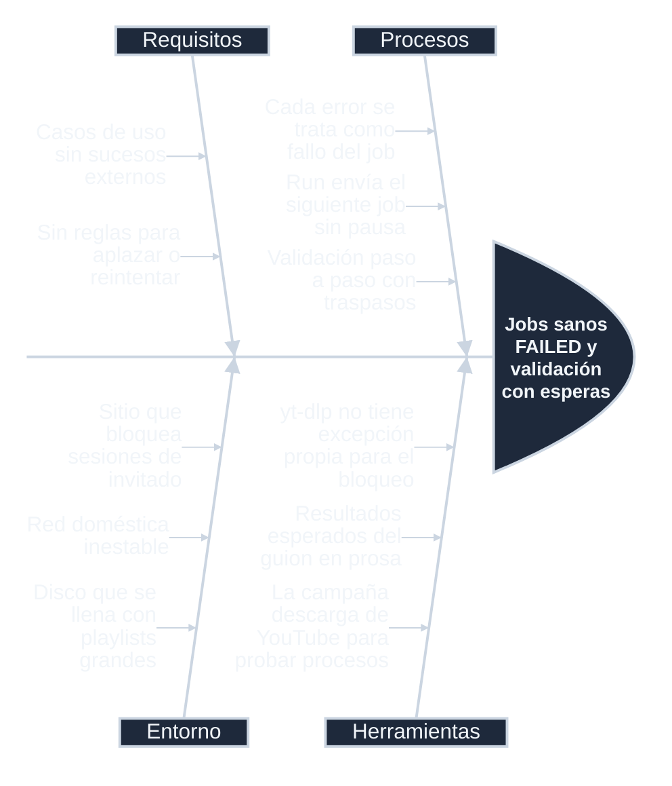

# Análisis de requisitos: continuidad, condiciones externas y referencias

- **Fase RUP:** Elaboración (consolidación del modelo de requisitos tras la campaña T42)
- **Versión:** 3.1 (2026-11-26; añade YTDownload-2026 y VoiceBlueprintPro). 3.0 (2026-11-26). La versión 2.0 se titulaba «funcionamiento sin vigilancia y validación sin esperas»; esta integra el análisis de los proyectos de referencia en el modelo canónico y deja abiertas las decisiones.
- **Responsabilidad:** razonamiento y evidencia del modelo de requisitos. Los requisitos están en sus artefactos: [modelo de casos de uso](use-case-model.md), [reglas de negocio](business-rules.md), [especificación complementaria](supplementary-specification.md), [catálogo de condiciones de fallo](failure-conditions.md) y [modelo de validación](../process/validation-use-case-model.md).
- **Técnicas (BABOK v3):** ver §5.2.

---

## 1. Necesidad (6.1)

| | |
|---|---|
| **El problema de** | una cola que no reacciona a lo que pasa fuera de ella (el sitio bloquea, falta la red, se llena el disco), y una validación en Windows que depende de esperas y de pasos manuales |
| **afecta a** | el User, que deja la cola trabajando sin vigilarla, y al Evaluador, que valida cada commit en Windows |
| **cuyo impacto es** | jobs sanos marcados `FAILED` en segundos; peticiones a un sitio que ya bloquea; trabajo manual para notar, esperar y reintentar; y, en la campaña, la mitad del tiempo del Evaluador esperando instrucciones (§2.2) |
| **una solución exitosa** | preserva los jobs cuando el sitio o el entorno no responden, no insiste ante quien restringe, informa y continúa según una política decidida; y una validación que ejecuta y comprueba cada bloque sin que el Evaluador espere a nadie |

**Restricción del Responsable (2026-11-26):** no depender de PO Tokens.

## 2. Estado actual (6.1)

### 2.1 Evidencia del producto

| Momento (2026-11-25) | Suceso externo | Respuesta actual de la cola |
|---|---|---|
| 22:24, paso 5.2 | El equipo perdió la resolución de nombres (`getaddrinfo failed`, 11001) | 8 jobs `FAILED` con `NETWORK` en segundos y uno `UNKNOWN` (T42-D7); `run` siguió enviando jobs hasta vaciar la cola |
| 23:27, paso 5.7 | Otro programa retuvo la base de datos | `run` terminaba a mitad de la cola (T42-D12, ya corregido) |
| 23:36, paso 5.7 | YouTube respondió `Sign in to confirm you're not a bot` a toda petición | Cada job falló en 1 o 2 s con `UNAVAILABLE`, gastando su intento |

Entre las 22:23 y las 23:36, los logs de las colas registran 93 extracciones de YouTube (81 videos y 12 playlists), más las 4 pruebas `network`. Es menos que el límite de las sesiones de invitado que documenta yt-dlp (unos 300 videos por hora; página *Extractors* de su wiki). El bloqueo, por tanto, no depende solo del número de peticiones.

### 2.2 Mapa de flujo de valor de la sesión de validación (10.34)

La sesión del Evaluador fue el 2026-11-25, de 22:18 a 23:51 (unos 92 min).
- **De dónde salen los tiempos:** la consola del Evaluador muestra, en cada prompt, la hora y el tiempo transcurrido desde el anterior, con un margen de un minuto. Las esperas son el tiempo entre el último comando de un mensaje del Evaluador y el primero del siguiente; incluyen leer la instrucción y escribirla.
- **Clases:** valor añadido (VA), necesaria para el negocio (BVA) y sin valor añadido (NVA).

| Actividad | Min | Clase | Desperdicio (Lean) |
|---|---|---|---|
| Suites (paso 3) | 11,3 | VA | — |
| Pasos 5.2 a 5.7 con resultados válidos, incluidos los que encontraron T42-D10 y T42-D12 | 25 | VA | — |
| Preparar la ejecución, las colas, la segunda ventana y la evidencia | 5 | BVA | — |
| **Esperar la siguiente instrucción del analista** (9 esperas; la mayor, de 13 min, de 22:52 a 23:05) | **47,5** | NVA | Espera |
| Pasos repetidos por defectos del guion (5.6 sin cola, 5.7, 5.7-r2, `purge`) | 2,5 | NVA | Defectos y reproceso |
| Arranque fallido por un comando incompleto del analista (faltaba `git fetch`) | 0,5 | NVA | Defectos |
| Comprobar a mano si YouTube responde | 0,7 | NVA | Espera |

**Resultado:** un 39 % del tiempo es de valor añadido y un 51 %, espera.
- **El desperdicio dominante** no viene de la red ni del sitio: es el traspaso paso a paso entre el Evaluador y el analista. Cada resultado se pega en la conversación, se interpreta a mano y vuelve como una instrucción nueva.
- **Una dependencia innecesaria:** los pasos 6 a 12 prueban procesos, cierres y archivos, pero descargan de YouTube, así que heredan sus bloqueos y los de la red.

## 3. Causa raíz (10.40)

### 3.1 Espina de pescado

### 3.2 Cinco porqués

| Problema | Porqués | Causa raíz |
|---|---|---|
| Todos los jobs pendientes acaban `FAILED` tras un corte o un bloqueo | 1. `run` envía el siguiente job, que también falla. 2. `run` trata cada error como un fallo del job. 3. La clasificación de fallos solo tiene motivos por job (`FailureReason`); no existe una condición del entorno que comparten todos los jobs. 4. UC-03 A2 modeló los fallos como sucesos de un job. 5. Los casos de uso se identificaron por los objetivos del User, no por los sucesos externos (BABOK 10.47 admite casos de uso iniciados por un suceso externo) | **Faltó la lista de sucesos externos** al identificar los casos de uso |
| El Evaluador espera la mitad de la sesión | 1. Tras cada paso espera la siguiente instrucción. 2. El resultado se interpreta a mano en la conversación. 3. El guion describe los resultados esperados en prosa y nada los comprueba. 4. La campaña se diseñó como un guion manual (ADR-0021: sin CI; comportamientos que solo existen en Windows). 5. La herramienta de validación no se trató como una solución con sus propios casos de uso | **La validación no tiene un oráculo automático**, y sus pasos dependen de YouTube y de la red aunque no los prueben |

## 4. Identificación sistemática de casos de uso

### 4.1 Lista de actores y objetivos

| Actor | Objetivo | Cubierto por | Clasificación |
|---|---|---|---|
| User | Instalar y verificar | UC-01 | Existente; A10 y A11 propuestos |
| User | Saber qué contiene una URL antes de encolarla | — | **UC-15 nuevo** |
| User | Poner contenidos en la cola, con sus opciones | UC-02 | Existente; A5 a A8 propuestos (mismo objetivo) |
| User | Que la cola se descargue sin vigilarla | UC-03, UC-04 | Existente; extendido por UC-11 |
| User | Cancelar, recuperar, reintentar, listar, ver, purgar | UC-05 a UC-10 | Existente |
| User | Dejar libre la conexión o el equipo un rato sin perder la cola | — | **UC-14** (propuesto en la versión 2.0; reformulado por la necesidad) |
| User | Reportar un problema con todo lo necesario | — | **UC-16 nuevo** |
| User | Descargar sin saturar la conexión | — | Requisito no funcional (SUP-P06): una configuración, sin interacción propia |
| User | Usar su cuenta del sitio | — | Decisión D-1 |
| User | Actualizar yt-dlp sin esperar una versión del programa | Procedimiento SUP-S01 | **Candidato**, decisión D-8 |
| User | Empezar la cola a una hora | — | Exclusión: lo cubre el Programador de tareas de Windows |
| User | Ser avisado al terminar | — | Exclusión: `run` ya resume al terminar |
| Mantenedor | Actualizar yt-dlp cuando un sitio cambia | Procedimiento SUP-S01 | Proceso de desarrollo |
| Evaluador | Validar un commit en Windows | VUC-01 a VUC-08 | [Modelo de validación](../process/validation-use-case-model.md) |

### 4.2 Lista de sucesos externos y temporales

Cada suceso tiene su fila, con sus atributos, en el [catálogo de condiciones de fallo](failure-conditions.md). Aquí solo se clasifica su destino.

| Suceso | Destino |
|---|---|
| El sitio restringe la sesión (antibots, captcha, límite de peticiones, HTTP 429) | UC-11 A1; BR-01 |
| El equipo pierde la conectividad | UC-11 A2; BR-05 |
| Se llena la unidad de las descargas o del estado | UC-11 A3; BR-08 |
| Fallo transitorio con un host (5xx, timeout) | UC-03 A15; BR-07 (divergencia R-24) |
| El equipo se suspende | SUP-R08; al despertar, UC-11 A2 |
| Cierre o corte de luz | UC-06 |
| Cierre entre el final de la descarga y el registro | UC-06 A4 y A11 (propuesto); R-25 |
| Otro programa retiene la base de datos | UC-03 A10 (corregido, T42-D12) |
| Un antivirus bloquea un archivo un instante | `file_access_retries` (vigente) |
| El sitio cambia y el extractor falla | UC-03 A3, SUP-S01; D-8 |
| YouTube exige PO Token a los clientes por defecto | R-20; BR-12 |
| Un contenido pide una cuenta | UC-03 A2; UC-11 E2 |
| Una transmisión en directo o programada | UC-03 E1; D-10; R-26 |

### 4.3 Consolidación de los casos de uso propuestos en la versión 2.0

La versión 2.0 propuso UC-11 (esperar a que el sitio levante un bloqueo), UC-12 (esperar a la red), UC-13 (esperar espacio en disco) y UC-14 (pausar y continuar). Sus nombres describían una solución, esperar, y no la necesidad. Las referencias no esperan (§6) y eso tampoco prueba que esperar sea incorrecto: la política es una decisión (D-2).

| Antes | Necesidad | Ahora |
|---|---|---|
| UC-11 Esperar a que el sitio levante un bloqueo | Preservar los jobs ante una restricción externa | UC-11 A1 |
| UC-12 Esperar a la red | Administrar las interrupciones de conectividad | UC-11 A2 |
| UC-13 Esperar espacio en disco | Preservar el trabajo ante almacenamiento insuficiente | UC-11 A3 |
| UC-14 Pausar y continuar la cola | Controlar temporalmente la ejecución | UC-14, con detención ordenada (A2) |

UC-12 y UC-13 se retiran y sus identificadores no se reutilizan. Los tres primeros compartían actor, disparador (un suceso externo durante `run`), flujo y garantías; su diferencia es la regla de reconocimiento y el alcance, que BABOK 10.47 modela como escenarios de un mismo caso de uso.

## 5. Referencias analizadas y técnicas

### 5.1 Referencias

Las referencias solo aportan evidencia. No son dependencias del producto, no se modifican y no se copia su código (licencias incompatibles con The Unlicense: Seal es GPL-3.0 y VoiceStudio, AGPL-3.0).

| Proyecto | Versión o commit | Licencia | Alcance analizado | Limitaciones |
|---|---|---|---|---|
| queued-media-downloader | `main` en `14bd247` | Unlicense | Todo el código y los documentos | — |
| yt-dlp | 2026.11.23 (la fijada, sdist en `/tmp/ytdlp-new`); 2026.10.26 en el espacio de análisis | Unlicense | `options.py` y `__init__.py` (valores de la línea de comandos), `YoutubeDL.py` (valores de la librería), `utils/_utils.py` (`RetryManager`), `extractor/youtube/` (clientes, restricciones), `networking/` (proxy, timeouts), `postprocessor/` | Solo el código fuente; no se ejecutó contra sitios reales |
| Seal | `5a4f5fb` (2026-11-25), versionCode 200_000_150 | GPL-3.0 | Descarga, cola (`download/DownloaderV2.kt`), preferencias (`util/PreferenceUtil.kt`, `util/DownloadUtil.kt`), formatos y playlists (`ui/page/downloadv2/configure/`), historial, actualización (`util/UpdateUtil.kt`), cookies, comandos personalizados, errores | Aplicación Android: lo propio de Android (tarjeta SD, red medida) solo se usa como evidencia de la necesidad |
| VoiceStudio | `d9061408` (2026-11-26) | AGPL-3.0 | Importación desde URL (`services/dub_pipeline.py`), cola por lotes (`api/routers/batch.py`), fallos (`core/failure.py`), herramientas de medios, entorno, autodiagnóstico, paquete de diagnóstico, resistencia en Windows, arnés de pruebas | Solo el dominio compartido; el procesamiento de voz e IA queda fuera |
| YTDownload-2026 | `0abda8e` (2026-07-02), 33 commits; yt-dlp 2026.2.4 en su `uv.lock` | **Sin licencia declarada** (todos los derechos reservados): solo se toman ideas | Toda la aplicación: `infrastructure/ytdlp_service.py`, `application/download_coordinator.py`, `application/command_api.py`, modelos (`domain/models/`), CLI (`interfaces/cli/root.py`), herramientas MCP (`infrastructure/mcp/tools/`), `docs/` (guía de descarga de YouTube en 2026: proxy, cuentas, cookies, subtítulos, playlists) | Interfaz gráfica (PySide6) leída solo por sus opciones; documentación en ruso |
| VoiceBlueprintPro | `e9a2a63` (2026-11-22), 89 commits; yt-dlp 2026.8.19 | AGPL-3.0 | Derivado de VoiceStudio (separado el 2026-11-09, según su historial y `NOTICE`). Se comparó, archivo por archivo, con VoiceStudio `d9061408` en el dominio compartido: importación desde URL, fallos, entorno, herramientas de medios, cola por lotes, autodiagnóstico, asistente de instalación (`api/routers/setup/`) | Su canal de importación es una versión anterior a la de VoiceStudio; el resto (voz, IA, móvil) queda fuera del dominio |
| Kannagi (yt-dlp-gui) | Sin Git ni versión declarada, en `upstream/source/yt-dlp-gui-kannagi` | MIT | `Wrappers/DLP.cs`, `Wrappers/FFMPEG.cs`, `ViewModels/Main.cs`, `Models/Config.cs`, `Models/Cookies.cs`, `Views/Release.xaml.cs` | Sin versión: los hallazgos no se pueden fechar |
| FFmpeg | Código: checkout parcial de `master` en `329157f5` (2026-11-22); binarios: n9.0.2-39 LGPL compartido, en `vendor/ffmpeg/` | LGPL | Contratos que usa el producto: unión de video y audio, extracción de audio, `ffprobe` | El checkout solo tiene los registros de códecs y formatos y los Makefiles; los contratos se verificaron con los binarios incluidos y la documentación de yt-dlp |
| BABOK v3 | Copia entregada por el Responsable | IIBA | Capítulos 6, 7 y 10 | — |

### 5.2 Técnicas aplicadas

| Técnica (BABOK v3) | Aporte |
|---|---|
| 10.4 Benchmarking and Market Analysis | §6: cada capacidad de las referencias, con su destino |
| 10.18 Document Analysis | Lectura del código y la documentación de las referencias y de la wiki de yt-dlp |
| 10.22 Functional Decomposition | Inventario de capacidades de cada referencia antes de clasificarlas |
| 10.24 Interface Analysis | §7.1: parámetros de la librería de yt-dlp frente a su línea de comandos |
| 10.9 Business Rules Analysis | Separación de reglas, parámetros y decisiones en el [catálogo](business-rules.md) |
| 10.16 Decision Modelling | §9 |
| 10.40 Root Cause Analysis | §3 |
| 10.34 Process Analysis | §2.2 (mapa de flujo de valor) |
| 10.44 State Modelling | Estados de los jobs ante cada condición ([catálogo de condiciones](failure-conditions.md)) |
| 10.47 Use Cases and Scenarios | UC-11 consolidado, UC-14 a UC-16 y el formato común de los casos de uso |
| 10.30 Non-Functional Requirements Analysis | Especificación complementaria 2.0 |
| 10.38 Risk Analysis | R-24 a R-27 |
| 10.1 Acceptance and Evaluation Criteria | Criterios de aceptación de cada caso de uso |
| 10.33 Prioritization | §8.2 |
| 10.41 Scope Modelling | Exclusiones (§6.3) y [modelo de casos de uso](use-case-model.md) |
| 10.6 Business Capability Analysis | §6: capacidades agrupadas por área |
| 10.21 Glossary | [Vocabulario](../design/00-vocabulary.md), §1.0 |

## 6. Hallazgos de las referencias y su incorporación

Cada hallazgo se cualifica en una sola categoría y tiene un único destino en el modelo canónico. **Estado** describe nuestro producto: vigente, parcial, propuesto, divergente o excluido. Las referencias se citan como S (Seal), V (VoiceStudio), B (VoiceBlueprintPro), D (YTDownload-2026), K (Kannagi), Y (yt-dlp) y F (FFmpeg). Una fila con varias letras es un requisito propio respaldado por varias referencias.

### 6.1 Capacidades del dominio

| Área | Capacidad | Evidencia | Categoría | Destino | Estado |
|---|---|---|---|---|---|
| Cola | Varias descargas a la vez | S: `MAX_CONCURRENCY = 3` en `DownloaderV2.kt`; D: `max_concurrent` = 2 | UC existente | SUP-P01 (`worker_count`) | Vigente |
| Cola | Fallo restartable, sin perder la tarea | S: estado `Error`; V: `retry_batch_job` | UC existente | UC-07 | Vigente |
| Cola | Reintento solo cuando el trabajo ya se detuvo | V: `retry_ready`, `_admit_retry` | Regla | BR-14 (`CANCELLATION_REQUESTED` no es reintentable) | Vigente |
| Cola | Trabajo interrumpido por un reinicio | S: pasa a `Canceled`; V y B: pasan a `failed` (`sweep_orphans_on_startup`); D: la cola vive en memoria y sus registros quedan `queued` o `downloading` para siempre | UC existente | UC-06, BR-19: nosotros reanudamos | Vigente; mejor que las referencias |
| Cola | No borrar archivos de un trabajo activo | V: `delete_batch_job` (#2547) | Regla | BR-17, BR-18 | Vigente |
| Cola | Pausa, detención | S: cancelar y reanudar tareas | UC nuevo | UC-14 | Propuesto (D-6) |
| Consulta | Información y formatos antes de descargar | S: `fetchInfo`, `FormatPage.kt`; K: Analyze; D: `fetch_info` y el «modo A» de su guía (primero metadatos, después descarga); Y: `-F`, `--dump-json` | UC nuevo | UC-15 | Propuesto |
| Consulta | Elegir entradas de una playlist | S: `PlaylistSelectionPage.kt`; D: guía, §8 («solo 1–20», «5, 7, 9»); Y: `--playlist-items` | Flujo alternativo | UC-02 A6, UC-04 A8 | Propuesto |
| Opciones | Recortar un tramo | S: recortes; K, Y: `--download-sections` | Flujo alternativo | UC-02 A8 | Propuesto, prioridad baja |
| Opciones | Subtítulos, miniatura, metadatos, capítulos | S: `DownloadUtil.kt`; K: incrustar subtítulos, miniatura y capítulos; D: archivos al lado del video (`.info.json`, `.description`, miniatura, subtítulos por idioma, incluidos los automáticos), activados por omisión | Pendiente de cualificación | UC-02 A7 | Pendiente |
| Opciones | Extraer audio y convertirlo | S, K, D, Y: `FFmpegExtractAudio` | UC existente | UC-02 `--audio-only` | Vigente |
| Opciones | Calidad por preajuste (mejor, 1080p, 720p, 480p, 360p, solo audio) | D: `QualityOption` y `_build_format_string`; S y K: selector de calidad | Flujo alternativo | UC-02 A9 | Propuesto |
| Opciones | Opciones por job sobre los valores globales | D: `DownloadCoordinator.add` | UC existente | UC-02: las download options se fijan al encolar | Vigente |
| Opciones | Unir a otro contenedor (mkv) | S, K: remux | Elemento de configuración | `default_format_selector` y la plantilla; sin opción propia | Excluido de momento: sin necesidad del User |
| Opciones | SponsorBlock, partir por capítulos, `parse-metadata` | S | Exclusión | §6.3 | Excluido |
| Opciones | Plantillas de comandos personalizados | S: plantillas y su log | Exclusión | §6.3 | Excluido |
| Archivos | Plantilla de salida y subcarpetas por playlist | S, K, D (carpeta por playlist y por video, índice con tres cifras), Y | UC existente | UC-03 (plantilla determinista), carpeta de la playlist | Vigente |
| Archivos | Nombres seguros y recortados | S: `restrict-filenames`; Y: `trim_file_name` | UC existente | `max_filename_length` | Vigente |
| Archivos | Archivo de descargas (`--download-archive`) | S: `DOWNLOAD_ARCHIVE` | Decisión arquitectónica | ADR-0012: duplicados por media key | Excluido por ADR |
| Archivos | Fecha del archivo | K: modificada, de subida o de creación; V: desactiva `updatetime` (#642) | Capacidad técnica | Y 2026.11.23 la desactiva por defecto | Vigente (sin cambio de fecha) |
| Archivos | Comprobación previa del destino | V: `ingest_pipeline` (#1225) | Flujo alternativo | UC-01 A10; catálogo, §3 | Propuesto |
| Archivos | Borrar el registro con su archivo | S: historial; V: `delete_batch_job`; D: `delete_download` con vista previa y confirmación, pero borra la carpeta de salida entera con `shutil.rmtree` | Flujo alternativo | UC-10 A5 | Propuesto (D-11) |
| Fallos | Taxonomía con indicación de si reintentar sirve | V: `core/failure.py` (`_HINTS`) | Requisito suplementario | SUP-U05; catálogo de condiciones | Propuesto |
| Fallos | Antibots nunca se reintenta | V: `test_yt_bot_check_2034.py` | Regla | BR-01, BR-03 | Propuesto |
| Fallos | Límite de peticiones y captcha | V no los reconoce; Y: `raise_no_formats(expected=True)` | Regla | BR-01 (los incluye) | Propuesto |
| Fallos | Disco lleno por `errno` o `winerror` en toda la cadena | V: `is_disk_full_error` | Regla | BR-08 | Propuesto |
| Fallos | Reintentos de red propios (2, a 2 y 4 s) | V y B: `yt_download_sync` | Capacidad técnica | BR-07: se delega en yt-dlp | Sustituido |
| Fallos | Cambiar de cliente de YouTube ante 403 o DRM | V: `_YT_PLAYER_CLIENTS` | Exclusión | §6.3 | Excluido |
| Fallos | Regresión con el texto literal reportado | V: pruebas con los dos apóstrofos | Capacidad de validación | SUP-V03 | Propuesto |
| Red | Proxy (configurado o del sistema) | S, K, D: opción `proxy`; V y B: `core/user_env.py`; D, guía §2: recomienda el proxy del sistema y una salida estable, porque rotar la IP rompe sesiones y reanudaciones; Y: `getproxies()` si no se configura | Decisión | D-7; UC-01 A11 | Pendiente (Y ya usa el del sistema) |
| Red | Cookies | S: perfiles por WebView; K: modos con detección por expresión; V y B: `cookies.txt` efímero (0600, ≤1 MB, borrado al terminar); D, guía §3 y §4: cuenta técnica separada, `cookies-from-browser`, misma IP para la sesión y la descarga, cookies tratadas como contraseñas | Decisión | D-1; BR-12 | Pendiente |
| Red | Forzar IPv4, agente de usuario | S | Elemento de configuración | Sin necesidad del User | Excluido de momento |
| Red | Límite de ancho de banda | S, K, Y: `ratelimit`; D, guía §12: ante la limitación de velocidad del sitio | Requisito suplementario | SUP-P06 | Propuesto |
| Red | Fragmentos concurrentes, aria2c | S, K | Exclusión | §6.3 | Excluido |
| Red | No descargar en una red medida | S: `CELLULAR_DOWNLOAD`, `isActiveNetworkMetered` | Exclusión | §6.3 | Excluido |
| Red | Ritmo de peticiones | Y: preajuste `-t sleep`; D, guía §8 y §12: pausa entre entradas de una playlist y poca concurrencia | Regla | BR-02 | Propuesto (D-3) |
| Herramientas | ffmpeg con SHA-256 | V: `acquire_bundled`; nosotros: `SOURCE.md` | UC existente | UC-01 A5 | Vigente |
| Herramientas | ffmpeg propio o del sistema | V: `set_custom_path`, `use_system`; K: rutas | UC existente | UC-01 A4, `ffmpeg_path` | Vigente |
| Herramientas | Actualizar yt-dlp desde el programa, y volver a la versión probada | S: canales y periodicidad (`UpdateUtil.kt`); V: capa desde PyPI y «Restore tested version»; K: comprobación diaria | UC candidato | D-8 frente a ADR-0002 | Pendiente |
| Diagnóstico | Autodiagnóstico ok, aviso o fallo | V: `core/diagnose.py`; B: comprobaciones del asistente de instalación (`api/routers/setup/wizard.py`) | UC existente | UC-01 (`diagnose`), A9 a A11 | Vigente y propuesto |
| Diagnóstico | Paquete de diagnóstico limpio de datos sensibles | V: `core/diagnostic_bundle.py`; S: informe de error | UC nuevo | UC-16, SUP-SEC01, SUP-O03 | Propuesto |
| Diagnóstico | Modo detallado (`-v`) | S | Elemento de configuración | El log ya registra los mensajes de yt-dlp | Vigente |
| Historial | Exportar e importar el historial; modo privado | S | Exclusión | §6.3 | Excluido |
| Windows | Árbol de procesos con Job Object | V: `contained_subprocess.py` | UC existente | SUP-R02, ADR-0013 | Vigente |
| Windows | Vigilancia del proceso padre | V: `parent_liveness.py` | Capacidad técnica | ADR-0013 (`KILL_ON_JOB_CLOSE`) | Vigente |
| Windows | Sin ventanas de consola | V: `CREATE_NO_WINDOW` | Capacidad técnica | Programa de consola; los workers son del mismo proceso | No aplica |
| Windows | yt-dlp sin depender de stdout ni stderr | V: `test_dub_download_stdio.py` | UC existente | `noprogress`, `logger` | Vigente |
| Windows | Archivo bloqueado un instante | V: `fs_retry.py` (~4 s) | UC existente | `file_access_retries` | Vigente |
| Validación | Separar a quien actúa de quien juzga | V: `tests/probe` («No LLM ever sits on the verdict path») | Capacidad de validación | VBR-04, SUP-V02 | Propuesto |
| Directos | Transmisiones en directo | Y: `is_live`, `wait_for_video` | Excepción | UC-03 E1 | Sin cualificar (D-10) |
| Integridad | Verificar el archivo final | F: `ffprobe`; ninguna referencia lo hace tras descargar | Regla | BR-23, UC-06 A11 | Propuesto (D-9) |
| Integridad | Identificar los archivos de un job buscando la carpeta más reciente | D: `_find_newest_folder`, `_scan_folder` | Regla (evidencia en contra) | BR-17: un job solo reconoce los archivos que reclamó; buscar por fecha puede tomar archivos ajenos | Vigente |
| Integridad | Una cancelación nunca se registra como descarga completada | D: tras `cancel`, `download` devuelve un resultado vacío y el coordinador marca el registro `done` | Regla (evidencia en contra) | UC-05 y el contrato de `JobCompleted` (UC-03 A8): sin archivo final, nunca `COMPLETED` | Vigente |
| Consulta | Salida JSON de `list` y `show` | D: `history list --format json`, `--json` global | Flujo alternativo | UC-08 A5, UC-09 A5 | Propuesto |
| Consulta | Buscar en la cola por título o URL | D: `search_downloads`; S: historial | Flujo alternativo | UC-08 A6 | Propuesto, prioridad baja |
| Integración | Servidor MCP para agentes, lectura de transcripciones y descripciones | D: `infrastructure/mcp/`, 10 herramientas | Exclusión | §6.3 | Excluido |
| Seguridad | Archivo de credenciales creado ya con permisos restringidos | B: `core/user_env.py` (`_opener_0600`) | Requisito suplementario | SUP-SEC03 | Propuesto (condicionado a D-1 y D-7) |
| Archivos | Espacio libre de una carpeta que aún no existe | B: `disk_free_bytes` sube al antecesor existente | Flujo alternativo | UC-01 A10 | Propuesto |
| Fallos | Volumen no confiable (`winerror` 448), bloqueo prolongado por sincronización | V y B: `WINDOWS_UNTRUSTED_MOUNT`, `VIDEO_DOWNLOAD_OS_ERROR` | Excepción | [Catálogo de condiciones](failure-conditions.md), §3 | Propuesto |
| Validación | Pruebas sin red separadas de las comprobaciones reales, que siguen pendientes hasta ejecutarse | D: `smoke_*.py` frente a «opt-in real validation gates»; marca `e2e` | Capacidad de validación | Clasificación de las pruebas ([plan de E2, §8.2](../project-management/iteration-plan-e2.md#82-clasificación-de-las-pruebas-2026-11-26-main-tras-la-actualización-de-yt-dlp)), VBR-02 | Vigente |

### 6.2 Lo que tenemos y las referencias no

- Una cola persistente que reanuda desde los parciales tras un cierre (S, V y B marcan los trabajos como cancelados o fallidos; D los pierde).
- Playlists y canales con extracción plana y duplicados por media key (V y B no admiten playlists; D descarga una playlist entera como un solo trabajo).
- Propiedad de los nombres finales con reclamaciones (ADR-0030).
- yt-dlp fijado con pruebas de contrato, y deno con yt-dlp-ejs incluidos (V y B usan `ejs:github` sin declarar un runtime de JavaScript; D no declara ninguno).
- El límite de peticiones y el captcha reconocidos como restricción del sitio (propuesto).

### 6.3 Exclusiones

| Capacidad | Motivo |
|---|---|
| Cambiar de cliente de YouTube ante un 403 | `android` exige PO Token (wiki de yt-dlp); los clientes por defecto de 2026.11.23 no lo necesitan; contrario a BR-12 |
| PO Tokens y proveedores de PO Token | Restricción del Responsable (2026-11-26) |
| SponsorBlock, partir por capítulos, `parse-metadata` | Edición del contenido, fuera del objetivo de descargarlo |
| Plantillas de comandos personalizados | Convertiría el producto en una interfaz de la línea de comandos de yt-dlp; rompe las pruebas de contrato |
| Fragmentos concurrentes y aria2c | Otra dependencia y más peticiones por segundo al sitio, contrario a BR-02 |
| Red medida, tarjeta SD, notificaciones móviles | Propias de Android |
| Exportar e importar el historial; modo privado | La cola no es un historial; `purge` ya lo limpia |
| Búsqueda en YouTube y recortes de voz (V) | Fuera del dominio |
| Caché por hash del contenido (V) | Los duplicados se resuelven por media key (BR-13) |
| Red privada bloqueada (V, B) | El programa es local; el User escribe sus propias URLs |
| Servidor MCP y herramientas para agentes (D) | Otra interfaz con su propio contrato y su propia superficie de seguridad; la salida JSON (UC-08 A5, UC-09 A5) cubre la automatización desde scripts. Se reconsidera con la interfaz gráfica futura |
| Leer transcripciones y descripciones descargadas (D) | Son archivos del User en su carpeta; el producto los descarga (UC-02 A7, pendiente), no los interpreta |
| Navegador automatizado para iniciar sesión (D, guía §4: Playwright) | Una dependencia grande para obtener cookies; depende de D-1 |
| Interfaz gráfica, temas visuales (D, S, K) | Fuera del alcance inicial ([ADR-0001](../notes/adr-0001-project-scope.md)) |

## 7. Continuidad, reintentos y recuperación

### 7.1 yt-dlp: línea de comandos, librería y nuestro producto

La línea de comandos de yt-dlp fija valores que la librería no fija. Como el producto usa la librería, hereda los valores de la librería, no los de la línea de comandos.

| Parámetro | Línea de comandos | Librería | Nuestro producto | Efectivo hoy |
|---|---|---|---|---|
| `retries` (HTTP) | 10 (`options.py`) | Sin valor; `RetryManager` lo convierte en 0 | No se pasa | **0** (divergencia, R-24) |
| `fragment_retries` | 10 | Sin valor (0) | No se pasa | **0** (divergencia, R-24) |
| `extractor_retries` | 3 | 3 (`get_param('extractor_retries', 3)`) | No se pasa | 3 |
| `file_access_retries` | 3 | 3 | 10 | 10 |
| `socket_timeout` | 20 s | 20 s (`DEFAULT_TIMEOUT`) | No se pasa | 20 s |
| `retry_sleep_functions` | Sin espera | Sin espera | No se pasa | Sin espera |
| `sleep_interval`, `sleep_interval_requests` | 0; preajuste `-t sleep`: 10 a 20 s y 0,75 s | 0 | No se pasa | 0 |
| `ratelimit` | Sin límite | Sin límite | No se pasa | Sin límite |
| `proxy` | Sin valor: proxy del sistema | Sin valor: `urllib.request.getproxies()` (variables de entorno y registro de Windows) | No se pasa | Proxy del sistema |
| `continuedl` | Activo | Activo | Activo | Activo |
| `updatetime` | Inactivo (`--no-mtime`) | Inactivo | No se pasa | Inactivo |

Las referencias que usan la librería pasan los reintentos de forma explícita: V y B, 10 y 10; D, 5 y 5. Evidencia en la campaña T42: el job 11 falló con `[download] Got error` sin «Giving up after»; con la línea de comandos habría reintentado hasta 10 veces.

### 7.2 Responsabilidades

| Concepto | Responsable | Estado |
|---|---|---|
| Reintento de una petición o un fragmento | yt-dlp (BR-07) | Divergente |
| Reintento del job | Cola, a petición del User (UC-07) | Vigente |
| Espera creciente entre reintentos | yt-dlp dentro del job; la cola entre comprobaciones de una restricción (BR-03) | Pendiente (D-2, D-4) |
| Ritmo de peticiones | yt-dlp dentro de una extracción; la cola entre jobs (BR-02) | Propuesto (D-3) |
| Aplazamiento y control de admisión | Cola (BR-04, UC-11) | Propuesto |
| Pausa, continuación y detención | Cola (UC-14) | Propuesto (D-6) |
| Recuperación tras un cierre | Cola (UC-06, BR-19) | Vigente; A11 propuesto (D-9) |
| Reanudar una descarga desde sus parciales | yt-dlp (`continuedl`) | Vigente |

### 7.3 Política de continuidad ante una condición externa

Ninguna referencia espera un plazo largo: Seal y VoiceStudio fallan el trabajo e informan; Kannagi repite con cookies. Eso indica lo que hacen, no que esperar sea incorrecto. Las alternativas están en D-2.

## 8. Estado futuro, prioridad y verificación

### 8.1 Brechas

| Brecha | Estado futuro | Medida de éxito |
|---|---|---|
| Fallos en cadena ante condiciones externas | UC-11 | Ningún job `FAILED` por una condición externa; ningún `retry` manual tras ella |
| Peticiones a un sitio que restringe | BR-02, BR-03 | Ninguna petición al sitio fuera de lo que permite la política |
| 0 reintentos HTTP y de fragmentos | BR-07 | Paridad con la línea de comandos de yt-dlp (SUP-R11) |
| Recuperación que depende del sitio | UC-06 A11 | Un job con evidencia local suficiente se completa sin peticiones |
| Esperas del Evaluador | VUC-04, VUC-08 | Espera por debajo del 10 % de la sesión |
| Pasos de la campaña que dependen de YouTube sin probarlo | VUC-05 | Los pasos 6 a 12 pasan sin red externa |

### 8.2 Prioridad (10.33)

| Prioridad | Elementos |
|---|---|
| **Alta** | UC-11, BR-07 (paridad de reintentos), VUC-04, VUC-05 |
| **Media** | UC-06 A11, UC-15, UC-02 A6 y A9, UC-08 A5, UC-09 A5, SUP-R08, SUP-U05, VUC-06 a VUC-08 |
| **Baja** | UC-14, UC-16, UC-02 A5 y A8, UC-08 A6, UC-10 A5, SUP-P06 |
| **Pendiente de cualificación** | UC-02 A7, el candidato «Actualizar yt-dlp» (D-8) |

### 8.3 Verificación de los requisitos (7.2)

| Característica | Cómo se cumple |
|---|---|
| Atómicos | Un caso de uso por objetivo; una directiva por regla; un valor por parámetro |
| Completos | Todos los casos de uso tienen los campos comunes ([modelo, §2](use-case-model.md)); la matriz del §5 del modelo cuenta los flujos |
| Consistentes | Una sola autoridad por concepto: reglas en el catálogo, condiciones en su catálogo, términos en el vocabulario |
| Factibles | Cada regla se apoya en una capacidad comprobada de yt-dlp 2026.11.23 o de la biblioteca estándar |
| Comprobables | Cada caso de uso tiene criterios de aceptación y escenarios de prueba; cada requisito suplementario, un criterio |
| Priorizados | §8.2 |

## 9. Decisiones pendientes

Ninguna está aprobada. La recomendación es la del analista; decide el Responsable.

### D-1. Cookies o cuenta del sitio

- **Contexto y necesidad:** un contenido que pide una cuenta, o una restricción del sitio que persiste, solo se resuelven con una sesión iniciada.
- **Alternativas:** (a) sin cookies; (b) `cookies.txt` explícito y efímero (V); (c) cookies del navegador (`--cookies-from-browser`); (d) cookies solo cuando el error lo pide (K: modos WhenNeeded, Ask, Always, Never).
- **Evidencia:** la wiki de yt-dlp avisa de que la cuenta puede ser bloqueada; ADR-0004 dejó sin verificar las cookies de Chrome en Windows; V y B las borran tras cada uso; D recomienda una cuenta técnica separada y la misma IP para la sesión y la descarga.
- **A favor de (b):** acceso legítimo controlado por el User, sin leer el navegador. **En contra:** el User debe exportarlas; riesgo para su cuenta.
- **Restricciones y riesgos:** BR-12; R-27 (fuga de credenciales); SUP-SEC01 y SUP-SEC03.
- **Impacto:** funcional, UC-02 y UC-11 E2; arquitectónico, credenciales en la configuración y SUP-SEC01.
- **Recomendación:** (a) mientras la restricción no se repita con el ritmo de BR-02; si se adoptan, (b).

### D-2. Política de continuidad ante una condición externa

- **Contexto y necesidad:** tras aplazar los jobs afectados (UC-11), algo debe decidir cuándo continuar.
- **Alternativas:** (a) esperar y comprobar dentro de `run`; (b) terminar de forma ordenada cuando solo queden jobs aplazados, y continuar en el siguiente `run`; (c) continuidad selectiva y después (b); (d) solo informar y esperar una acción del User.
- **Evidencia:** ninguna referencia espera; yt-dlp estima la restricción en «hasta una hora»; la campaña T42 muestra que sin aplazamiento se pierden todos los jobs.
- **A favor de (c):** no se pierden jobs, no hay peticiones en vano y `run` no queda colgado. **En contra:** el User debe volver a ejecutar `run`; una interfaz gráfica futura preferiría (a).
- **Restricciones y riesgos:** BR-03; R-21 (YouTube prolonga la restricción).
- **Impacto:** funcional, UC-11 pasos 5 y 6; arquitectónico, ADR-0031 (plazos persistentes solo con (a)).
- **Recomendación:** (c).

### D-3. Ritmo de peticiones por defecto para YouTube

- **Alternativas:** (a) el preajuste `-t sleep`; (b) sin ritmo por defecto; (c) un ritmo menor.
- **Evidencia:** el preajuste de yt-dlp; en la campaña, 93 extracciones en 73 min llevaron a una restricción.
- **A favor de (a):** valor documentado por yt-dlp. **En contra:** 100 videos añaden unos 25 min.
- **Impacto:** funcional, UC-11 A1 y UC-15; arquitectónico, planificación por sitio.
- **Recomendación:** (a), configurable hasta 0.

### D-4. Plazo ante una restricción del sitio

- **Contexto:** solo aplica si D-2 elige esperar.
- **Alternativas:** (a) plazo fijo; (b) plazo creciente con un máximo; (c) sin plazo: solo una acción del User.
- **Evidencia:** insuficiente; ningún valor está respaldado (§3 del catálogo de reglas: parámetros pendientes).
- **Recomendación:** decidir D-2 primero; el valor se fija con evidencia, no por estimación.

### D-5. Espacio libre mínimo para enviar un job

- **Alternativas:** (a) un mínimo fijo configurable; (b) un mínimo calculado con el tamaño estimado del formato; (c) solo reaccionar al error de escritura.
- **Evidencia:** yt-dlp da `filesize` o `filesize_approx` para muchos formatos; la unión de ffmpeg puede necesitar el doble; falta la medición (SUP-P07).
- **Recomendación:** (c) más (b) cuando el tamaño se conozca; el valor de (a) queda pendiente de SUP-P07.

### D-6. Comportamiento de la pausa

- **Alternativas:** (a) dejar terminar los jobs en curso; (b) detenerlos; (c) las dos, con una opción.
- **Evidencia:** `Ctrl+C` ya detiene sin perder nada (UC-05 A6).
- **Recomendación:** (c): `pause` deja terminar y `pause --now` detiene.

### D-7. Proxy

- **Contexto y necesidad:** en algunas redes solo se sale por un proxy.
- **Alternativas:** (a) solo el del sistema, como ya hace yt-dlp; (b) además, una clave `proxy` propia; (c) además, informar en `diagnose`.
- **Evidencia:** yt-dlp usa `getproxies()` si no se configura; V lo toma del entorno y diagnostica sus fallos (SOCKS sin soporte, TLS interceptado).
- **Restricciones y riesgos:** BR-12 (no como evasión); R-27 si lleva contraseña.
- **Impacto:** funcional, UC-01 A11 y el catálogo, §2; arquitectónico, una clave de configuración.
- **Recomendación:** (a) y (c); (b) solo si un User lo necesita.

### D-8. Actualizar yt-dlp desde el programa

- **Contexto y necesidad:** cuando un sitio cambia, el extractor falla hasta que se actualiza yt-dlp.
- **Alternativas:** (a) solo el Mantenedor, con el procedimiento (ADR-0002); (b) el User instala una versión más reciente, con una forma de volver a la probada (V); (c) aviso de que hay una versión nueva, sin instalarla.
- **Evidencia:** S, V y K actualizan o avisan; ADR-0002 fija la versión para que las pruebas de contrato sean válidas.
- **A favor de (b):** el User no espera. **En contra:** sin pruebas de contrato para esa versión; reglas como BR-01 dependen de los textos de yt-dlp.
- **Impacto:** funcional, un caso de uso nuevo; arquitectónico, contradice ADR-0002.
- **Recomendación:** (a), con un tiempo de respuesta comprometido por el Mantenedor; reevaluar si R-20 ocurre.

### D-9. Completar un job con evidencia local

- **Contexto y necesidad:** UC-06 A4 depende del sitio (R-25).
- **Alternativas:** (a) mantener A4; (b) completar si la reclamación coincide y `ffprobe` abre el archivo con la duración guardada; (c) además, comprobar el tamaño esperado.
- **Evidencia:** T42, cola 5.7-r2; el owner token y las reclamaciones (ADR-0030) identifican el archivo propio.
- **Restricciones:** nunca por un archivo no vacío; nunca un archivo ajeno (BR-17, BR-23).
- **Impacto:** funcional, UC-06 A11; arquitectónico, guardar la duración y usar `ffprobe` en la recuperación.
- **Recomendación:** (b).

### D-10. Transmisiones en directo y programadas

- **Alternativas:** (a) rechazarlas con un mensaje; (b) grabar hasta que terminen, con un límite de duración; (c) esperar al inicio (`wait_for_video`) con un límite.
- **Evidencia:** hoy no hay regla (R-26); yt-dlp distingue `is_live` y `live_status`.
- **Recomendación:** (a) hasta que un User las necesite.

### D-11. Purgar y borrar los archivos propios

- **Alternativas:** (a) `purge` nunca borra archivos (vigente); (b) una opción que borra solo los propios, con confirmación.
- **Evidencia:** S y V borran el registro con su archivo; D muestra una vista previa y pide confirmación, pero borra la carpeta entera (con una playlist, todas sus entradas); las reclamaciones permiten saber cuáles son propios.
- **Riesgo:** borrar un archivo que el User quería; se mitiga con la confirmación y BR-17.
- **Recomendación:** (b), prioridad baja.

## 10. Limitaciones del análisis

- Kannagi no tiene versión ni historial: sus hallazgos no se pueden fechar.
- YTDownload-2026 no declara licencia: solo aporta ideas, y su guía está en ruso (se tradujo para el análisis).
- VoiceBlueprintPro se analizó por diferencias con VoiceStudio; los archivos idénticos o solo renombrados no aportan hallazgos propios.
- El checkout de FFmpeg es parcial: los contratos se comprobaron con los binarios incluidos, no con su código.
- Ningún hallazgo de comportamiento se ejecutó contra un sitio real: la campaña está en pausa por la restricción de YouTube.
- Los parámetros pendientes (§3 del catálogo de reglas) no tienen evidencia; no se proponen valores.
- Las condiciones de Windows (suspensión, disco lleno real, rutas largas) solo se verifican en la campaña.

## 11. Trabajo propuesto

Ninguna tarea empieza hasta que el Responsable apruebe las decisiones de las que depende.

| Tarea | Contenido | Prioridad | Depende de |
|---|---|---|---|
| T52 | Aplazar un job (`JobDeferred`), reconocer las condiciones externas (BR-01, BR-05, BR-08) con pruebas de contrato | Alta | D-1, D-2 |
| T53 | Política de continuidad y control de admisión por sitio, conectividad y unidad (UC-11) | Alta | T52, D-2 a D-5 |
| T54 | Paridad de reintentos con la línea de comandos de yt-dlp (BR-07, SUP-R11) | Alta | — |
| T55 | Completar con evidencia local (UC-06 A11) | Media | D-9 |
| T56 | `list`, `show` y `diagnose` con los aplazamientos, el destino y el proxy (UC-08 A4, UC-09 A4, UC-01 A9 a A11) | Media | T53, D-7 |
| T57 | Evitar la suspensión del equipo con jobs en curso (SUP-R08) | Media | — |
| T58 | Pausa, continuación y detención (UC-14); límite de ancho de banda (SUP-P06) | Baja | D-6 |
| T59 | Medios locales para la validación (VUC-05) | Alta | — |
| T60 | Bloques de la campaña con comprobación automática y resumen (VUC-04, VUC-08) | Alta | T59 |
| T61 | Comprobación del acceso al sitio y paquete de evidencia (VUC-06, VUC-07), compartido con UC-16 | Media | — |
| T62 | Consultar un contenido (UC-15) y seleccionar entradas (UC-02 A6, UC-04 A8) | Media | — |
| T63 | Indicación de si reintentar sirve (SUP-U05) | Media | — |
| T64 | Informe de diagnóstico (UC-16) con limpieza de datos sensibles (SUP-SEC01) | Baja | T61 |
| T65 | Directos (UC-03 E1) y purgar con archivos (UC-10 A5) | Baja | D-10, D-11 |
| T66 | Preajustes de calidad (UC-02 A9), salida JSON y búsqueda (UC-08 A5 y A6, UC-09 A5) | Media | — |

## Fuentes

- IIBA, *A Guide to the Business Analysis Body of Knowledge (BABOK Guide)* v3, copia entregada por el Responsable: capítulos 6, 7 y 10.
- Wiki de yt-dlp, *Extractors* y *PO-Token-Guide*: texto entregado por el Responsable el 2026-11-26.
- yt-dlp 2026.11.23: `yt_dlp/options.py`, `yt_dlp/__init__.py`, `yt_dlp/YoutubeDL.py`, `yt_dlp/utils/_utils.py` (`RetryManager`), `yt_dlp/networking/`, `yt_dlp/extractor/youtube/_video.py` y `_base.py`, `yt_dlp/extractor/common.py` (`raise_no_formats`).
- Seal `5a4f5fb`, VoiceStudio `d9061408`, VoiceBlueprintPro `e9a2a63`, YTDownload-2026 `0abda8e`, Kannagi (`upstream/source/yt-dlp-gui-kannagi`), FFmpeg `329157f5` y n9.0.2-39: rutas en §5.1 y §6.1.
- Consolas y evidencia de la ejecución `20261125-222227-ddffe96cb470` ([registro de la campaña](../project-management/t42-results.md)).
- Historial: el análisis detallado de VoiceStudio (flujos, actores y trazabilidad) se publicó en `doc/requirements/benchmarking/voicestudio-use-cases.md` (commit `14bd247`) y se integró aquí y en los artefactos canónicos; el archivo se retiró en esta versión.
