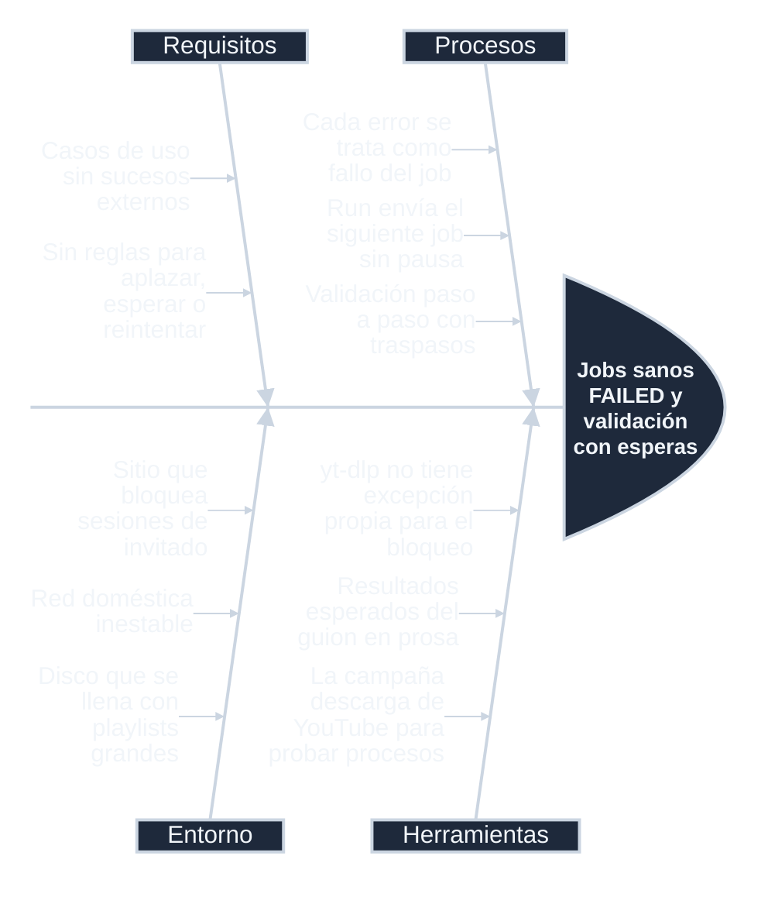

# Análisis: funcionamiento sin vigilancia y validación sin esperas

- **Fase RUP:** Elaboración (cambio de requisitos tras la campaña T42)
- **Versión:** 2.0 (revisada con la guía BABOK v3; propuesta para revisión del Responsable)
- **Fecha:** 2026-11-26
- **Técnicas (BABOK v3):**
  - 6.1 Analyze Current State y 6.2 Define Future State;
  - 10.34 Process Analysis (mapa de flujo de valor);
  - 10.40 Root Cause Analysis (espina de pescado y cinco porqués);
  - 10.47 Use Cases and Scenarios;
  - 10.9 Business Rules Analysis;
  - 10.33 Prioritization (agrupación);
  - 7.2 Verify Requirements.
- **Resultados:**
  - casos de uso nuevos del producto, [UC-11](use-cases/uc-11-wait-out-a-site-block.md) a [UC-14](use-cases/uc-14-pause-and-continue-the-queue.md);
  - [reglas de negocio](business-rules.md);
  - [casos de uso de la validación](../process/validation-use-case-model.md);
  - [ADR-0031](../notes/adr-0031-site-waits-and-network-waits.md) (propuesta).

La versión 1.0 de este análisis trataba solo el bloqueo de YouTube y los cortes de red. Esta versión identifica de forma sistemática todos los casos de uso que faltan, en el producto y en la validación, y ajusta la forma de los casos de uso a BABOK 10.47.

---

## 1. Necesidad (6.1)

| | |
|---|---|
| **El problema de** | una cola que no reacciona a lo que pasa fuera de ella (el sitio bloquea, falta la red, se llena el disco), y una validación en Windows que depende de esperas y de pasos manuales |
| **afecta a** | el User, que deja la cola trabajando sin vigilarla, y al Evaluador, que valida cada commit en Windows |
| **cuyo impacto es** | jobs sanos marcados `FAILED` en segundos; peticiones a un sitio que ya bloquea; trabajo manual para notar, esperar y reintentar; y, en la campaña, la mitad del tiempo del Evaluador esperando instrucciones (§2.2) |
| **una solución exitosa** | deja de pedir cuando el sitio o el entorno no responden, espera sin gastar los jobs y continúa sola; y una validación que ejecuta y comprueba cada bloque sin que el Evaluador espere a nadie |

**Restricción del Responsable (2026-11-26):** no depender de PO Tokens.

## 2. Estado actual (6.1)

### 2.1 Evidencia del producto

| Momento (2026-11-25) | Suceso externo | Respuesta actual de la cola |
|---|---|---|
| 22:24, paso 5.2 | El equipo perdió la resolución de nombres (`getaddrinfo failed`, 11001) | 8 jobs `FAILED` con `NETWORK` en segundos y uno `UNKNOWN` (T42-D7); `run` siguió enviando jobs hasta vaciar la cola |
| 23:27, paso 5.7 | Otro programa retuvo la base de datos | `run` terminaba a mitad de la cola (T42-D12, ya corregido) |
| 23:36, paso 5.7 | YouTube respondió `Sign in to confirm you're not a bot` a toda petición | Cada job falló en 1 o 2 s con `UNAVAILABLE`, gastando su intento |

Entre las 22:23 y las 23:36, los logs de las colas registran 93 extracciones de YouTube (81 videos y 12 playlists), más las 4 pruebas `network`. Es menos que el límite de las sesiones de invitado que documenta yt-dlp (unos 300 videos por hora; página *Extractors* de su wiki). El bloqueo, por tanto, no depende solo del número de peticiones.

### 2.2 Mapa de flujo de valor de la sesión de validación (10.34)

La sesión del Evaluador fue el 2026-11-25, de 22:18 a 23:51 (unos 92 min).
- **De dónde salen los tiempos:** la consola del Evaluador muestra, en cada prompt, la hora y el tiempo transcurrido desde el anterior, con un margen de un minuto. Las esperas son el tiempo entre el último comando de un mensaje del Evaluador y el primero del siguiente; incluyen leer la instrucción y escribirla.
- **Clases:** valor añadido (VA), necesaria para el negocio (BVA) y sin valor añadido (NVA).

| Actividad | Min | Clase | Desperdicio (Lean) |
|---|---|---|---|
| Suites (paso 3) | 11,3 | VA | — |
| Pasos 5.2 a 5.7 con resultados válidos, incluidos los que encontraron T42-D10 y T42-D12 | 25 | VA | — |
| Preparar la ejecución, las colas, la segunda ventana y la evidencia | 5 | BVA | — |
| **Esperar la siguiente instrucción del analista** (9 esperas; la mayor, de 13 min, de 22:52 a 23:05) | **47,5** | NVA | Espera |
| Pasos repetidos por defectos del guion (5.6 sin cola, 5.7, 5.7-r2, `purge`) | 2,5 | NVA | Defectos y reproceso |
| Arranque fallido por un comando incompleto del analista (faltaba `git fetch`) | 0,5 | NVA | Defectos |
| Comprobar a mano si YouTube responde | 0,7 | NVA | Espera |

**Resultado:** un 39 % del tiempo es de valor añadido y un 51 %, espera.
- **El desperdicio dominante** no viene de la red ni del sitio: es el traspaso paso a paso entre el Evaluador y el analista. Cada resultado se pega en la conversación, se interpreta a mano y vuelve como una instrucción nueva.
- **Una dependencia innecesaria:** los pasos 6 a 12 prueban procesos, cierres y archivos, pero descargan de YouTube, así que heredan sus bloqueos y los de la red.

## 3. Causa raíz (10.40)

### 3.1 Espina de pescado

### 3.2 Cinco porqués

| Problema | Porqués | Causa raíz |
|---|---|---|
| Todos los jobs pendientes acaban `FAILED` tras un corte o un bloqueo | 1. `run` envía el siguiente job, que también falla. 2. `run` trata cada error como un fallo del job. 3. La clasificación de fallos solo tiene motivos por job (`FailureReason`); no existe una condición del entorno que comparten todos los jobs. 4. UC-03 A2 modeló los fallos como sucesos de un job. 5. Los casos de uso se identificaron por los objetivos del User, no por los sucesos externos (BABOK 10.47 admite casos de uso iniciados por un suceso externo) | **Faltó la lista de sucesos externos** al identificar los casos de uso |
| El Evaluador espera la mitad de la sesión | 1. Tras cada paso espera la siguiente instrucción. 2. El resultado se interpreta a mano en la conversación. 3. El guion describe los resultados esperados en prosa y nada los comprueba. 4. La campaña se diseñó como un guion manual (ADR-0021: sin CI; comportamientos que solo existen en Windows). 5. La herramienta de validación no se trató como una solución con sus propios casos de uso | **La validación no tiene un oráculo automático**, y sus pasos dependen de YouTube y de la red aunque no los prueben |

## 4. Identificación sistemática de casos de uso

### 4.1 Lista de actores y objetivos

| Actor | Objetivo | Cubierto por | Clasificación |
|---|---|---|---|
| User | Instalar y verificar | UC-01 | Existente |
| User | Poner contenidos en la cola | UC-02 | Existente |
| User | Poner en la cola las URLs de un archivo | UC-02 | Flujo alternativo propuesto (A5): mismo objetivo |
| User | Que la cola se descargue sin vigilarla | UC-03, UC-04 | Existente; extendido por UC-11 a UC-13 |
| User | Cancelar, recuperar, reintentar, listar, ver, purgar | UC-05 a UC-10 | Existente |
| User | Dejar libre la conexión un rato sin perder la cola | — | **UC-14 nuevo** (pausar y continuar) |
| User | Descargar sin saturar la conexión | — | Requisito no funcional (SUP-P06): una configuración, sin interacción propia |
| User | Usar su cuenta del sitio | — | Fuera de alcance (D-1) |
| User | Empezar la cola a una hora | — | Fuera de alcance: lo cubre el Programador de tareas de Windows |
| User | Ser avisado al terminar | — | Fuera de alcance: `run` ya resume al terminar |
| Mantenedor | Actualizar yt-dlp cuando un sitio cambia | Procedimiento SUP-S01 | Proceso de desarrollo, no caso de uso del sistema |
| Evaluador | Validar un commit en Windows | — | **Casos de uso de la validación** (§4.3) |

### 4.2 Lista de sucesos externos y temporales

| Suceso | Respuesta actual | Clasificación |
|---|---|---|
| El sitio bloquea la sesión (antibots, captcha, límite de peticiones) | Cada job `FAILED` con `UNAVAILABLE` | **UC-11 nuevo** |
| El equipo pierde la red | Cada job `FAILED` con `NETWORK` | **UC-12 nuevo** |
| Se llena el disco de las descargas o del estado | Cada job `FAILED` con `FILESYSTEM` (mismo patrón) | **UC-13 nuevo** |
| El equipo se suspende durante una descarga | La descarga se detiene; al despertar, errores de red | Requisito no funcional SUP-R08 (evitar la suspensión mientras hay jobs en curso); al despertar, UC-12 |
| Corte de luz o cierre | Recuperación | UC-06 (existente) |
| Otro programa retiene la base de datos | `run` terminaba a mitad de la cola | UC-03 A10 (corregido, T42-D12) |
| Un antivirus bloquea un archivo `.part` | Reintentos de yt-dlp (`file_access_retries`) | Existente (diseño, Parte 2) |
| El sitio cambia y el extractor falla | `EXTRACTOR_OUTDATED` | UC-03 A3 y SUP-S01 (existente) |
| YouTube exige PO Token a los clientes por defecto | No ocurre con yt-dlp 2026.11.23 | Riesgo R-20; SUP-S01 |
| Un contenido pide una cuenta (privado, restricción de edad, solo miembros) | `UNAVAILABLE` | UC-03 A2 (existente; regla BR-01) |

### 4.3 Validación en Windows: caso de uso de negocio y casos de uso del sistema

BABOK 10.47 distingue los casos de uso de negocio (cómo trabaja un actor en un proceso) de los de sistema (cómo usa una aplicación). La validación es un proceso del Evaluador apoyado en `scripts/windows/validation_campaign.ps1`. Sus casos de uso están en el [modelo de casos de uso de la validación](../process/validation-use-case-model.md):
- **VUC-01 a VUC-03** describen lo que ya existe.
- **VUC-04 a VUC-08** son nuevos y quitan el desperdicio del §2.2: ejecutar un bloque con comprobación automática, servir medios locales, comprobar el acceso al sitio, empaquetar la evidencia y resumir los resultados.

### 4.4 Prioridad (10.33, agrupación)

| Prioridad | Elementos | Motivo |
|---|---|---|
| **Alta** | UC-11, UC-12, VUC-04, VUC-05 | Producen el desperdicio medido: jobs perdidos y la mitad de la sesión de validación en espera |
| **Media** | UC-13, VUC-06, VUC-07, VUC-08, SUP-R08 | Mismo patrón de fallo en cadena, menos frecuente; o reducen traspasos que quedan tras VUC-04 |
| **Baja** | UC-14, UC-02 A5, SUP-P06 | Comodidad con alternativas actuales: `Ctrl+C` y volver a ejecutar `run`, o varias URLs en `enqueue` |

## 5. Estado futuro y brechas (6.2)

| Brecha | Estado futuro | Medida de éxito |
|---|---|---|
| Fallos en cadena ante sucesos externos | `run` aplaza los jobs afectados, espera y continúa (UC-11 a UC-13) | Ningún job `FAILED` por un bloqueo, un corte o un disco lleno; ningún `retry` manual tras esos sucesos |
| Peticiones a un sitio que bloquea | Ritmo y espera por sitio (UC-11, BR-02, BR-03) | Ninguna petición al sitio durante su espera |
| Esperas del Evaluador | Cada bloque se ejecuta y se comprueba solo, y escribe su resultado (VUC-04, VUC-08) | Espera del Evaluador por debajo del 10 % de la sesión |
| Pasos de la campaña que dependen de YouTube sin probarlo | Medios locales (VUC-05) | Los pasos 6 a 12 pasan sin red externa |

## 6. Reglas de negocio (10.9)

Las decisiones que gobiernan los casos de uso (qué es un bloqueo, cuánto esperar, cuándo reintentar) están en el [catálogo de reglas de negocio](business-rules.md). Así quedan separadas de los flujos y enlazadas desde el paso que las usa, como pide BABOK 10.47.

## 7. Opciones evaluadas

| Opción | Evaluación | Decisión propuesta |
|---|---|---|
| Proveedor de PO Token (plugin) | Dependencia externa no afiliada a yt-dlp, contraria a la restricción del §1. Los clientes por defecto de yt-dlp 2026.11.23 (`tv_samsung`, `visionos`; `_DEFAULT_CLIENTS` en `extractor/youtube/_video.py`) no lo exigen (`GVS_PO_TOKEN_POLICY` en `_base.py`) | Descartada |
| Cookies o cuenta | La referencia (`yt-dlp-gui-kannagi`, `Wrappers/DLP.cs`) repite con `--cookies-from-browser` cuando el error contiene `sign` y `confirm`. La wiki de yt-dlp avisa del riesgo de que la cuenta sea bloqueada, y ADR-0004 dejó sin verificar las cookies de Chrome en Windows | Fuera de alcance (D-1) |
| Ritmo de peticiones por sitio | Preajuste `-t sleep` de yt-dlp (`options.py`): de 10 a 20 s entre descargas y 0,75 s entre peticiones | Adoptada (UC-11, BR-02) |
| Aplazar y esperar ante una condición del entorno | Quita los fallos en cadena y la vigilancia | Adoptada (UC-11 a UC-13) |
| Pausar y continuar la cola | Alternativa a `Ctrl+C` desde otra terminal; base para una interfaz gráfica futura | Adoptada con prioridad baja (UC-14) |
| Oráculo automático en la validación | Quita la espera dominante del §2.2 | Adoptada (VUC-04, VUC-08) |
| Medios locales en la validación | Los pasos que no prueban YouTube dejan de depender de él | Adoptada (VUC-05) |

## 8. Verificación de los requisitos (7.2)

| Característica | Cómo se cumple |
|---|---|
| Atómicos | Un caso de uso por objetivo o suceso; cada regla de negocio, una sola directiva |
| Completos | Cada caso de uso nuevo tiene objetivo, disparador, precondiciones, flujos, excepciones y garantías de éxito y mínima; UC-01 a UC-10 reciben objetivo y disparador |
| Consistentes | Términos nuevos en el [vocabulario](../design/00-vocabulary.md); ningún caso de uso existente cambia salvo por extensión |
| Concisos | Los casos de uso hablan desde el actor; el diseño está en ADR-0031 y las reglas, en el catálogo |
| Factibles | Cada regla se apoya en una capacidad comprobada de yt-dlp 2026.11.23 o de la biblioteca estándar |
| Inequívocos y comprobables | Cada caso de uso tiene escenarios de prueba; cada regla, un valor o un criterio comprobable |
| Priorizados | §4.4 |
| Comprensibles | Español, con el vocabulario del proyecto |

## 9. Decisiones del Responsable

| Id | Decisión | Recomendación |
|---|---|---|
| D-1 | ¿Cookies o cuenta del sitio? | Fuera de alcance; se reconsidera si el bloqueo se repite con el ritmo de BR-02 |
| D-2 | Si todo lo pendiente está esperando, ¿`run` espera o termina? | Espera, con un aviso periódico; `Ctrl+C` lo detiene sin perder nada |
| D-3 | Ritmo por defecto para YouTube | El de `-t sleep` (BR-02); con 100 videos añade unos 25 min |
| D-4 | Espera ante un bloqueo | 60 min, duplicando hasta 4 h (BR-03) |
| D-5 | Espacio libre mínimo para enviar un job | 1 GiB, configurable (BR-08) |
| D-6 | ¿`pause` deja terminar los jobs en curso? | Sí; `pause --now` los detiene como un `Ctrl+C` (BR-10) |

## 10. Trabajo propuesto

| Tarea | Contenido | Prioridad | Depende de |
|---|---|---|---|
| T52 | Aplazar un job (`JobDeferred`, `RUNNING → PENDING` sin gastar intento) y clasificar el bloqueo con una prueba de contrato | Alta | D-1 |
| T53 | Esperas por sitio persistentes, ritmo por sitio y prueba tras la espera (UC-11) | Alta | T52, D-2 a D-4 |
| T54 | Esperar a la red y reintento automático de un fallo aislado (UC-12) | Alta | T52 |
| T55 | Esperar a que haya espacio en disco (UC-13) | Media | T52, D-5 |
| T56 | `list`, `show` y `diagnose` con las esperas (UC-08 A4, UC-09 A4, UC-01 A9) | Media | T53 a T55 |
| T57 | Evitar la suspensión del equipo con jobs en curso (SUP-R08) | Media | — |
| T58 | Pausar y continuar la cola (UC-14) y límite de ancho de banda (SUP-P06) | Baja | D-6 |
| T59 | Medios locales para la validación (VUC-05) | Alta | — |
| T60 | Bloques de la campaña con comprobación automática y resumen de resultados (VUC-04, VUC-08) | Alta | T59 |
| T61 | Comprobación del acceso al sitio y paquete de evidencia (VUC-06, VUC-07) | Media | — |

## Fuentes

- IIBA, *A Guide to the Business Analysis Body of Knowledge (BABOK Guide)* v3, copia entregada por el Responsable: 6.1, 6.2, 7.2, 10.9, 10.33, 10.34, 10.40 y 10.47.
- Wiki de yt-dlp, *Extractors* y *PO-Token-Guide*: texto entregado por el Responsable el 2026-11-26.
- yt-dlp 2026.11.23:
  - `yt_dlp/extractor/youtube/_video.py`: `_DEFAULT_CLIENTS` y `playabilityStatus`;
  - `yt_dlp/extractor/youtube/_base.py`;
  - `yt_dlp/extractor/common.py`: `raise_no_formats`;
  - `yt_dlp/options.py`: preajuste `sleep`;
  - `yt_dlp/YoutubeDL.py`.
- Espacio de análisis: `upstream/source/yt-dlp-gui-kannagi`.
- Consolas y evidencia de la ejecución `20261125-222227-ddffe96cb470` ([registro de la campaña](../project-management/t42-results.md)).
