# Modelo de casos de uso

- **Fase RUP:** Elaboración
- **Versión:** 2.1 (2026-11-26; reconciliación de exclusiones: UC-18 a UC-28). 2.0 (2026-11-26; consolidación del modelo de requisitos). La 1.1 era la auditoría previa a la aceptación (T49).
- **Términos:** [vocabulario](../design/00-vocabulary.md)
- **Razonamiento y evidencia:** [análisis de requisitos](requirements-analysis.md)

---

## 1. Actores

| Actor | Tipo | Descripción |
|---|---|---|
| **User** | Principal | Persona que usa la línea de comandos en Windows 10/11 x64, posiblemente con un equipo y una conexión modestos |
| **Media site** | Secundario | Sitio de video o audio soportado por yt-dlp (YouTube y otros). Responde a las peticiones de extracción y descarga, y puede restringirlas |
| **Mantenedor** | Secundario | Recibe el informe de diagnóstico (UC-16), cualifica versiones de las dependencias (UC-27, SUP-S01) |
| **Programa cliente** | Principal (canal) | Otro programa que usa las operaciones del producto con su contrato estructurado (SUP-I01); no tiene casos de uso propios: usa los del User (§13.7 del análisis) |
| **Sistema de archivos** | Secundario | Unidades y programas que retienen archivos (UC-17, UC-25) |
| **Servicio de SponsorBlock** | Secundario | Proporciona los segmentos de un video de YouTube (UC-03 A18) |
| **Temporizador** | Secundario | Reloj del sistema o Programador de tareas de Windows (UC-21, según D-13) |

---

## 2. Formato de los casos de uso

Cada caso de uso sigue BABOK v3, 10.47, con estos elementos:
- nombre, objetivo, actores principal y secundarios, disparador;
- precondiciones y postcondiciones (garantías de éxito y mínima);
- flujo básico, flujos alternativos y excepciones;
- reglas de negocio, requisitos suplementarios, restricciones y dependencias asociados;
- criterios de aceptación y escenarios de prueba.

Los flujos transversales se documentan una sola vez y se enlazan:
- condiciones de fallo y su tratamiento: [catálogo de condiciones de fallo](failure-conditions.md);
- reglas: [catálogo de reglas de negocio](business-rules.md);
- condiciones externas durante `run`: UC-11, que extiende UC-03 y UC-04.

En UC-01, UC-02, UC-04 y UC-06, los flujos que terminan sin el objetivo (configuración no válida, base de datos inutilizable) están entre los alternativos, con su código de salida; no se duplican como excepciones.

---

## 3. Diagrama

Los casos de uso significativos para la arquitectura están resaltados; los propuestos tienen el borde discontinuo, y los condicionados a una decisión, el borde ámbar. El Programa cliente no aparece: usa los mismos casos de uso que el User.

```mermaid
---
config:
  theme: base
  darkMode: true
  themeVariables:
    background:         "#0f172a"
    primaryColor:       "#1e293b"
    primaryTextColor:   "#f1f5f9"
    primaryBorderColor: "#94a3b8"
    lineColor:          "#cbd5e1"
    secondaryColor:     "#334155"
    tertiaryColor:      "#1e3a8a"
    noteBkgColor:       "#1e3a8a"
    noteTextColor:      "#f1f5f9"
---
flowchart LR
    User(["User"])
    MediaSite(["Media site"])
    Maintainer(["Mantenedor"])

    subgraph System["queued-media-downloader"]
        InstallAndVerify["UC-01 Install and verify environment"]
        InspectMedia["UC-15 Inspect media before enqueueing"]
        EnqueueMedia["UC-02 Enqueue media"]
        DownloadSingleMedia["UC-03 Download single media"]
        ExpandPlaylist["UC-04 Expand playlist"]
        CancelJob["UC-05 Cancel job"]
        RecoverAndResume["UC-06 Recover and resume queue"]
        RetryJob["UC-07 Retry job"]
        ListJobs["UC-08 List jobs"]
        ShowJob["UC-09 Show job"]
        PurgeFinishedJobs["UC-10 Purge finished jobs"]
        PreserveJobs["UC-11 Preserve jobs under external conditions"]
        PreserveStorage["UC-17 Preserve work under storage failures"]
        ControlQueue["UC-14 Control queue execution"]
        DiagnosticReport["UC-16 Prepare a diagnostic report"]
        DownloadProfiles["UC-18 Manage download profiles"]
        AccessProfiles["UC-19 Manage authorized access profiles"]
        Configuration["UC-20 Manage application configuration"]
        Schedule["UC-21 Schedule queue execution"]
        ExportImport["UC-22 Export and import queue"]
        BackupRestore["UC-23 Back up and restore queue"]
        SupplementaryInfo["UC-24 Retrieve supplementary information"]
        ManageMedia["UC-25 Manage downloaded media"]
        VerifyMedia["UC-26 Verify downloaded media"]
        Dependencies["UC-27 Manage media dependencies"]
        Notifications["UC-28 Receive operational notifications"]
    end

    User --> InstallAndVerify
    User --> InspectMedia
    User --> EnqueueMedia
    User --> DownloadSingleMedia
    User --> ExpandPlaylist
    User --> CancelJob
    User --> RecoverAndResume
    User --> RetryJob
    User --> ListJobs
    User --> ShowJob
    User --> PurgeFinishedJobs
    User --> ControlQueue
    User --> DiagnosticReport
    User --> DownloadProfiles
    User --> AccessProfiles
    User --> Configuration
    User --> Schedule
    User --> ExportImport
    User --> BackupRestore
    User --> SupplementaryInfo
    User --> ManageMedia
    User --> VerifyMedia
    User --> Dependencies
    User --> Notifications
    SupplementaryInfo --> MediaSite
    InspectMedia --> MediaSite
    DownloadSingleMedia --> MediaSite
    ExpandPlaylist --> MediaSite
    PreserveJobs -. extends .-> DownloadSingleMedia
    PreserveJobs -. extends .-> ExpandPlaylist
    PreserveStorage -. extends .-> DownloadSingleMedia
    PreserveStorage -. extends .-> ExpandPlaylist
    DiagnosticReport --> Maintainer

    classDef default fill:#1e293b,stroke:#94a3b8,stroke-width:1px,color:#f1f5f9
    classDef cluster fill:#1e3a8a,stroke:#94a3b8,stroke-width:1px,color:#f1f5f9
    classDef focal fill:#1e3a8a,stroke:#60a5fa,color:#f1f5f9
    classDef optional fill:#1e293b,stroke:#475569,stroke-dasharray:4 3,color:#94a3b8
    classDef focalProposed fill:#1e3a8a,stroke:#60a5fa,stroke-dasharray:4 3,color:#f1f5f9
    classDef external fill:#172032,stroke:#475569,color:#94a3b8
    classDef conditioned fill:#1c1400,stroke:#fbbf24,stroke-dasharray:4 3,color:#fde68a
    class InstallAndVerify,DownloadSingleMedia,ExpandPlaylist,CancelJob,RecoverAndResume,EnqueueMedia focal
    class PreserveJobs,PreserveStorage focalProposed
    class InspectMedia,ControlQueue,DiagnosticReport,DownloadProfiles,Configuration,Schedule,ExportImport,BackupRestore,SupplementaryInfo,ManageMedia,VerifyMedia optional
    class AccessProfiles,Dependencies,Notifications conditioned
    class MediaSite,Maintainer external
```

UC-03 y UC-04 los inicia el User con `run`; se ejecutan dentro de la cola y se comunican con el Media site. UC-11 los extiende ante una restricción del sitio o un corte de conectividad, y UC-17, ante un fallo de almacenamiento. La validación en Windows tiene su propio [modelo de casos de uso](../process/validation-use-case-model.md).

---

## 4. Casos de uso

| ID | Caso de uso | Comando | Arquitectura | Estado | Especificación |
|---|---|---|---|---|---|
| UC-01 | Instalar y verificar el entorno | `uv sync`, `diagnose` | **Sí:** uv, ffmpeg incluido, Git LFS, deno, Windows | Implementado; A9 a A11 propuestos | [Completa](use-cases/uc-01-install-and-verify-environment.md) |
| UC-02 | Encolar contenido | `enqueue` | **Sí:** entrada a la cola, SQLite, varios procesos | Implementado; A5, A6, A8 y A9 propuestos, A7 pendiente de cualificación | [Completa](use-cases/uc-02-enqueue-media.md) |
| UC-03 | Descargar un contenido | `run` | **Sí:** recorre toda la arquitectura | Implementado; A11 a A14 propuestos; A15 divergente; E1 sin cualificar | [Completa](use-cases/uc-03-download-single-media.md) |
| UC-04 | Expandir una playlist | `run` | **Sí:** iteración perezosa, duplicados, jobs hijos | Implementado; A6 parcial; A8 propuesto | [Completa](use-cases/uc-04-expand-playlist.md) |
| UC-05 | Cancelar un job | `cancel` | **Sí:** cancelación cooperativa y forzada, árbol de procesos | Implementado | [Completa](use-cases/uc-05-cancel-job.md) |
| UC-06 | Recuperar la cola y reanudar descargas | `run` | **Sí:** recuperación, `.part`, `selected_format_id` | Implementado; A4 parcial (R-25); A10 y A11 propuestos | [Completa](use-cases/uc-06-recover-and-resume-queue.md) |
| UC-07 | Reintentar un job | `retry` | No | Implementado | [Completa](use-cases/uc-07-retry-job.md) |
| UC-08 | Listar jobs | `list` | No | Implementado; A4 a A6 propuestos | [Completa](use-cases/uc-08-list-jobs.md) |
| UC-09 | Ver un job | `show` | No | Implementado; A2 parcial; A4 y A5 propuestos | [Completa](use-cases/uc-09-show-job.md) |
| UC-10 | Purgar jobs terminados | `purge` | No | Implementado; A5 propuesto | [Completa](use-cases/uc-10-purge-finished-jobs.md) |
| UC-11 | Preservar los jobs ante condiciones externas (sitio y conectividad) | `run` | **Sí:** `JobDeferred`, control de admisión | Propuesto; política pendiente (D-2) | [Completa](use-cases/uc-11-preserve-jobs-under-external-conditions.md) |
| UC-12 | — | — | — | **Retirado** (2026-11-26): consolidado en UC-11 A2; el id no se reutiliza | — |
| UC-13 | — | — | — | **Retirado** (2026-11-26): consolidado en UC-11 A3 y después sustituido por UC-17, que es una responsabilidad nueva y mayor, no su reactivación ([análisis, §13.9](requirements-analysis.md#139-gobierno-de-los-identificadores)); el id no se reutiliza | — |
| UC-14 | Controlar temporalmente la ejecución de la cola | `pause`, `resume`, `stop` | No | Propuesto (D-6) | [Completa](use-cases/uc-14-control-queue-execution.md) |
| UC-15 | Consultar un contenido antes de encolarlo | `inspect` | No | Propuesto | [Completa](use-cases/uc-15-inspect-media-before-enqueueing.md) |
| UC-16 | Preparar un informe de diagnóstico | `report` | No | Propuesto | [Completa](use-cases/uc-16-prepare-a-diagnostic-report.md) |
| UC-17 | Preservar el trabajo ante fallos de almacenamiento | `run` | **Sí:** control de admisión por unidad, identificación en la cadena de causas | Propuesto; D-5 y D-12 pendientes | [Completa](use-cases/uc-17-preserve-work-under-storage-failures.md) |
| UC-18 | Administrar perfiles de descarga | `profile` | No | Propuesto (D-19) | [Completa](use-cases/uc-18-manage-download-profiles.md) |
| UC-19 | Administrar perfiles de acceso autorizado | `access` | **Sí:** ciclo de vida de credenciales | Condicionado (D-1, D-7) | [Completa](use-cases/uc-19-manage-authorized-access-profiles.md) |
| UC-20 | Administrar la configuración | `config` | No | Propuesto; parcial (carga y validación existen) | [Completa](use-cases/uc-20-manage-application-configuration.md) |
| UC-21 | Programar la ejecución de la cola | `schedule` | Según D-13 | Propuesto (D-13) | [Completa](use-cases/uc-21-schedule-queue-execution.md) |
| UC-22 | Exportar e importar la cola y el historial | `export`, `import` | **Sí:** formato de intercambio | Propuesto | [Completa](use-cases/uc-22-export-and-import-queue.md) |
| UC-23 | Respaldar y restaurar la cola | `backup`, `restore` | **Sí:** copia coherente | Propuesto; parcial (UC-06 A8) | [Completa](use-cases/uc-23-back-up-and-restore-queue.md) |
| UC-24 | Obtener la información complementaria de un contenido | `enqueue --info-only` | **Sí:** job sin resultado multimedia | Propuesto (D-15, D-16) | [Completa](use-cases/uc-24-retrieve-supplementary-media-information.md) |
| UC-25 | Administrar los resultados descargados | `files` | **Sí:** registro de resultados | Propuesto; parcial (`output_path`) | [Completa](use-cases/uc-25-manage-downloaded-media.md) |
| UC-26 | Verificar los resultados descargados | `verify` | No | Propuesto (D-9, D-15) | [Completa](use-cases/uc-26-verify-downloaded-media.md) |
| UC-27 | Administrar las dependencias multimedia | `dependencies` | Según D-8 | Condicionado (D-8); sustituye al candidato «Actualizar yt-dlp» | [Completa](use-cases/uc-27-manage-media-dependencies.md) |
| UC-28 | Recibir avisos operativos | — (`run`) | No | Condicionado (D-14) | [Completa](use-cases/uc-28-receive-operational-notifications.md) |

### 4.1 Capacidades transversales

| Capacidad | Autoridad | Usada por |
|---|---|---|
| Clasificar un fallo e informar de él | [Catálogo de condiciones de fallo](failure-conditions.md), BR-22, SUP-U05 | UC-03, UC-04, UC-06, UC-09, UC-15 |
| Condiciones externas y de almacenamiento | UC-11 (sitio y conectividad), UC-17 (almacenamiento); BR-01, BR-05, BR-08, BR-25 a BR-28 | UC-03, UC-04, UC-15 |
| Propiedad de los archivos finales | BR-17, [ADR-0030](../notes/adr-0030-final-file-ownership-claims.md) | UC-03, UC-06, UC-07, UC-10 |
| Job requests desde otra terminal | SUP-C04 | UC-05, UC-07, UC-14 |
| Cola ocupada por otro programa | UC-03 A10 | Todos los comandos |
| Recogida de diagnóstico y limpieza de datos sensibles | SUP-O03, SUP-SEC01 | UC-01, UC-16, VUC-07 |
| Resultados de un job: obligatoriedad, completitud y propiedad | BR-29 a BR-31, D-15 ([análisis, §13.1](requirements-analysis.md#131-resultados-de-un-job-y-su-cardinalidad)) | UC-03, UC-05, UC-06, UC-07, UC-09, UC-10, UC-24, UC-25, UC-26 |
| Identidad de las peticiones y variantes | BR-13, BR-32, D-16 | UC-02, UC-03, UC-18, UC-22, UC-24 |
| Credenciales: referencias y copias por job | BR-34, BR-35, SUP-SEC01, SUP-SEC03, SUP-SEC04 | UC-19, UC-20, UC-22, UC-23 |
| Contrato estructurado para programas | SUP-I01, D-17 | Todos los comandos |
| Admisión de `run` (ventana, pausa, condiciones, conexión de uso medido) | BR-09, BR-10, BR-28, BR-37 | UC-11, UC-14, UC-17, UC-21 |

### 4.2 Exclusiones

El inventario de exclusiones y su cualificación están en el [análisis, §12](requirements-analysis.md#12-reconciliación-de-exclusiones): 34 exclusiones de alcance revisadas, 9 se mantienen y 18 se reincorporaron como necesidades.

---

## 5. Matriz de completitud

La genera `scripts/check_requirements_model.py` a partir de las especificaciones, y `scripts/run_checks.py` comprueba que esté al día. No se edita a mano.

Tiene dos dimensiones:
- **Definición** del caso de uso (campo Estado): aprobado, propuesto, condicionado o retirado (los retirados no tienen especificación).
- **Estado de cada flujo:**
  - **implementado:** existe y lo cubren las pruebas automáticas;
  - **parcial:** existe con una brecha o limitación documentada;
  - **defecto:** un escenario vigente se comporta mal;
  - **divergente:** incumple el reparto de responsabilidades documentado;
  - **propuesto** o **condicionado:** ausente en el código;
  - **sin cualificar.**

Las reglas para leer las marcas de cada flujo están en el docstring del script.

<!-- completeness-matrix:start -->
| UC | Definición | Alternativos | Excepciones | Implementado | Parcial | Defecto | Divergente | Propuesto | Condicionado | Sin cualificar | Reglas | Suplementarios | Criterios | Necesita Windows |
|---|---|---|---|---|---|---|---|---|---|---|---|---|---|---|
| UC-01 | aprobado | 11 | 0 | 8 | 0 | 0 | 0 | 3 | 0 | 0 | 3 | 7 | 3 | Sí |
| UC-02 | aprobado | 14 | 0 | 4 | 0 | 0 | 0 | 9 | 1 | 0 | 5 | 3 | 3 | No |
| UC-03 | aprobado | 19 | 2 | 9 | 1 | 1 | 1 | 8 | 0 | 1 | 12 | 9 | 4 | Sí |
| UC-04 | aprobado | 8 | 0 | 6 | 1 | 0 | 0 | 1 | 0 | 0 | 2 | 2 | 3 | No |
| UC-05 | aprobado | 9 | 3 | 11 | 0 | 0 | 0 | 1 | 0 | 0 | 2 | 2 | 4 | Sí |
| UC-06 | aprobado | 12 | 0 | 8 | 0 | 1 | 0 | 3 | 0 | 0 | 7 | 3 | 4 | Sí |
| UC-07 | aprobado | 8 | 3 | 10 | 0 | 0 | 0 | 1 | 0 | 0 | 4 | 2 | 3 | Sí |
| UC-08 | aprobado | 6 | 3 | 6 | 0 | 0 | 0 | 3 | 0 | 0 | 0 | 2 | 2 | Sí |
| UC-09 | aprobado | 6 | 2 | 4 | 1 | 0 | 0 | 3 | 0 | 0 | 1 | 3 | 2 | Sí |
| UC-10 | aprobado | 6 | 2 | 6 | 0 | 0 | 0 | 2 | 0 | 0 | 2 | 1 | 3 | Sí |
| UC-11 | propuesto | 9 | 4 | 0 | 0 | 0 | 0 | 13 | 0 | 0 | 10 | 7 | 5 | Sí |
| UC-14 | propuesto | 6 | 1 | 0 | 0 | 0 | 0 | 7 | 0 | 0 | 2 | 2 | 4 | Sí |
| UC-15 | propuesto | 6 | 3 | 0 | 0 | 0 | 0 | 9 | 0 | 0 | 3 | 3 | 3 | Sí |
| UC-16 | propuesto | 2 | 1 | 0 | 0 | 0 | 0 | 3 | 0 | 0 | 0 | 3 | 3 | No |
| UC-17 | propuesto | 10 | 2 | 0 | 0 | 0 | 0 | 12 | 0 | 0 | 8 | 4 | 5 | Sí |
| UC-18 | propuesto | 7 | 3 | 0 | 0 | 0 | 0 | 10 | 0 | 0 | 2 | 2 | 3 | No |
| UC-19 | condicionado | 10 | 3 | 0 | 0 | 0 | 0 | 0 | 13 | 0 | 3 | 3 | 4 | Sí |
| UC-20 | propuesto | 7 | 2 | 0 | 0 | 0 | 0 | 9 | 0 | 0 | 3 | 4 | 3 | No |
| UC-21 | propuesto | 9 | 2 | 0 | 0 | 0 | 0 | 11 | 0 | 0 | 3 | 2 | 3 | Sí |
| UC-22 | propuesto | 6 | 3 | 0 | 0 | 0 | 0 | 9 | 0 | 0 | 4 | 2 | 4 | No |
| UC-23 | propuesto | 3 | 3 | 0 | 0 | 0 | 0 | 6 | 0 | 0 | 4 | 2 | 3 | No |
| UC-24 | propuesto | 8 | 2 | 0 | 0 | 0 | 0 | 10 | 0 | 0 | 5 | 3 | 3 | Sí |
| UC-25 | propuesto | 6 | 3 | 0 | 0 | 0 | 0 | 9 | 0 | 0 | 4 | 2 | 3 | Sí |
| UC-26 | propuesto | 4 | 2 | 0 | 0 | 0 | 0 | 6 | 0 | 0 | 5 | 2 | 3 | Sí |
| UC-27 | condicionado | 5 | 2 | 0 | 0 | 0 | 0 | 0 | 7 | 0 | 0 | 3 | 3 | No |
| UC-28 | condicionado | 4 | 1 | 0 | 0 | 0 | 0 | 0 | 5 | 0 | 2 | 3 | 2 | Sí |
| **Total** | **26** | **201** | **52** | **72** | **3** | **2** | **1** | **148** | **26** | **1** | — | — | **85** | **18 de 26** |
<!-- completeness-matrix:end -->

Las columnas Reglas y Suplementarios cuentan los identificadores distintos que enlaza cada caso de uso.

**Verificación:**
- **Implementados:** pasan las pruebas automáticas de `main` (verificados en desarrollo).
- **Correcciones T42-D7 a D12:** esperan su confirmación en Windows ([plan de E2, §8](../project-management/iteration-plan-e2.md#8-matriz-de-casos-de-uso-implementación-y-validación)).
- **Propuestos y condicionados:** no están implementados ni validados.

No hay una baseline validada en Windows posterior a la campaña T42.

## 6. Trazabilidad con el diseño

| Caso de uso | Componentes | Módulos de caso de uso |
|---|---|---|
| UC-01 | `ffmpeg_discovery`, `diagnostics`, `configuration` | `diagnostics/diagnose_environment.py` |
| UC-02 | `job_queue`, `job_storage` | `job_queue/enqueue_media.py` |
| UC-03 | `job_queue`, `workers`, `media_extraction`, `job_storage` | `job_queue/run_queue.py` |
| UC-04 | `job_queue`, `workers`, `media_extraction`, `job_storage` | `job_queue/run_queue.py` |
| UC-05 | `job_queue`, `workers`, `job_storage` | `job_queue/cancel_job.py`, `job_queue/run_queue.py` |
| UC-06 | `job_queue`, `media_extraction`, `job_storage` | `job_queue/recover_interrupted_jobs.py`, `job_queue/run_queue.py` |
| UC-07 | `job_queue`, `job_storage` | `job_queue/retry_job.py`, `job_queue/run_queue.py` |
| UC-08, UC-09 | `job_queue`, `job_storage` | `job_queue/list_jobs.py` (`ListJobs`, `ShowJob`) |
| UC-10 | `job_queue`, `job_storage`, `media_extraction` (parciales y reclamaciones) | `job_queue/purge_finished_jobs.py` |
| UC-11, UC-14, UC-17 (propuestos) | `job_queue`, `workers`, `media_extraction`, `job_storage` | `job_queue/run_queue.py` (planificación y aplazamientos); clasificación en `media_extraction` ([ADR-0031](../notes/adr-0031-site-waits-and-network-waits.md)) |
| UC-15 (propuesto) | `media_extraction`, `command_line` | Sin diseñar |
| UC-16 (propuesto) | `diagnostics`, `job_storage`, `command_line` | Sin diseñar |
| UC-18 a UC-28 (propuestos o condicionados) | Se derivarán de los requisitos consolidados y de D-13 a D-20; ningún módulo, tabla ni evento nuevo se decide en esta etapa | Sin diseñar |

La trazabilidad por requisito (requisito, criterio, componentes, tareas, código, pruebas, evidencia, divergencias y pendientes en Windows) está en el [plan de E2, §8](../project-management/iteration-plan-e2.md#8-matriz-de-casos-de-uso-implementación-y-validación).
