# Modelo de casos de uso

- **Fase RUP:** Elaboración
- **Versión:** 3.4 (2026-11-26; instrucción 2.7.0: UC-33 a UC-40 aceptados, 38 casos de uso aceptados; UC-41 reconciliado como «Adquirir acceso a la aplicación»; candidatos UC-42 y UC-43, §4.3). 3.3 (2026-11-26; instrucción 2.6.0: UC-29 a UC-32 aceptados, 30 casos de uso aceptados; candidatos UC-33 a UC-41 con horizonte futuro, §4.3). 3.2 (2026-11-26; casos de uso candidatos UC-29 a UC-32 y ampliaciones propuestas, §4.3, instrucción 2.5.0). 3.1 (2026-11-26; trazabilidad con la realización arquitectónica y la aplicabilidad por plataforma). 3.0 (2026-11-26; **alcance de los 26 casos de uso aceptado por el Responsable**). 2.1: reconciliación de exclusiones, UC-18 a UC-28. 2.0 (2026-11-26; consolidación del modelo de requisitos). La 1.1 era la auditoría previa a la aceptación (T49).
- **Términos:** [vocabulario](../design/00-vocabulary.md)
- **Razonamiento y evidencia:** [análisis de requisitos](requirements-analysis.md)

---

## 1. Actores

| Actor | Tipo | Descripción |
|---|---|---|
| **User** | Principal | Persona que usa la línea de comandos en Windows 10/11 x64, posiblemente con un equipo y una conexión modestos |
| **Media site** | Secundario | Sitio de video o audio soportado por yt-dlp (YouTube y otros). Responde a las peticiones de extracción y descarga, y puede restringirlas |
| **Mantenedor** | Secundario | Recibe el informe de diagnóstico (UC-16), cualifica versiones de las dependencias (UC-27, SUP-S01) |
| **Programa cliente** | Principal (canal) | Otro programa que usa las operaciones del producto con su contrato estructurado (SUP-I01); no tiene casos de uso propios: usa los del User (§13.7 del análisis) |
| **Sistema de archivos** | Secundario | Unidades y programas que retienen archivos (UC-17, UC-25) |
| **Servicio de SponsorBlock** | Secundario | Proporciona los segmentos de un video de YouTube (UC-03 A18) |
| **Temporizador** | Secundario | Reloj del sistema o Programador de tareas de Windows (UC-21, según D-13) |

---

## 2. Formato de los casos de uso

Cada caso de uso sigue BABOK v3, 10.47, con estos elementos:
- nombre, objetivo, actores principal y secundarios, disparador;
- precondiciones y postcondiciones (garantías de éxito y mínima);
- flujo básico, flujos alternativos y excepciones;
- reglas de negocio, requisitos suplementarios, restricciones y dependencias asociados;
- criterios de aceptación y escenarios de prueba.

Los flujos transversales se documentan una sola vez y se enlazan:
- condiciones de fallo y su tratamiento: [catálogo de condiciones de fallo](failure-conditions.md);
- reglas: [catálogo de reglas de negocio](business-rules.md);
- condiciones externas durante `run`: UC-11, que extiende UC-03 y UC-04.

En UC-01, UC-02, UC-04 y UC-06, los flujos que terminan sin el objetivo (configuración no válida, base de datos inutilizable) están entre los alternativos, con su código de salida; no se duplican como excepciones.

---

## 3. Diagrama

Todos los casos de uso del diagrama tienen el alcance aceptado; los candidatos (§4.3) no aparecen. Los significativos para la arquitectura están resaltados; los que aún no están implementados tienen el borde discontinuo. El Programa cliente no aparece: usa los mismos casos de uso que el User.

```mermaid
---
config:
  theme: base
  darkMode: true
  themeVariables:
    background:         "#0f172a"
    primaryColor:       "#1e293b"
    primaryTextColor:   "#f1f5f9"
    primaryBorderColor: "#94a3b8"
    lineColor:          "#cbd5e1"
    secondaryColor:     "#334155"
    tertiaryColor:      "#1e3a8a"
    noteBkgColor:       "#1e3a8a"
    noteTextColor:      "#f1f5f9"
---
flowchart LR
    User(["User"])
    MediaSite(["Media site"])
    Maintainer(["Mantenedor"])

    subgraph System["queued-media-downloader"]
        InstallAndVerify["UC-01 Install and verify environment"]
        InspectMedia["UC-15 Inspect media before enqueueing"]
        EnqueueMedia["UC-02 Enqueue media"]
        DownloadSingleMedia["UC-03 Download single media"]
        ExpandPlaylist["UC-04 Expand playlist"]
        CancelJob["UC-05 Cancel job"]
        RecoverAndResume["UC-06 Recover and resume queue"]
        RetryJob["UC-07 Retry job"]
        ListJobs["UC-08 List jobs"]
        ShowJob["UC-09 Show job"]
        PurgeFinishedJobs["UC-10 Purge finished jobs"]
        PreserveJobs["UC-11 Preserve jobs under external conditions"]
        PreserveStorage["UC-17 Preserve work under storage failures"]
        ControlQueue["UC-14 Control queue execution"]
        DiagnosticReport["UC-16 Prepare a diagnostic report"]
        DownloadProfiles["UC-18 Manage download profiles"]
        AccessProfiles["UC-19 Manage authorized access profiles"]
        Configuration["UC-20 Manage application configuration"]
        Schedule["UC-21 Schedule queue execution"]
        ExportImport["UC-22 Export and import queue"]
        BackupRestore["UC-23 Back up and restore queue"]
        SupplementaryInfo["UC-24 Retrieve supplementary information"]
        ManageMedia["UC-25 Manage downloaded media"]
        VerifyMedia["UC-26 Verify downloaded media"]
        Dependencies["UC-27 Manage media dependencies"]
        Notifications["UC-28 Receive operational notifications"]
        ModifyJobs["UC-29 Modify unfinished jobs"]
        Subscriptions["UC-30 Manage content subscriptions"]
        NewContent["UC-31 Retrieve new content"]
        UpdateApplication["UC-32 Update the application"]
        Transcribe["UC-33 Transcribe media"]
        Translate["UC-34 Translate a transcript"]
        Summarize["UC-35 Summarize media content"]
        Subtitles["UC-36 Generate subtitles"]
        Speech["UC-37 Generate speech"]
        Dub["UC-38 Dub media"]
        Models["UC-39 Manage inference models"]
        Collections["UC-40 Manage media collections"]
    end

    User --> InstallAndVerify
    User --> InspectMedia
    User --> EnqueueMedia
    User --> DownloadSingleMedia
    User --> ExpandPlaylist
    User --> CancelJob
    User --> RecoverAndResume
    User --> RetryJob
    User --> ListJobs
    User --> ShowJob
    User --> PurgeFinishedJobs
    User --> ControlQueue
    User --> DiagnosticReport
    User --> DownloadProfiles
    User --> AccessProfiles
    User --> Configuration
    User --> Schedule
    User --> ExportImport
    User --> BackupRestore
    User --> SupplementaryInfo
    User --> ManageMedia
    User --> VerifyMedia
    User --> Dependencies
    User --> Notifications
    User --> ModifyJobs
    User --> Subscriptions
    User --> NewContent
    User --> UpdateApplication
    NewContent --> MediaSite
    User --> Transcribe
    User --> Translate
    User --> Summarize
    User --> Subtitles
    User --> Speech
    User --> Dub
    User --> Models
    User --> Collections
    SupplementaryInfo --> MediaSite
    InspectMedia --> MediaSite
    DownloadSingleMedia --> MediaSite
    ExpandPlaylist --> MediaSite
    PreserveJobs -. extends .-> DownloadSingleMedia
    PreserveJobs -. extends .-> ExpandPlaylist
    PreserveStorage -. extends .-> DownloadSingleMedia
    PreserveStorage -. extends .-> ExpandPlaylist
    DiagnosticReport --> Maintainer

    classDef default fill:#1e293b,stroke:#94a3b8,stroke-width:1px,color:#f1f5f9
    classDef cluster fill:#1e3a8a,stroke:#94a3b8,stroke-width:1px,color:#f1f5f9
    classDef focal fill:#1e3a8a,stroke:#60a5fa,color:#f1f5f9
    classDef optional fill:#1e293b,stroke:#475569,stroke-dasharray:4 3,color:#94a3b8
    classDef focalProposed fill:#1e3a8a,stroke:#60a5fa,stroke-dasharray:4 3,color:#f1f5f9
    classDef external fill:#172032,stroke:#475569,color:#94a3b8
    class InstallAndVerify,DownloadSingleMedia,ExpandPlaylist,CancelJob,RecoverAndResume,EnqueueMedia focal
    class PreserveJobs,PreserveStorage,ModifyJobs,Subscriptions,NewContent,UpdateApplication,Transcribe,Translate,Summarize,Speech,Dub,Models,Collections focalProposed
    class Subtitles optional
    class InspectMedia,ControlQueue,DiagnosticReport,DownloadProfiles,Configuration,Schedule,ExportImport,BackupRestore,SupplementaryInfo,ManageMedia,VerifyMedia,AccessProfiles,Dependencies,Notifications optional
    class MediaSite,Maintainer external
```

UC-03 y UC-04 los inicia el User con `run`; se ejecutan dentro de la cola y se comunican con el Media site. UC-11 los extiende ante una restricción del sitio o un corte de conectividad, y UC-17, ante un fallo de almacenamiento. La validación en Windows tiene su propio [modelo de casos de uso](../process/validation-use-case-model.md).

---

## 4. Casos de uso

| ID | Caso de uso | Comando | Arquitectura | Estado | Especificación |
|---|---|---|---|---|---|
| UC-01 | Instalar y verificar el entorno | `uv sync`, `diagnose` | **Sí:** uv, ffmpeg incluido, Git LFS, deno, Windows | Aceptado; implementado; A9 a A11 sin implementar | [Completa](use-cases/uc-01-install-and-verify-environment.md) |
| UC-02 | Encolar contenido | `enqueue` | **Sí:** entrada a la cola, SQLite, varios procesos | Aceptado; implementado; A5 a A14 sin implementar, A14 con condición técnica (R-29) | [Completa](use-cases/uc-02-enqueue-media.md) |
| UC-03 | Descargar un contenido | `run` | **Sí:** recorre toda la arquitectura | Aceptado; implementado; A1 divergente (D-16), A2 defecto (R-28), A15 divergente (R-24), ampliaciones sin implementar | [Completa](use-cases/uc-03-download-single-media.md) |
| UC-04 | Expandir una playlist | `run` | **Sí:** iteración perezosa, duplicados, jobs hijos | Aceptado; implementado; A6 parcial, A8 sin implementar | [Completa](use-cases/uc-04-expand-playlist.md) |
| UC-05 | Cancelar un job | `cancel` | **Sí:** cancelación cooperativa y forzada, árbol de procesos | Aceptado; implementado; A9 sin implementar | [Completa](use-cases/uc-05-cancel-job.md) |
| UC-06 | Recuperar la cola y reanudar descargas | `run` | **Sí:** recuperación, `.part`, `selected_format_id` | Aceptado; implementado; A4 defecto (R-25), A10 a A12 sin implementar | [Completa](use-cases/uc-06-recover-and-resume-queue.md) |
| UC-07 | Reintentar un job | `retry` | No | Aceptado; implementado; A8 sin implementar | [Completa](use-cases/uc-07-retry-job.md) |
| UC-08 | Listar jobs | `list` | No | Aceptado; implementado; A4 a A6 sin implementar | [Completa](use-cases/uc-08-list-jobs.md) |
| UC-09 | Ver un job | `show` | No | Aceptado; implementado; A2 parcial, A4 a A6 sin implementar | [Completa](use-cases/uc-09-show-job.md) |
| UC-10 | Purgar jobs terminados | `purge` | No | Aceptado; implementado; A5 y A6 sin implementar | [Completa](use-cases/uc-10-purge-finished-jobs.md) |
| UC-11 | Preservar los jobs ante condiciones externas (sitio y conectividad) | `run` | **Sí:** `JobDeferred`, control de admisión | Aceptado; sin implementar (D-2, D-3, D-4) | [Completa](use-cases/uc-11-preserve-jobs-under-external-conditions.md) |
| UC-12 | — | — | — | **Retirado** (2026-11-26): consolidado en UC-11 A2; el id no se reutiliza | — |
| UC-13 | — | — | — | **Retirado** (2026-11-26): consolidado en UC-11 A3 y después sustituido por UC-17, que es una responsabilidad nueva y mayor, no su reactivación ([análisis, §13.9](requirements-analysis.md#139-gobierno-de-los-identificadores)); el id no se reutiliza | — |
| UC-14 | Controlar temporalmente la ejecución de la cola | `pause`, `resume`, `stop` | No | Aceptado; sin implementar (D-6) | [Completa](use-cases/uc-14-control-queue-execution.md) |
| UC-15 | Consultar un contenido antes de encolarlo | `inspect` | No | Aceptado; sin implementar | [Completa](use-cases/uc-15-inspect-media-before-enqueueing.md) |
| UC-16 | Preparar un informe de diagnóstico | `report` | No | Aceptado; sin implementar | [Completa](use-cases/uc-16-prepare-a-diagnostic-report.md) |
| UC-17 | Preservar el trabajo ante fallos de almacenamiento | `run` | **Sí:** control de admisión por unidad, identificación en la cadena de causas | Aceptado; sin implementar (D-5, D-12) | [Completa](use-cases/uc-17-preserve-work-under-storage-failures.md) |
| UC-18 | Administrar perfiles de descarga | `profile` | No | Aceptado; sin implementar (D-19, cualificada) | [Completa](use-cases/uc-18-manage-download-profiles.md) |
| UC-19 | Administrar perfiles de acceso autorizado | `access` | **Sí:** ciclo de vida de credenciales | Aceptado; sin implementar (D-1, D-7); A10 con condición técnica | [Completa](use-cases/uc-19-manage-authorized-access-profiles.md) |
| UC-20 | Administrar la configuración | `config` | No | Aceptado; parcial | [Completa](use-cases/uc-20-manage-application-configuration.md) |
| UC-21 | Programar la ejecución de la cola | `schedule` | **Sí:** programación persistida y lanzador por plataforma (D-13; [Parte 3, §8.5](../design/03-target-architecture-and-evolution.md#85-programación-d-13)) | Aceptado; sin implementar (D-13) | [Completa](use-cases/uc-21-schedule-queue-execution.md) |
| UC-22 | Exportar e importar la cola y el historial | `export`, `import` | **Sí:** formato de intercambio | Aceptado; sin implementar (D-16, D-21) | [Completa](use-cases/uc-22-export-and-import-queue.md) |
| UC-23 | Respaldar y restaurar la cola | `backup`, `restore` | **Sí:** copia coherente | Aceptado; parcial (UC-06 A8) | [Completa](use-cases/uc-23-back-up-and-restore-queue.md) |
| UC-24 | Obtener la información complementaria de un contenido | `enqueue --info-only` | **Sí:** job sin resultado multimedia | Aceptado; sin implementar (D-15, D-16) | [Completa](use-cases/uc-24-retrieve-supplementary-media-information.md) |
| UC-25 | Administrar los resultados descargados | `files` | **Sí:** registro de resultados | Aceptado; parcial (`output_path`) | [Completa](use-cases/uc-25-manage-downloaded-media.md) |
| UC-26 | Verificar los resultados descargados | `verify` | No | Aceptado; sin implementar (D-9, D-15) | [Completa](use-cases/uc-26-verify-downloaded-media.md) |
| UC-27 | Administrar las dependencias multimedia | `dependencies` | **Sí:** procedimiento cualificado y capacidades (D-8; [Parte 3, §8.7](../design/03-target-architecture-and-evolution.md#87-capacidades-del-ambiente)) | Aceptado; sin implementar (D-8); A2 con condición técnica | [Completa](use-cases/uc-27-manage-media-dependencies.md) |
| UC-28 | Recibir avisos operativos | — (`run`) | No | Aceptado; sin implementar (D-14) | [Completa](use-cases/uc-28-receive-operational-notifications.md) |
| UC-29 | Modificar jobs no terminados | `modify` | **Sí:** identidad de la petición, duplicados, compatibilidad de parciales | Aceptado (2.6.0); sin implementar | [Completa](use-cases/uc-29-modify-pending-jobs.md) |
| UC-30 | Gestionar suscripciones a fuentes de contenido | `subscription` | **Sí:** fuente y contenido conocido en el modelo de información | Aceptado (2.6.0); sin implementar | [Completa](use-cases/uc-30-manage-content-subscriptions.md) |
| UC-31 | Obtener contenido nuevo de las fuentes | `subscription check` | **Sí:** creación de jobs no interactiva con procedencia | Aceptado (2.6.0); sin implementar | [Completa](use-cases/uc-31-retrieve-new-content.md) |
| UC-32 | Actualizar la aplicación | `update` | **Sí:** mecanismo por canal, migración | Aceptado (2.6.0); sin implementar | [Completa](use-cases/uc-32-update-the-application.md) |
| UC-33 | Transcribir un medio | `transcribe` | **Sí:** primer resultado derivado; motor aislado | Aceptado (2.7.0): objetivo y flujo básico; flujos alternativos propuestos; sin implementar | [Completa](use-cases/uc-33-transcribe-media.md) |
| UC-34 | Traducir una transcripción | `translate` | **Sí:** motores locales o remotos con secretos | Aceptado (2.7.0), ídem | [Completa](use-cases/uc-34-translate-transcript.md) |
| UC-35 | Resumir el contenido de un medio | `summarize` | **Sí:** modelo de lenguaje | Aceptado (2.7.0), ídem | [Completa](use-cases/uc-35-summarize-media-content.md) |
| UC-36 | Generar subtítulos | `subtitles` | No | Aceptado (2.7.0), ídem | [Completa](use-cases/uc-36-generate-subtitles.md) |
| UC-37 | Generar voz | `speak` | **Sí:** síntesis por fragmentos y GPU | Aceptado (2.7.0), ídem | [Completa](use-cases/uc-37-generate-speech.md) |
| UC-38 | Doblar un medio | `dub` | **Sí:** composición de operaciones y recuperación por etapa | Aceptado (2.7.0), ídem | [Completa](use-cases/uc-38-dub-media.md) |
| UC-39 | Administrar modelos de inferencia | `models` | **Sí:** descarga, integridad y compatibilidad | Aceptado (2.7.0), ídem | [Completa](use-cases/uc-39-manage-inference-models.md) |
| UC-40 | Administrar colecciones de medios | `collection` | **Sí, moderado:** referencias heterogéneas | Aceptado (2.7.0), ídem | [Completa](use-cases/uc-40-manage-media-collections.md) |

### 4.3 Casos de uso candidatos (instrucción 2.7.0)

UC-33 a UC-40 están **aceptados** desde la 2.7.0 (tabla de §4): el objetivo y su flujo básico están en el alcance del producto; sus flujos alternativos y de excepción son propuestas pendientes de aprobación, y su asignación a entregas se decide en la [hoja de ruta](../product-management/product-roadmap.md). Quedan como candidatos, pendientes de aprobación del Responsable:

| ID | Caso de uso | Comando previsto | Arquitectura | Estado | Especificación |
|---|---|---|---|---|---|
| UC-41 | Adquirir acceso a la aplicación | — (interfaces con canal comercial) | **Sí:** contrato de acceso compartido (ADR-0036) | Candidato; reconciliado en la 2.7.0 (antes «Adquirir el modo sin anuncios») | [Completa](use-cases/uc-41-acquire-ad-free-mode.md) |
| UC-42 | Administrar proyectos de procesamiento | `project` | **Sí:** entidad persistente distinta del job | Candidato (2.7.0) | [Completa](use-cases/uc-42-manage-processing-projects.md) |
| UC-43 | Administrar voces | `voice` | No | Candidato (2.7.0) | [Completa](use-cases/uc-43-manage-voices.md) |

Objetivos cualificados que **no** se convierten en casos de uso ([análisis, §17.4, §17.8 y §17.10](requirements-analysis.md#1710-necesidades-parciales-disposiciones)):
- **Usar IA:** no es un objetivo del User; cada operación es un caso de uso (D-23).
- **Perfiles de procesamiento:** ampliación de UC-18 (A10, propuesta).
- **Cualificación del dispositivo y consulta de capacidades:** SUP-P10 (propuesto), UC-39 A2 y el diagnóstico (UC-01, UC-16).
- **Flujos de trabajo de procesamiento:** sin diseñador genérico; la composición está en UC-38 y en BR-55.
- **Regeneración selectiva y edición de transcripciones:** flujos de UC-33, UC-34, UC-36, UC-37 y UC-38.
- **Objetivos comerciales** (consultar el acceso, continuar con publicidad, restaurar, adquisición fallida): escenarios de UC-41; el inicio del periodo inicial es un comportamiento automático (D-25).
- **Reproducción integrada:** objetivo por cualificar en la hoja de ruta; abrir con otra aplicación ya está aceptado (UC-25 A7).

### 4.1 Capacidades transversales

| Capacidad | Autoridad | Usada por |
|---|---|---|
| Clasificar un fallo e informar de él | [Catálogo de condiciones de fallo](failure-conditions.md), BR-22, SUP-U05 | UC-03, UC-04, UC-06, UC-09, UC-15 |
| Condiciones externas y de almacenamiento | UC-11 (sitio y conectividad), UC-17 (almacenamiento); BR-01, BR-05, BR-08, BR-25 a BR-28 | UC-03, UC-04, UC-15 |
| Propiedad de los archivos finales | BR-17, [ADR-0030](../notes/adr-0030-final-file-ownership-claims.md) | UC-03, UC-06, UC-07, UC-10 |
| Job requests desde otra terminal | SUP-C04 | UC-05, UC-07, UC-14 |
| Cola ocupada por otro programa | UC-03 A10 | Todos los comandos |
| Recogida de diagnóstico y limpieza de datos sensibles | SUP-O03, SUP-SEC01 | UC-01, UC-16, VUC-07 |
| Resultados de un job: obligatoriedad, completitud y propiedad | BR-29 a BR-31, D-15 ([análisis, §13.1](requirements-analysis.md#131-resultados-de-un-job-y-su-cardinalidad)) | UC-03, UC-05, UC-06, UC-07, UC-09, UC-10, UC-24, UC-25, UC-26 |
| Identidad de las peticiones y variantes | BR-13, BR-32, D-16 | UC-02, UC-03, UC-18, UC-22, UC-24 |
| Credenciales: referencias y copias por job | BR-34, BR-35, SUP-SEC01, SUP-SEC03, SUP-SEC04 | UC-19, UC-20, UC-22, UC-23 |
| Contrato estructurado para programas | SUP-I01, D-17 | Todos los comandos |
| Admisión de `run` (ventana, pausa, condiciones, conexión de uso medido) | BR-09, BR-10, BR-28, BR-37 | UC-11, UC-14, UC-17, UC-21 |

### 4.2 Exclusiones

El inventario de exclusiones y su cualificación están en el [análisis, §12](requirements-analysis.md#12-reconciliación-de-exclusiones): 34 exclusiones de alcance revisadas, 9 se mantienen y 18 se reincorporaron como necesidades.

---

## 5. Matriz de completitud

La genera `scripts/check_requirements_model.py` a partir de las especificaciones, y `scripts/run_checks.py` comprueba que esté al día. No se edita a mano.

Tiene tres dimensiones independientes:
- **Definición** del caso de uso (campo Estado): aceptado o retirado. Los 38 vigentes están aceptados (Responsable: 26 el 2026-11-26, UC-29 a UC-32 en la instrucción 2.6.0 y UC-33 a UC-40 en la 2.7.0); los candidatos son objetivos propuestos pendientes de aprobación. Los retirados no tienen especificación y no aparecen.
- **Implementación de cada flujo** (marca `[estado: …]` del flujo):
  - **implementado**, **parcial** (con una brecha documentada), **defecto** (un escenario vigente se comporta mal), **divergente** (contradice una resolución o el reparto documentado), **ausente** (aceptado sin implementar) o **sin cualificar**;
  - «condicionado» se suma cuando el flujo tiene una condición técnica pendiente (columna Condicionados).
- **Verificación** del caso de uso: «prueba en desarrollo» si sus escenarios implementados tienen pruebas automáticas; si no, «sin evidencia». Ninguno está validado en Windows sobre el commit actual.

Que un requisito esté aceptado o especificado no significa que esté implementado. El número de casos de uso aceptados no es un porcentaje de avance.

<!-- completeness-matrix:start -->
| UC | Definición | Alternativos | Excepciones | Implementado | Parcial | Defecto | Divergente | Ausente | Sin cualificar | Condicionados | Propuestos | Reglas | Suplementarios | Criterios | Verificación | Necesita Windows |
|---|---|---|---|---|---|---|---|---|---|---|---|---|---|---|---|---|
| UC-01 | aceptado | 11 | 0 | 8 | 0 | 0 | 0 | 3 | 0 | 0 | 0 | 3 | 7 | 3 | prueba en desarrollo | Sí |
| UC-02 | aceptado | 18 | 1 | 4 | 0 | 0 | 0 | 15 | 0 | 1 | 0 | 8 | 3 | 3 | prueba en desarrollo | No |
| UC-03 | aceptado | 19 | 2 | 9 | 0 | 1 | 2 | 9 | 0 | 1 | 0 | 15 | 9 | 4 | prueba en desarrollo | Sí |
| UC-04 | aceptado | 8 | 0 | 6 | 1 | 0 | 0 | 1 | 0 | 0 | 0 | 2 | 2 | 3 | prueba en desarrollo | No |
| UC-05 | aceptado | 10 | 3 | 11 | 0 | 0 | 0 | 2 | 0 | 0 | 0 | 2 | 2 | 4 | prueba en desarrollo | Sí |
| UC-06 | aceptado | 12 | 0 | 8 | 0 | 1 | 0 | 3 | 0 | 0 | 0 | 9 | 3 | 4 | prueba en desarrollo | Sí |
| UC-07 | aceptado | 8 | 3 | 10 | 0 | 0 | 0 | 1 | 0 | 0 | 0 | 4 | 2 | 3 | prueba en desarrollo | Sí |
| UC-08 | aceptado | 6 | 3 | 6 | 0 | 0 | 0 | 3 | 0 | 0 | 0 | 0 | 2 | 2 | prueba en desarrollo | Sí |
| UC-09 | aceptado | 6 | 2 | 4 | 1 | 0 | 0 | 3 | 0 | 0 | 0 | 1 | 3 | 2 | prueba en desarrollo | Sí |
| UC-10 | aceptado | 7 | 2 | 6 | 0 | 0 | 0 | 3 | 0 | 0 | 0 | 2 | 1 | 3 | prueba en desarrollo | Sí |
| UC-11 | aceptado | 9 | 4 | 0 | 0 | 0 | 0 | 13 | 0 | 0 | 0 | 10 | 7 | 5 | sin evidencia | Sí |
| UC-14 | aceptado | 9 | 2 | 0 | 0 | 0 | 0 | 11 | 0 | 0 | 0 | 3 | 2 | 4 | sin evidencia | Sí |
| UC-15 | aceptado | 6 | 3 | 0 | 0 | 0 | 0 | 9 | 0 | 0 | 0 | 3 | 3 | 3 | sin evidencia | Sí |
| UC-16 | aceptado | 2 | 1 | 0 | 0 | 0 | 0 | 3 | 0 | 0 | 0 | 0 | 3 | 3 | sin evidencia | No |
| UC-17 | aceptado | 10 | 2 | 0 | 0 | 0 | 0 | 12 | 0 | 0 | 0 | 8 | 4 | 5 | sin evidencia | Sí |
| UC-18 | aceptado | 10 | 3 | 0 | 0 | 0 | 0 | 13 | 0 | 0 | 1 | 2 | 2 | 3 | sin evidencia | No |
| UC-19 | aceptado | 11 | 3 | 0 | 0 | 0 | 0 | 14 | 0 | 1 | 0 | 3 | 3 | 4 | sin evidencia | Sí |
| UC-20 | aceptado | 10 | 2 | 0 | 0 | 0 | 0 | 12 | 0 | 0 | 0 | 4 | 6 | 3 | sin evidencia | No |
| UC-21 | aceptado | 10 | 2 | 0 | 0 | 0 | 0 | 12 | 0 | 0 | 0 | 3 | 2 | 3 | sin evidencia | Sí |
| UC-22 | aceptado | 6 | 3 | 0 | 0 | 0 | 0 | 9 | 0 | 0 | 0 | 4 | 2 | 4 | sin evidencia | No |
| UC-23 | aceptado | 3 | 3 | 0 | 0 | 0 | 0 | 6 | 0 | 0 | 0 | 4 | 2 | 3 | sin evidencia | No |
| UC-24 | aceptado | 8 | 2 | 0 | 0 | 0 | 0 | 10 | 0 | 0 | 0 | 5 | 3 | 3 | sin evidencia | Sí |
| UC-25 | aceptado | 10 | 4 | 0 | 0 | 0 | 0 | 14 | 0 | 0 | 0 | 5 | 2 | 3 | sin evidencia | Sí |
| UC-26 | aceptado | 4 | 2 | 0 | 0 | 0 | 0 | 6 | 0 | 0 | 0 | 5 | 2 | 3 | sin evidencia | Sí |
| UC-27 | aceptado | 5 | 2 | 0 | 0 | 0 | 0 | 7 | 0 | 1 | 0 | 0 | 3 | 3 | sin evidencia | No |
| UC-28 | aceptado | 4 | 1 | 0 | 0 | 0 | 0 | 5 | 0 | 0 | 0 | 2 | 3 | 2 | sin evidencia | Sí |
| UC-29 | aceptado | 6 | 2 | 0 | 0 | 0 | 0 | 8 | 0 | 0 | 0 | 5 | 0 | 5 | sin evidencia | No |
| UC-30 | aceptado | 8 | 3 | 0 | 0 | 0 | 0 | 11 | 0 | 0 | 0 | 1 | 0 | 4 | sin evidencia | No |
| UC-31 | aceptado | 7 | 2 | 0 | 0 | 0 | 0 | 9 | 0 | 0 | 0 | 3 | 0 | 4 | sin evidencia | No |
| UC-32 | aceptado | 5 | 3 | 0 | 0 | 0 | 0 | 8 | 0 | 0 | 0 | 2 | 2 | 3 | sin evidencia | No |
| UC-33 | aceptado | 9 | 3 | 0 | 0 | 0 | 0 | 12 | 0 | 0 | 12 | 2 | 0 | 5 | sin evidencia | Sí |
| UC-34 | aceptado | 7 | 2 | 0 | 0 | 0 | 0 | 9 | 0 | 0 | 9 | 1 | 2 | 4 | sin evidencia | No |
| UC-35 | aceptado | 5 | 1 | 0 | 0 | 0 | 0 | 6 | 0 | 0 | 6 | 2 | 0 | 3 | sin evidencia | No |
| UC-36 | aceptado | 7 | 2 | 0 | 0 | 0 | 0 | 9 | 0 | 0 | 9 | 3 | 0 | 4 | sin evidencia | No |
| UC-37 | aceptado | 5 | 2 | 0 | 0 | 0 | 0 | 7 | 0 | 0 | 7 | 1 | 0 | 3 | sin evidencia | No |
| UC-38 | aceptado | 7 | 2 | 0 | 0 | 0 | 0 | 9 | 0 | 0 | 9 | 2 | 0 | 4 | sin evidencia | No |
| UC-39 | aceptado | 8 | 4 | 0 | 0 | 0 | 0 | 12 | 0 | 0 | 12 | 0 | 1 | 4 | sin evidencia | No |
| UC-40 | aceptado | 6 | 1 | 0 | 0 | 0 | 0 | 7 | 0 | 0 | 7 | 1 | 1 | 3 | sin evidencia | No |
| UC-41 | candidato | 4 | 2 | 0 | 0 | 0 | 0 | 6 | 0 | 0 | 0 | 2 | 2 | 3 | sin evidencia | No |
| UC-42 | candidato | 2 | 1 | 0 | 0 | 0 | 0 | 3 | 0 | 0 | 0 | 0 | 0 | 2 | sin evidencia | No |
| UC-43 | candidato | 2 | 1 | 0 | 0 | 0 | 0 | 3 | 0 | 0 | 0 | 0 | 0 | 1 | sin evidencia | No |
| **Total** | **41** | **310** | **86** | **72** | **2** | **2** | **2** | **318** | **0** | **4** | **72** | — | — | **137** | **10 con prueba** | **19 de 41** |
<!-- completeness-matrix:end -->

Las columnas Reglas y Suplementarios cuentan los identificadores distintos que enlaza cada caso de uso.

**Verificación:**
- **Herramienta documental:** `scripts/check_requirements_model.py` comprueba la coherencia y los conteos, no la conformidad funcional.
- **Implementados:** pasan las pruebas automáticas de `main` (verificados en desarrollo).
- **Correcciones T42-D7 a D12:** esperan su confirmación en Windows ([plan de E2, §8](../project-management/iteration-plan-e2.md#8-matriz-de-casos-de-uso-implementación-y-validación)).
- **Propuestos y condicionados:** no están implementados ni validados.

No hay una baseline validada en Windows posterior a la campaña T42.

## 6. Trazabilidad con el diseño

| Caso de uso | Componentes | Módulos de caso de uso |
|---|---|---|
| UC-01 | `ffmpeg_discovery`, `diagnostics`, `configuration` | `diagnostics/diagnose_environment.py` |
| UC-02 | `job_queue`, `job_storage` | `job_queue/enqueue_media.py` |
| UC-03 | `job_queue`, `workers`, `media_extraction`, `job_storage` | `job_queue/run_queue.py` |
| UC-04 | `job_queue`, `workers`, `media_extraction`, `job_storage` | `job_queue/run_queue.py` |
| UC-05 | `job_queue`, `workers`, `job_storage` | `job_queue/cancel_job.py`, `job_queue/run_queue.py` |
| UC-06 | `job_queue`, `media_extraction`, `job_storage` | `job_queue/recover_interrupted_jobs.py`, `job_queue/run_queue.py` |
| UC-07 | `job_queue`, `job_storage` | `job_queue/retry_job.py`, `job_queue/run_queue.py` |
| UC-08, UC-09 | `job_queue`, `job_storage` | `job_queue/list_jobs.py` (`ListJobs`, `ShowJob`) |
| UC-10 | `job_queue`, `job_storage`, `media_extraction` (parciales y reclamaciones) | `job_queue/purge_finished_jobs.py` |
| UC-11, UC-14, UC-17 (propuestos) | `job_queue`, `workers`, `media_extraction`, `job_storage` | `job_queue/run_queue.py` (planificación y aplazamientos); clasificación en `media_extraction` ([ADR-0031](../notes/adr-0031-site-waits-and-network-waits.md)) |
| UC-15 | `media_extraction`, `command_line` | Definido en el diseño, Parte 3 |
| UC-16 | `diagnostics`, `job_storage`, `command_line` | Definido en el diseño, Parte 3 |
| UC-18 a UC-28 | Componentes actuales y propuestos en la realización de la Parte 3, §12 | Sin implementar |

**Analysis and Design** (instrucción 2.3.0): la realización arquitectónica de los 26 casos de uso, con sus contratos, su estado de diseño y su aplicabilidad en Windows CLI, Windows GUI, Android e iOS, está en el [diseño, Parte 3, §12 y §13](../design/03-target-architecture-and-evolution.md#12-realización-de-los-26-casos-de-uso). El script de comprobación del modelo verifica que esas dos tablas cubren los 26 casos de uso con estados válidos. La matriz de completitud de §5 sigue siendo la del requisito y la implementación; el diseño y la plataforma no se duplican aquí.

La trazabilidad por requisito (requisito, criterio, componentes, tareas, código, pruebas, evidencia, divergencias y pendientes en Windows) está en el [plan de E2, §8](../project-management/iteration-plan-e2.md#8-matriz-de-casos-de-uso-implementación-y-validación).
