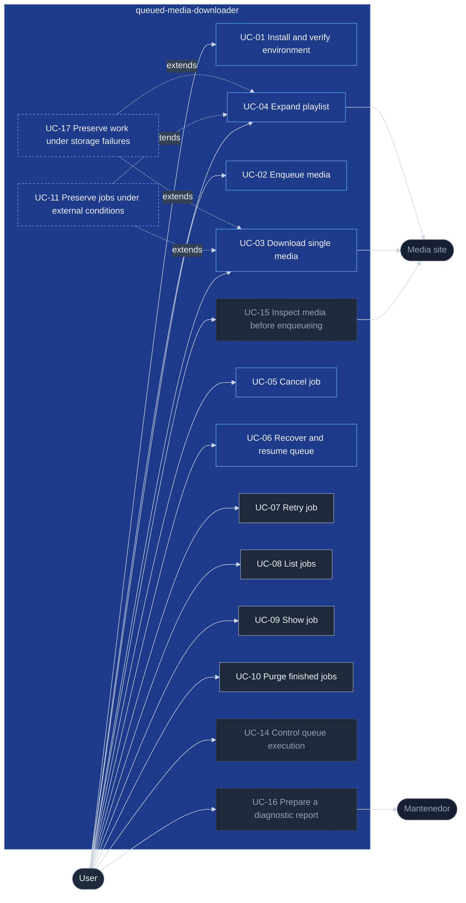

# Modelo de casos de uso

- **Fase RUP:** Elaboración
- **Versión:** 2.0 (2026-11-26; consolidación del modelo de requisitos). La 1.1 era la auditoría previa a la aceptación (T49).
- **Términos:** [vocabulario](../design/00-vocabulary.md)
- **Razonamiento y evidencia:** [análisis de requisitos](requirements-analysis.md)

---

## 1. Actores

| Actor | Tipo | Descripción |
|---|---|---|
| **User** | Principal | Persona que usa la línea de comandos en Windows 10/11 x64, posiblemente con un equipo y una conexión modestos |
| **Media site** | Secundario | Sitio de video o audio soportado por yt-dlp (YouTube y otros). Responde a las peticiones de extracción y descarga, y puede restringirlas |
| **Mantenedor** | Secundario | Recibe el informe de diagnóstico (UC-16) y actualiza yt-dlp (SUP-S01) |

---

## 2. Formato de los casos de uso

Cada caso de uso sigue BABOK v3, 10.47, con estos elementos:
- nombre, objetivo, actores principal y secundarios, disparador;
- precondiciones y postcondiciones (garantías de éxito y mínima);
- flujo básico, flujos alternativos y excepciones;
- reglas de negocio, requisitos suplementarios, restricciones y dependencias asociados;
- criterios de aceptación y escenarios de prueba.

Los flujos transversales se documentan una sola vez y se enlazan:
- condiciones de fallo y su tratamiento: [catálogo de condiciones de fallo](failure-conditions.md);
- reglas: [catálogo de reglas de negocio](business-rules.md);
- condiciones externas durante `run`: UC-11, que extiende UC-03 y UC-04.

En UC-01, UC-02, UC-04 y UC-06, los flujos que terminan sin el objetivo (configuración no válida, base de datos inutilizable) están entre los alternativos, con su código de salida; no se duplican como excepciones.

---

## 3. Diagrama

Los casos de uso significativos para la arquitectura están resaltados; los propuestos tienen el borde discontinuo.

UC-03 y UC-04 los inicia el User con `run`; se ejecutan dentro de la cola y se comunican con el Media site. UC-11 los extiende ante una restricción del sitio o un corte de conectividad, y UC-17, ante un fallo de almacenamiento. La validación en Windows tiene su propio [modelo de casos de uso](../process/validation-use-case-model.md).

---

## 4. Casos de uso

| ID | Caso de uso | Comando | Arquitectura | Estado | Especificación |
|---|---|---|---|---|---|
| UC-01 | Instalar y verificar el entorno | `uv sync`, `diagnose` | **Sí:** uv, ffmpeg incluido, Git LFS, deno, Windows | Implementado; A9 a A11 propuestos | [Completa](use-cases/uc-01-install-and-verify-environment.md) |
| UC-02 | Encolar contenido | `enqueue` | **Sí:** entrada a la cola, SQLite, varios procesos | Implementado; A5, A6, A8 y A9 propuestos, A7 pendiente de cualificación | [Completa](use-cases/uc-02-enqueue-media.md) |
| UC-03 | Descargar un contenido | `run` | **Sí:** recorre toda la arquitectura | Implementado; A11 a A14 propuestos; A15 divergente; E1 sin cualificar | [Completa](use-cases/uc-03-download-single-media.md) |
| UC-04 | Expandir una playlist | `run` | **Sí:** iteración perezosa, duplicados, jobs hijos | Implementado; A6 parcial; A8 propuesto | [Completa](use-cases/uc-04-expand-playlist.md) |
| UC-05 | Cancelar un job | `cancel` | **Sí:** cancelación cooperativa y forzada, árbol de procesos | Implementado | [Completa](use-cases/uc-05-cancel-job.md) |
| UC-06 | Recuperar la cola y reanudar descargas | `run` | **Sí:** recuperación, `.part`, `selected_format_id` | Implementado; A4 parcial (R-25); A10 y A11 propuestos | [Completa](use-cases/uc-06-recover-and-resume-queue.md) |
| UC-07 | Reintentar un job | `retry` | No | Implementado | [Completa](use-cases/uc-07-retry-job.md) |
| UC-08 | Listar jobs | `list` | No | Implementado; A4 a A6 propuestos | [Completa](use-cases/uc-08-list-jobs.md) |
| UC-09 | Ver un job | `show` | No | Implementado; A2 parcial; A4 y A5 propuestos | [Completa](use-cases/uc-09-show-job.md) |
| UC-10 | Purgar jobs terminados | `purge` | No | Implementado; A5 propuesto | [Completa](use-cases/uc-10-purge-finished-jobs.md) |
| UC-11 | Preservar los jobs ante condiciones externas (sitio y conectividad) | `run` | **Sí:** `JobDeferred`, control de admisión | Propuesto; política pendiente (D-2) | [Completa](use-cases/uc-11-preserve-jobs-under-external-conditions.md) |
| UC-12 | — | — | — | **Retirado** (2026-11-26): consolidado en UC-11 A2; el id no se reutiliza | — |
| UC-13 | — | — | — | **Retirado** (2026-11-26): consolidado en UC-11 A3 y, tras la revisión del almacenamiento, sustituido por UC-17; el id no se reutiliza | — |
| UC-14 | Controlar temporalmente la ejecución de la cola | `pause`, `resume`, `stop` | No | Propuesto (D-6) | [Completa](use-cases/uc-14-control-queue-execution.md) |
| UC-15 | Consultar un contenido antes de encolarlo | `inspect` | No | Propuesto | [Completa](use-cases/uc-15-inspect-media-before-enqueueing.md) |
| UC-16 | Preparar un informe de diagnóstico | `report` | No | Propuesto | [Completa](use-cases/uc-16-prepare-a-diagnostic-report.md) |
| UC-17 | Preservar el trabajo ante fallos de almacenamiento | `run` | **Sí:** control de admisión por unidad, identificación en la cadena de causas | Propuesto; D-5 y D-12 pendientes | [Completa](use-cases/uc-17-preserve-work-under-storage-failures.md) |
| — | Actualizar yt-dlp | — | — | **Candidato**, pendiente de D-8 (contradice ADR-0002) | [Análisis, D-8](requirements-analysis.md#d-8-actualizar-yt-dlp-desde-el-programa) |

### 4.1 Capacidades transversales

| Capacidad | Autoridad | Usada por |
|---|---|---|
| Clasificar un fallo e informar de él | [Catálogo de condiciones de fallo](failure-conditions.md), BR-22, SUP-U05 | UC-03, UC-04, UC-06, UC-09, UC-15 |
| Condiciones externas y de almacenamiento | UC-11 (sitio y conectividad), UC-17 (almacenamiento); BR-01, BR-05, BR-08, BR-25 a BR-28 | UC-03, UC-04, UC-15 |
| Propiedad de los archivos finales | BR-17, [ADR-0030](../notes/adr-0030-final-file-ownership-claims.md) | UC-03, UC-06, UC-07, UC-10 |
| Job requests desde otra terminal | SUP-C04 | UC-05, UC-07, UC-14 |
| Cola ocupada por otro programa | UC-03 A10 | Todos los comandos |
| Recogida de diagnóstico y limpieza de datos sensibles | SUP-O03, SUP-SEC01 | UC-01, UC-16, VUC-07 |

### 4.2 Exclusiones

Las capacidades de las referencias que no entran en el alcance, con su motivo, están en el [análisis, §6.3](requirements-analysis.md#63-exclusiones). Además: empezar la cola a una hora (lo cubre el Programador de tareas de Windows) y avisar al terminar (`run` ya resume al terminar).

---

## 5. Matriz de completitud

Conteo del 2026-11-26 sobre las especificaciones, tras integrar YTDownload-2026 y VoiceBlueprintPro y separar las condiciones de almacenamiento (UC-17). Un flujo es **vigente** si está implementado y lo cubren las pruebas automáticas de `main`; **parcial** si lo está con una brecha documentada; **propuesto** si no está implementado; **divergente** si el comportamiento real contradice el requisito; **pendiente** si falta cualificarlo.

| UC | Alternativos | Excepciones | Vigentes | Parciales | Propuestos | Divergentes | Pendientes | Reglas | Suplementarios | Criterios | Necesita Windows |
|---|---|---|---|---|---|---|---|---|---|---|---|
| UC-01 | 11 | 0 | 8 | 0 | 3 | 0 | 0 | 3 | 7 | 3 | Sí |
| UC-02 | 9 | 0 | 4 | 0 | 4 | 0 | 1 | 1 | 3 | 3 | No |
| UC-03 | 15 | 2 | 11 | 0 | 4 | 1 | 1 | 9 | 9 | 4 | Sí |
| UC-04 | 8 | 0 | 6 | 1 | 1 | 0 | 0 | 2 | 2 | 3 | No |
| UC-05 | 8 | 3 | 11 | 0 | 0 | 0 | 0 | 2 | 2 | 4 | Sí |
| UC-06 | 11 | 0 | 8 | 1 | 2 | 0 | 0 | 6 | 3 | 4 | Sí |
| UC-07 | 7 | 3 | 10 | 0 | 0 | 0 | 0 | 4 | 2 | 3 | Sí |
| UC-08 | 6 | 3 | 6 | 0 | 3 | 0 | 0 | 0 | 2 | 2 | Sí |
| UC-09 | 5 | 2 | 4 | 1 | 2 | 0 | 0 | 1 | 3 | 2 | Sí |
| UC-10 | 5 | 2 | 6 | 0 | 1 | 0 | 0 | 2 | 1 | 3 | Sí |
| UC-11 | 9 | 4 | 0 | 0 | 13 | 0 | 0 | 10 | 7 | 5 | Sí |
| UC-14 | 6 | 1 | 0 | 0 | 7 | 0 | 0 | 2 | 2 | 4 | Sí |
| UC-15 | 4 | 3 | 0 | 0 | 7 | 0 | 0 | 3 | 3 | 3 | Sí |
| UC-16 | 2 | 1 | 0 | 0 | 3 | 0 | 0 | 0 | 3 | 3 | No |
| UC-17 | 10 | 2 | 0 | 0 | 12 | 0 | 0 | 8 | 4 | 5 | Sí |
| **Total** | **116** | **26** | **74** | **3** | **62** | **1** | **2** | — | — | **51** | **12 de 15** |

Las columnas Reglas y Suplementarios cuentan los identificadores distintos que enlaza cada caso de uso; un mismo requisito puede estar en varios.

**Resumen:**
- **Casos de uso:** 15 vigentes en el modelo (10 implementados y 5 propuestos), 2 retirados y 1 candidato.
- **Escenarios:** 15 básicos, 116 alternativos y 26 de excepción.
- **Reglas de negocio:** 28 (10 vigentes y 18 propuestas), más 4 de la validación ([catálogo](business-rules.md)).
- **Requisitos suplementarios:** 47: 28 vigentes, 1 parcial, 15 propuestos, 1 divergente (SUP-R11) y 2 pendientes de medición (SUP-P04, SUP-P07) ([especificación](supplementary-specification.md)).
- **Verificación:** los flujos vigentes pasan las pruebas automáticas de `main`. Las correcciones T42-D7 a D12 esperan su confirmación en Windows, en una campaña futura ([plan de E2, §8](../project-management/iteration-plan-e2.md#8-matriz-de-casos-de-uso-implementación-y-validación)).

---

## 6. Trazabilidad con el diseño

| Caso de uso | Componentes | Módulos de caso de uso |
|---|---|---|
| UC-01 | `ffmpeg_discovery`, `diagnostics`, `configuration` | `diagnostics/diagnose_environment.py` |
| UC-02 | `job_queue`, `job_storage` | `job_queue/enqueue_media.py` |
| UC-03 | `job_queue`, `workers`, `media_extraction`, `job_storage` | `job_queue/run_queue.py` |
| UC-04 | `job_queue`, `workers`, `media_extraction`, `job_storage` | `job_queue/run_queue.py` |
| UC-05 | `job_queue`, `workers`, `job_storage` | `job_queue/cancel_job.py`, `job_queue/run_queue.py` |
| UC-06 | `job_queue`, `media_extraction`, `job_storage` | `job_queue/recover_interrupted_jobs.py`, `job_queue/run_queue.py` |
| UC-07 | `job_queue`, `job_storage` | `job_queue/retry_job.py`, `job_queue/run_queue.py` |
| UC-08, UC-09 | `job_queue`, `job_storage` | `job_queue/list_jobs.py` (`ListJobs`, `ShowJob`) |
| UC-10 | `job_queue`, `job_storage`, `media_extraction` (parciales y reclamaciones) | `job_queue/purge_finished_jobs.py` |
| UC-11, UC-14, UC-17 (propuestos) | `job_queue`, `workers`, `media_extraction`, `job_storage` | `job_queue/run_queue.py` (planificación y aplazamientos); clasificación en `media_extraction` ([ADR-0031](../notes/adr-0031-site-waits-and-network-waits.md)) |
| UC-15 (propuesto) | `media_extraction`, `command_line` | Sin diseñar |
| UC-16 (propuesto) | `diagnostics`, `job_storage`, `command_line` | Sin diseñar |

La trazabilidad por requisito (requisito, criterio, componentes, tareas, código, pruebas, evidencia, divergencias y pendientes en Windows) está en el [plan de E2, §8](../project-management/iteration-plan-e2.md#8-matriz-de-casos-de-uso-implementación-y-validación).
