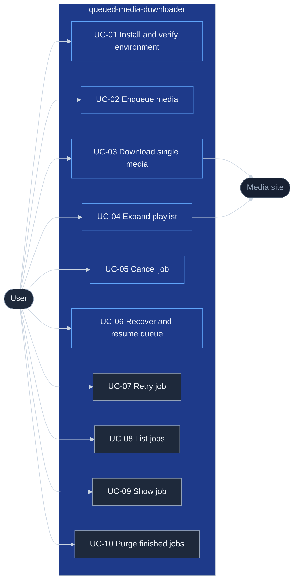

# Modelo de casos de uso

- **Fase RUP:** Inicio
- **Versión:** 1.1 (auditoría previa a la aceptación, T49)
- **Fecha:** 2026-11-26
- **Términos:** [vocabulario](../design/00-vocabulary.md)

---

## 1. Actores

| Actor | Tipo | Descripción |
|---|---|---|
| **User** | Principal | Persona que usa la línea de comandos en Windows 10/11 x64, posiblemente con un equipo y una conexión modestos |
| **Media site** | Secundario | Sitio de video o audio soportado por yt-dlp (YouTube y otros). Responde a las peticiones de extracción y descarga |

---

## 2. Diagrama

El diagrama muestra qué casos de uso inicia cada actor. Los casos de uso significativos para la arquitectura (los que se especifican completos y se implementan en la Elaboración) están resaltados.

UC-03 y UC-04 los inicia el User con `run`; ambos se ejecutan dentro de la cola y se comunican con el Media site.

---

## 3. Casos de uso

| ID | Caso de uso | Comando | Significativo para la arquitectura | Especificación |
|---|---|---|---|---|
| UC-01 | Instalar y verificar el entorno | `uv sync`, `diagnose` | **Sí:** uv, ffmpeg incluido, Git LFS, deno, Windows | [Completa](use-cases/uc-01-install-and-verify-environment.md) |
| UC-02 | Encolar contenido | `enqueue` | **Sí:** entrada a la cola, SQLite, varios procesos | [Completa](use-cases/uc-02-enqueue-media.md) |
| UC-03 | Descargar un contenido | `run` | **Sí:** recorre toda la arquitectura (pool de procesos, yt-dlp, ffmpeg, job events) | [Completa](use-cases/uc-03-download-single-media.md) |
| UC-04 | Expandir una playlist | `run` | **Sí:** iteración perezosa, duplicados, jobs hijos | [Completa](use-cases/uc-04-expand-playlist.md) |
| UC-05 | Cancelar un job | `cancel` | **Sí:** cancelación cooperativa y forzada, process tree | [Completa](use-cases/uc-05-cancel-job.md) |
| UC-06 | Recuperar la cola y reanudar descargas | `run` | **Sí:** recuperación, `.part`, `selected_format_id` | [Completa](use-cases/uc-06-recover-and-resume-queue.md) |
| UC-07 | Reintentar un job | `retry` | No | [Completa](use-cases/uc-07-retry-job.md) |
| UC-08 | Listar jobs | `list` | No | [Completa](use-cases/uc-08-list-jobs.md) |
| UC-09 | Ver un job | `show` | No | [Completa](use-cases/uc-09-show-job.md) |
| UC-10 | Purgar jobs terminados | `purge` | No | [Completa](use-cases/uc-10-purge-finished-jobs.md) |

Las especificaciones de UC-07 a UC-10 se completaron en la auditoría previa a la aceptación (T49), al entrar esos casos de uso en E2. Se conserva el resumen original:

### Especificaciones breves (versión 1.0)

- **UC-07 Reintentar un job.** El User indica uno o varios jobs `FAILED` o `CANCELLED` (o todos los fallidos con `--all-failed`). El sistema registra una job request `RETRY`; al procesarla, el job vuelve a `PENDING` e incrementa `attempt_count`. Un job `SKIPPED` o `COMPLETED` no se puede reintentar.
- **UC-08 Listar jobs.** El User consulta los jobs, opcionalmente filtrados por estado o por playlist padre. El sistema muestra id, tipo, estado, título y motivo de fallo, sin modificar nada.
- **UC-09 Ver un job.** El User consulta un job concreto. El sistema muestra todos sus datos; si es una playlist, también el resumen de sus hijos por estado.
- **UC-10 Purgar jobs terminados.** El User elimina de la base de datos los jobs `COMPLETED` y/o `CANCELLED` (sin opciones, ambos). Los archivos descargados no se tocan.

---

## 4. Trazabilidad con el diseño

| Caso de uso | Componentes | Módulos de caso de uso |
|---|---|---|
| UC-01 | `ffmpeg_discovery`, `diagnostics`, `configuration` | `diagnostics/diagnose_environment.py` |
| UC-02 | `job_queue`, `job_storage` | `job_queue/enqueue_media.py` |
| UC-03 | `job_queue`, `workers`, `media_extraction`, `job_storage` | `job_queue/run_queue.py` |
| UC-04 | `job_queue`, `workers`, `media_extraction`, `job_storage` | `job_queue/run_queue.py` |
| UC-05 | `job_queue`, `workers`, `job_storage` | `job_queue/cancel_job.py`, `job_queue/run_queue.py` |
| UC-06 | `job_queue`, `media_extraction`, `job_storage` | `job_queue/recover_interrupted_jobs.py`, `job_queue/run_queue.py` |
| UC-07 | `job_queue`, `job_storage` | `job_queue/retry_job.py`, `job_queue/run_queue.py` |
| UC-08, UC-09 | `job_queue`, `job_storage` | `job_queue/list_jobs.py` (`ListJobs`, `ShowJob`) |
| UC-10 | `job_queue`, `job_storage`, `media_extraction` (parciales y reclamaciones) | `job_queue/purge_finished_jobs.py` |

La trazabilidad por requisito (requisito, criterio, componentes, tareas, código, pruebas, evidencia, divergencias y pendientes en Windows) está en el [plan de E2, §8](../project-management/iteration-plan-e2.md#8-matriz-de-casos-de-uso-implementación-y-validación).
